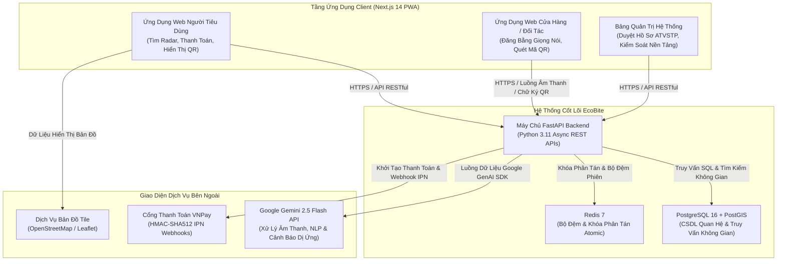
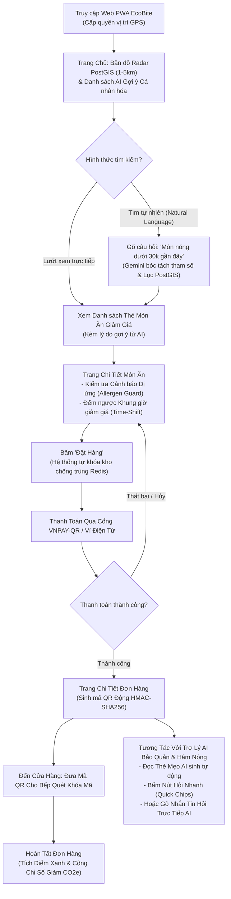

# 🌱 EcoBite Platform — Nền tảng Giải cứu Thực phẩm & Không Phế liệu (Food Rescue & Zero-Waste Platform)

[]()
[]()
[]()
[]()
[]()
[]()
[]()

**EcoBite** là nền tảng giải cứu thực phẩm thông minh theo mô hình **Online-to-Offline (O2O)**, được thiết kế nhằm kết nối các cơ sở kinh doanh thực phẩm thương mại (nhà hàng, tiệm bánh, quán cà phê và siêu thị) với người tiêu dùng địa phương có nhu cầu mua **các món ăn dư thừa trong ngày (Surplus Food Dishes)** với mức giá ưu đãi sâu từ **40% đến 70%**. Dự án hướng tới sứ mệnh giảm lãng phí thực phẩm, cắt giảm phát thải khí nhà kính ($CH_4$ và $CO_2$) và lan toả phong cách sống xanh bền vững.

---

## Thành viên Thực hiện (Team Members)

📌 **Group 05 — FIT HCMUS** *(Trường Đại học Khoa học Tự nhiên, ĐHQG TP.HCM)*

| MSSV | Họ và tên | Vai trò chính trong dự án (Role) | Email FIT |
| :--- | :--- | :--- | :--- |
| **24127402** | **Phùng Quốc Huy** | **AI & Data Lead / Full-Stack Engineer** | `pqhuy2425@clc.fitus.edu.vn` |
| 24127495 | Đặng Trọng Phúc | Backend Lead & AI Engineer / Full-Stack Engineer | `dtphuc2418@clc.fitus.edu.vn` |
| 24127561 | Đàng Thế Tony | QA/Tester Lead & Backend Engineer / Full-Stack Engineer | `dttony2424@clc.fitus.edu.vn` |
| 24127246 | Võ Ngọc Thịnh | Frontend Lead / Full-Stack Engineer | `vnthinh2418@clc.fitus.edu.vn` |

---

## Mục lục (Table of Contents)

1. [Thành viên Thực hiện (Team Members)](#thành-viên-thực-hiện-team-members)
2. [Mục lục (Table of Contents)](#mục-lục-table-of-contents)
3. [Tổng quan Dự án & Điểm Khác biệt Cốt lõi (Project Overview & Core Differentiators)](#tổng-quan-dự-án--điểm-khác-biệt-cốt-lõi-project-overview--core-differentiators)
4. [Đối tượng Sử dụng & Môi trường Vận hành (Target Users & Target Environments)](#đối-tượng-sử-dụng--môi-trường-vận-hành-target-users--target-environments)
5. [Tính năng Cốt lõi (Key Features)](#tính-năng-cốt-lõi-key-features)
6. [Phân hệ Trí tuệ Nhân tạo (AI Intelligence Suite)](#phân-hệ-trí-tuệ-nhân-tạo-ai-intelligence-suite---powered-by-google-gemini-25-flash)
7. [Kiến trúc Hệ thống & Sơ đồ (System Architecture & Diagrams)](#kiến-trúc-hệ-thống--sơ-đồ-system-architecture--diagrams)
8. [Cấu trúc Dự án (Project Directory Structure)](#cấu-trúc-dự-án-project-directory-structure)
9. [Hướng dẫn Khởi động Nhanh (Quick Start Guide)](#hướng-dẫn-khởi-động-nhanh-quick-start-guide)
10. [Biến Môi trường (Environment Variables)](#biến-môi-trường-environment-variables)
11. [Bộ Tài liệu Kỹ thuật (Documentation Index)](#bộ-tài-liệu-kỹ-thuật-documentation-index)
12. [Quy định Commit & Đóng góp (Commit & Contribution Conventions)](#quy-định-commit--đóng-góp-commit--contribution-conventions)
13. [Tuyên bố Miễn trừ Trách nhiệm & Giấy phép (Disclaimer & License)](#tuyên-bố-miễn-trừ-trách-nhiệm--giấy-phép-disclaimer--license)

---

## Tổng quan Dự án & Điểm Khác biệt Cốt lõi (Project Overview & Core Differentiators)

EcoBite vận hành trên nền tảng web **Progressive Web App (PWA)** với kiến trúc ba tầng tách rời (Decoupled Three-Tier): ứng dụng người dùng **Next.js 14**, máy chủ **FastAPI (Python 3.11)** và hạ tầng dữ liệu **PostgreSQL 16 + PostGIS** kết hợp **Redis 7**, tích hợp trực tiếp trí tuệ nhân tạo **Google Gemini 2.5 Flash** cho các phân hệ thông minh.

Khác với các nền tảng phương Tây như *Too Good To Go* hay *Yindii* (sử dụng "Túi mù" / **Mystery Bags**), EcoBite định vị khác biệt qua **3 trụ cột (Three Core Differentiators)**:

1. **Minh bạch 100% từng món ăn (No Mystery Bags)**: Hiển thị rõ tên món, hình ảnh chân thực, thành phần và cảnh báo dị ứng 2 tầng theo chuẩn 14 chất dị ứng EU FIC.
2. **Giảm giá theo khung giờ tất định (Rule-Based Time-Shift Discounting)**: Tự động hạ giá minh bạch (giảm 40%-50% giờ giải cứu tiêu chuẩn, giảm tới 70% trong 30-45 phút cuối trước khi đóng cửa).
3. **Đăng món siêu tốc bằng AI giọng nói (AI Voice Quick-Post)**: Tận dụng Google Gemini 2.5 Flash nhận diện tiếng lóng ẩm thực Việt Nam (*"bốn lăm cành"*, *"bì chả"*), bóc tách danh mục món và rà soát dị ứng chỉ trong 3 giây.

---

## Đối tượng Sử dụng & Môi trường Vận hành (Target Users & Target Environments)

### Đối tượng Người dùng (Target Users)

- **Consumers (Người giải cứu thực phẩm)**: Sinh viên, nhân viên văn phòng tìm kiếm các bữa ăn chất lượng hợp vệ sinh với giá ưu đãi (giảm 40% - 70%) và có ý thức giảm thiểu lãng phí thực phẩm đô thị.
- **Store Partners (Đối tác Cửa hàng)**: Tiệm bánh, nhà hàng, quán cà phê, siêu thị muốn tối ưu hoá chi phí nguyên liệu và thu hồi doanh thu từ món ăn dư thừa cuối ca.
- **System Administrators (Quản trị viên)**: Đội ngũ vận hành chịu trách nhiệm xác minh chứng nhận An toàn Vệ sinh Thực phẩm (ATVSTP), duyệt cửa hàng và giám sát chỉ số môi trường.

### Môi trường Vận hành (Target Environments)

- **Client Application (Ứng dụng Khách)**: Progressive Web App (PWA) đa nền tảng xây dựng bằng Next.js 14 App Router, Tailwind CSS, tương thích di động và máy tính.
- **Backend Infrastructure (Hạ tầng Hậu kỳ)**: FastAPI (Python 3.11), PostgreSQL 16 + PostGIS (truy vấn không gian địa lý), Redis 7 (lưu cache & khoá chống bán vượt tồn kho) và Google GenAI SDK (Gemini 2.5 Flash).

---

## Tính năng Cốt lõi (Key Features)

1. **Xác thực & Đăng ký cửa hàng - KYC & Kiểm tra ATVSTP (Authentication & Merchant Onboarding)**: Đăng nhập Email/Password hoặc Google OAuth2, phân quyền RBAC (`CONSUMER`, `STORE_PARTNER`, `ADMIN`) với JWT dual-tokens. Quán bắt buộc nộp Giấy chứng nhận ATVSTP chính thức để Admin phê duyệt trước khi được đăng bán.
2. **Danh mục Thực đơn Cơ bản & Quản lý Món Dư (Base Menu Catalog & Surplus Dish Management)**: Quán duy trì danh mục cố định (`menu_items`) chứa ảnh chuẩn độ nét cao và giá gốc niêm yết. Cuối ca, khởi tạo món dư hoạt động (`dishes`) kế thừa ảnh và giá gốc chuẩn mà không cần nhập lại.
3. **Công cụ Giảm giá theo Khung giờ Dựa trên Quy tắc (Rule-Based Time-Shift Discounting Engine)**: Định giá giảm dần theo thời gian tất định, không dùng AI đoán giá. Tự động chuyển đổi giữa khung giờ tiêu chuẩn (giảm 40%–50%) sang giờ chót xả hàng (giảm tới 70% trong 30–45 phút cuối) kèm đồng hồ đếm ngược trực tiếp.
4. **Tìm kiếm Dựa trên Vị trí & Khám phá Radar PostGIS (Location-Based Search & PostGIS Radar Discovery)**: Truy vấn không gian PostgreSQL PostGIS (`ST_DWithin`, `ST_Distance`) tính khoảng cách thực trong bán kính 1–5 km (mở rộng 10 km). Bản đồ radar Leaflet tương tác, bộ lọc ẩm thực, thanh trượt giá và chỉ báo mức độ gấp.
5. **Khóa Chống Bán Quá Tồn Kho & Quản lý Đơn Hàng (Inventory Anti-Overselling Lock & Order Management)**: Kiểm soát đồng thời cấp CSDL nghiêm ngặt bằng câu lệnh SQL nguyên tử (`UPDATE dishes SET remaining_quantity = remaining_quantity - :qty WHERE remaining_quantity >= :qty`) kết hợp Redis distributed lock đảm bảo zero over-selling.
6. **Thanh toán Không Tiền Mặt Liền Mạch - Cổng VNPay (Seamless Cashless Checkout - VNPay Payment Gateway)**: Tích hợp cổng VNPay quét VNPAY-QR động từ app ngân hàng và ví điện tử; xử lý IPN Webhook Server-to-Server mã hóa xác thực HMAC-SHA512 với quy trình idempotent chống trùng lặp.
7. **Mã QR Một Lần Động HMAC-SHA256 & Trình Quét Web tại Cửa Hàng (Dynamic Single-Use QR Token & In-Store Web Scanner)**: Sinh mã QR ký điện tử HMAC-SHA256 (`order_id`, `user_id`, `nonce`, `pickup_deadline`). Chủ quán dùng máy quét camera web (`html5-qrcode`) để xác thực đơn, đánh dấu đã dùng tức thì, chống chụp màn hình và chống Replay Attack.
8. **Đánh Giá Xác Thực, Điểm Xanh & Trình Theo Dõi Tác Động Môi Trường (Verified Reviews, Green Points & Environmental Impact Tracker)**: Chỉ đơn hàng đã quét QR thành công (`COMPLETED`) mới được đánh giá 1–5 sao. Tự động quy đổi mỗi suất ăn thành ~2.5 kg $CO_2e$ tiết kiệm, tích Điểm Xanh đổi voucher và vinh danh trên Bảng xếp hạng Xanh.

---

## Phân hệ Trí tuệ Nhân tạo (AI Intelligence Suite - Powered by Google Gemini 2.5 Flash)

1. **Trợ lý Đa Phương Thức Đăng Nhanh Hàng Loạt & Bộ Bảo Vệ Dị Ứng 2 Tầng (Batch Quick-Post Multimodal Assistant & 2-Tier Allergen Guard)**:
   - *Native Multimodal Audio Ingestion*: Gửi trực tiếp tệp âm thanh thô tới Gemini 2.5 Flash không qua STT trung gian, nhận diện chính xác tiếng lóng ẩm thực Việt (*"bốn lăm cành"*, *"bì chả"*).
   - *Menu-Catalog Grounding*: Tự động khớp tên món với Thực đơn gốc (`menu_items`) để kéo ảnh nét và giá gốc chuẩn.
   - *Two-Tier Allergen Guard (14 chuẩn EU FIC)*: Tách bạch rõ `EXPLICIT` (người bán nói trực tiếp) và `INFERRED` (AI suy luận công thức món Việt: chả có trứng, nước mắm có cá, mỡ hành có đậu phộng, bánh mì có gluten); kèm ghi chú khẩu vị văn hóa (`dietary_notes`: có hành/ngò, cay, chua, chay).
   - *Batch Extraction & Server-Time Grounding*: Bóc tách nhiều món (`List[SurplusDishItem]`) và quy đổi thời gian tương đối (*"từ giờ đến 3h chiều"*) thành mốc giờ ISO 8601 tuyệt đối bằng `current_server_time`.
2. **Gợi ý Món Ăn Thông Minh & Tìm Kiếm Ngữ Nghĩa Hội Thoại (Smart Food Recommendation & Conversational Semantic Search)**:
   - *Layer 1 - Hard Safety Invariant (SQL & PostGIS)*: Lọc bán kính 1–3 km và loại trừ nghiêm ngặt 100% món ăn chứa chất dị ứng của người dùng (`excluded_allergens` trong `user_preferences`) tại cấp độ truy vấn CSDL, không phụ thuộc vào AI sinh xác suất.
   - *Layer 2 - Multi-Factor Heuristic Scoring*:
     $$\text{Score} = (0.40 \times \text{Proximity}) + (0.30 \times \text{Discount Depth \& Time Urgency}) + (0.30 \times \text{Taste Profile Match})$$
     Ưu tiên các Deal Giải Cứu Cấp Bách bước vào 30 phút cuối áp dụng luật giảm 70%.
   - *Layer 3 - Generative AI Personalization*: Gemini 2.5 Flash sinh lý do đề xuất ngắn gọn (20–30 từ), giàu cảm xúc hiển thị trên thẻ giao diện UI.
   - *Conversational Semantic Search*: Người dùng gõ câu tìm kiếm tự nhiên (*"Tìm món súp ấm nóng dưới 30k ở gần đây"*), Gemini trích xuất ý định, ngân sách để truy vấn cơ sở dữ liệu PostGIS.

---

## Kiến trúc Hệ thống & Sơ đồ (System Architecture & Diagrams)

Hệ thống EcoBite được tổ chức theo mô hình **Ba Tầng Tách rời (Decoupled Three-Tier)**: tầng ứng dụng Client (Next.js 14 PWA) giao tiếp HTTPS với máy chủ FastAPI cốt lõi, kết nối hạ tầng dữ liệu PostgreSQL/PostGIS & Redis, và hợp tác với ba dịch vụ bên ngoài (Gemini, VNPay, dịch vụ bản đồ Tile).

### 1. Sơ đồ Kiến trúc Ba Tầng (Three-Tier Architecture Diagram)

Giải thích nhanh các khối trong sơ đồ:

- **Tầng Client**: ba ứng dụng web riêng biệt cho Người tiêu dùng (`ConsumerUI`), Cửa hàng/Đối tác (`MerchantUI`) và Bảng Quản trị (`AdminUI`).
- **Tầng Backend Cốt lõi**: FastAPI (Python 3.11, Async REST APIs) — cầu nối điều phối dữ liệu tới PostgreSQL 16 + PostGIS và Redis 7.
- **Tầng Dịch vụ Bên ngoài**: Google Gemini 2.5 Flash (âm thanh, NLP & dị ứng), Cổng thanh toán VNPay (HMAC-SHA512 IPN) và Dịch vụ bản đồ Tile (OpenStreetMap / Leaflet).



### 2. Sơ đồ Hành trình Người dùng (User Journey Diagram)

Sơ đồ diễn tả toàn bộ hành trình khách hàng trải qua **5 giai đoạn**: *Khám phá* (Radar PostGIS & tìm kiếm ngữ nghĩa) → *Chi tiết & Chọn món* (Cảnh báo dị ứng, đếm ngược giờ vàng) → *Thanh toán* (VNPAY-QR) → *Nhận món tại cửa hàng* (Quét mã QR động HMAC-SHA256) → *Tương tác AI* (Trợ lý bảo quản & Hâm nóng với các mẹo sinh tự động).



---

## Cấu trúc Dự án (Project Directory Structure)

```text
EcoBite/
├── .agents/                      # ⚙️ Tài nguyên tự động hoá cho AI Coding Agents
│   └── skills/                   #    └─ Bộ kỹ năng speckit (spec, plan, tasks, implement...)
├── .env.example                  # 🔐 Biến môi trường mẫu (an toàn để commit)
├── .gitignore                    # 🙈 Loại trừ tệp nhạy cảm (.env, weights .pt, venv...)
├── .pre-commit-config.yaml       # 🪝 Git Pre-commit Hooks (Ruff, detect-private-key, chặn commit .env)
├── .vscode/                      # 🧩 Cấu hình trình soạn thảo
│   └── settings.json
├── AGENTS.md                     # 🤖 Bộ quy tắc Pair-Coding: quy trình 5 bước & 8 Guardrails
├── docker-compose.yml            # 🐳 Hạ tầng: PostgreSQL 16 + PostGIS 3.4 & Redis 7
├── README.md                     # 📘 Tài liệu giới thiệu dự án (bạn đang đọc)
│
├── backend/                      # 🔧 Backend FastAPI (Python 3.11) — 3 tầng Router -> Service -> Repository
│   ├── alembic/                  #    └─ Phiên bản hoá CSDL (Database Migrations)
│   ├── app/
│   │   ├── api/v1/endpoints/     #    └─ Tầng HTTP Router (auth, users, stores, menu, dishes, orders, payments, reviews)
│   │   ├── core/                 #    └─ Cấu hình & Bảo mật (JWT, RBAC, Hashing, Redis lock)
│   │   ├── db/                   #    └─ Quản lý phiên SQLAlchemy 2.0 (AsyncSession) + seed dữ liệu demo
│   │   ├── models/               #    └─ ORM Models (SQLAlchemy 2.0, Mapped[T])
│   │   ├── repositories/         #    └─ Tầng Truy xuất Dữ liệu — chỉ chứa truy vấn & Atomic Update
│   │   ├── schemas/              #    └─ DTOs xác thực Pydantic v2
│   │   ├── services/             #    └─ Tầng Nghiệp vụ (discovery, dish_service, order_service, payment_service, qr_service, review_service...)
│   │   └── main.py               #    └─ Điểm khởi tạo ứng dụng + Lifespan Singleton (nạp Model ML)
│   ├── tests/                    #    └─ Unit, Integration (kèm concurrency) & Property tests (pytest + conftest fixtures)
│   ├── alembic.ini
│   ├── Dockerfile                #    └─ Image build cho FastAPI (uvicorn)
│   ├── pyproject.toml            #    └─ Cấu hình Ruff / Mypy / Pytest
│   ├── requirements.txt
│   └── SETUP.md                  #    └─ Cẩm nang khắc phục môi trường Python/PowerShell
│
├── frontend/                     # 🖥️ Frontend Next.js 14 App Router (PWA)
│   ├── src/app/                  #    └─ Routes: `/`, `/login`, `/register`, `/orders`, `/store/onboard`, `/store/verify-qr`
│   ├── src/components/           #    └─ UI (Button, Card, Navbar...), RadarMap (Leaflet), DishCard, OrderModal, AuthGuard
│   ├── src/services/             #    └─ Service layer gọi REST API qua @/lib/api-client
│   ├── src/lib/                  #    └─ api-client.ts (Axios + Bearer/refresh) & utils.ts (format VND, khoảng cách...)
│   ├── src/hooks/                #    └─ useGeolocation và custom hooks
│   ├── src/providers/            #    └─ TanStack React Query provider
│   ├── src/types/                #    └─ DTO TypeScript dùng chung (api.ts)
│   ├── __tests__/                #    └─ Unit Tests components/hooks (scaffold — runner chưa cấu hình)
│   ├── public/                   #    └─ Tài nguyên tĩnh (hình ảnh, fonts)
│   ├── package.json
│   ├── tailwind.config.js
│   └── tsconfig.json
│
├── ml/                           # 🧠 Module AI/ML — Suy luận trực quan & NLP
│   ├── datasets/                 #    └─ Bộ dữ liệu huấn luyện/đánh giá
│   ├── notebooks/                #    └─ Jupyter Notebooks thí nghiệm
│   ├── weights/                  #    └─ Model weights (.pt) — Backend nạp 1 lần qua Lifespan Singleton
│   ├── requirements.txt          #    └─ Thư viện ML riêng, tách khỏi backend runtime
│   └── README.md                 #    └─ Quy chuẩn ML/NLP & cách backend gọi model
│
├── docs/                         # 📚 Bộ tài liệu kỹ thuật chi tiết (Proposal, PRD, ERD, API Spec...)
│
├── specs/                        # 📐 Đặc tả SDD theo feature (001-rescue-discovery-order-qr)
│   └── 001-rescue-discovery-order-qr/  #    └─ spec.md, plan.md, tasks.md, research.md, data-model.md, contracts/
│
├── .specify/                     # 🧭 Con trỏ feature đang hoạt động (feature.json) & constitution rút gọn
│
└── src/                          # 🧰 Khung công cụ Spec-Kit phát triển hướng đặc tả (Spec-Driven Development)
    └── .specify/
        ├── scripts/              #    └─ Kịch bản tự động hoá quy trình spec
        ├── templates/            #    └─ Mẫu tài liệu spec / plan / tasks
        ├── memory/               #    └─ Hiến chương dự án (Constitution) & quyết định nhóm
        ├── workflows/            #    └─ Quy trình làm việc chuẩn hoá
        └── integrations/         #    └─ Cấu hình tích hợp công cụ AI
```

---

## Hướng dẫn Khởi động Nhanh (Quick Start Guide)

### Bước 1. Khởi động Hạ tầng Cơ sở Dữ liệu & Redis với Docker (Infrastructure up with Docker)

```bash
docker compose up -d
docker compose ps
```

> Lệnh này kích hoạt PostgreSQL 16 + PostGIS 3.4 và Redis 7 theo khai báo trong `docker-compose.yml`.

### Bước 2. Thiết lập Biến môi trường (.env) (Configure Environment Variables)

```bash
cp .env.example .env
# Điền GEMINI_API_KEY, VNP_TMN_CODE, VNP_HASH_SECRET
```

> ⚠️ Tuyệt đối không commit tệp `.env` — Pre-commit hook (`forbid-env-files`) sẽ chặn lệch này.

### Bước 3. Thiết lập Backend (FastAPI Setup)

```bash
cd backend
python -m venv .venv
# Windows CMD:          .venv\Scripts\activate
# Windows PowerShell:   .\.venv\Scripts\Activate.ps1
# Linux / macOS / Git Bash: source .venv/bin/activate
pip install -r requirements.txt
uvicorn app.main:app --reload --port 8000
```

> Trên **Windows PowerShell**, kích hoạt venv bằng: `.venv\Scripts\Activate.ps1` (chi tiết xem `backend/SETUP.md`).
> **API Documentation**: Sau khi server chạy, truy cập Swagger UI tại `http://localhost:8000/docs` hoặc ReDoc tại `http://localhost:8000/redoc`.

### Bước 4. Thiết lập Frontend (Next.js 14 Setup)

```bash
cd frontend
npm install
npm run dev
```

> Ứng dụng PWA sẵn sàng tại `http://localhost:3000`.

### Bước 5. Chạy Bộ Kiểm thử Tự động Backend (Run Backend Automated Tests)

```bash
cd backend
pytest -v
```

> Để đạt đủ các **Quality Gates** trước khi commit, chạy thêm: `ruff check app/`, `ruff format --check app/`, `mypy app/` (backend) và `npm run lint`, `npm run type-check` (frontend). Chi tiết tại [`AGENTS.md`](AGENTS.md).

---

## Biến Môi trường (Environment Variables)

Sao chép `.env.example` (root) → `.env` cho hạ tầng Docker & biến client; với backend, dùng `backend/.env.example` làm chuẩn (đã khớp tên field trong `app/core/config.py`). Bảng dưới liệt kê các biến quan trọng nhất theo nhóm:

### Cơ sở Dữ liệu & Bộ đệm (Database & Cache)

| Biến (Variable) | Mô tả (Description) |
| :--- | :--- |
| `ENVIRONMENT` / `DEBUG` | Chế độ vận hành: `development` / `production`. |
| `API_V1_STR` | Tiền tố định tuyến REST API (`/api/v1`). |
| `BACKEND_CORS_ORIGINS` | Danh sách origin của frontend được phép CORS. |
| `DATABASE_URL` | Chuỗi kết nối SQLAlchemy 2.0 async (asyncpg) sử dụng bởi FastAPI. |
| `SYNC_DATABASE_URL` | Chuỗi kết nối đồng bộ (psycopg2) sử dụng bởi Alembic Migrations. |
| `POSTGRES_DB` / `POSTGRES_USER` | Tên cơ sở dữ liệu & tài khoản PostgreSQL 16 + PostGIS. |
| `REDIS_URL` | Kết nối Redis 7 — bộ đệm & khoá phân tán chống bán vượt tồn kho. |

### Bảo mật & Xác thực (Security & Authentication)

| Biến (Variable) | Mô tả (Description) |
| :--- | :--- |
| `JWT_SECRET_KEY` | Khoá ký JWT HS256 — tối thiểu 32 ký tự, bắt buộc đổi khi vận hành thật. |
| `ACCESS_TOKEN_EXPIRE_MINUTES` / `REFRESH_TOKEN_EXPIRE_DAYS` | Thời hạn phiên đăng nhập cơ chế Dual-Token. |
| `QR_SIGNATURE_SECRET` | Khoá HMAC-SHA256 ký số cho Mã QR nhận món một lần sử dụng. |
| `QR_TOKEN_VALIDITY_MINUTES` | Thời gian hiệu lực mã QR (60 phút) — chống Replay Attack & chụp màn hình. |
| `GOOGLE_CLIENT_ID` / `GOOGLE_CLIENT_SECRET` | Thông tin đăng nhập Google OAuth2. |

### Phân hệ AI & Thanh toán (AI & Payment)

| Biến (Variable) | Mô tả (Description) |
| :--- | :--- |
| `GEMINI_API_KEY` | Khoá Google AI Studio cho Gemini 2.5 Flash (Quick-Post, Gợi ý món, Tìm kiếm hội thoại). |
| `GEMINI_MODEL` | Tên model suy luận (`gemini-2.5-flash`). |
| `VNP_TMN_CODE` / `VNP_HASH_SECRET` | Mã đối tác & khoá ký HMAC-SHA512 của Cổng thanh toán VNPay Sandbox. |
| `VNP_URL` / `VNP_RETURN_URL` | URL cổng thanh toán & trang nhận kết quả trả về client. |

### Học máy & Frontend (Machine Learning & Frontend)

| Biến (Variable) | Mô tả (Description) |
| :--- | :--- |
| `ML_WEIGHTS_DIR` / `ML_MODEL_FILENAME` | Đường dẫn tệp model `.pt` — backend nạp một lần duy nhất qua Lifespan Singleton. |
| `ML_DEVICE` | Thiết bị suy luận: `cpu`, `cuda` (NVIDIA GPU) hoặc `mps` (Apple Silicon). |
| `ML_CONFIDENCE_THRESHOLD` / `ML_FALLBACK_TO_MOCK` | Ngưỡng tin cậy dự đoán & chế độ mô phỏng khi thiếu model. |
| `NEXT_PUBLIC_API_BASE_URL` | Endpoint REST API công khai cho ứng dụng khách. |
| `NEXT_PUBLIC_DEFAULT_LAT` / `NEXT_PUBLIC_DEFAULT_LNG` | Toạ độ tâm bản đồ mặc định (TP.HCM) cho Radar PostGIS. |

> ⚠️ **Lưu ý đồng bộ tên biến**: Settings backend (`backend/app/core/config.py`, `case_sensitive=True`) đọc trực tiếp các field `SECRET_KEY`, `APP_ENV`, `CORS_ORIGINS`, `DATABASE_URL`, `QR_SIGNATURE_SECRET`, `VNP_*`, `REDIS_URL`. Một số khoá trong `.env.example` (root) như `JWT_SECRET_KEY`, `ENVIRONMENT`, `BACKEND_CORS_ORIGINS` hiện **chưa khớp tên field** và bị bỏ qua im lặng (`extra="ignore"`) — hãy dùng `backend/.env.example` (đã khớp tên field) làm chuẩn cho FastAPI, hoặc đặt thêm `SECRET_KEY` và `CORS_ORIGINS`. `SYNC_DATABASE_URL` không cần khai báo: Alembic tự suy từ `DATABASE_URL` qua property `settings.sync_database_url`.

---

## Bộ Tài liệu Kỹ thuật (Documentation Index)

| Tài liệu | Mô tả nội dung chính |
| :--- | :--- |
| 🎓 [`docs/00_Project_Proposal_Section_B.md`](docs/00_Project_Proposal_Section_B.md) | Đề xuất dự án (Project Proposal): bối cảnh, vấn đề thực tiễn & tầm nhìn sản phẩm. |
| 📄 [`docs/01_PRD_and_User_Stories.md`](docs/01_PRD_and_User_Stories.md) | Mục tiêu sản phẩm, Persona, khảo sát ứng dụng (Yindii, Too Good To Go), 8 tính năng cốt lõi & 2 tính năng AI. |
| 🏗️ [`docs/02_System_Architecture.md`](docs/02_System_Architecture.md) | Kiến trúc Three-Tier, Sequence Diagrams (Quick-Post, Recommendation, VNPay IPN HMAC-SHA512, QR Scanner). |
| 🗄️ [`docs/03_Database_Schema_ERD.md`](docs/03_Database_Schema_ERD.md) | Thiết kế CSDL PostgreSQL/PostGIS, ERD Mermaid, bảng `payment_transactions`, `user_preferences` & GIST Index. |
| 🔌 [`docs/04_API_Specification.md`](docs/04_API_Specification.md) | Đặc tả chi tiết RESTful API v1 đầy đủ Request/Response schemas chuẩn Pydantic v2. |
| 📋 [`docs/05_Agile_Roadmap_and_Kanban.md`](docs/05_Agile_Roadmap_and_Kanban.md) | Thỏa ước hoạt động nhóm (Team Contract), Toolchain Setup (Jira, GitHub), phân chia Sprint PA1 – PA5, DoR & DoD. |
| 🛠️ [`docs/06_Environment_and_ML_Setup_Guide.md`](docs/06_Environment_and_ML_Setup_Guide.md) | Cẩm nang cài đặt chi tiết Docker, Python 3.11, venv, Gemini API Key và VNPay Sandbox. |
| 🛡️ [`docs/07_AI_Development_Workflow_and_Quality_Gates.md`](docs/07_AI_Development_Workflow_and_Quality_Gates.md) | Hướng dẫn chu trình TDD, 4 Quality Gates và cài đặt Git Pre-commit Hooks. |
| ⚙️ [`backend/SETUP.md`](backend/SETUP.md) | Cẩm nang khắc phục lỗi môi trường Python/PowerShell/Pylance cho lập trình viên Backend. |
| 🤖 [`ml/README.md`](ml/README.md) | Quy chuẩn ML/NLP, cấu trúc metadata format và hướng dẫn Backend gọi model. |
| 📜 [`AGENTS.md`](AGENTS.md) | Bộ quy tắc & 8 ranh giới bất khả xâm phạm dành cho AI Coding Assistant. |
| 🏛️ [`src/.specify/memory/constitution.md`](src/.specify/memory/constitution.md) | Hiến chương kỹ thuật (Constitution) — nguyên tắc bắt buộc cho mọi contributor & AI agent. |
| 📐 [`specs/001-rescue-discovery-order-qr/`](specs/001-rescue-discovery-order-qr/) | Đặc tả SDD feature hiện tại: spec, plan, tasks (tiến độ), data-model, hợp đồng API. |

---

## Quy định Commit & Đóng góp (Commit & Contribution Conventions)

### Định dạng Commit chuẩn (Conventional Commits)

Mọi commit bám khung `type(scope): description`:

| Loại (Type) | Ý nghĩa (Meaning) | Ví dụ (Example) |
| :--- | :--- | :--- |
| `feat(...)` | Tính năng mới (New Feature) | `feat(order): add dynamic hmac qr signature verification and unit tests` |
| `fix(...)` | Sửa lỗi (Bug Fix) | `fix(dish): prevent race condition on remaining_quantity update` |
| `test(...)` | Bổ sung/cập nhật kiểm thử (Tests) | `test(payment): cover vnpay ipn idempotent flow` |
| `refactor(...)` | Tái cấu trúc không đổi hành vi (Refactoring) | `refactor(discovery): extract postgis radar query into repository` |
| `docs(...)` | Cập nhật tài liệu (Documentation) | `docs(readme): merge architecture diagrams into readme` |

### Chu trình Phát triển Bắt buộc (Mandatory Development Loop)

Tuân thủ quy trình 5 bước nêu trong [`AGENTS.md`](AGENTS.md): **Phân tích & Lập kế hoạch (Analyze & Plan)** → **Viết kiểm thử trước (Test-First)** → **Cài đặt (Implement)** → **Chạy vòng kiểm chứng (Verification Loop: `ruff` → `mypy` → `pytest` → `npm run lint` → `npm run type-check`)** → **Đề xuất Commit**. Toàn bộ kiểm tra phải XANH 100% trước khi commit.

### Pre-commit Hooks

```bash
pip install pre-commit
pre-commit install
```

Cấu hình trong `.pre-commit-config.yaml` thực thi: **Ruff Linter/Formatter** (backend), `detect-private-key`, `check-merge-conflict`, chặn tệp lớn (> 5MB — tránh commit model `.pt`), sửa khoảng trắng cuối dòng và **tuyệt đối chặn commit tệp `.env`**.

---

## Tuyên bố Miễn trừ Trách nhiệm & Giấy phép (Disclaimer & License)

- **An toàn Vệ sinh Thực phẩm (Food Safety)**: Nền tảng EcoBite đóng vai trò cầu nối công nghệ. Cửa hàng đối tác chịu trách nhiệm pháp lý trực tiếp về chất lượng thực phẩm và thông tin ATVSTP công bố trên hệ thống.
- **Cảnh báo Dị ứng bằng AI (AI Allergen Advisory)**: Các thông tin suy luận dị ứng (`INFERRED`) do Gemini AI đưa ra chỉ mang tính chất hỗ trợ tham khảo. Người dùng có tiền sử dị ứng nghiêm trọng được khuyến cáo luôn kiểm tra lại với chủ cửa hàng trước khi tiêu dùng.
- **License (Giấy phép)**: Dự án thuộc quyền sở hữu học thuật của Group 05 - FIT HCMUS (2024-2026).
