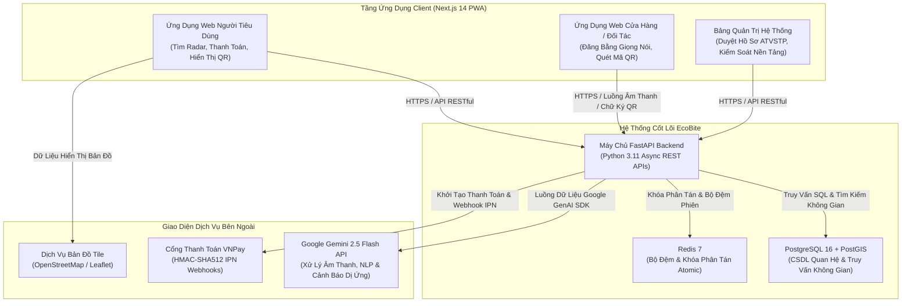

```mermaid
graph TD
    %% Giai đoạn 1: Khám phá
    A["Truy cập Web PWA EcoBite<br/>(Cấp quyền vị trí GPS)"] --> B["Trang Chủ: Bản đồ Radar PostGIS (1-5km)<br/>& Danh sách AI Gợi ý Cá nhân hóa"]
    
    B --> C{"Hình thức tìm kiếm?"}
    C -- "Tìm tự nhiên (Natural Language)" --> D["Gõ câu hỏi: 'Món nóng dưới 30k gần đây'<br/>(Gemini bóc tách tham số & Lọc PostGIS)"]
    C -- "Lướt xem trực tiếp" --> E["Xem Danh sách Thẻ Món Ăn Giảm Giá<br/>(Kèm lý do gợi ý từ AI)"]
    D --> E

    %% Giai đoạn 2: Chi tiết & Chọn món
    E --> F["Trang Chi Tiết Món Ăn<br/>- Kiểm tra Cảnh báo Dị ứng (Allergen Guard)<br/>- Đếm ngược Khung giờ giảm giá (Time-Shift)"]
    F --> G["Bấm 'Đặt Hàng'<br/>(Hệ thống tự khóa kho chống trùng Redis)"]

    %% Giai đoạn 3: Thanh toán
    G --> H["Thanh Toán Qua Cổng VNPAY-QR / Ví Điện Tử"]
    H --> I{"Thanh toán thành công?"}
    I -- "Thất bại / Hủy" --> F
    I -- "Thành công" --> J["Trang Chi Tiết Đơn Hàng<br/>(Sinh mã QR Động HMAC-SHA256)"]

    %% Giai đoạn 4 & 5: Nhận hàng & Tương tác AI
    J --> K["Đến Cửa Hàng: Đưa Mã QR Cho Bếp Quét Khóa Mã"]
    K --> L["Hoàn Tất Đơn Hàng<br/>(Tích Điểm Xanh & Cộng Chỉ Số Giảm CO2e)"]
    
    J --> M["Tương Tác Với Trợ Lý AI Bảo Quản & Hâm Nóng<br/>- Đọc Thẻ Mẹo AI sinh tự động<br/>- Bấm Nút Hỏi Nhanh (Quick Chips)<br/>- Hoặc Gõ Nhắn Tin Hỏi Trực Tiếp AI"]