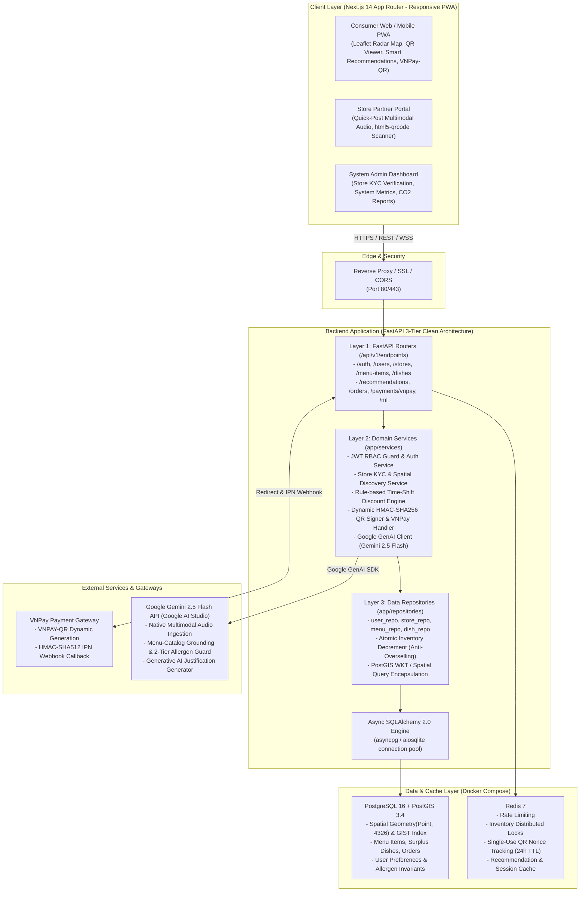
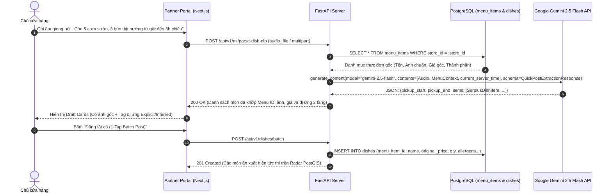
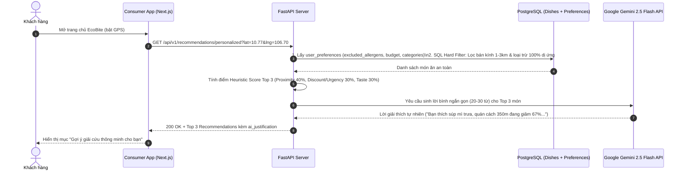
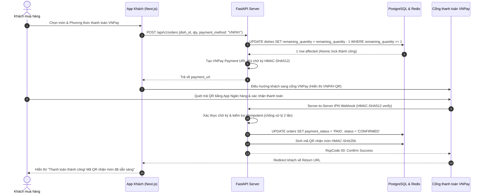
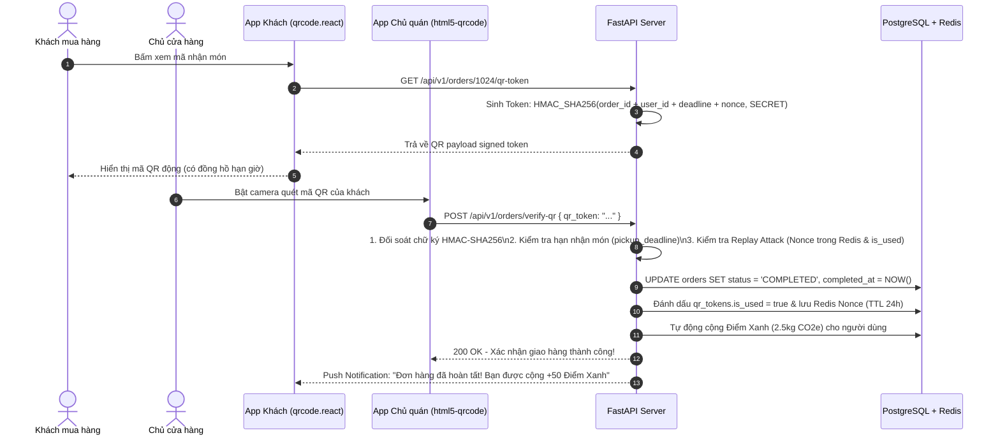

# 🏗️ EcoBite Platform - System Architecture & Technical Design

**Dự án**: EcoBite - Nền tảng Giải cứu Thực phẩm Thông minh & Kết nối Xanh (Food Rescue Platform)
**Nhóm thực hiện**: Group 5 - Lớp Kỹ nghệ Phần mềm / Computer Science (HCMUS)
- **Phùng Quốc Huy** (24127402) — *AI and Data Lead / Full-Stack Engineer*
- **Đặng Trọng Phúc** (24127495) — *Backend Lead & AI Engineer / Full-Stack Engineer*
- **Đàng Thế Tony** (24127561) — *QA/Tester Lead & Backend Engineer / Full-Stack Engineer*
- **Võ Ngọc Thịnh** (24127246) — *Frontend Lead / Full-Stack Engineer*

**Phiên bản**: 2.2.0 (Đồng bộ Cổng thanh toán VNPay IPN, Thuật toán Heuristic Scoring & Gemini 2.5 Flash)
**Trạng thái**: Approved for Implementation

---

## 1. Kiến trúc Hệ thống Tổng quan (High-Level Architecture)

Hệ thống EcoBite được thiết kế theo mô hình **Decoupled Three-Tier Architecture** mở rộng, kết hợp **Cổng thanh toán không tiền mặt VNPay (HMAC-SHA512)** và phân hệ **AI Intelligence Suite (Google Gemini 2.5 Flash)**.

### 1.1. Kiến trúc Phân tầng Backend (`Router ➔ Service ➔ Repository`)

Để đảm bảo nguyên tắc **Single Responsibility Principle (SRP)** và dễ dàng kiểm thử độc lập (Unit Test / Integration Test), toàn bộ mã nguồn Backend trong `backend/app/` được phân tách nghiêm ngặt thành 3 tầng:

| Tầng (Layer) | Thư mục | Trách nhiệm cốt lõi |
| :--- | :--- | :--- |
| **1. Presentation / Router Layer** | `backend/app/api/v1/endpoints/` | Tiếp nhận HTTP Request, xác thực phân quyền RBAC (`require_roles`), chuẩn hóa dữ liệu đầu vào/đầu ra qua Pydantic v2 Schemas và gọi xuống tầng Service. Tuyệt đối không viết câu lệnh truy vấn SQL tại Router. |
| **2. Business / Service Layer** | `backend/app/services/` | Chứa toàn bộ quy tắc nghiệp vụ cốt lõi: Động cơ tính giá giảm giờ chót (`DishService`), đối chiếu Menu Grounding (`MenuService`), kiểm duyệt KYC (`StoreService`), tính khoảng cách không gian (`DiscoveryService`). Điều phối dữ liệu thông qua tầng Repository. |
| **3. Data Access / Repository Layer** | `backend/app/repositories/` | Các module `user_repo.py`, `store_repo.py`, `menu_repo.py`, `dish_repo.py` làm việc trực tiếp với `AsyncSession` (SQLAlchemy 2.0), đóng gói toàn bộ truy vấn CRUD, xử lý tọa độ WKT/PostGIS và thực thi cập nhật tồn kho nguyên tử (`atomic_decrement_quantity`). |

---

## 2. Luồng Dữ liệu Nghiệp vụ Chính (Data Flow Sequences)

### 2.1. Luồng Trợ lý AI Bóc tách Hàng loạt Món ăn & Khớp Thực đơn Gốc (AI Feature 1)

1. **Frontend**: Nhân viên hoặc chủ quán gửi file ghi âm ngắn (Native Multimodal Audio) hoặc văn bản: *"Còn 5 cơm sườn chả, 3 bún thịt nướng xả từ giờ đến 3h chiều nhé"*.
2. **FastAPI (`POST /api/v1/ml/parse-dish-nlp`)**: Truy vấn Danh mục Thực đơn Cơ bản (`menu_items`) của quán từ PostgreSQL và gắn mốc `current_server_time`.
3. **Gemini 2.5 Flash (Native Audio & Structured Outputs)**:
   - Nhận trực tiếp file âm thanh thô, hiểu chuẩn xác phương ngữ và tiếng lóng ẩm thực Việt (*"bốn lăm cành"*, *"bì chả"*).
   - So khớp tên món với thực đơn gốc để gán `matched_menu_id`, tự động kế thừa **Ảnh chuẩn và Giá gốc**.
   - **Rà soát dị ứng 2 tầng (Two-Tier Allergen Guard)**:
     - `EXPLICIT`: Thành phần chủ quán đọc rõ.
     - `INFERRED`: Suy luận tri thức ẩm thực truyền thống theo 14 chuẩn EU FIC (Trứng trong chả trứng, Cá trong nước mắm, Đậu phộng trong mỡ hành/bún thịt nướng, Gluten trong bánh mì).
     - Gắn cờ văn hóa địa phương `dietary_notes` (Có mỡ hành, độ cay, đồ chua, ăn chay).
   - Quy đổi thời gian tương đối (*"từ giờ đến 3h chiều"*) thành dấu thời gian ISO 8601 tuyệt đối `13:55:00 - 15:00:00`.
4. **Draft Cards & 1-Tap Batch Post**: Chủ quán xem lại danh sách thẻ món ăn đã có sẵn ảnh đẹp và tag dị ứng, gạt nút xác nhận rồi bấm **"Đăng tất cả"** để lưu hàng loạt vào bảng `dishes`.

---

### 2.2. Luồng Hệ thống Gợi ý Món ăn Thông minh & Tìm kiếm Ngữ nghĩa (AI Feature 2)

Hệ thống hoạt động theo mô hình **Hybrid 3 Lớp**:

1. **Layer 1 - Hard Safety Invariant (SQL & PostGIS)**:
   - Truy vấn PostGIS: Lọc các món khả dụng (`remaining_quantity > 0`) trong bán kính 1–3 km.
   - **Bảo đảm an toàn dị ứng tuyệt đối**: Bắt buộc loại trừ 100% các món ăn chứa thành phần dị ứng trong `user_preferences.excluded_allergens` tại cấp độ câu lệnh SQL Database. Tuyệt đối không giao phó việc bảo vệ tính mạng người dùng cho văn bản AI xác suất.
2. **Layer 2 - Multi-Factor Heuristic Scoring**:
   - Xếp hạng các món ứng viên an toàn dựa trên công thức tổng hợp trọng số:
     $$\text{Score} = (0.40 \times \text{Proximity}) + (0.30 \times \text{Discount Depth \& Time Urgency}) + (0.30 \times \text{Taste Profile Match})$$
   - Ưu tiên các **Giao dịch Giải cứu Cấp bách (Urgent Rescue Deals)** bước vào 30 phút cuối áp dụng luật giảm giá sâu 70%.
3. **Layer 3 - Generative AI Personalization**:
   - Gửi hồ sơ khẩu vị tóm tắt và Top 3 món có điểm cao nhất sang Gemini 2.5 Flash.
   - Mô hình sinh lời giải thích ngắn gọn, xúc tích (20–30 từ), giàu cảm xúc hiển thị trực tiếp trên thẻ món ăn UI.

---

### 2.3. Luồng Giảm giá theo Khung giờ Tất định (Feature 3)

Hệ thống EcoBite sử dụng **Luật Thời gian Xác định (Deterministic Business Rules)**, không dùng AI đoán giá:
- Mỗi món ăn có 3 mức giá:
  1. `original_price`: Giá niêm yết ban đầu trên thực đơn.
  2. `rescue_price`: Giá giải cứu tiêu chuẩn (giảm 40% – 50%) trong suốt khung giờ mở bán.
  3. `rule_discount_price`: Giá giờ chót giảm sâu tới 70% trong 30–45 phút cuối trước giờ đóng cửa.
- **Công thức tính giá tại thời điểm $T_{\text{current}}$**:
  $$\text{Current Price} = \begin{cases}
  \text{rule\_discount\_price} & \text{nếu } T_{\text{current}} \ge \text{rule\_discount\_start\_time} \\
  \text{rescue\_price} & \text{nếu } \text{pickup\_start\_time} \le T_{\text{current}} < \text{rule\_discount\_start\_time} \\
  \text{original\_price} & \text{trường hợp khác}
  \end{cases}$$

---

### 2.4. Luồng Thanh toán Không Tiền mặt Liền mạch qua VNPay (Feature 6)

1. **Khách bấm Đặt hàng**: Backend thực hiện câu lệnh Atomic Lock cập nhật tồn kho `WHERE remaining_quantity >= :qty`.
2. **Khởi tạo Giao dịch VNPay**: Backend gọi thuật toán sinh URL thanh toán có chữ ký bảo mật HMAC-SHA512 (`vnp_SecureHash`).
3. **Thanh toán VNPAY-QR**: Khách hàng mở ứng dụng Mobile Banking hoặc Ví điện tử quét mã VNPAY-QR và thanh toán.
4. **Xử lý Webhook IPN Idempotent**:
   - Cổng VNPay gửi tín hiệu Instant Payment Notification (IPN) ngầm sang Backend qua `GET /api/v1/payments/vnpay/ipn`.
   - Backend đối soát chữ ký HMAC-SHA512.
   - Kiểm tra mã giao dịch chống trùng lặp (idempotency check trong Redis/DB). Nếu giao dịch chưa xử lý, cập nhật `orders.payment_status = 'PAID'` và tự động sinh mã QR nhận món HMAC-SHA256.
   - Trả phản hồi `{"RspCode": "00", "Message": "Confirm Success"}` cho VNPay.

---

### 2.5. Luồng Quét Mã QR Xác nhận Đơn hàng tại Cửa hàng (Feature 7)

---

## 3. Kiến trúc Bảo mật & Toàn vẹn Dữ liệu (Security & Data Integrity)

1. **JWT Dual-Token & RBAC**:
   - `Access Token`: Thời hạn ngắn (24 giờ), mang thông tin `sub` (user_id), `role`, `email`.
   - `Refresh Token`: Thời hạn 30 ngày, lưu mã băm an toàn trong CSDL, tự động thu hồi khi đăng xuất.
   - Phân quyền RBAC chặt chẽ qua FastAPI Dependencies: `require_roles(["STORE_PARTNER"])`, `require_roles(["ADMIN"])`.
2. **Khóa Tồn kho Chống Bán Vượt (Zero Over-selling)**:
   - Thực thi cập nhật SQL nguyên tử kết hợp kiểm tra điều kiện `WHERE remaining_quantity >= :qty` và cơ chế Distributed Lock của Redis.
3. **Bảo mật Thanh toán VNPay (HMAC-SHA512 & Idempotency)**:
   - Toàn bộ tham số gửi sang VNPay và nhận về từ IPN Webhook đều được kiểm tra chữ ký băm mật mã học HMAC-SHA512 bằng `vnp_HashSecret`.
   - Cơ chế xử lý Webhook Idempotent ngăn ngừa việc ghi nhận thanh toán trùng lặp khi VNPay thử lại nhiều lần.
4. **Mã QR Dùng Một Lần (Single-Use Dynamic HMAC-SHA256)**:
   - Chứa `order_id`, `consumer_id`, `pickup_deadline`, và chuỗi ngẫu nhiên `nonce`.
   - Loại trừ hoàn toàn rủi ro chụp màn hình gửi người khác hoặc tấn công Replay Attack nhờ cờ `is_used` trong DB và khóa Redis Nonce TTL 24 giờ.
5. **Bảo đảm An toàn Dị ứng Cứng (Allergen Hard Invariant)**:
   - Các chất dị ứng trong `user_preferences.excluded_allergens` được lọc cứng ở tầng câu lệnh SQL PostGIS, không phụ thuộc vào kết quả sinh ngẫu nhiên xác suất của AI.
