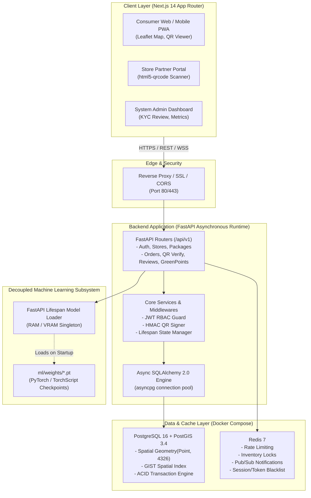
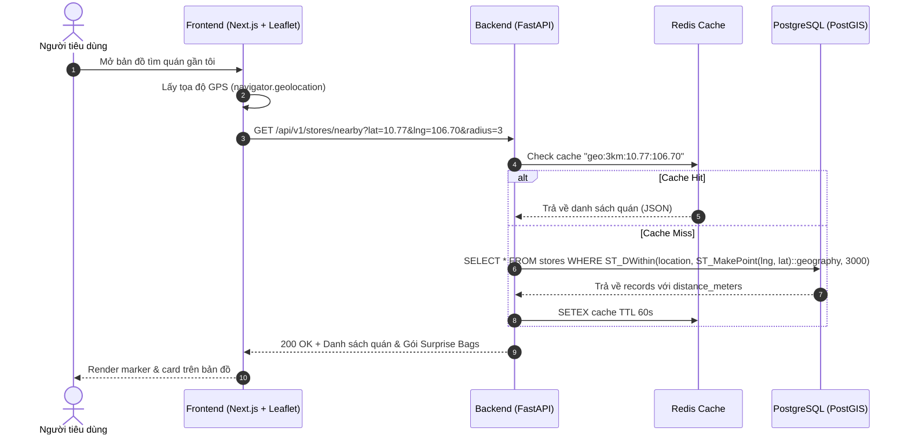

# EcoBite Platform - System Architecture & Technical Design

**Dự án**: EcoBite - Nền tảng Cứu trợ Thực phẩm Dư thừa & Kết nối Xanh  
**Tác giả**: Senior DevOps Engineer & Technical Project Manager  
**Phiên bản**: 1.0.0  

---

## 1. Kiến trúc Hệ thống Tổng quan (High-Level Architecture)

Hệ thống EcoBite được thiết kế theo mô hình **Decoupled Three-Tier Architecture** kết hợp thành phần **AI/ML Inference Pipeline độc lập**.



---

## 2. Luồng Dữ liệu Nghiệp vụ Chính (Data Flow Sequences)

### 2.1. Luồng Tìm kiếm Quán Theo Bán kính Vị trí (Spatial Geo-Search)
1. **Frontend**: Trình duyệt lấy tọa độ GPS hiện tại của người dùng (`lat`, `lng`).
2. **FastAPI**: Endpoint `GET /api/v1/stores/nearby?lat=10.7769&lng=106.7009&radius_km=3` tiếp nhận yêu cầu.
3. **Database (PostGIS)**: Thực thi truy vấn không gian sử dụng hàm `ST_DWithin` và toán tử `ST_Distance` trên trường `stores.location` (kiểu dữ liệu `geometry(Point, 4326)`) được đánh chỉ mục không gian `GIST Index`.
4. **Cache**: Kết quả truy vấn các cửa hàng trong khu vực lân cận được cache tại Redis trong thời gian ngắn (TTL = 60s) để giảm tải cho database khi lưu lượng người dùng cao.



---

### 2.2. Luồng Sinh & Quét Mã QR Xác nhận Nhận hàng (Pickup Verification)

Để chống gian lận (chụp màn hình gửi người khác, tái sử dụng mã nhiều lần), mã QR không lưu plain text `order_id` mà sử dụng chuỗi ký điện tử **HMAC-SHA256 Token**.


---

## 3. Kiến trúc Tích hợp Machine Learning (Decoupled ML Lifespan Architecture)

### 3.1. Phân tách Trách nhiệm (Decoupling)
- **Thư mục `ml/`**: Là môi trường dành cho việc phát triển mô hình, chứa các công cụ đào tạo nặng (`ultralytics`, `jupyterlab`, `scikit-learn`, `pandas`).
- **Thư mục `backend/`**: Là môi trường Web API gọn nhẹ. Chỉ cài đặt `torch` và `torchvision` (runtime inference) nhằm tối ưu dung lượng container và tốc độ khởi động.

### 3.2. Cơ chế Singleton & FastAPI Lifespan Manager
Để đảm bảo hiệu năng xử lý cực đại, Backend tuyệt đối không nạp file trọng số `.pt` ở từng request. Toàn bộ trọng số được nạp sẵn vào bộ nhớ (RAM/VRAM) trong sự kiện khởi động ứng dụng:

```python
# Minh họa luồng nạp Lifespan trong FastAPI
from contextlib import asynccontextmanager
from fastapi import FastAPI
import torch
import os

@asynccontextmanager
async def lifespan(app: FastAPI):
    # --- STARTUP LOGIC ---
    weights_dir = os.getenv("ML_WEIGHTS_DIR", "../ml/weights")
    model_name = os.getenv("ML_MODEL_FILENAME", "food_quality_yolov8.pt")
    weights_path = os.path.join(weights_dir, model_name)
    device = torch.device(os.getenv("ML_DEVICE", "cpu"))

    if os.path.exists(weights_path):
        # Nạp mô hình một lần duy nhất vào memory
        app.state.ml_model = torch.load(weights_path, map_location=device)
        app.state.ml_model.eval()
        app.state.ml_ready = True
    else:
        # Fallback chế độ mô phỏng cho môi trường dev khi chưa có weights thật
        app.state.ml_model = None
        app.state.ml_ready = False

    yield  # Ứng dụng tiếp nhận các HTTP requests

    # --- SHUTDOWN LOGIC ---
    # Thu dọn tài nguyên, giải phóng VRAM
    if hasattr(app.state, "ml_model") and app.state.ml_model is not None:
        del app.state.ml_model
```

---

## 4. Kiến trúc Bảo mật & Phân quyền (Security & Authorization)

1. **JWT Dual-Token Authentication**:
   - `Access Token`: Hạn dùng 1 ngày (1440 phút), mang thông tin `sub` (user_id), `role`, `email`.
   - `Refresh Token`: Hạn dùng 30 ngày, lưu mã băm an toàn trong database.
2. **Role-Based Access Control (RBAC)**:
   - Áp dụng cơ chế FastAPI Dependency Injection (`get_current_active_user`, `require_roles(["ADMIN"])`).
3. **Chống Tấn công Đặt hàng Đồng thời (Race Conditions & Over-selling)**:
   - Áp dụng Redis Distributed Lock hoặc PostgreSQL `SELECT ... FOR UPDATE` khi xử lý đơn hàng gói Surprise Bag cuối cùng.
4. **Bảo mật Mã QR Xác nhận Đơn**:
   - Sử dụng thuật toán HMAC-SHA256 với secret key riêng biệt `QR_SIGNATURE_SECRET`.
   - Mỗi token có hạn sử dụng ngắn và chỉ được chấp nhận 1 lần duy nhất (Single-use Nonce lưu trong Redis với TTL 24 giờ).
