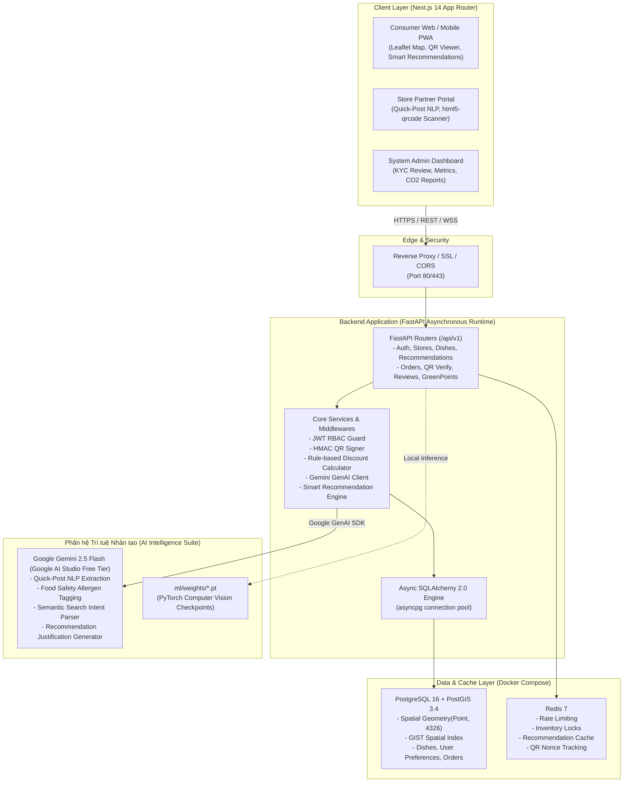
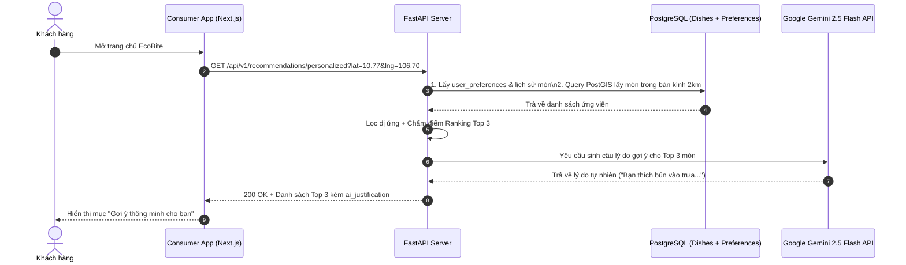
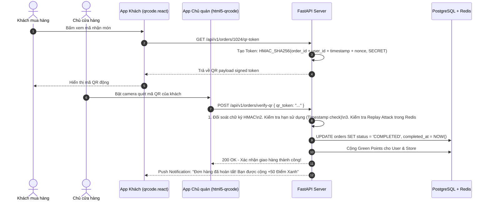

# EcoBite Platform - System Architecture & Technical Design

**Dự án**: EcoBite - Nền tảng Cứu trợ Thực phẩm Dư thừa & Kết nối Xanh
**Tác giả**: Senior DevOps Engineer & Technical Project Manager
**Phiên bản**: 2.1.0 (Bổ sung Phân hệ AI Intelligence Suite & Hệ thống Gợi ý Món ăn Thông minh)

---

## 1. Kiến trúc Hệ thống Tổng quan (High-Level Architecture)

Hệ thống EcoBite được thiết kế theo mô hình **Decoupled Three-Tier Architecture** kết hợp phân hệ **AI Intelligence Suite (Google Gemini 2.5 Flash)** và thành phần **AI/ML Inference Pipeline độc lập**.

---

## 2. Luồng Dữ liệu Nghiệp vụ Chính (Data Flow Sequences)

### 2.1. Luồng Trợ lý AI Bóc tách Hàng loạt Món ăn & Khớp Thực đơn Gốc (Batch Quick-Post & Menu Grounding)
1. **Frontend**: Chủ quán bấm ghi âm 1 câu ngắn (hoặc nhập text): *"Còn 5 cơm sườn chả, 3 bún thịt nướng xả từ giờ đến 3h chiều nhé"*.
2. **FastAPI (`POST /api/v1/ml/parse-dish-nlp`)**: Tiếp nhận file audio hoặc text, lấy thời gian thực `current_server_time` của server và truy vấn Thực đơn gốc (`menu_items`) của quán từ PostgreSQL.
3. **Gemini 2.5 Flash (Native Audio & Structured Outputs)**:
   - Nhận trực tiếp luồng Audio + Danh mục Menu gốc + `current_server_time` trong System Prompt.
   - Phân tích ngữ nghĩa, tự động giải mã giờ tương đối (*"từ giờ đến 3h chiều"* $\rightarrow$ `13:55:00` - `15:00:00`).
   - Khớp `matched_menu_id` với từng món trong thực đơn để tự động kế thừa **Ảnh món ăn và Giá gốc**.
   - **Rà soát dị ứng 2 tầng (2-Tier Allergen Guard)**:
     - `EXPLICIT`: Thành phần chủ quán đọc rõ.
     - `INFERRED`: AI suy luận từ công thức món Việt (Trứng trong chả, Nước mắm cá, Đậu phộng trong mỡ hành...) theo chuẩn 14 chất EU FIC.
     - Tách riêng `dietary_notes` (Có hành ngò, cay vừa, ăn chay).
4. **Frontend Preview (Draft Cards)**: Hiển thị danh sách các thẻ món ăn đã có sẵn ảnh đại diện từ Menu gốc, lộ trình giảm giá theo giờ và nút gạt xác nhận dị ứng. Chủ quán chỉ cần 1 chạm **"Đăng tất cả"** để lưu hàng loạt vào bảng `dishes`.

---

### 2.2. Luồng Hệ thống Gợi ý Món ăn Thông minh Cá nhân hóa (AI Smart Recommendation)
Động cơ gợi ý hoạt động theo mô hình **Hybrid Context-Aware Matcher**:
1. **Frontend**: Gửi tọa độ GPS hiện tại của người dùng kèm JWT token xác thực: `GET /api/v1/recommendations/personalized?lat=10.77&lng=106.70`.
2. **Backend**:
   - Truy vấn thông tin `user_preferences` (chế độ ăn, danh sách dị ứng cần tránh, ngân sách ưa thích) và lịch sử 5 đơn hàng gần nhất.
   - Truy vấn PostGIS: Lấy các món ăn khả dụng (`remaining_quantity > 0`) trong bán kính 2km.
   - **Bộ lọc An toàn & Ngữ cảnh**:
     - Loại trừ hoàn toàn các món có chứa chất dị ứng của người dùng.
     - Ưu tiên các món đang bước vào 30 phút cuối của luật giảm giá 70% (Deal khẩn cấp).
   - **Bộ xếp hạng (Scoring)**: Tính điểm phù hợp dựa trên: Khoảng cách (40%) + Mức giảm giá (30%) + Khớp khẩu vị (30%).
3. **Gemini 2.5 Flash**: Nhận thông tin Top 3 món điểm cao nhất và profile tóm tắt của user, sinh ra câu văn giải thích tự nhiên, ngắn gọn (Justification) để hiển thị lên UI.
4. **Trả kết quả**: Trả về danh sách món gợi ý kèm tag "Lý do AI gợi ý".

---

### 2.3. Luồng Luật Giảm giá Theo Khung giờ (Rule-based Time-based Discounting)
Hệ thống EcoBite sử dụng **Luật Thời gian Xác định (Deterministic Business Rules)**:
- Mỗi món ăn có 3 mức giá:
  1. `original_price`: Giá niêm yết ban đầu (ví dụ: `50.000đ`).
  2. `rescue_price`: Giá giải cứu tiêu chuẩn trong khung giờ mở bán (ví dụ: `25.000đ` - giảm 50%).
  3. `rule_discount_price`: Giá giờ chót giảm sâu hơn trong 30-45 phút cuối (ví dụ: `15.000đ` - giảm 70%).
- **Công thức tính giá tại thời điểm $T_{\text{current}}$**:
  $$\text{Current Price} = \begin{cases}
  \text{rule\_discount\_price} & \text{nếu } T_{\text{current}} \ge \text{rule\_discount\_start\_time} \\
  \text{rescue\_price} & \text{nếu } \text{pickup\_start\_time} \le T_{\text{current}} < \text{rule\_discount\_start\_time} \\
  \text{original\_price} & \text{trường hợp khác}
  \end{cases}$$

---

### 2.4. Luồng Sinh & Quét Mã QR Xác nhận Nhận hàng (Pickup Verification)

Để chống gian lận (chụp màn hình gửi người khác, tái sử dụng mã nhiều lần), mã QR sử dụng chữ ký điện tử **HMAC-SHA256 Token**.

---

## 3. Kiến trúc Bảo mật & Phân quyền (Security & Authorization)

1. **JWT Dual-Token Authentication**:
   - `Access Token`: Hạn dùng 1 ngày (1440 phút), mang thông tin `sub` (user_id), `role`, `email`.
   - `Refresh Token`: Hạn dùng 30 ngày, lưu mã băm an toàn trong database.
2. **Role-Based Access Control (RBAC)**:
   - Áp dụng cơ chế FastAPI Dependency Injection (`get_current_active_user`, `require_roles(["ADMIN"])`).
3. **Chống Tấn công Đặt hàng Đồng thời (Race Conditions & Over-selling)**:
   - Áp dụng Redis Distributed Lock hoặc PostgreSQL `SELECT ... FOR UPDATE` khi xử lý đơn hàng món ăn cuối cùng.
4. **Bảo mật Mã QR Xác nhận Đơn**:
   - Sử dụng thuật toán HMAC-SHA256 với secret key riêng biệt `QR_SIGNATURE_SECRET`.
   - Mỗi token có hạn sử dụng ngắn và chỉ được chấp nhận 1 lần duy nhất (Single-use Nonce lưu trong Redis với TTL 24 giờ).
