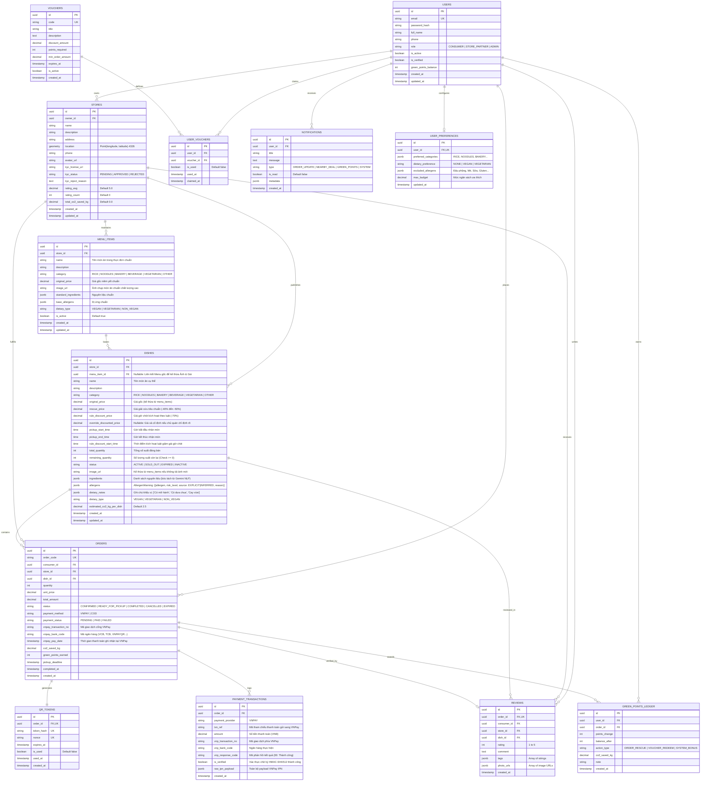

# 🗄️ EcoBite Platform - Database Schema & Entity-Relationship Design (ERD)

**Dự án**: EcoBite - Nền tảng Giải cứu Thực phẩm Thông minh & Kết nối Xanh (Food Rescue Platform)
**Nhóm thực hiện**: Group 5 - Lớp Kỹ nghệ Phần mềm / Computer Science (HCMUS)
- **Phùng Quốc Huy** (24127402) — *AI and Data Lead / Full-Stack Engineer*
- **Đặng Trọng Phúc** (24127495) — *Backend Lead & AI Engineer / Full-Stack Engineer*
- **Đàng Thế Tony** (24127561) — *QA/Tester Lead & Backend Engineer / Full-Stack Engineer*
- **Võ Ngọc Thịnh** (24127246) — *Frontend Lead / Full-Stack Engineer*

**Hệ quản trị CSDL**: PostgreSQL 16 kết hợp Không gian địa lý PostGIS 3.4
**ORM**: SQLAlchemy 2.0 (Async Engine: `asyncpg`, Migration: `alembic`)
**Phiên bản**: 2.2.0 (Đồng bộ Bảng Giao dịch Thanh toán VNPay & Hồ sơ Dị ứng Khẩu vị)
**Trạng thái**: Approved for Implementation

---

## 1. Sơ đồ Thực thể Liên kết (Entity-Relationship Diagram)



---

## 2. Đặc tả Chi tiết các Bảng CSDL (Tables Specification)

### 2.1. Bảng `users` (Tài khoản người dùng)
| Trường | Kiểu dữ liệu | Ràng buộc | Mô tả |
| :--- | :--- | :--- | :--- |
| `id` | `UUID` | PK, Default `gen_random_uuid()` | Khóa chính |
| `email` | `VARCHAR(255)` | UNIQUE, NOT NULL | Địa chỉ email đăng nhập |
| `password_hash` | `VARCHAR(255)` | NOT NULL | Mật khẩu mã hoá bằng bcrypt |
| `full_name` | `VARCHAR(100)` | NOT NULL | Họ và tên |
| `phone` | `VARCHAR(20)` | NULL | Số điện thoại liên hệ |
| `role` | `VARCHAR(20)` | NOT NULL, DEFAULT 'CONSUMER' | Vai trò: `CONSUMER`, `STORE_PARTNER`, `ADMIN` |
| `is_active` | `BOOLEAN` | NOT NULL, DEFAULT true | Trạng thái hoạt động |
| `is_verified` | `BOOLEAN` | NOT NULL, DEFAULT false | Xác thực email/SĐT |
| `green_points_balance`| `INTEGER` | NOT NULL, DEFAULT 0 | Số dư Điểm Xanh hiện tại |
| `created_at` | `TIMESTAMP` | NOT NULL, DEFAULT CURRENT_TIMESTAMP | Thời điểm tạo |

### 2.2. Bảng `user_preferences` (Hồ sơ Khẩu vị phục vụ AI Recommendation)
| Trường | Kiểu dữ liệu | Ràng buộc | Mô tả |
| :--- | :--- | :--- | :--- |
| `id` | `UUID` | PK | Khóa chính |
| `user_id` | `UUID` | FK -> `users.id`, UNIQUE, NOT NULL | Thuộc người dùng nào |
| `preferred_categories`| `JSONB` | DEFAULT '[]' | Các nhóm món ưa thích (VD: `["NOODLES", "RICE"]`) |
| `dietary_preference` | `VARCHAR(50)` | NOT NULL, DEFAULT 'NONE' | `NONE`, `VEGAN`, `VEGETARIAN` |
| `excluded_allergens` | `JSONB` | DEFAULT '[]' | **Bộ lọc an toàn cứng SQL**: AI không bao giờ gợi ý món chứa các chất này (VD: `["Đậu phộng", "Hải sản"]`) |
| `max_budget` | `NUMERIC(12,2)` | NULL | Mức ngân sách tối đa quen thuộc của người dùng |
| `updated_at` | `TIMESTAMP` | DEFAULT CURRENT_TIMESTAMP | Thời điểm cập nhật khẩu vị gần nhất |

### 2.3. Bảng `stores` (Cửa hàng / Đối tác)
| Trường | Kiểu dữ liệu | Ràng buộc | Mô tả |
| :--- | :--- | :--- | :--- |
| `id` | `UUID` | PK | Mã định danh cửa hàng |
| `owner_id` | `UUID` | FK -> `users.id`, NOT NULL | Chủ sở hữu cửa hàng |
| `name` | `VARCHAR(255)` | NOT NULL | Tên cửa hàng / thương hiệu |
| `address` | `VARCHAR(500)` | NOT NULL | Địa chỉ thực tế |
| `location` | `GEOMETRY(Point, 4326)`| NOT NULL | Tọa độ GPS phục vụ truy vấn không gian PostGIS |
| `kyc_license_url` | `VARCHAR(500)` | NULL | Link ảnh Giấy chứng nhận ATVSTP |
| `kyc_status`| `VARCHAR(20)`| NOT NULL, DEFAULT 'PENDING' | Trạng thái duyệt: `PENDING`, `APPROVED`, `REJECTED` |
| `kyc_reject_reason`| `TEXT` | NULL | Lý do Admin từ chối phê duyệt |
| `rating_avg` | `NUMERIC(3,2)` | DEFAULT 5.0 | Điểm đánh giá sao trung bình |
| `total_co2_saved_kg`| `NUMERIC(10,2)`| DEFAULT 0.0 | Tổng lượng khí CO2 đã giảm phát thải |

### 2.4. Bảng `menu_items` (Thực đơn Gốc Chuẩn của Quán - Menu Grounding)
| Trường | Kiểu dữ liệu | Ràng buộc | Mô tả |
| :--- | :--- | :--- | :--- |
| `id` | `UUID` | PK | Mã món trong thực đơn gốc |
| `store_id` | `UUID` | FK -> `stores.id`, NOT NULL | Thuộc cửa hàng nào |
| `name` | `VARCHAR(255)` | NOT NULL | Tên chuẩn của món ăn (Ví dụ: "Cơm sườn bì chả") |
| `description` | `TEXT` | NULL | Mô tả chi tiết món ăn |
| `category` | `VARCHAR(50)` | NOT NULL | `RICE`, `NOODLES`, `BAKERY`, `BEVERAGE`, `VEGETARIAN`... |
| `original_price` | `NUMERIC(12,2)` | NOT NULL | Giá gốc niêm yết tại quán |
| `image_url` | `VARCHAR(500)` | NOT NULL | Ảnh chụp món ăn chuẩn chất lượng cao để hiển thị trên app |
| `standard_ingredients`| `JSONB` | DEFAULT '[]' | Thành phần nguyên liệu chuẩn |
| `base_allergens` | `JSONB` | DEFAULT '[]' | Dị ứng cơ bản đã xác định trước |
| `dietary_type` | `VARCHAR(50)` | NOT NULL, DEFAULT 'NON_VEGAN'| `VEGAN`, `VEGETARIAN`, `NON_VEGAN` |
| `is_active` | `BOOLEAN` | NOT NULL, DEFAULT true | Còn phục vụ trong thực đơn không |

### 2.5. Bảng `dishes` (Món ăn Dư thừa Cụ thể Đăng bán trong Ca)
| Trường | Kiểu dữ liệu | Ràng buộc | Mô tả |
| :--- | :--- | :--- | :--- |
| `id` | `UUID` | PK | Mã món ăn dư thừa đăng bán |
| `store_id` | `UUID` | FK -> `stores.id`, NOT NULL | Thuộc cửa hàng nào |
| `menu_item_id` | `UUID` | FK -> `menu_items.id`, NULL | Liên kết thực đơn gốc (để kế thừa Ảnh và Giá gốc) |
| `name` | `VARCHAR(255)` | NOT NULL | Tên món ăn (Kế thừa từ `menu_items` hoặc tên tự do) |
| `category` | `VARCHAR(50)` | NOT NULL | `RICE`, `NOODLES`, `BAKERY`, `BEVERAGE`, `VEGETARIAN`... |
| `original_price` | `NUMERIC(12,2)` | NOT NULL | Giá gốc thị trường (kế thừa từ `menu_items`) |
| `rescue_price` | `NUMERIC(12,2)` | NOT NULL | Giá giải cứu tiêu chuẩn (giảm 40% – 50%) |
| `rule_discount_price`| `NUMERIC(12,2)`| NULL | Giá giờ chót tự động giảm sâu theo luật (giảm tới 70%) |
| `override_discounted_price`| `NUMERIC(12,2)`| NULL | Giá xả cố định nếu chủ quán đọc giá cụ thể |
| `pickup_start_time` | `TIME` | NOT NULL | Giờ bắt đầu nhận món trong ngày (VD: `14:00:00`) |
| `pickup_end_time` | `TIME` | NOT NULL | Giờ kết thúc nhận món (VD: `15:00:00`) |
| `rule_discount_start_time`| `TIME`| NULL | Thời điểm kích hoạt luật giảm giá giờ chót (VD: `14:30:00`) |
| `total_quantity` | `INTEGER` | NOT NULL | Tổng số suất đăng bán ban đầu |
| `remaining_quantity` | `INTEGER` | NOT NULL, CHECK (>= 0) | Số lượng suất còn lại (Kiểm soát chống bán vượt) |
| `status` | `VARCHAR(20)` | NOT NULL, DEFAULT 'ACTIVE' | `ACTIVE`, `SOLD_OUT`, `EXPIRED`, `INACTIVE` |
| `image_url` | `VARCHAR(500)` | NULL | Kế thừa từ `menu_items.image_url` |
| `ingredients` | `JSONB` | DEFAULT '[]' | Danh sách nguyên liệu bóc tách từ Gemini NLP |
| `allergens` | `JSONB` | DEFAULT '[]' | Cảnh báo dị ứng 2 tầng `[{allergen, risk_level, source: EXPLICIT/INFERRED, reason}]` |
| `dietary_notes` | `JSONB` | DEFAULT '[]' | Ghi chú khẩu vị: `['Có mỡ hành', 'Có dưa chua', 'Cay vừa']` |
| `dietary_type` | `VARCHAR(50)` | NOT NULL, DEFAULT 'NON_VEGAN'| `VEGAN`, `VEGETARIAN`, `NON_VEGAN` |
| `estimated_co2_kg_per_dish`| `NUMERIC(6,2)`| DEFAULT 2.5 | Ước tính giảm phát thải CO2 mỗi suất ăn (kg) |

### 2.6. Bảng `orders` & `payment_transactions` (Đơn hàng & Giao dịch VNPay)
| Bảng / Trường | Kiểu dữ liệu | Ràng buộc | Mô tả |
| :--- | :--- | :--- | :--- |
| **`orders.id`** | `UUID` | PK | Mã đơn hàng |
| **`orders.order_code`** | `VARCHAR(50)` | UNIQUE, NOT NULL | Mã hiển thị thân thiện (VD: `EB-20261016-9981`) |
| **`orders.status`** | `VARCHAR(30)` | NOT NULL | `CONFIRMED`, `READY_FOR_PICKUP`, `COMPLETED`, `CANCELLED`, `EXPIRED` |
| **`orders.payment_method`**| `VARCHAR(20)`| NOT NULL | `VNPAY`, `COD` |
| **`orders.payment_status`**| `VARCHAR(20)`| NOT NULL, DEFAULT 'PENDING' | `PENDING`, `PAID`, `FAILED` |
| **`orders.vnpay_transaction_no`**| `VARCHAR(100)`| NULL | Mã giao dịch cổng VNPay |
| **`payment_transactions.id`**| `UUID`| PK | Khóa chính bản ghi giao dịch |
| **`payment_transactions.order_id`**| `UUID`| FK -> `orders.id` | Liên kết đơn hàng |
| **`payment_transactions.txn_ref`**| `VARCHAR(100)`| NOT NULL | Mã tham chiếu thanh toán gửi sang VNPay |
| **`payment_transactions.vnp_response_code`**| `VARCHAR(10)`| NOT NULL | Mã kết quả từ VNPay (`00` = Thành công) |
| **`payment_transactions.is_verified`**| `BOOLEAN`| NOT NULL | Đã xác thực chữ ký HMAC-SHA512 hợp lệ |
| **`payment_transactions.raw_ipn_payload`**| `JSONB`| NOT NULL | Toàn bộ dữ liệu callback để phục vụ kiểm toán |

### 2.7. Bảng `qr_tokens` (Mã QR Nhận Món Dùng Một Lần)
| Trường | Kiểu dữ liệu | Ràng buộc | Mô tả |
| :--- | :--- | :--- | :--- |
| `id` | `UUID` | PK | Khóa chính |
| `order_id` | `UUID` | FK -> `orders.id`, UNIQUE, NOT NULL | Mã đơn hàng tương ứng |
| `token_hash` | `VARCHAR(255)` | UNIQUE, NOT NULL | Chữ ký HMAC-SHA256 băm an toàn |
| `nonce` | `VARCHAR(64)` | UNIQUE, NOT NULL | Chuỗi ngẫu nhiên dùng 1 lần (Single-use nonce) |
| `expires_at` | `TIMESTAMP` | NOT NULL | Thời điểm hết hạn (khớp `pickup_deadline`) |
| `is_used` | `BOOLEAN` | NOT NULL, DEFAULT false | Đã quét nhận món chưa (chống Replay Attack) |
| `used_at` | `TIMESTAMP` | NULL | Thời điểm quét hoàn tất tại quán |

---

## 3. Chiến lược Đánh Chỉ mục (Indexing Strategy)

```sql
-- 1. Spatial GIST Index phục vụ truy vấn Radar PostGIS bán kính 1km - 10km
CREATE INDEX idx_stores_location ON stores USING GIST (location);

-- 2. Compound Indexes phục vụ lọc món theo cửa hàng, danh mục và trạng thái
CREATE INDEX idx_dishes_store_status ON dishes (store_id, status);
CREATE INDEX idx_dishes_category_status ON dishes (category, status);
CREATE INDEX idx_dishes_pickup_window ON dishes (pickup_start_time, pickup_end_time);

-- 3. GIN Indexes trên các trường JSONB (Dị ứng, Nguyên liệu & Khẩu vị)
CREATE INDEX idx_dishes_allergens_gin ON dishes USING GIN (allergens);
CREATE INDEX idx_dishes_ingredients_gin ON dishes USING GIN (ingredients);
CREATE INDEX idx_user_pref_allergens_gin ON user_preferences USING GIN (excluded_allergens);

-- 4. B-Tree Indexes phục vụ tra cứu Đơn hàng, Mã đơn và Thanh toán
CREATE INDEX idx_orders_consumer_created ON orders (consumer_id, created_at DESC);
CREATE INDEX idx_orders_store_status ON orders (store_id, status);
CREATE UNIQUE INDEX idx_orders_code ON orders (order_code);
CREATE INDEX idx_payment_txn_ref ON payment_transactions (txn_ref);

-- 5. Unique Indexes chống gian lận mã QR
CREATE UNIQUE INDEX idx_qr_tokens_hash ON qr_tokens (token_hash);
CREATE UNIQUE INDEX idx_qr_tokens_nonce ON qr_tokens (nonce);
```
