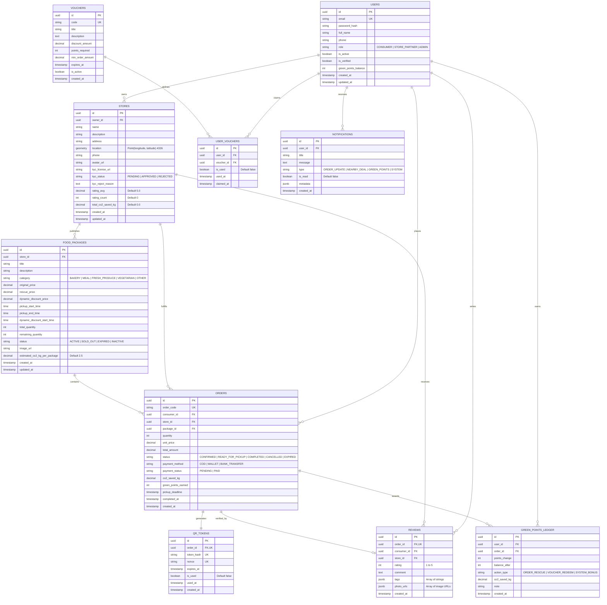

# EcoBite Platform - Database Schema & Entity-Relationship Design (ERD)

**Dự án**: EcoBite - Nền tảng Cứu trợ Thực phẩm Dư thừa & Kết nối Xanh  
**Hệ quản trị CSDL**: PostgreSQL 16 kết hợp Không gian địa lý PostGIS 3.4  
**ORM**: SQLAlchemy 2.0 (Async Engine: `asyncpg`, Migration: `alembic`)  

---

## 1. Sơ đồ Thực thể Liên kết (Entity-Relationship Diagram)



---

## 2. Đặc tả Chi tiết các Bảng CSDL (Tables Specification)

### 2.1. Bảng `users` (Tài khoản người dùng)
| Trường | Kiểu dữ liệu | Ràng buộc | Mô tả |
| :--- | :--- | :--- | :--- |
| `id` | `UUID` | PK, Default gen_random_uuid() | Khóa chính |
| `email` | `VARCHAR(255)` | UNIQUE, NOT NULL | Địa chỉ email đăng nhập |
| `password_hash` | `VARCHAR(255)` | NOT NULL | Mật khẩu mã hoá bằng bcrypt |
| `full_name` | `VARCHAR(100)` | NOT NULL | Họ và tên |
| `phone` | `VARCHAR(20)` | NULL | Số điện thoại liên hệ |
| `role` | `VARCHAR(20)` | NOT NULL, DEFAULT 'CONSUMER' | Vai trò: `CONSUMER`, `STORE_PARTNER`, `ADMIN` |
| `is_active` | `BOOLEAN` | NOT NULL, DEFAULT true | Trạng thái hoạt động |
| `is_verified` | `BOOLEAN` | NOT NULL, DEFAULT false | Xác thực email/SĐT |
| `green_points_balance`| `INTEGER` | NOT NULL, DEFAULT 0 | Số dư Điểm Xanh hiện tại |

### 2.2. Bảng `stores` (Cửa hàng / Đối tác)
| Trường | Kiểu dữ liệu | Ràng buộc | Mô tả |
| :--- | :--- | :--- | :--- |
| `id` | `UUID` | PK | Mã định danh cửa hàng |
| `owner_id` | `UUID` | FK -> users.id, NOT NULL | Chủ sở hữu cửa hàng |
| `name` | `VARCHAR(255)` | NOT NULL | Tên cửa hàng / thương hiệu |
| `address` | `VARCHAR(500)` | NOT NULL | Địa chỉ thực tế |
| `location` | `GEOMETRY(Point, 4326)`| NOT NULL | Tọa độ GPS phục vụ truy vấn không gian PostGIS |
| `kyc_status`| `VARCHAR(20)`| NOT NULL, DEFAULT 'PENDING' | Trạng thái duyệt: `PENDING`, `APPROVED`, `REJECTED` |
| `rating_avg` | `NUMERIC(3,2)` | DEFAULT 5.0 | Điểm đánh giá sao trung bình |
| `total_co2_saved_kg`| `NUMERIC(10,2)`| DEFAULT 0.0 | Tổng lượng khí CO2 đã giảm phát thải |

### 2.3. Bảng `food_packages` (Gói thức ăn Surprise Bag)
| Trường | Kiểu dữ liệu | Ràng buộc | Mô tả |
| :--- | :--- | :--- | :--- |
| `id` | `UUID` | PK | Mã gói hàng |
| `store_id` | `UUID` | FK -> stores.id | Thuộc cửa hàng |
| `title` | `VARCHAR(255)` | NOT NULL | Tên gói thức ăn bất ngờ |
| `category` | `VARCHAR(50)` | NOT NULL | Phân loại: BAKERY, MEAL, FRESH_PRODUCE... |
| `original_price` | `NUMERIC(12,2)` | NOT NULL | Giá gốc thị trường |
| `rescue_price` | `NUMERIC(12,2)` | NOT NULL | Giá giải cứu tiêu chuẩn (-50% đến -70%) |
| `dynamic_discount_price`| `NUMERIC(12,2)`| NULL | Giá giờ chót giảm sâu hơn trong 30 phút cuối |
| `pickup_start_time` | `TIME` | NOT NULL | Giờ bắt đầu nhận món trong ngày (VD: 19:30) |
| `pickup_end_time` | `TIME` | NOT NULL | Giờ kết thúc nhận món (VD: 21:00) |
| `remaining_quantity` | `INTEGER` | NOT NULL, CHECK (>= 0) | Số lượng suất còn lại |

### 2.4. Bảng `orders` & `qr_tokens` (Đơn hàng & Mã xác nhận)
- Trạng thái đơn hàng (`orders.status`):
  - `CONFIRMED`: Đặt hàng thành công, đã giữ tồn kho.
  - `READY_FOR_PICKUP`: Đang trong khung giờ nhận hàng.
  - `COMPLETED`: Chủ quán đã quét mã QR thành công, giao hàng xong.
  - `CANCELLED`: Người dùng hủy trước giờ hẹn hoặc quán hủy.
  - `EXPIRED`: Khách không đến lấy trước giờ kết thúc (`pickup_deadline`).
- `qr_tokens.nonce`: Mã ngẫu nhiên 32 ký tự, được đánh dấu `is_used = true` ngay khi quét để ngăn chặn quét trùng lặp (Double Claim).

---

## 3. Chiến lược Đánh Chỉ mục (Indexing Strategy)

Để đảm bảo hiệu năng truy vấn cao nhất cho hàng trăm nghìn giao dịch và tìm kiếm vị trí:

1. **Spatial GIST Index trên `stores.location`**:
   ```sql
   CREATE INDEX idx_stores_location ON stores USING GIST (location);
   ```
   *Mục đích: Cho phép truy vấn bán kính `ST_DWithin` phản hồi trong thời gian dưới 10ms.*

2. **Compound Index trên `food_packages`**:
   ```sql
   CREATE INDEX idx_packages_store_status ON food_packages (store_id, status);
   ```

3. **B-Tree Index trên `orders`**:
   ```sql
   CREATE INDEX idx_orders_consumer_created ON orders (consumer_id, created_at DESC);
   CREATE INDEX idx_orders_store_status ON orders (store_id, status);
   CREATE UNIQUE INDEX idx_orders_code ON orders (order_code);
   ```

4. **Unique Index trên `qr_tokens`**:
   ```sql
   CREATE UNIQUE INDEX idx_qr_tokens_hash ON qr_tokens (token_hash);
   ```
