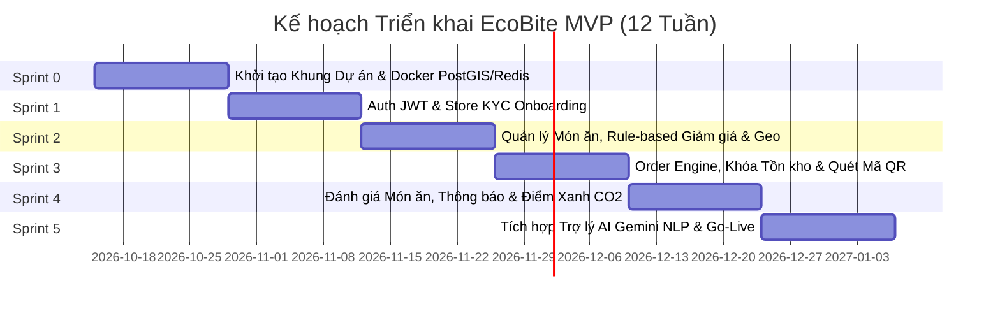

# EcoBite Platform - Agile Roadmap, Sprints & Kanban Board

**Dự án**: EcoBite - Nền tảng Cứu trợ Thực phẩm Dư thừa & Kết nối Xanh
**Phương pháp luận**: Scrum / Agile kết hợp Kanban Continuous Delivery
**Quy mô Sprint**: 2 tuần / Sprint (Tổng cộng 6 Sprints = 12 tuần MVP)
**Phiên bản**: 2.0.0 (Cập nhật: Món ăn cụ thể + Trợ lý AI Gemini 2.5 Flash NLP + Giảm giá Rule-based)

---

## 1. Lộ trình Triển khai Dự án (Agile Release Roadmap)

### 1.1. Chi tiết Mục tiêu từng Sprint

#### Sprint 0: Nền tảng Kỹ thuật & Môi trường (Foundation & Infrastructure)
- **Mục tiêu**: Chuẩn bị hạ tầng phát triển, CSDL, Caching, Gemini API Key và kiến trúc khung.
- **Deliverables**:
  - Khởi tạo cây thư mục chuẩn cho `backend`, `frontend`, `ml`.
  - Cấu hình `docker-compose.yml` (PostGIS 16 + Redis 7) hoạt động ổn định.
  - Thiết lập Alembic migrations và SQLAlchemy async engine.
  - Chuẩn bị pipeline test và linter (Ruff, ESLint, TypeScript, Pre-commit).

#### Sprint 1: Xác thực & Quản lý Đối tác Cửa hàng (Identity & Store Onboarding)
- **Mục tiêu**: Hoàn thiện toàn bộ quy trình đăng ký, phân quyền và KYC cửa hàng.
- **Deliverables**:
  - API Register, Login (JWT Access + Refresh tokens), Password Hashing (Bcrypt).
  - Phân quyền RBAC (`CONSUMER`, `STORE_PARTNER`, `ADMIN`).
  - Giao diện Đối tác nộp hồ sơ KYC (ảnh giấy phép ATVSTP, tọa độ GPS).
  - Admin Portal duyệt/từ chối hồ sơ đối tác.

#### Sprint 2: Quản lý Món ăn Cụ thể & Tìm kiếm Không gian (Dish Management & Geo-Search)
- **Mục tiêu**: Cho phép quán đăng bán từng món ăn dư thừa và người mua tìm thấy quán gần nhất.
- **Deliverables**:
  - CRUD Món ăn cụ thể (`dishes`) kèm khung giờ nhận hàng (`pickup_window`).
  - Logic tự động hạ giá theo khung giờ bằng luật xác định (Rule-based Time-based Discounting: giờ vàng giảm 50%, 30 phút cuối áp dụng luật giảm 70%).
  - Tích hợp PostGIS `ST_DWithin` và `GIST Index` phục vụ tìm kiếm theo bán kính 1km - 10km.
  - Bản đồ tương tác Leaflet hiển thị các quán và danh sách món ăn đang mở bán trên frontend.

#### Sprint 3: Đặt hàng, Khóa Tồn kho & Xác thực Mã QR (Order & QR Engine)
- **Mục tiêu**: Khép kín quy trình giao dịch Online-to-Offline (O2O).
- **Deliverables**:
  - Luồng Checkout an toàn với Redis atomic lock / DB row lock chống bán vượt số lượng món (over-selling).
  - Thuật toán ký mã QR động sử dụng HMAC-SHA256 (`order_id`, `timestamp`, `nonce`).
  - Tích hợp camera web scanner (`html5-qrcode`) cho Store Partner.
  - API xác thực mã QR, đối soát thời gian và đổi trạng thái đơn sang `COMPLETED`.

#### Sprint 4: Đánh giá, Thông báo & Hệ thống Điểm Xanh (Engagement & Eco-Impact)
- **Mục tiêu**: Gia tăng tính gắn kết của cộng đồng và đo lường tác động môi trường.
- **Deliverables**:
  - Hệ thống Đánh giá 1-5 sao kèm ảnh chụp cho từng món ăn cụ thể, chỉ cho phép người đã hoàn tất đơn (Verified).
  - Động cơ thông báo thời gian thực qua Redis Pub/Sub và WebSocket.
  - Thuật toán tính toán giảm phát thải CO2 (1 suất ăn giải cứu = 2.5kg CO2e).
  - Ví Điểm Xanh (Green Points) và đổi mã voucher giảm giá.

#### Sprint 5: Tích hợp Phân hệ AI Intelligence Suite & Go-Live (AI & Production Hardening)
- **Mục tiêu**: Tối ưu tốc độ đăng bài của chủ quán qua AI NLP, kích hoạt hệ thống gợi ý món ăn thông minh cho người dùng, kiểm thử tải và phát hành bản Beta.
- **Deliverables**:
  - Endpoint `POST /api/v1/ml/parse-dish-nlp` tích hợp **Google Gemini 2.5 Flash** (Native Audio & Structured Outputs) hỗ trợ Quick-Post bóc tách hàng loạt món ăn từ file âm thanh/văn bản, tự động khớp Thực đơn gốc (`menu_items`) để kéo ảnh + giá, rà soát dị ứng 2 tầng (`EXPLICIT` + `INFERRED`).
  - Endpoint `POST /api/v1/dishes/batch` hỗ trợ chủ quán đăng hàng loạt món ăn (1-Tap Batch Post) từ kết quả AI.
  - Endpoint `GET /api/v1/recommendations/personalized` và `GET /api/v1/recommendations/urgent-deals` gợi ý món ăn cá nhân hóa theo ngữ cảnh, lọc cứng dị ứng ở tầng SQL và sinh lời bình thuyết phục qua Gemini Flash.
  - Endpoint `POST /api/v1/dishes/search-semantic` tìm kiếm món ăn bằng ngôn ngữ tự nhiên.
  - Load testing với Locust / k6 (mục tiêu 1,000 req/s cho các truy vấn Geo-Search).
  - Penetration testing, kiểm tra chống replay attack trên mã QR.

---

## 2. Tiêu chuẩn Sẵn sàng & Hoàn thành (Agile Criteria)

### 2.1. Definition of Ready (DoR) - Điều kiện để đưa User Story vào Sprint
1. User Story được viết rõ ràng theo mẫu: *As a... I want... So that...*
2. Tiêu chí nghiệm thu (Acceptance Criteria) được định nghĩa chi tiết theo cú pháp *Given - When - Then*.
3. Thiết kế giao diện (UI/UX wireframe trên Figma) đã được thống nhất.
4. Schema cơ sở dữ liệu và Endpoint API liên quan đã được đặc tả trong `docs/`.
5. Đã ước lượng Story Points và giải quyết các phụ thuộc kỹ thuật (Dependencies).

### 2.2. Definition of Done (DoD) - Điều kiện để hoàn tất một User Story
1. Toàn bộ mã nguồn tuân thủ coding standard, chạy qua linter không có warning/error (`ruff check`, `npm run lint`).
2. Unit Tests và Integration Tests đạt tỷ lệ bao phủ code (Coverage) tối thiểu 80%.
3. Endpoint API có tài liệu Swagger/OpenAPI cập nhật và schema Pydantic chặt chẽ.
4. Đã qua quy trình Code Review (tối thiểu 1 Senior Developer phê duyệt PR).
5. Đã kiểm thử thành công trên môi trường Staging.
6. Không phát hiện lỗi bảo mật nghiêm trọng (OWASP Top 10, SQL Injection, Replay Attack).

---

## 3. Bảng Kanban Quản lý Công việc (Kanban Board Structure)

| Cột (Column) | WIP Limit | Mô tả hoạt động |
| :--- | :---: | :--- |
| **1. Backlog** | $\infty$ | Danh sách các User Stories và tính năng được ưu tiên từ PRD. |
| **2. Ready for Dev** | 10 | Các tasks đã thỏa mãn Definition of Ready (DoR). |
| **3. In Progress** | 5 | Đang được các lập trình viên triển khai (Coding). |
| **4. Code Review** | 4 | Pull Request mở, Peer Review và chạy automated CI pipeline. |
| **5. Testing / QA** | 4 | Kiểm thử chức năng, xác thực Acceptance Criteria trên Staging. |
| **6. Done** | $\infty$ | Đáp ứng đầy đủ Definition of Done (DoD), sẵn sàng release. |

---

## 4. Ma trận Quản lý Rủi ro (Risk Management Matrix)

| Rủi ro Kỹ thuật / Nghiệp vụ | Mức độ | Kế hoạch Phòng ngừa & Ứng phó |
| :--- | :---: | :--- |
| **Gian lận mã QR (Chụp màn hình, giả mạo)** | **Cao** | Ký token HMAC-SHA256 với secret an toàn, giới hạn thời gian hiệu lực và hủy token ngay lần quét đầu tiên qua Redis nonce. |
| **Nhiều khách cùng đặt món cuối cùng (Race Condition)** | **Cao** | Sử dụng Redis Distributed Lock hoặc PostgreSQL `SELECT ... FOR UPDATE` khi trừ tồn kho món ăn. |
| **Giới hạn Rate Limit của Google Gemini Free Tier** | **Thấp** | Google AI Studio cung cấp 15 RPM / 1,500 RPD miễn phí, kèm cơ chế Pydantic Schema Fallback nếu có lỗi mạng. |
| **Quán đăng thực phẩm kém chất lượng** | **Cao** | Bắt buộc nộp chứng nhận ATVSTP, áp dụng tính năng cảnh báo dị ứng tự động bằng AI và hệ thống cấm quán tự động nếu điểm đánh giá < 3.5 sao. |
