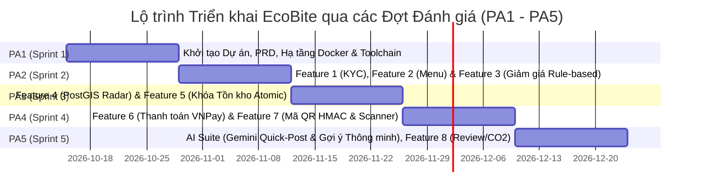

# 📋 EcoBite Platform - Agile Roadmap, Sprints & Team Contract

**Dự án**: EcoBite - Nền tảng Giải cứu Thực phẩm Thông minh & Kết nối Xanh (Food Rescue Platform)
**Nhóm thực hiện**: Group 5 - Lớp Kỹ nghệ Phần mềm / Computer Science (HCMUS)
- **Phùng Quốc Huy** (24127402 - pqhuy2425@clc.fitus.edu.vn) — *AI and Data Lead / Full-Stack Engineer*
- **Đặng Trọng Phúc** (24127495 - dtphuc2418@clc.fitus.edu.vn) — *Backend Lead & AI Engineer / Full-Stack Engineer*
- **Đàng Thế Tony** (24127561 - dttony2424@clc.fitus.edu.vn) — *QA/Tester Lead & Backend Engineer / Full-Stack Engineer*
- **Võ Ngọc Thịnh** (24127246 - vnthinh2418@clc.fitus.edu.vn) — *Frontend Lead / Full-Stack Engineer*

**Phương pháp luận**: Scrum / Agile kết hợp Kanban Continuous Delivery
**Quy mô Sprint**: 2 đến 3 tuần tương ứng với từng Project Assignment (PA1 đến PA5)
**Phiên bản**: 2.2.0 (Đồng bộ Thỏa ước Nhóm - Team Contract & Hạ tầng Toolchain Jira/GitHub)

---

## 1. Thỏa ước Hoạt động Nhóm (Team Contract)

### 1.1. Phân vai & Trách nhiệm Thành viên (Team Roles & Responsibilities)

1. **Phùng Quốc Huy – AI and Data Lead / Full-Stack Engineer**:
   - *Trách nhiệm chính (Primary)*: Phụ trách kiến trúc đường ống dữ liệu (Data Pipeline), phát triển và tối ưu mô hình AI/ML, tích hợp Gemini 2.5 Flash Structured Outputs và cơ chế chấm điểm gợi ý món ăn.
   - *Trách nhiệm chung (General)*: Tham gia phát triển full-stack và theo dõi xử lý bug.
2. **Đặng Trọng Phúc – Backend Lead & AI Engineer / Full-Stack Engineer**:
   - *Trách nhiệm chính (Primary)*: Trưởng nhóm kiến trúc hệ thống backend FastAPI, quản lý cơ sở dữ liệu PostgreSQL/PostGIS và Redis, tích hợp cổng thanh toán VNPay và hỗ trợ tích hợp dịch vụ AI vào backend.
   - *Trách nhiệm chung (General)*: Tham gia phát triển full-stack và theo dõi xử lý bug.
3. **Đàng Thế Tony – QA/Tester Lead & Backend Engineer / Full-Stack Engineer**:
   - *Trách nhiệm chính (Primary)*: Trưởng nhóm đảm bảo chất lượng phần mềm (QA), thiết kế kế hoạch kiểm thử (Test Plan), viết test cases tự động (Unit & Integration Tests), kiểm soát Quality Gates và hỗ trợ logic nghiệp vụ backend.
   - *Trách nhiệm chung (General)*: Tham gia phát triển full-stack và theo dõi xử lý bug.
4. **Võ Ngọc Thịnh – Frontend Lead / Full-Stack Engineer**:
   - *Trách nhiệm chính (Primary)*: Trưởng nhóm phát triển frontend Next.js 14, thiết kế giao diện responsive UI/UX (Tailwind CSS, Leaflet Map Radar, Web Camera Scanner `html5-qrcode`) và tích hợp kết nối API với Backend.
   - *Trách nhiệm chung (General)*: Tham gia phát triển full-stack và theo dõi xử lý bug.

### 1.2. Kế hoạch Giao tiếp (Communication Plan)
- **Công cụ giao tiếp**:
  - **Zalo (Group 05)**: Thông báo nhanh hàng ngày, trao đổi kỹ thuật nóng, cảnh báo khẩn cấp và chia sẻ link task.
  - **Google Meet**: Họp nhóm cố định, Sprint Planning, Scrum Check-ins, Code Reviews và lập trình cặp (pair-programming).
- **Quy chuẩn Phản hồi (Response Time Expectations)**:
  - *Tin nhắn thông thường*: Phản hồi trong vòng **2 đến 4 giờ** trong khung giờ làm việc tiêu chuẩn (8:00 AM – 10:00 PM).
  - *Tin khẩn cấp / Blocker*: Khi được gắn thẻ `@all` trên Zalo, các thành viên bắt buộc phản hồi trong vòng **1 giờ**.
- **Biên bản Cuộc họp**: Tóm tắt biên bản và các quyết định kỹ thuật then chốt ngay sau mỗi buổi họp lên group chat.

### 1.3. Lịch trình Làm việc & Chính sách Deadline (Work Schedule & Deadlines)
- **Lịch họp cố định**: Tối thứ Hai hàng tuần lúc **20:30** (Google Meet).
- **Chính sách Internal Deadline**:
  - Mọi task được giao, mã nguồn commit và nội dung báo cáo bắt buộc phải hoàn tất **trước ít nhất 1 ngày** so với hạn chót chính thức của môn học.
  - Khoảng đệm 1 ngày này dành riêng cho việc cross-review chéo giữa các thành viên và rà soát chất lượng trước khi nộp.
- **Quy trình Ứng phó Sự cố Khẩn cấp**:
  - Báo trước sớm nhất có thể nếu gặp lý do bất khả kháng.
  - Các thành viên còn lại lập tức hỗ trợ nhận lại task để đảm bảo tiến độ chung không bị gián đoạn.

### 1.4. Quy trình Ra Quyết định & Giải quyết Bất đồng (Decision-Making & Conflict Resolution)
- **Đồng thuận & Bỏ phiếu Đa số**: Mọi quyết định kỹ thuật được thảo luận cởi mở; nếu không đạt đồng thuận tuyệt đối sẽ giải quyết bằng bỏ phiếu đa số (>50%).
- **Quyền Phán quyết Cuối cùng (Tie-Breaking & Final Say)**: Trong trường hợp số phiếu hòa, Domain Lead chịu trách nhiệm cao nhất về mảng đó (AI Lead cho ML/NLP, Backend Lead cho Kiến trúc/Database, Frontend Lead cho Giao diện UI) giữ phiếu quyết định cuối cùng.

---

## 2. Thiết lập Môi trường & Công cụ Dự án (Toolchain Setup)

| Hạng mục | Công cụ được chỉ định | Không gian làm việc / URL | Mục đích sử dụng |
| :--- | :--- | :--- | :--- |
| **Nộp bài môn học** | Moodle | HCMUS Courses Portal | Nộp báo cáo và deliverables chính thức |
| **Thảo luận lớp** | Facebook Group / Forum | Course Official Group | Nhận thông báo chung từ Giảng viên & Hỏi đáp |
| **Giao tiếp nhóm** | Google Meet & Zalo | Group 05 Server | Họp định kỳ, lập trình cặp & trao đổi hàng ngày |
| **Quản lý Task Scrum** | Jira Software | `ecobite-hcmus.atlassian.net` | Bảng Scrum Sprint Board & Issue Tracking |
| **Quản lý Mã nguồn** | GitHub (Private) | `github.com/hcmus-cs300-g05/ecobite` | Repository chứa source code & tài liệu markdown |
| **Spec-Driven Dev** | Spec Kit | Local CLI / Repository setup | Quy trình phát triển hướng đặc tả (Spec-to-Code) |
| **AI Coding Assistants**| GitHub Copilot / Cursor & Gemini Pro | Student Verified Accounts | Trợ lý tăng tốc lập trình cặp & rà soát code |

### Quy chuẩn Thiết lập Jira Workspace:
1. **Quy tắc Gán 1-1 (1-to-1 Assignee Rule)**: Mỗi task chỉ gán duy nhất cho một thành viên chịu trách nhiệm chính.
2. **Vòng đời Ngày tháng (Date Lifecycle)**: Mỗi issue phải có `Created Date`, `Start Date`, và `Resolution Date`. Tuyệt đối không tạo bù sau khi đã xong việc.
3. **Phân cấp Issue trong Scrum**: Epics (Nhóm tính năng) $\rightarrow$ User Stories $\rightarrow$ Subtasks & Bugs.

---

## 3. Lộ trình Triển khai Dự án theo Sprint (Agile Release Roadmap)

### 3.1. Chi tiết Mục tiêu từng Giai đoạn Đánh giá (PA1 – PA5)

#### PA1 (Sprint 1): Project Proposal, Foundations & Infrastructure
- **Mục tiêu**: Hoàn thiện báo cáo đề xuất dự án, thiết lập toàn bộ quy chuẩn nhóm, hạ tầng Docker (PostGIS 16 + Redis 7), Jira và repository.
- **Deliverables**:
  - Bộ tài liệu chuẩn trong `docs/` (`01_PRD`, `02_Architecture`, `03_ERD`, `04_API`, `05_Roadmap`).
  - Cấu hình `docker-compose.yml` PostGIS và Redis 7 hoạt động ổn định.
  - Thiết lập Git Pre-commit hooks (Ruff, ESLint, Secrets Detection).

#### PA2 (Sprint 2): Core Identity & Dish Management with Rule-Based Pricing
- **Mục tiêu**: Xây dựng phân hệ người dùng và quản lý thực đơn cơ bản cùng luật giảm giá giờ chót.
- **Deliverables**:
  - **Feature 1**: Authentication JWT Dual-tokens & Store KYC Onboarding (nộp ảnh chứng nhận ATVSTP, Admin duyệt).
  - **Feature 2**: Quản lý Base Menu Catalog (`menu_items`) & Tạo món dư thừa hoạt động (`dishes`).
  - **Feature 3**: Động cơ giảm giá theo khung giờ tất định (Rule-Based Time-Shift Discounting: mở bán giảm 50%, 30 phút cuối tự động áp dụng giá xả 70%).

#### PA3 (Sprint 3): Radar Discovery & Anti-Overselling Inventory Engine
- **Mục tiêu**: Người dùng khám phá món ăn quanh mình qua bản đồ tương tác và checkout an toàn tuyệt đối.
- **Deliverables**:
  - **Feature 4**: Tìm kiếm dựa trên vị trí GPS & Radar PostGIS (`ST_DWithin`, GIST Index) trong bán kính 1–5 km trên bản đồ Leaflet.
  - **Feature 5**: Cơ chế khóa tồn kho nguyên tử (`UPDATE dishes SET remaining_quantity = remaining_quantity - :qty WHERE remaining_quantity >= :qty`) kết hợp Redis Distributed Lock chống bán quá số lượng (Zero Over-selling).

#### PA4 (Sprint 4): Cashless Checkout & In-Store Verification
- **Mục tiêu**: Khép kín quy trình thanh toán không tiền mặt và giao nhận món bảo mật tại quán.
- **Deliverables**:
  - **Feature 6**: Tích hợp cổng thanh toán VNPay hỗ trợ tạo URL VNPAY-QR động và Webhook IPN xử lý idempotent xác thực chữ ký HMAC-SHA512.
  - **Feature 7**: Thuật toán sinh mã QR động một lần ký HMAC-SHA256 (`order_id`, `user_id`, `nonce`, `pickup_deadline`) và tích hợp máy quét camera web (`html5-qrcode`) cho chủ quán.

#### PA5 (Sprint 5): AI Intelligence Suite, Community Engagement & Go-Live
- **Mục tiêu**: Tối ưu hóa trải nghiệm đăng bài bằng Trợ lý AI Gemini 2.5 Flash, kích hoạt động cơ gợi ý cá nhân hóa và đo lường tác động môi trường.
- **Deliverables**:
  - **AI Feature 1**: Trợ lý Đa phương thức Đăng nhanh Hàng loạt (Native Audio Ingestion, Menu Grounding, 2-Tier Allergen Guard, Server-Time Grounding).
  - **AI Feature 2**: Động cơ Gợi ý Món ăn Thông minh (SQL Hard Filter dị ứng, Multi-Factor Heuristic Scoring, Gemini Justification) & Tìm kiếm Ngữ nghĩa Hội thoại.
  - **Feature 8**: Đánh giá Món ăn Xác thực (Verified Reviews), Ví Điểm Xanh (Green Points) quy đổi $2.5\text{ kg } CO_2e$/suất và Bảng vinh danh Xanh.

---

## 4. Tiêu chuẩn Nghiệm thu Scrum (DoR & DoD)

### 4.1. Definition of Ready (DoR)
1. User Story viết theo format chuẩn: *As a... I want... So that...*
2. Tiêu chí nghiệm thu rõ ràng theo format *Given - When - Then*.
3. Endpoint API và Schema CSDL liên quan đã được đặc tả hoàn chỉnh trong `docs/`.
4. Story Points và Assignee 1-1 đã được phân định trên Jira.

### 4.2. Definition of Done (DoD)
1. Code tuân thủ PEP 8 (Python) và Prettier/ESLint (TypeScript), không có lỗi lint hoặc type-check (`ruff check`, `mypy`, `npm run type-check`).
2. Có Unit Tests và Integration Tests tự động đạt coverage tối thiểu 80%.
3. Tối thiểu 1 PR approval trước khi merge vào nhánh chính.
4. Đã kiểm thử chức năng thành công trên môi trường cục bộ/staging và không có lỗi bảo mật.
