# Project Assignment 2 (PA2) — Group 05 Report

**Course:** CS300 — CSC13002 Introduction to Software Engineering
**Institution:** Faculty of Information Technology, VNU-HCM University of Science (HCMUS)
**Team:** Group 05
**Project:** EcoBite — Food Rescue & Zero-Waste Platform
**Reporting Period:** 18/10/2026 – 31/10/2026 (Sprint 2 — PA2)

| Student ID | Member         | Primary Role                                    |
| ---------- | -------------- | ----------------------------------------------- |
| 24127402   | Phùng Quốc Huy   | AI & Data Lead — Project Manager (Scrum Master) |
| 24127495   | Đặng Trọng Phúc  | Backend & Architecture Lead                     |
| 24127246   | Võ Ngọc Thịnh   | Frontend & UI/UX Lead — Scrum Coordinator       |
| 24127561   | Đàng Thế Tony    | QA / Testing Lead — Backend Engineer            |

## Revision History

| Date       | Version | Description                                                            | Author   |
| ---------- | ------- | ---------------------------------------------------------------------- | -------- |
| 31/10/2026 | 1.0     | Initial PA2 draft: Software Development Plan, Vision Document, Spec Kit initialization report, AI usage report, and weekly report. | Group 05 |
| 14/11/2026 | 1.1     | *Revised after teaching-assistant feedback (planned).*                  | Group 05 |

## Table of Contents

1. [A - Project Plan](#a---project-plan)
2. [B — Vision Document](#b--vision-document)
3. [C — Spec Kit Initialization](#c--spec-kit-initialization)
4. [D — AI Usage Report and Weekly Report](#d--ai-usage-report-and-weekly-report)


---

# A - Project Plan
**Project:** EcoBite
**Document:** Software Development Plan (Small Project)
**Version:** 1.0

## Revision History

| Date       | Version | Description                                                        | Author          |
| ---------- | ------- | ------------------------------------------------------------------ | --------------- |
| 31/10/2026 | 1.0     | Initial draft of the EcoBite Software Development Plan for PA2.     | Đặng Trọng Phúc |

## Table of Contents
- 1. Introduction — 1.1 Purpose, 1.2 Scope, 1.3 Overview
- 2. Project Overview — 2.1 Project Purpose, Scope, and Objectives; 2.2 Assumptions and Constraints; 2.3 Project Deliverables
- 3. Project Organization — 3.1 Organizational Structure, 3.2 Roles and Responsibilities
- 4. Management Process — 4.1 Project Estimates; 4.2 Project Plan (Phase Plan, Iteration Objectives, Releases, Project Schedule, Project Resourcing); 4.3 Project Monitoring and Control (Requirements Management, Reporting and Measurement, Risk Management, Configuration Management, Project Close-out)
- 5. Technical Process Plans — 5.1 Development Methodology, 5.2 Tools and Toolchain, 5.3 Continuous Integration and Delivery

## 1. Introduction

> **Task Assignment**
> *Performed by*: Phùng Quốc Huy | *Reviewed by*: Đàng Thế Tony, Võ Ngọc Thịnh | *Edited by*: Đặng Trọng Phúc

This Software Development Plan (SDP) gathers all of the information necessary to coordinate, monitor, and control the quality of the EcoBite software project. It defines a Scrum-based, iterative development approach, the allocation of resources, the quality gates, and the delivery milestones that the team of four student engineers commits to across the five Project Assignments (PA1–PA5). This is an initial version prepared for review by the teaching assistants and will be revised in PA3-2026 based on their feedback.

## 1.1 Purpose

The purpose of this Software Development Plan is to collect and normalize all information required to steer the EcoBite project. It is the top-level operational plan used by the following parties for specific purposes:

- **Project Manager / Scrum Master (Phùng Quốc Huy):** uses the plan to build the sprint schedule, allocate story points, track actual progress against the plan (burn-down charts), manage risks, and resolve cross-team blockers.
- **Domain Leads & Engineers (team members):** use the plan to understand individual role responsibilities, internal task deadlines, the quality standards of the Definition of Done (DoD), and the dependencies between the Frontend, Backend, and AI/ML work streams.
- **QA / Testing Lead (Đàng Thế Tony):** uses the plan to build the automated test strategy (unit and integration testing), establish quality gates, and reconcile acceptance criteria for each increment.
- **Course Lecturers & Evaluation Committee:** use the plan as the basis for assessing the engineering methodology, the degree of completion of the five technical delivery milestones (PA1–PA5), and the maturity of the team's development process.

## 1.2 Scope

This Software Development Plan covers the entire development lifecycle of the EcoBite project, including:

- Business requirements analysis and software architecture specification.
- Design, programming, and automated testing of the three platform sub-systems: the Responsive Progressive Web Application (Next.js 14), the asynchronous service backend (FastAPI / Python 3.11), and the spatial database and caching layer (PostgreSQL 16 + PostGIS 3.4, Redis 7).
- Integration of the external service gateways: the national payment gateway VNPay (HMAC-SHA512 authenticated) and the generative AI service Google Gemini 2.5 Flash API (multimodal audio processing and dish recommendation).
- Containerized packaging with Docker and the staging deployment process.

The details of individual sprints are managed as Jira sprint boards and summarized in this document (Sections 4.2 and Part D). The plans in this document are based upon the product requirements defined in the Vision Document (Part B).

## 1.3 Overview
This Software Development Plan contains the following information:

- **Section 2 — Project Overview:** describes the core purpose of the project, the system scope, measurable SMART objectives, technical and business assumptions and constraints, and the catalog of deliverables for each milestone.
- **Section 3 — Project Organization:** describes the team organization model, the domain-lead assignment matrix (with review authorities), and the internal governance rules.
- **Section 4 — Management Process:** defines the Scrum iteration plan and WBS, the project schedule, staffing and training, progress monitoring, change control, risk management, and configuration management.
- **Section 5 — Technical Process Plans:** defines the working methodology, the development toolchain, quality gates, and the continuous integration and delivery pipeline.

## 2. Project Overview
> **Task Assignment **
> *Performed by*: Phùng Quốc Huy | *Reviewed by*: Đàng Thế Tony, Võ Ngọc Thịnh | *Edited by*: Đặng Trọng Phúc

## 2.1 Project Purpose, Scope, and Objectives
### 2.1.1 Purpose
The EcoBite project is developed to fundamentally address the paradox of commercial food waste in large Vietnamese cities. The system provides a digital platform that enables food-and-beverage businesses (bakeries, restaurants, eateries, and supermarkets) to rapidly clear their surplus, hygienic, sellable portions of fresh food remaining at the end of each working shift at a 40%–70% discount — thereby recovering input costs, reducing waste-disposal expenses, and cutting greenhouse-gas emissions (methane, CH4, and carbon dioxide, CO2). At the same time, urban consumers with modest incomes (students and office workers) gain easy access to high-quality food at a saving.

### 2.1.2 Scope
The delivered system comprises:

1. **Consumer Web PWA:** surplus-dish discovery within a 1–5 km walking radius on a PostGIS radar map, personalized dish recommendations based on taste profile and a personal medical allergen list, checkout through the VNPay QR gateway, and in-store pickup authenticated by a one-time HMAC-SHA256 dynamic QR code.
2. **Store Partner Portal:** submission of food-hygiene-and-safety (ATVSTP) certification for KYC approval; management of the persistent base menu catalog (`menu_items`); near-instant end-of-shift posting of a whole batch of surplus dishes (target: under 3 seconds) using AI voice input (Gemini 2.5 Flash) with a 2-tier allergen review; and scanning of customer pickup QR codes with the web camera.
3. **System Admin Dashboard:** review of store ATVSTP certifications, transaction supervision, suspension of violating accounts, and tracking of cumulative avoided CO2e emissions.
4. **Core Service Infrastructure:** the deterministic rule-based time-shift discounting engine, the database-level atomic inventory lock that guarantees zero over-selling, and the idempotent payment IPN webhook processor.

### 2.1.3 SMART Project Objectives
- **Features and business conversion:**
  - Deliver 100% (10 of 10) of the core features defined in the PRD by week 10 of the semester.
  - Reduce the end-of-shift posting time for an entire batch of surplus dishes to **under 3 seconds** through the AI Multimodal Quick-Post feature.
  - Shorten in-store pickup verification to **under 2 seconds** via the web-camera scanner, with a **100%** replay-attack detection rate.
- **Data integrity and health safety:**
  - Guarantee **zero over-selling** (0% over-allocation of stock) in all concurrent-load scenarios.
  - Guarantee that **100% of dishes containing ingredients a user declared as allergens** are excluded by a hard SQL database query-layer filter before any recommendation is displayed.
- **Technical performance (SLA):**
  - Average response time of the main business APIs: ≤ 150 ms (hard ceiling: ≤ 500 ms).
  - Execution time of the PostGIS radar query within a 5 km radius: ≤ 100 ms.
  - AI audio extraction time on Gemini 2.5 Flash: ≤ 2.0 s.
- **Code quality and testing:**
  - Automated test coverage of **at least 80%** for all backend business logic (`services/`) and the critical endpoints (`api/v1/`).
  - **Zero red findings** on the static toolset: `ruff check`, `mypy --strict`, `npm run lint`, and `npm run type-check`.

## 2.2 Assumptions and Constraints
### 2.2.1 Assumptions

1. **User devices and connectivity:** end users and store partners own modern web-browser-capable devices with Internet access (4G/5G/Wi-Fi) and consent to grant geolocation (GPS) and camera permission for QR scanning.
2. **Food-hygiene compliance:** partner stores in the network hold a valid business license and a valid Food Hygiene and Safety Certificate (ATVSTP) issued by the competent authority, and commit to storing posted dishes under safe conditions until handover to the customer.
3. **Third-party API availability:**
   - Google AI Studio maintains the availability of Gemini 2.5 Flash within the free-tier quota (15 requests per minute, 1,000,000 tokens per minute) for research and testing purposes.
   - VNPay maintains a stable Sandbox environment for testing payment URL creation and IPN webhook reception.
4. **Culinary culture:** Vietnamese consumers prefer to know the exact dishes and their ingredient lists before purchasing rather than accepting an opaque "mystery bag" model.

### 2.2.2 Constraints
- **Schedule constraint:**
  - The project is strictly limited to a 10-week semester, divided into 5 evaluation milestones (PA1–PA5), each lasting two weeks per the course schedule.
  - An **internal deadline** policy applies: all source code and reports must be completed at least 24 hours before the official course deadline.
- **Budget and staffing constraints:**
  - Financial budget: **0 VND (zero budget)**. The team maximizes free student cloud services (Google AI Studio Free Tier, GitHub Education, Render/Supabase free tiers, or self-hosted Docker).
  - Staffing: the team consists of **4 student engineers** combining multiple roles (full-stack, AI, QA) working part-time alongside other courses.
- **Technical constraints:**
  - The frontend must use **Next.js 14 App Router** with TypeScript and Tailwind CSS, deployed as a responsive PWA.
  - The backend must be built on **FastAPI (Python 3.11)** with a fully async/await architecture, SQLAlchemy 2.0, and Pydantic v2.
  - **Decoupled ML rule:** no heavy training libraries (ultralytics, jupyterlab, matplotlib) may be added to `backend/requirements.txt`, keeping the production Docker image under 500 MB. The backend serves inference only (torch runtime and the Google GenAI SDK).
- **Security and compliance constraints:**
  - Committing sensitive information (`.env`, API keys, JWT secrets, the VNPay hash secret) to the repository is strictly prohibited.
  - Every monetary transaction through VNPay must be signed with HMAC-SHA512 and processed idempotently to prevent duplicate records.
  - Pickup QR codes must carry an HMAC-SHA256 signature, an expiry (`pickup_deadline`), and a random nonce that is invalidated after a single scan to defeat replay attacks.

## 2.3 Project Deliverables
The table below allocates the deliverables, technical documents, and source code to the five evaluation milestones (PA1–PA5):

| Milestone                             | Deliverables                                                                                                                                                                      | Location / Format                                                                                          | Target Date | Primary Owner                        |
| ------------------------------------- | ---------------------------------------------------------------------------------------------------------------------------------------------------------------------------------- | ----------------------------------------------------------------------------------------------------------- | ----------- | ------------------------------------ |
| **PA1 (Sprint 1)** — Foundation       | Project proposal; PRD & user stories v1.0; Vision Document (RUP structure); Docker Compose stack (PostgreSQL 16 + PostGIS 3.4 + Redis 7); Jira board and Git pre-commit hooks.        | `docs/00_Project_Proposal_Section_B.md`<br>`docs/01_PRD_and_User_Stories.md`<br>`docker-compose.yml`<br>Jira & GitHub repository | 17/10/2026  | Phùng Quốc Huy (AI & Data Lead / PM) |
| **PA2 (Sprint 2)** — Identity & Menu  | JWT dual-token authentication & RBAC; KYC submission and ATVSTP approval workflow; base menu catalog (`menu_items`) and surplus dishes (`dishes`); deterministic time-shift discounting engine; unit tests for the auth and dish services. | `backend/app/api/v1/`<br>`backend/app/services/`<br>`backend/tests/unit/`                                   | 31/10/2026  | Đặng Trọng Phúc (Backend Lead)       |
| **PA3 (Sprint 3)** — Radar & Stock Safety | PostGIS radar spatial search (ST_DWithin); interactive Leaflet map on the consumer PWA; atomic inventory lock (DB transaction + Redis); concurrent race-condition test suite.      | `backend/app/services/geo/`<br>`frontend/src/components/map/`<br>`backend/tests/integration/`               | 14/11/2026  | Võ Ngọc Thịnh (FE) & Đặng Trọng Phúc (BE) |
| **PA4 (Sprint 4)** — Payment & QR Pickup | VNPay gateway integration (HMAC-SHA512); idempotent IPN webhook handler; dynamic HMAC-SHA256 QR token algorithm (anti-replay); in-browser camera scanner (html5-qrcode); payment and QR reconciliation tests. | `backend/app/api/v1/`<br>`backend/app/services/qr/`<br>`frontend/src/components/qr/`<br>`backend/tests/integration/` | 28/11/2026  | Đàng Thế Tony (QA / Backend Lead)    |
| **PA5 (Sprint 5)** — AI & Go-Live     | AI multimodal audio quick-post & 2-tier allergen guard (Gemini 2.5 Flash); 3-layer dish recommendation; verified reviews & Green Points (CO2e tracker); final project report and demo video. | `backend/app/services/ai/`<br>`backend/app/services/recommendation/`<br>`frontend/src/components/ai/`<br>final report & video | 12/12/2026  | Group 05 (led by Phùng Quốc Huy)     |

## 3. Project Organization
> **Task Assignment **
> *Performed by*: Võ Ngọc Thịnh | *Reviewed by*: Phùng Quốc Huy, Đặng Trọng Phúc | *Edited by*: Đàng Thế Tony

The team operates a **cross-functional Scrum model** combined with domain-based technical leadership:

- **Full-stack engineering model:** all four members act as full-stack engineers participating in the entire software lifecycle — requirements analysis, system design, feature implementation, unit/integration testing, and technical documentation.
- **Domain leads:** to maximize technical quality and decision speed, the project is divided into four deep domains, each headed by one member: AI & Data, Backend & Architecture, Frontend & UI/UX, and QA/Testing.
- **Governance and review protocol:**
  - All work (documents, source code, designs) follows a strict one-to-one assignee rule on Jira (each task has exactly one primary owner) and requires at least one peer review (PR approval) before merging into the main branch.
  - Common decisions are adopted by consensus or majority vote (>50%); in the event of a 2–2 tie, the responsible domain lead casts the final decision.
  - The team maintains an internal deadline **one day earlier** than the official course submission deadline to leave room for cross-testing and quality review.

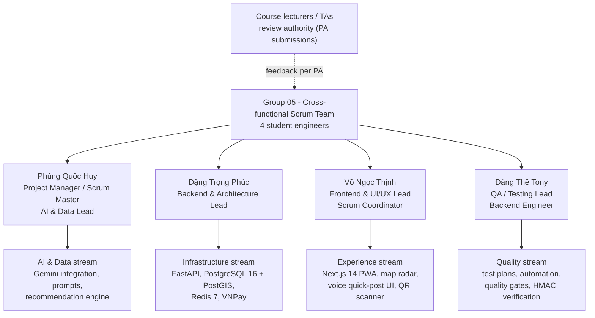

## 3.1 Organizational Structure
The organizational chart above reflects the cross-functional Scrum structure with domain-driven leadership. Every member is a full-stack engineer and therefore contributes across streams; the domain-lead roles exist to concentrate review authority and technical decision-making. The teaching assistants and lecturer act as the external review authority for each Project Assignment, providing feedback that feeds the change-control loop described in Section 4.3.1.

## 3.2 Roles and Responsibilities
| Person                        | Role                                                                                                                                                                                                                                                                                                                                                                                                                                                                                                                                              |
| ----------------------------- | -------------------------------------------------------------------------------------------------------------------------------------------------------------------------------------------------------------------------------------------------------------------------------------------------------------------------------------------------------------------------------------------------------------------------------------------------------------------------------------------------------------------------------------------------- |
| **Phùng Quốc Huy (24127402)**  | **AI & Data Lead / Project Manager (Scrum Master):** owns the data-processing pipeline design and the **Google Gemini 2.5 Flash SDK** integration. Builds the **Batch Quick-Post Multimodal Assistant** (native voice ingestion, base menu-catalog grounding, and the 2-tier allergen filtering per the 14 EU FIC standards). Develops the **3-Layer Hybrid Recommendation** engine and natural-language search. Coordinates sprint planning, burn-down tracking, and risk management. |
| **Đặng Trọng Phúc (24127495)** | **Backend & Architecture Lead / AI Engineer:** owns the modular layered **FastAPI (Python 3.11)** backend and the **PostgreSQL 16 + PostGIS** configuration (spatial queries ST_DWithin, ST_Distance). Designs the **anti-overselling lock** with **Redis 7** distributed locks and ACID transactions. Integrates the **VNPay** payment gateway (HMAC-SHA512 IPN webhook) and the automatic **Rule-Based Time-Shift Discounting Engine**.             |
| **Võ Ngọc Thịnh (24127246)**   | **Frontend & UI/UX Lead / Scrum Coordinator:** owns the **Progressive Web App (PWA)** client architecture built on **Next.js 14 (App Router)** and **Tailwind CSS** across the three modules: consumer, store partner, and admin. Builds the interactive radar map, the voice quick-post recording interface for stores, and the in-browser QR scanner (html5-qrcode). Facilitates stand-ups and weekly reviews. |
| **Đàng Thế Tony (24127561)**   | **QA / Testing Lead & Backend Engineer:** owns the quality-assurance plan, test plans, and test cases for critical business flows. Builds the automated test suites (unit & integration) for the **one-time QR code HMAC-SHA256** create/verify mechanism, anti-screenshot fraud, and allergen-filter invariance. Supports backend business logic for **Verified Reviews**, **Green Points**, and the CO2e emissions tracker. |

## 4. Management Process
> **Task Assignment **
> *Performed by*: Phùng Quốc Huy | *Reviewed by*: Đàng Thế Tony, Võ Ngọc Thịnh | *Edited by*: Đặng Trọng Phúc

## 4.1 Project Estimates
### 4.1.1 Cost Estimates
- **Actual financial budget:** **0 VND (zero financial budget)**.
- **Basis of estimates:** the project runs on an academic software model that maximizes free cloud resources and education programs:
  - *AI/GenAI infrastructure:* Google AI Studio Free Tier for Gemini 2.5 Flash (quota: 15 requests per minute and 1,000,000 tokens per minute).
  - *Payment infrastructure:* the free VNPay Gateway sandbox environment.
  - *Hosting and source control:* GitHub Education repository, GitHub Actions CI/CD, and Jira Software Cloud (free standard plan, up to 10 users).
  - *Test environment:* a local Docker Compose cluster on the members' workstations.

### 4.1.2 Effort and Schedule Estimates
- **Project size:** 10 weeks of development, organized into **5 iterations (sprints)**, each lasting exactly two weeks.
- **Total workload (velocity estimate):** approximately **85–100 story points** for the 10 core features (core features plus AI features). The team's average velocity is estimated at **18–20 story points per sprint**.
- **Re-estimation points and triggers:**
  - Re-estimation occurs regularly at each **Sprint Review / Sprint Planning** session (held Monday evenings).
  - Ad-hoc re-estimation is triggered when: (1) the requirement scope changes due to lecturer feedback; (2) a third-party API quota (VNPay, Google Gemini) is tightened or its authentication method changes; (3) the defect rate in one sprint exceeds 20% of the total tasks.

## 4.2 Project Plan
### 4.2.1 Phase Plan (Sprint-Based)
Per the PA2-2026 instructions, the project applies the **Scrum process**; RUP phase terminology from the template (Inception, Elaboration, Construction, Transition) is disregarded. The project is organized into **5 sprints, each corresponding to one Project Assignment (PA1–PA5) and lasting two weeks**. The timeline below is maintained in Jira as the single source of truth for sprint tasks, and each sprint closes with a PA submission milestone.

**Work Breakdown Structure (WBS), high level:**

- **WBS 1 — Sprint 1 (PA1): Foundation & governance**
  - 1.1 Market survey, Vision Document, PRD & user stories.
  - 1.2 Jira workspace, GitHub repository, Git pre-commit hooks.
  - 1.3 Docker Compose configuration: PostgreSQL 16 + PostGIS 3.4 and Redis 7.
- **WBS 2 — Sprint 2 (PA2): Identity & menu**
  - 2.1 Authentication: JWT dual tokens & RBAC (CONSUMER, STORE_PARTNER, ADMIN).
  - 2.2 KYC workflow: ATVSTP certificate submission and approval.
  - 2.3 Base menu catalog (`menu_items`) and active surplus dishes (`dishes`).
  - 2.4 Deterministic rule-based time-shift discounting engine.
- **WBS 3 — Sprint 3 (PA3): Spatial discovery & stock safety**
  - 3.1 Interactive Leaflet radar map integration.
  - 3.2 PostGIS spatial queries (ST_DWithin, ST_Distance) with a GIST index.
  - 3.3 Database-level atomic inventory locking against over-selling.
- **WBS 4 — Sprint 4 (PA4): Cashless payment & pickup verification**
  - 4.1 VNPay gateway integration (dynamic VNPAY-QR, HMAC-SHA512).
  - 4.2 Idempotent IPN webhook coordination (duplicate suppression).
  - 4.3 Dynamic QR-code HMAC-SHA256 signing (anti-replay attack).
  - 4.4 In-browser camera scanner at the checkout counter (html5-qrcode).
- **WBS 5 — Sprint 5 (PA5): AI intelligence & completion**
  - 5.1 AI multimodal quick-post via Vietnamese voice and the 2-tier allergen guard (EU FIC).
  - 5.2 3-layer smart meal recommendation (SQL hard filter + heuristics + Gemini).
  - 5.3 Verified reviews and the CO2e tracker (Green Points).
  - 5.4 User acceptance testing (UAT), packaging, and handover.

**Major milestones with achievement criteria:**

| Milestone                      | Target Date | Achievement Criteria                                                                        |
| ------------------------------ | ----------- | --------------------------------------------------------------------------------------------- |
| PA1 — Foundation & governance  | 17/10/2026 | Documentation set (00–07) complete; Docker PostGIS + Redis stack runs; Jira sprint board ready. |
| PA2 — Identity & menu          | 31/10/2026 | JWT + RBAC working; KYC approval flow working; 70% last-hour discount rule verified by tests.  |
| PA3 — Radar & stock safety     | 14/11/2026 | Radar query ≤ 100 ms within 1–5 km; concurrency test suite demonstrates zero over-selling.     |
| PA4 — Payment & QR pickup      | 28/11/2026 | IPN verified with HMAC-SHA512; QR pickup verified in < 2 s; 100% replay attempts blocked.       |
| PA5 — AI & go-live             | 12/12/2026 | Voice posting < 3 s; allergen hard filter blocks 100%; coverage ≥ 80%; release demo ready.     |

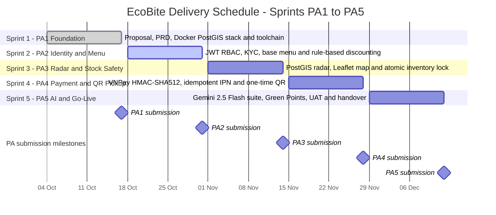

Important demos and release points are defined in Section 4.2.3; the sprint goal and exit criteria per iteration are detailed in Section 4.2.2.

### 4.2.2 Iteration Objectives
| Iteration                    | Sprint Goal                                | Objectives                                                                                                       | Core Exit Criteria                                                                                                                    |
| ---------------------------- | ------------------------------------------ | ------------------------------------------------------------------------------------------------------------------ | --------------------------------------------------------------------------------------------------------------------------------------- |
| **Sprint 1 (PA1)**<br>(04/10 – 17/10/2026) | Foundation & governance | Freeze business requirements; approve the Vision Document and PRD; establish the toolchain and database containers. | • Documentation set 00–07 completed in `docs/`.<br>• Docker Compose (PostGIS + Redis) runs successfully.<br>• Jira sprint board ready. |
| **Sprint 2 (PA2)**<br>(18/10 – 31/10/2026) | Identity & menu | Build the identity security framework, the ATVSTP moderation workflow, the base menu catalog, and the last-hour pricing rules. | • JWT dual-token login & RBAC working.<br>• Admin approves KYC successfully.<br>• 70% last-hour discount formula verified.       |
| **Sprint 3 (PA3)**<br>(01/11 – 14/11/2026) | Radar & stock safety | Deliver PostGIS geospatial capability and control concurrent inventory disputes.                                  | • Radar query ≤ 100 ms for 1–5 km radius.<br>• Concurrency testing achieves 100% zero over-selling.                                  |
| **Sprint 4 (PA4)**<br>(15/11 – 28/11/2026) | Payment & pickup | Close the VNPay payment loop and the safe in-store dish handover.                                                   | • IPN webhook verifies HMAC-SHA512 signatures.<br>• QR pickup verified in < 2 s; 100% of reused codes rejected.                 |
| **Sprint 5 (PA5)**<br>(29/11 – 12/12/2026) | AI & go-live | Deliver the Gemini 2.5 Flash experience, the Green Points system, packaging, and full acceptance.                   | • Voice posting < 3 s.<br>• Allergen filter eliminates 100% of health risks.<br>• Test coverage ≥ 80%; demo-ready go-live.         |

### 4.2.3 Releases
- **Release 0.1 (Architecture spike / milestone PA1):** a base-architecture verification release; provides the seed database, Alembic migration scripts, and specification documents.
- **Release 0.2 (Internal alpha / milestone PA3):** an internal release used to test the PostGIS radar discovery feature and the atomic inventory lock; includes concurrent load testing.
- **Release 0.3 (Staging beta / milestone PA4):** a trial release integrating the VNPay sandbox and the in-browser QR scanner; internal users trial the full order-and-pickup flow.
- **Release 1.0 (Production release / milestone PA5):** the complete release integrating the full AI intelligence suite (Gemini 2.5 Flash), the CO2e measurement tooling, and the optimized PWA, ready for final acceptance.

### 4.2.4 Project Schedule
The overall schedule is shown in the Gantt chart in Section 4.2.1. The authoritative schedule source is the Jira board: each PA maps to one sprint containing concrete tasks assigned to a single owner and reviewed by at least one peer (see Part D for the PA2 sprint evidence). The submission dates are fixed by the course calendar: PA1 — 17/10/2026, PA2 — 31/10/2026, PA3 — 14/11/2026, PA4 — 28/11/2026, PA5 — 12/12/2026.

### 4.2.5 Project Resourcing
**Staff allocation and responsibility matrix (RACI by area):**

- **Phùng Quốc Huy (24127402)** — *AI & Data Lead / Project Manager:* responsible for the data-pipeline architecture, the Gemini 2.5 Flash API integration (structured outputs), and overall coordination of the project schedule.
- **Đặng Trọng Phúc (24127495)** — *Backend Lead / Full-Stack Engineer:* responsible for the FastAPI architecture, the PostgreSQL/PostGIS database, Redis locks, and the VNPay IPN integration.
- **Đàng Thế Tony (24127561)** — *QA/Testing Lead / Backend Engineer:* responsible for the test plan, unit/integration test automation, quality-gate control, and HMAC signature security testing.
- **Võ Ngọc Thịnh (24127246)** — *Frontend Lead / Full-Stack Engineer:* responsible for the Next.js 14 App Router interface, PWA optimization, the Leaflet radar map, and the in-browser QR scanner (html5-qrcode).

**Team training schedule:**

| Training Topic                                                        | Complete By | Trainer                          |
| ---------------------------------------------------------------------- | ----------- | -------------------------------- |
| Asynchronous FastAPI & SQLAlchemy 2.0 (asyncpg)                         | Week 2      | Đặng Trọng Phúc                  |
| PostGIS spatial programming (ST_DWithin) & Leaflet                      | Week 4      | Võ Ngọc Thịnh & Đặng Trọng Phúc |
| GenAI structured outputs with the google-genai SDK                      | Week 7      | Phùng Quốc Huy                   |
| Automated testing conventions: pytest-asyncio & Playwright              | Week 3      | Đàng Thế Tony                    |

## 4.3 Project Monitoring and Control
### 4.3.1 Requirements Management
- The platform requirements are centrally managed in the **Vision Document** (Part B) and the **PRD**; requirements changes flow through the configuration-management process below.
- **Change Request (CR) workflow:**
  1. *Proposal:* any member who identifies a technical shortcoming, or receives new lecturer feedback, creates a Change Request issue in Jira.
  2. *Impact assessment:* the Product Owner and the relevant domain lead evaluate the impact on schedule capacity and architecture risk.
  3. *Approval:* the change is approved only with the consensus of at least 3 of the 4 members. Once approved, the PRD and the task backlog are updated in sync **before** any code is written.

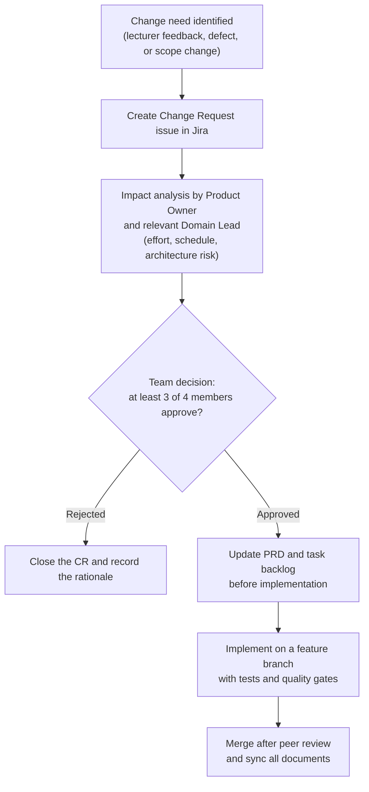

### 4.3.2 Reporting and Measurement
- **Regular progress reporting:**
  - *Asynchronous daily stand-up (Async Daily Scrum):* each morning the team posts three answers to the team chat: What was done yesterday? What will be done today? Are there any blockers?
  - *Sprint Review & Retrospective:* Monday evenings (20:30) on Google Meet, closing the burn-down chart and demoing features.
- **Minimal set of metrics (aligned with the RUP minimal metrics set):**
  - **Sprint velocity (earned value):** total story points completed against the Definition of Done.
  - **Defect trend:** the ratio of newly opened bugs to resolved bugs; the blocker/critical count must be zero before every submission day.
  - **Test coverage & pass rate:** measured with pytest-cov; a 100% test pass rate and ≥ 80% code coverage are maintained.

### 4.3.3 Risk Management
Risks were identified during Sprint 1 planning, are evaluated at least once per iteration, and are ordered by magnitude. The current register:

| Rank          | Risk Description and Impact                                                                                                                                                                                                 | Mitigation Strategy and/or Contingency Plan                                                                                                                                                                                   |
| ------------- | --------------------------------------------------------------------------------------------------------------------------------------------------------------------------------------------------------------------------- | -------------------------------------------------------------------------------------------------------------------------------------------------------------------------------------------------------------------------------- |
| **R1 (High)**   | **Exhaustion of the Google Gemini 2.5 Flash free-tier quota (15 RPM).** *Impact:* when all stores post surplus batches at end of shift simultaneously, the API returns HTTP 429 Too Many Requests, disrupting store operations. | **Mitigation:** design a buffered request queue and apply **graceful degradation/fallback** — if the AI service fails, users automatically switch to the traditional manual entry form fed by the base menu catalog.                        |
| **R2 (High)**   | **Inventory race conditions on surplus dishes (over-selling).** *Impact:* several customers tap to buy the final portion at the same time, selling beyond actual stock, causing failed handovers and reputational damage.        | **Mitigation:** mandatory database-level atomic conditional update (`UPDATE dishes SET remaining_quantity = remaining_quantity - :qty WHERE remaining_quantity >= :qty`) combined with a Redis distributed lock.                                   |
| **R3 (High)**   | **Life-threatening food-allergen vulnerability.** *Impact:* a wrong AI inference or an undeclared ingredient by the store exposes diners to anaphylaxis from rescued food.                      | **Mitigation:** establish the **Allergen Hard Invariant** — the allergen exclusion filter (`excluded_allergens`) must run as a hard SQL query-layer filter; medical safety is never delegated to probabilistic AI.                                  |
| **R4 (Medium)** | **QR pickup replay attack.** *Impact:* a customer screenshots the pickup QR and shares it, letting someone claim the order a second time (double-claiming fraud).                                       | **Mitigation:** dynamic QR codes signed with HMAC-SHA256 with a random nonce and a pickup deadline; the system checks the `is_used` flag and tracks nonces in Redis (TTL 24 h) to reject the second scan instantly.                                   |
| **R5 (Medium)** | **VNPay IPN webhook incidents and financial mismatches.** *Impact:* network glitches cause duplicate webhook deliveries or transactions stuck in the PENDING state.                                     | **Mitigation:** strict HMAC-SHA512 signature verification; **idempotent webhook** processing; a background task automatically releases reserved inventory 10 minutes after payment if the order is abandoned before pickup.                           |
| **R6 (Low)**    | **Schedule conflicts and personal deadline slippage.** *Impact:* exam overlap or force-majeure events slow one member and the shared sprint.                                                                  | **Mitigation:** enforce the **internal deadline policy** (work completed 24 hours before the official deadline); assign work with pair-programming so a second member can always take over a task.                                                    |

**Risk matrix (current position of each risk):**

| Impact \ Likelihood    | Low  | Medium | High |
| ---------------------- | ---- | ------ | ---- |
| **High impact**        | R3   | R2     | R1   |
| **Medium impact**      | —    | R4, R5 | —    |
| **Low impact**         | —    | R6     | —    |

### 4.3.4 Configuration Management
- **Version control:**
  - The team uses a GitHub repository with a **trimmed GitFlow branching strategy**: `main` (stable, submission-ready code only), `develop` (sprint feature integration), plus `feature/<feature-name>` and `fix/<bug-name>` branches.
  - Mandatory rule: every pull request requires **at least 1 approval** from a domain lead and must pass the full automated lint/test suite before merging.
- **Version naming (semantic versioning):** the `vMAJOR.MINOR.PATCH` standard applies (for example, `v1.0.0` for the final release, `v0.2.1` for in-sprint feature releases).
- **Secrets management:**
  - `.env` files, private keys, and API keys must never be committed to Git.
  - All environment variables are loaded dynamically via `pydantic-settings` on the backend and `process.env` on the frontend, with `.env.example` as the configuration template.
- **Backup and disaster recovery:**
  - The PostgreSQL development database is backed up via `pg_dump` after each sprint close.
  - Source code and design documents are mirrored in GitHub Cloud and on the members' local workstations.

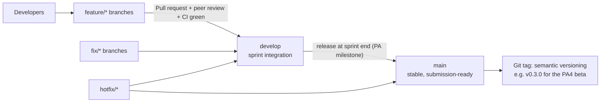

### 4.3.5 Project Close-out
At the completion of the final acceptance milestone (PA5):

1. **Deliverable inventory:** reconcile all deliverables listed in Section 2.3 to confirm no source code, user documentation, or demo video is missing.
2. **Post-mortem (retrospective meeting):** review successes and lessons learned regarding teamwork, tooling, and code quality.
3. **Archiving:** create the official release tag (`v1.0.0`) on GitHub, freeze the Jira boards, and package all reports as PDF/DOCX for the course portal.
4. **Member contribution assessment:** complete the internal cross-evaluation (peer review) based on the RACI assignment and actual story-point completion.

# B — Vision Document

**Project:** EcoBite — Food Rescue & Zero-Waste Platform
**Document:** Vision Document (Small Project)
**Version:** 1.0

## Revision History
| Date       | Version | Description                                                         | Author        |
| ---------- | ------- | -------------------------------------------------------------------- | ------------- |
| 31/10/2026 | 1.0     | Initial Vision Document draft for PA2, refined from the PA1 proposal. | Võ Ngọc Thịnh |

## Table of Contents
- 1. Introduction — 1.1 References
- 2. Positioning — 2.1 Problem Statement, 2.2 Product Position Statement
- 3. Stakeholder and User Descriptions — 3.1 Stakeholder Summary, 3.2 User Summary, 3.3 User Environment, 3.4 Summary of Key Stakeholder or User Needs, 3.5 Alternatives and Competition
- 4. Product Overview — 4.1 Product Perspective, 4.2 Assumptions and Dependencies
- 5. Product Features
- 6. Non-Functional Requirements

## 1. Introduction
> **Task Assignment **
> *Performed by*: Phùng Quốc Huy | *Reviewed by*: Đàng Thế Tony, Võ Ngọc Thịnh | *Edited by*: Đặng Trọng Phúc

The purpose of this Vision Document is to collect, analyze, and define the high-level needs, core features, and strategic vision of the EcoBite ecosystem — an intelligent food-rescue platform operating an online-to-offline (O2O) model. The document focuses on the capabilities expected by the stakeholders and target users, and explains why these needs exist in the context of today's urban food market. The specific details of user interaction flows, business data, and supplementary constraints are elaborated in the Use-Case Specifications, the Product Requirements Document (PRD), and the Software Architecture Document (SAD).

This document is the guiding reference for the entire project lifecycle. As an initial PA2 draft, it will be revised in PA3-2026 based on teaching-assistant feedback.

## 1.1 References
- EcoBite Project Proposal (Section B) — Group 05, CS300 Introduction to Software Engineering, Faculty of Information Technology, HCMUS, 10/2026.
- Product Requirements Document (PRD) & User Stories v2.2.0 — specification of the 10 user stories and acceptance criteria; repository path `docs/01_PRD_and_User_Stories.md`.
- System Architecture Document (SAD) v2.2.0 — decoupled three-tier architecture, VNPay HMAC-SHA512 payment flow, and Gemini 2.5 Flash AI integration; `docs/02_System_Architecture.md`.
- Database Schema & ERD v2.1.0 — PostgreSQL 16 relational entities, PostGIS spatial functions, and GIST indexing; `docs/03_Database_Schema_ERD.md`.
- RESTful API Specification v2.0 — `/api/v1` endpoint conventions, HTTP response codes, and JSON schemas; `docs/04_API_Specification.md`.
- Agile Roadmap & Kanban v1.0 — sprint plan PA1–PA5 and task board conventions; `docs/05_Agile_Roadmap_and_Kanban.md`.
- Rational Unified Process (RUP) Best Practices — guidance for constructing the Vision Document and iterative development, IBM Rational Software.
- Law on Food Safety No. 55/2010/QH12 — National Assembly of the Socialist Republic of Vietnam, 17/06/2010.
- European Regulation EU FIC No 1169/2011 — food information provision to consumers and the mandatory classification of 14 allergens.

## 2. Positioning
> **Task Assignment **
> *Performed by*: Võ Ngọc Thịnh | *Reviewed by*: Phùng Quốc Huy, Đặng Trọng Phúc | *Edited by*: Đàng Thế Tony
## 2.1 Problem Statement

| Component                      | Statement                                                                                                                                                                                                                                                                                                                                                                                                                                                                                                                                                                                                                          |
| ------------------------------- | --------------------------------------------------------------------------------------------------------------------------------------------------------------------------------------------------------------------------------------------------------------------------------------------------------------------------------------------------------------------------------------------------------------------------------------------------------------------------------------------------------------------------------------------------------------------- |
| The problem of                  | Large volumes of safe, edible food being wasted at the end of every selling shift by urban restaurants, food stores, eateries, and supermarkets — compounded by a slow, manual clearance-posting process, opaque product information (a "mystery bag" model that does not fit Vietnamese culinary culture), and hidden food-allergen risks for consumers.                                                                                                                                                                                                                                  |
| affects                         | **Store partners (merchants):** bakeries, cafés, restaurants, local eateries, and supermarkets.<br>**Urban consumers (food rescuers):** students, pupils, office workers, budget-conscious workers, environmentally minded citizens, and anyone seeking affordable quality food late in the day.<br>**The environment and urban community:** the municipal waste system, which is pressured by organic waste decomposing into greenhouse gases (methane, CH4, and carbon dioxide, CO2).                                                                                                          |
| the impact of which is          | **For stores:** direct financial loss — input material costs are written off entirely and waste-disposal fees pile on top; end-of-shift kitchen staff are too busy to spend 3–5 minutes per dish posting listings manually on social media, so the default is simply throwing the food away.<br>**For consumers:** they miss access to quality food at 40%–70% discounts, hesitate to buy "mystery bags" because the actual dishes are unknown (fear of taste mismatch), and risk life-threatening allergic reactions to hidden ingredients (peanuts, seafood, eggs, fish sauce, and similar) that they cannot see beforehand.<br>**For the environment:** greenhouse-gas emissions equivalent to tonnes of CO2e accumulate every day from landfilled surplus food. |
| a successful solution would be  | A progressive web platform (**EcoBite**) directly connecting stores and buyers in an online-to-offline (O2O) model built on four pillars:<br>• **Dish-level transparency:** replace mystery bags entirely with exact dish lists including real photos, standardized ingredient metadata, and explicit allergen warnings.<br>• **AI multimodal quick-post in under 3 seconds:** Google Gemini 2.5 Flash understands natural Vietnamese voice notes, letting kitchen staff post an entire batch by speaking, automatically grounding the base menu catalog and inferring a 2-tier allergen profile (14 EU FIC standards plus Vietnamese culinary knowledge).<br>• **Automatic time-based discounting and nearby discovery:** a deterministic real-time pricing engine (40%–50% during the standard window, automatically deepening to 60%–70% in the last 30–45 minutes before closing) combined with a 1–5 km **PostGIS** radar map and AI-personalized recommendations.<br>• **Safe, fraud-resistant transactions:** cashless payment via **VNPay**, an atomic **Redis/ACID** inventory lock against over-selling, and one-time **HMAC-SHA256** dynamic QR verification at the counter.   |

## 2.2 Product Position Statement
| Component           | Statement                                                                                                                                                                                                                                                                                                                                                                                                                                                |
| -------------------- | ---------------------------------------------------------------------------------------------------------------------------------------------------------------------------------------------------------------------------------------------------------------------------------------------------------------------------------------------------------------------------------------------------------------------------------------------------------- |
| For                  | Budget-conscious urban consumers in Vietnam (students, pupils, office workers) and local food-and-beverage establishments (restaurants, bakeries, cafés, supermarkets, food stores) holding a valid Food Hygiene and Safety Certificate (ATVSTP).                                                                                                                                                             |
| Who                  | Want to buy fresh, high-quality, fully specified end-of-day meals at deep discounts (40%–70%) without gambling on mystery bags or allergen risks — while helping stores recover capital from end-of-shift surplus and reducing environmental emissions.                                                                                                           |
| The (product name)   | **EcoBite** is a Progressive Web Application (PWA) for intelligent food rescue in an online-to-offline (O2O) model.                                                                                                                                                                                                                                                    |
| That                 | Provides a dish-level transparent pre-ordering experience for surplus food, automates batch posting through AI voice input, protects user health with strict ATVSTP moderation and a 2-tier medical allergen filter, and guarantees a fast, fraud-resistant payment-and-pickup process.                                                               |
| Unlike               | Foreign food-rescue applications such as **Too Good To Go** or **Yindii** — which rely on an anonymous "Surprise Bag / Mystery Bag" model with hidden dish categories, lack fast voice-input tooling for busy kitchens, lack allergen inference specialized for Vietnamese dishes, and lack deep integration with the domestic VNPay payment infrastructure. |
| Our product          | Pioneers the combination of **dish-level transparency** with the **Google Gemini 2.5 Flash** AI pair — enabling kitchen staff to post many dishes at once by voice in regional Vietnamese accents while automatically detecting allergens hidden in traditional recipes — alongside an **automatic time-window discount engine (40% to 70%)**, real-time **PostGIS** spatial discovery, **Redis ACID** inventory locking, and one-time **HMAC-SHA256** QR verification, all directly in the web browser with no heavy app installation. |

## 3. Stakeholder and User Descriptions
> *Performed by*: Võ Ngọc Thịnh | *Reviewed by*: Phùng Quốc Huy, Đặng Trọng Phúc | *Edited by*: Đàng Thế Tony
## 3.1 Stakeholder Summary

| Name                                                       | Description                                                                                                       | Responsibilities                                                                                                                                                                                                                                    |
| ----------------------------------------------------------- | ------------------------------------------------------------------------------------------------------------------- | ------------------------------------------------------------------------------------------------------------------------------------------------------------------------------------------------------------------------------------------------------ |
| Course lecturers and teaching assistants                     | The academic advisors and evaluation committee for the software engineering course.                                  | • Assess the quality of the Scrum process, specification documents (Project Plan, Vision, Spec Kit), and product completeness across the 5 sprints (PA1–PA5).<br>• Provide feedback, steer feature scope, and monitor team progress via Jira and Git. |
| Merchant business owners (F&B and supermarkets)              | Owners of restaurants, bakeries, cafés, and food chains that onboard their stores onto the EcoBite platform.          | • Provide business licenses and valid Food Hygiene and Safety (ATVSTP) certificates.<br>• Track revenue recovered from end-of-shift food, monitor cancellation rates, and use the CO2 savings data for sustainability (ESG) reporting.                  |
| Food safety regulators                                       | Authorities that issue and supervise food-hygiene standards and protect consumer rights.                             | Set the legal requirements that compel the platform to verify each store's ATVSTP permit before it can sell, and to disclose allergen information transparently (per the 14 EU FIC allergen groups).                                                     |
| Payment and AI infrastructure partners (VNPay & Google Cloud)| Third-party service providers integrated directly into EcoBite's core operations.                                    | • **VNPay:** provides the cashless payment gateway and transaction verification through the IPN webhook (HMAC-SHA512).<br>• **Google GenAI (Gemini 2.5 Flash):** provides the low-latency multimodal audio and natural-language API.                        |
| Group 05 development team                                    | The four software engineers who design, build, test, and operate the EcoBite platform.                               | Ensure the system meets architecture, security, and scalability standards and that all five builds (PA1–PA5) complete on schedule.                                                                                                                        |

## 3.2 User Summary
| Name                                             | Description                                                                                                                                                                          | Responsibilities                                                                                                                                                                                                                                                                                                                                                                                    | Stakeholder                                                        |
| ------------------------------------------------- | -------------------------------------------------------------------------------------------------------------------------------------------------------------------------------------- | ------------------------------------------------------------------------------------------------------------------------------------------------------------------------------------------------------------------------------------------------------------------------------------------------------------------------------------------------------------------------------------------------------ | --------------------------------------------------------------------- |
| Consumers / food rescuers                         | Students, pupils, office workers, and urban residents seeking quality, safe meals at 40%–70% savings who also want to reduce food waste.                                                  | • Set up a taste profile and a medical allergen exclusion list (`excluded_allergens`).<br>• Search surplus dishes by location (PostGIS 1–5 km radar) or by natural language.<br>• Reserve dishes, pay online via VNPay, arrive during the pickup window to present the QR code, and rate quality (1–5 stars) to earn Green Points.                                                | Represented directly by the consumer and student community.          |
| Store partners / kitchen staff                    | Store managers, chefs, or cashiers at bakeries, restaurants, eateries, and supermarkets who run the end-of-day surplus sales.                                                              | • Register the store account, upload the ATVSTP certificate, and set up the Base Menu Catalog.<br>• At each shift end, use the AI voice quick-post (or fast manual entry) to post surplus portions, pickup windows, and the automatic discount schedule.<br>• Scan customer QR codes at the counter using the web camera to verify and hand over orders.                                           | Merchant business owners (F&B and supermarkets).                        |
| System administrators                             | The EcoBite operations team responsible for quality control, food safety, and platform coordination.                                                                                      | • Verify and approve (or reject) business registrations and ATVSTP permits (KYC).<br>• Supervise posted dishes, handle complaints and transaction disputes, manage the Green Points reward system, and maintain the platform-wide environmental-impact dashboard.                                                                                                                            | Group 05 (operations) and the food-safety authorities.                 |

## 3.3 User Environment
- **Operational context and task cycle:**
  - **At the store (store partners):** the kitchen and checkout counter at the end of the lunch or dinner shift are busy and time-pressured — staff are simultaneously cleaning the kitchen, taking stock, and serving the last customers. Staff cannot sit at a computer filling long forms; therefore the whole posting cycle for the day's surplus must complete in seconds through voice recording on a phone, and counter QR scans must be near-instant.
  - **Consumer side:** users typically open the application while on the move, in class, or at the office right before lunch or dinner. They need quick lookups of nearby stores within a walking or short-ride radius (**1–5 km**, expandable to 10 km) together with live distance, a discount countdown timer, and real-time stock status.
- **Device platforms and operating systems:**
  - The system ships as a **Progressive Web Application (PWA)** built with **Next.js 14 (App Router)** and **Tailwind CSS**, running directly in the browser with no app-store download required.
  - It is fully optimized for mobile browsers (**Apple Safari on iOS**, **Google Chrome on Android**) for buyers and counter staff, and supports large-screen desktops (**Windows, macOS, Linux**) for store owners and administrators.
- **Hardware and integrations:**
  - **Device GPS** integration powers the PostGIS spatial discovery.
  - The **browser microphone** records the voice quick-post audio sent to Gemini 2.5 Flash.
  - The **device camera**, accessed through the html5-qrcode library in the browser, lets the store scan the customer's pickup code.
  - Smooth hand-off links to **mobile banking applications and the VNPay e-wallet** for cashless QR payment.

## 3.4 Summary of Key Stakeholder or User Needs
| Need                                                        | Priority        | Concerns                                                                                                                                                              | Current Solution                                                                                                                                        | Proposed Solutions                                                                                                                                                                                                                                                                                             |
| ------------------------------------------------------------- | ----------------- | ------------------------------------------------------------------------------------------------------------------------------------------------------------------------ | ---------------------------------------------------------------------------------------------------------------------------------------------------------- | ----------------------------------------------------------------------------------------------------------------------------------------------------------------------------------------------------------------------------------------------------------------------------------------------------------------- |
| Dish-level information transparency and medical allergen warnings | High            | Vietnamese users distrust the "mystery bag" because they fear receiving dishes that clash with their taste or contain hidden, dangerous allergens (peanuts, eggs, fish sauce, seafood). | Applications such as Too Good To Go / Yindii sell only anonymous "Surprise Bags"; allergen warnings are superficial or require asking the store directly.   | Post **dish-level transparent listings** with real photos inherited from the base menu; apply the **2-Tier Allergen Guard** on Gemini 2.5 Flash to automatically infer hidden allergens in Vietnamese dishes and hard-block 100% of matching dishes at the SQL query layer.                                                               |
| Ultra-fast end-of-shift posting for kitchen staff                 | High            | At shift end, kitchen staff are too busy cleaning to spend roughly 3 minutes per dish taking photos, typing names, prices, and ingredients for each surplus item.                        | Manual posting on social networks (Facebook/Zalo groups) — or simply throwing food away because the workflow is too heavy.                                   | **Batch Quick-Post Multimodal Assistant:** staff speak one short voice note (for example, "5 broken-rice pork-chop plates and 3 grilled pork vermicelli left, on sale until 3 PM"); Gemini 2.5 Flash processes the audio directly, grounds the base menu, and publishes the whole batch in seconds.                                           |
| Sell-through optimization with transparent pricing                | High            | Stores want to recover maximum value early in the rescue window yet clear 100% of stock before closing; buyers want clarity on the discount schedule.                                     | A single flat discount for the entire day, or manual ad-hoc pricing that is inconsistent across stores.                                                       | **Rule-Based Time-Shift Discounting Engine:** a transparent automatic discount schedule by time window (40%–50% in the standard window, automatically deepening to 60%–70% during the last 30–45 minutes before closing) with a live countdown timer.                                                                                            |
| Anti-overselling and fraud-proof pickup                           | High            | When few deeply discounted (70%) portions remain, many buyers tapping simultaneously can easily trigger over-selling; customers may also screenshot the pickup code and share it to claim twice. | Manual order confirmation by messaging, or a simple on-screen swipe button that is easily faked with screenshots.                                               | Redis 7 distributed locking combined with SQL ACID (`WHERE remaining_quantity >= :qty`) absolutely prevents over-selling; issue a one-time **dynamic QR code** signed with HMAC-SHA256 (with a nonce and short expiry) scanned directly in the browser.                                                                                      |
| Location-based discovery and taste-matched suggestions            | Medium – High   | Hungry users do not want to scroll through hundreds of distant or ill-suited stores.                                                                                                      | Basic category filters or generic random suggestions.                                                                                                        | Real-radius search (1–5 km) powered by the **PostGIS** spatial index combined with the **3-layer AI recommendation system** (scored as distance 40% + discount depth/urgency 30% + taste profile 30%) and conversational natural-language search (for example, "find a hot soup under 30k nearby").                              |
| Verified food-safety assurance and green-impact measurement       | Medium          | Buyers fear that end-of-day discounted food might come from unlicensed, low-quality establishments; stores and users lack long-term motivation to stay engaged.                          | Trust based purely on store reputation or free-form reviews (including from people who never purchased).                                                       | **Mandatory KYC approval of the ATVSTP certificate** before any store may post; allow reviews only from orders verified by successful QR pickup; convert each kilogram of rescued food into approximately **2.5 kg CO2e avoided** and reward **Green Points** redeemable for vouchers.                                               |

## 3.5 Alternatives and Competition
- **Status quo: manual clearance through social networks or outright disposal**
  - *How it works today:* many Vietnamese bakeries and eateries post their end-of-day discounts on personal Facebook pages, resident Zalo groups, or hand them to staff; whatever remains is discarded.
  - *Strengths:* no platform commission; familiar direct communication.
  - *Weaknesses:* extremely time-consuming manual chat-based order closing; no automatic reservation mechanism, so customers frequently arrive to find the food already gone; narrow reach; no tooling for payment control or allergen safety.
- **Direct regional competitor: Yindii**
  - *Operating model:* a food-rescue application active in Thailand and Singapore and trialing in Vietnam, offering two flows: Yindii Pickup (collect surplus food at the store) and Yindii Drop (delivery of dry goods to the home).
  - *Strengths:* intuitive interface; pickup time-slot division (morning/afternoon/evening); supports both self-pickup and delivery; computes CO2 savings in the cart.
  - *Weaknesses:*
    - Uses a **"Surprise Bag / Surprise Box"** model (a secret bag labeled only with a general category and estimated value — the buyer never knows the exact dishes) — a major psychological deterrent for Vietnamese consumers who are used to choosing specific dishes (rice, pho, vermicelli).
    - The recommendation system is still category-based and random rather than deeply personalized by taste profile and distance urgency.
    - Allergen information is limited to a free-text note field in the cart; there is no AI mechanism that automatically detects and blocks allergens at the database layer.
- **International benchmark: Too Good To Go (TGTG)**
  - *Operating model:* the world's largest food-rescue platform across Europe and North America, connecting consumers with restaurants, bakeries, and supermarkets through **"Surprise Bags"** sold at roughly one-third of the original price.
  - *Strengths:* the user journey from map/list discovery through reservation to pickup is very smooth; strong environmental brand identity with visual statistics of money saved and CO2 avoided.
  - *Weaknesses:*
    - Not localized for the Vietnamese market (no domestic VNPay / VNPAY-QR payment support and no Vietnamese dong handling).
    - Entirely reliant on the fixed-price **"Mystery / Surprise Bag"** model; there is no automatic progressive discounting toward closing time and no dish-level detail view.
    - Lacks an AI tool that lets busy kitchen staff post items by voice, and its on-screen pickup confirmation remains exposed to screenshot-sharing risks compared with a one-time HMAC-SHA256 dynamic QR code.

## 4. Product Overview
> *Performed by*: Đặng Trọng Phúc | *Reviewed by*: Võ Ngọc Thịnh, Đàng Thế Tony | *Edited by*: Phùng Quốc Huy
This section provides a high-level view of the product capabilities, the interfaces to other applications, and the system configurations of the **EcoBite** platform — the technology solution that connects food providers with consumers to minimize surplus-food waste.

## 4.1 Product Perspective

EcoBite is a self-contained web platform whose three application modules share one asynchronous service backend and one data layer; it integrates closely with a small set of external services to complete the end-to-end rescue loop between providers (restaurants, bakeries, supermarkets) and consumers. The system comprises:

1. **Consumer Web App (PWA):** for consumers to discover surplus dishes nearby, pre-order, pay through VNPay, pick up orders with a one-time QR code, and submit verified reviews.
2. **Store Partner Portal:** for partner stores to complete KYC verification, maintain the base menu catalog, post surplus batches (voice or manual), manage orders, and verify customer QR codes at the counter.
3. **Admin Web Dashboard:** for platform administrators to moderate store certifications (KYC), supervise transactions, manage disputes, and track the platform-wide green-impact metrics.

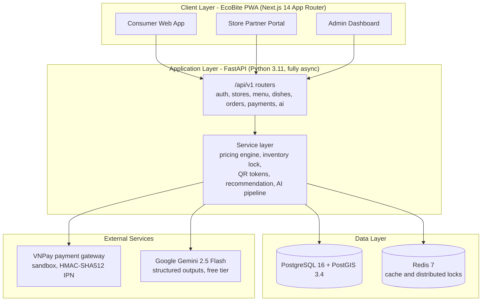

**Interfaces to external systems:**

### 4.1.1 Payment Gateway Interface
The platform integrates the national **VNPay** gateway over its API to process online payments (dynamic VNPAY-QR) and to receive signed **Instant Payment Notifications (IPN)** verified with HMAC-SHA512. Refunds are issued automatically when an order is cancelled before pickup. Payment status is only committed after a verified notification, and duplicate notifications are collapsed idempotently.

### 4.1.2 Geospatial and Mapping Interface
Discovery relies on the device/browser **GPS (Geolocation API)** to obtain the consumer's position and on **PostGIS** spatial queries (`ST_DWithin`, `ST_Distance`) over the PostgreSQL 16 database to compute the real radius search (1–5 km, expandable to 10 km). The consumer PWA renders results on an interactive **Leaflet** map with live store pins, distance labels, and routing hints.

### 4.1.3 Browser Media Interfaces
The PWA consumes two hardware interfaces directly in the browser with explicit user consent: the **camera**, through the html5-qrcode library, lets the store partner scan the customer's one-time pickup QR code at the counter; the **microphone** records the Vietnamese voice memo used by the AI quick-post feature.

### 4.1.4 Generative AI Service Interface
The backend calls **Google Gemini 2.5 Flash** through the google-genai SDK with Pydantic-schema structured outputs for three purposes: multimodal Vietnamese audio extraction for batch posting, the 2-tier allergen inference, and generative justifications for dish recommendations within the platform's free-tier quota (15 requests per minute, 1,000,000 tokens per minute). AI outputs never bypass the deterministic business rules: pricing, inventory, and allergen hard filters are enforced server-side.

### 4.1.5 Data Infrastructure Interfaces
PostgreSQL 16 with PostGIS stores all business entities and spatial data and is the single source of truth for orders, stock, and payments; access is exclusively asynchronous (async SQLAlchemy with `asyncpg` in production and `aiosqlite` in development/tests). Redis 7 provides short-lived caching and the distributed locking support for inventory reservation.

## 4.2 Assumptions and Dependencies
### Assumptions
1. **Partner devices and connectivity:** participating stores own smart devices (smartphone or computer) with a stable Internet connection to update surplus catalogs and confirm orders in time.
2. **User habits:** target consumers access the platform through a modern web browser (PWA — no installation needed), keep an active connection (4G/5G/Wi-Fi), and grant geolocation, camera, and microphone permission when using the relevant features.
3. **Food-safety responsibility:** the selling entity (restaurant or store) bears full responsibility for the quality, expiry, and hygiene of the products listed on EcoBite.
4. **Self-pickup process:** the operating model prioritizes buyers who collect orders in person during the designated window to keep logistics costs at zero.

### Dependencies
- **Third-party API availability:** stable operation depends on the uptime and quotas of the Google Gemini API, the VNPay gateway (sandbox in this phase), and Google OAuth 2.0 sign-in. When an external service is unavailable, the affected features degrade gracefully and the non-dependent features remain usable.
- **Geolocation capability:** nearby-store discovery depends on device location permission and coordinate data quality; a manual location entry is provided as a fallback.
- **Hosting infrastructure:** performance and availability depend on the server, network, database, and Redis resources, which must be monitored and load-tested periodically.
- **Legal compliance:** the system depends on continued compliance with Vietnamese regulations on food safety (Law 55/2010/QH12), e-commerce, and personal data protection (Decree 13/2023/ND-CP).

## 5. Product Features
> *Performed by*: Đặng Trọng Phúc | *Reviewed by*: Võ Ngọc Thịnh, Đàng Thế Tony | *Edited by*: Phùng Quốc Huy
This section describes the high-level core capabilities of the **EcoBite** platform. Each feature is an externally perceivable service that consumers, store partners, or administrators interact with directly to achieve the goals of cutting food waste and optimizing costs — the level of detail is deliberately kept general enough for every reviewer to understand while giving the team enough substance to build the use-case model.

### F-01 — Authentication and Merchant Onboarding (KYC and Food-Safety Verification)
Users authenticate with email/password or Google OAuth 2.0 under role-based access control (CONSUMER, STORE_PARTNER, ADMIN), using short-lived JWT access tokens paired with refresh tokens. Before a store may publish any dish, it must submit its official Food Hygiene and Safety certificate (ATVSTP) and verified business credentials for mandatory administrator approval. This feature establishes end-to-end community trust: all discounted surplus meals are guaranteed to originate from verified, certified, sanitary establishments. Consumers benefit from a safer supply, while administrators gain a concrete moderation lever and stores earn a trustworthy sales channel.

### F-02 — Base Menu Catalog and Surplus Dish Management
Merchants maintain a persistent Base Menu Catalog (`menu_items`) holding standard high-resolution imagery, original retail prices, and basic ingredient metadata for each dish they normally sell. At the end of each shift, they instantiate active Surplus Dishes (`dishes`) from the catalog, specifying remaining quantities, pickup windows, and clearance discount tiers. This removes the daily overhead of recreating listings from scratch and guarantees that surplus items always present authentic photos and verified baseline prices. Stores save minutes per posting cycle, and consumers see consistent, trustworthy product presentations — the catalog also provides the grounding data that the AI quick-post feature aligns against.

### F-03 — Rule-Based Time-Shift Discounting Engine
The engine enforces deterministic price-decay schedules over time, deliberately avoiding volatile, black-box AI pricing. Dishes transition automatically through predefined tiers: a standard rescue window at 40%–50% off and a final rush clearance at up to 70% off during the last 30–45 minutes, accompanied by live countdown timers. Transparent, predictable pricing builds consumer trust while creating urgency that helps stores clear 100% of perishable stock before kitchen closure. Buyers benefit from legible deal timing, and merchants convert what would have been waste into recovered revenue.

### F-04 — Location-Based Search and PostGIS Radar Discovery
The platform leverages PostgreSQL PostGIS spatial indexes (`ST_DWithin`, `ST_Distance`) to compute real-time distances between consumers and nearby stores within a 1–5 km radius (expandable to 10 km). An interactive radar map presents live store pins with cuisine filters (rice dishes, noodles, bakery, vegetarian), price sliders, and pickup-urgency indicators. This capability lets consumers discover surplus meals within walking distance in seconds, minimizing commute time and ensuring the rescued food stays hot and fresh. Stores benefit from concentrated visibility among nearby, high-intent buyers precisely when stock needs to move.

### F-05 — Inventory Anti-Overselling Lock and Order Management
Checkout concurrency is governed by strict database-level ACID controls: an atomic conditional update (`UPDATE dishes SET remaining_quantity = remaining_quantity - :qty WHERE remaining_quantity >= :qty`) backed by distributed Redis locks. Order state management additionally releases reserved stock when an order is abandoned before pickup. This guarantees zero over-selling, eliminating the race conditions that occur when multiple users attempt to buy the final discounted portion simultaneously. Merchants get reliable stock accounting and no failed handovers; consumers compete fairly for the last pieces.

### F-06 — Seamless Cashless Checkout (VNPay Payment Gateway)
The platform integrates the VNPay gateway supporting dynamic VNPAY-QR scanning from mobile banking applications, domestic ATM cards, and e-wallets. Payment confirmations arrive through HMAC-SHA512-verified Instant Payment Notification (IPN) webhooks processed with idempotent deduplication, and cancellations trigger automatic refunds. This provides a smooth, secure checkout experience familiar to tech-savvy urban users while protecting merchants against forged notifications and payment fraud. The VNPay sandbox environment supports the full test cycle during development.

### F-07 — Dynamic HMAC-SHA256 Single-Use QR Token and In-Store Web Scanner
For every paid order, the backend issues a dynamic QR code carrying a cryptographically signed single-use token derived from the order identifier, the user identity, a random nonce, and a short expiry window. The merchant scans the customer's QR code directly with the integrated in-browser camera scanner (html5-qrcode); real-time signature verification instantly marks the token as consumed. This closes the classic screenshot-sharing and double-claiming loopholes and defeats replay attacks without any additional hardware. Stores complete handovers in under 2 seconds, and consumers receive their orders with minimal friction.

### F-08 — Verified Reviews, Green Points, and Environmental Impact Tracker
Only users with verified in-store QR pickup transactions may submit 1–5-star ratings and reviews, eliminating fabricated feedback from people who never purchased. In parallel, the platform converts rescued meals into verified ecological metrics — approximately 2.5 kg of CO2e avoided per 1 kg of rescued food — and awards Green Points to user accounts, redeemable for reward vouchers and displayed on a public Green Leaderboard. This gamifies sustainable consumer habits and gives participating merchants verifiable ESG-style environmental reporting. The result is a credibility loop: trustworthy reviews attract buyers, and measurable impact motivates stores to keep participating.

### AI Feature F-09 — Batch Quick-Post Multimodal Assistant and 2-Tier Allergen Guard

This feature removes the critical operational bottleneck in which busy kitchen staff have no time to fill complex forms during end-of-shift closing. The merchant simply records one short voice memo — for example, "5 broken-rice pork-chop plates and 3 grilled pork vermicelli left, on sale until 3 PM" — and the platform publishes the entire batch. Four orchestrated steps make this possible:

1. **Native multimodal audio ingestion:** the raw audio streams directly to Gemini 2.5 Flash without an intermediate speech-to-text service, accurately handling Vietnamese regional accents, colloquialisms, and culinary phrasing.
2. **Menu-catalog grounding:** extracted dish names are aligned against the merchant's Base Menu Catalog in the prompt context to assign a `matched_menu_id`, automatically inheriting the verified dish imagery and original pricing and triggering the rule-based discount schedule.
3. **Two-tier allergen guard (14 EU FIC standards):** *explicit detection* captures allergens stated outright in the speech (for example, "contains crushed peanuts"), while *inferred culinary knowledge* derives hidden allergens from traditional Vietnamese recipes — for instance, broken rice with pork chop implies egg (in the steamed egg meatloaf) and fish (in fish sauce); grilled pork vermicelli implies peanuts and fish sauce; the Vietnamese baguette (banh mi) implies gluten. Culturally essential dietary notes (scallion-oil garnish, chili level, pickled vegetables, vegetarian suitability) are attached as structured attributes.
4. **Batch extraction and server-time grounding:** multiple surplus items (`List[SurplusDishItem]`) are extracted concurrently, and relative time expressions such as "until 3 PM" are resolved into absolute ISO 8601 timestamps using the server clock context. The whole exchange is constrained by a Pydantic structured-output schema (`QuickPostExtractionResponse`) so the parser can never accept malformed data.

The value is dramatic: listing time collapses from roughly 3 minutes per item to under 3 seconds for an entire batch, while standardized medical allergen warnings prevent life-threatening reactions. Busy kitchen staff gain a workflow they can actually complete at closing time, and safety-conscious consumers gain machine-checked transparency.

### AI Feature F-10 — Smart Food Recommendation and Natural-Language Semantic Search
The recommendation engine delivers personalized, context-aware surplus-meal discovery through a robust 3-layer hybrid architecture. **Layer 1 — hard safety invariant (SQL and PostGIS):** the candidate query is restricted to dishes within a 1–3 km radius and strictly and completely excludes every dish matching the user's declared medical allergens (`excluded_allergens` in user preferences); medical safety is enforced at the database query layer and is never delegated to probabilistic LLM text generation. **Layer 2 — multi-factor heuristic scoring:** candidates are ranked by the objective composite formula `Score = (0.40 × Proximity) + (0.30 × [Discount Depth + Time Urgency]) + (0.30 × Taste Profile Match)`, which deliberately prioritizes deals entering the final 30 minutes of 70% clearance so perishable food is saved before it expires. **Layer 3 — generative AI personalization:** the top three ranked candidates and the user's taste profile are passed to Gemini 2.5 Flash, which synthesizes a concise 20–30-word explanation rendered on the recommendation card (for example: "You often enjoy warm noodle soups at lunch — Pho Bac, 350 m away, has 2 bowls left at 67% off — only 18,000 VND until 13:30, verified peanut-free for your profile!"). A **conversational semantic search** completes the feature: consumers may ask in natural language ("find me a comforting warm soup under 30k nearby"), and Gemini extracts the intent, budget, and dietary constraints to construct the PostGIS query.

The value is measurable: conversion rates rise because suggestions fit both the stomach and the moment, search fatigue disappears for hungry users, and stores clear perishable stock before closing — all without ever compromising the health invariant.

### Key User Workflows
The two workflow diagrams below illustrate the most important user journeys of the application: the consumer rescue journey (discover → order → pay → pick up) and the merchant voice quick-post journey.

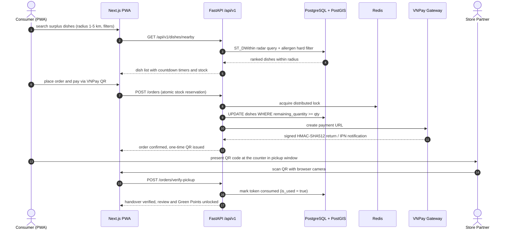

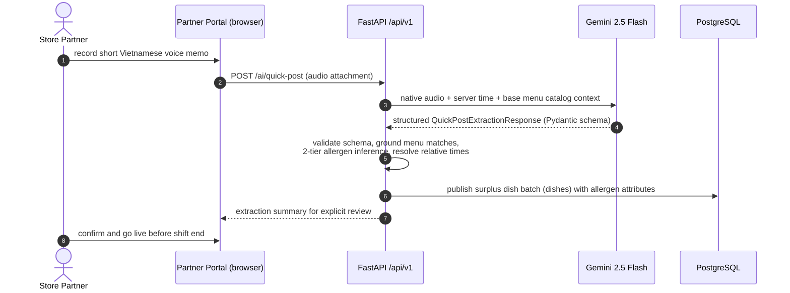

## 6. Non-Functional Requirements
> **Task Assignment **
> *Performed by*: Đàng Thế Tony | *Reviewed by*: Phùng Quốc Huy, Đặng Trọng Phúc | *Edited by*: Võ Ngọc Thịnh
The non-functional requirements define the quality standards, operating conditions, technical limits, and global constraints that apply to the entire EcoBite platform. They do not describe individual business functions; instead they ensure that all features presented in the Product Features section operate stably, securely, efficiently, and consistently.

The targets are grounded in EcoBite's technology architecture — Next.js 14, FastAPI (Python 3.11), PostgreSQL 16 with PostGIS, Redis 7, and Google Gemini 2.5 Flash. The quantitative values below are the design and test targets for the MVP release, not yet measured production results. Priority attributes (stability, benefit, effort, risk) are summarized in Section 6.7.

## 6.1 Standards, Hardware and Platform Requirements
### 6.1.1 Applicable Standards
- **NFR-STD-01 — Software quality standard:** the system targets the ISO/IEC 25010 quality model, focusing on performance efficiency, reliability, security, usability, maintainability, and compatibility.
- **NFR-STD-02 — Application security standard:** the backend and APIs must follow the OWASP Top 10 recommendations, applying access control, authentication, input validation, and defenses against common vulnerability classes.
- **NFR-STD-03 — Transport protection standard:** all connections between clients, the backend, and external services must use HTTPS with TLS 1.2 or higher; no authentication data or sensitive data may traverse unencrypted HTTP.
- **NFR-STD-04 — Interface standard:** the user interface targets WCAG 2.1 level AA, ensuring readable content, color contrast, keyboard navigation, and accessible forms.
- **NFR-STD-05 — Time and data standard:** transaction timestamps, discount schedules, pickup windows, and QR expiries must use ISO 8601; the system stores time in UTC and converts to the Vietnam time zone (UTC+7) for display.
- **NFR-STD-06 — Personal data protection standard:** collecting, processing, storing, and sharing personal data must comply with current Vietnamese regulations on personal data protection and information security.

### 6.1.2 Hardware Requirements
- **NFR-HW-01 — User devices:** users access EcoBite from smartphones, tablets, or personal computers with a modern web browser. Devices need at least 2 GB of RAM available to the browser and a stable Internet connection.
- **NFR-HW-02 — Devices supporting AI features:** stores using the voice quick-post feature need a working microphone; devices used for in-store QR scanning need a functioning camera or webcam accessible from the browser.
- **NFR-HW-03 — Geolocation:** nearby-store discovery requires GPS or browser location services. If the user denies location permission, the system must allow manual address entry or location selection.
- **NFR-HW-04 — MVP deployment server:** the backend and database environment should provide at least 4 vCPU, 8 GB RAM, and 50 GB SSD for the initial trial phase; the configuration must be adjusted according to load-testing results and data volume.

### 6.1.3 Platform Requirements
- **NFR-PLT-01 — Frontend:** the client must be built with Next.js 14 (App Router) and Tailwind CSS, deployed as a Progressive Web Application (PWA) with a responsive layout.
- **NFR-PLT-02 — Backend:** business APIs must be implemented with FastAPI on Python 3.11, applying asynchronous I/O where appropriate.
- **NFR-PLT-03 — Database and cache:** PostgreSQL 16 with PostGIS stores business data and serves geospatial queries; Redis 7 provides caching and distributed-lock coordination.
- **NFR-PLT-04 — Browser compatibility:** the system must work on current stable versions of Google Chrome, Microsoft Edge, Mozilla Firefox, and Apple Safari.
- **NFR-PLT-05 — Operating system compatibility:** users may access the system through browsers on Windows, macOS, Linux, Android, and iOS without installing separate software.

## 6.2 Performance Requirements
The performance requirements define processing-time limits and responsiveness under the target operating and test conditions. The values are kept consistent with the SMART objectives and iteration exit criteria in Part A to guarantee coherence between the plan and the product quality requirements.

- **NFR-PER-01 — API response time:** regular business APIs — excluding external processing by Google Gemini and VNPay — must respond in an average of at most 150 ms and a maximum of 500 ms under the defined load-test conditions. This applies to store information, dish details, catalog listings, and similar regular queries.
- **NFR-PER-02 — PostGIS radar search:** store and dish searches within a 5 km radius using PostgreSQL PostGIS must execute in at most 100 ms under target test conditions. The system must use appropriate spatial indexes; this limit applies to the database query time, not the total end-to-end API latency.
- **NFR-PER-03 — Order processing:** stock checks, order creation, and quantity updates must complete within the regular API response targets — at most 500 ms per request at the backend and database under the defined test conditions. Processing time inside the VNPay gateway is outside this limit.
- **NFR-PER-04 — AI processing:** for text-based assistance requests, the system must call Google Gemini 2.5 Flash and process results within a reasonable time given the external service conditions. AI response time is measured and tracked separately and is not subject to the 150 ms / 500 ms API limits.
- **NFR-PER-05 — Audio processing and batch posting:** the voice batch-posting flow must complete in under 3 seconds overall, and the audio extraction stage alone must finish in at most 2 seconds. The system must extract multiple dishes from one request, ground them against the base menu catalog, and convert relative time expressions into canonical timestamps. Targets apply provided the audio file and AI service are within the test limits.
- **NFR-PER-06 — Concurrency capacity:** the MVP must support at least 100 concurrent users with a failure rate below 1% in the standard load test, while maintaining the per-API response limits defined above.
- **NFR-PER-07 — Cache efficiency:** Redis 7 must serve cache retrievals at or under 100 ms at P95 for cacheable data such as catalogs and configuration. Inventory, order status, and payment results must always be confirmed against PostgreSQL to guarantee correctness and consistency.

## 6.3 Quality Requirements
### 6.3.1 Stability and Reliability
- **NFR-QUA-01:** the system must maintain a monthly availability of at least 99.5%, excluding scheduled maintenance announced in advance.
- **NFR-QUA-02:** core functions — sign-in, dish search, ordering, and order management — must operate stably throughout use, with no error that loses data of a confirmed transaction.
- **NFR-QUA-03:** errors from external services such as Gemini and VNPay must be handled with timeouts, bounded retries, and appropriate error messages; functions that do not depend on the failed service must keep working.

### 6.3.2 Robustness and Fault Tolerance
- **NFR-QUA-04:** when multiple users order the same dish concurrently, the total successful quantity must never exceed the actual stock; stock updates must be protected by a transaction and an atomic PostgreSQL update statement.
- **NFR-QUA-05:** repeated VNPay payment notifications must not create duplicate transactions; the system must apply idempotency so that one transaction is recorded successfully exactly once.
- **NFR-QUA-06:** if a business transaction fails midway, related data changes must be rolled back or compensated appropriately to preserve consistency.
- **NFR-QUA-07:** if Redis is interrupted, over-selling must not become possible; inventory operations must still rely on PostgreSQL's atomic control.

### 6.3.3 Security and Privacy
- **NFR-QUA-08:** 100% of APIs requiring authentication must verify a valid JWT and authorize against the three roles CONSUMER, STORE_PARTNER, and ADMIN.
- **NFR-QUA-09:** passwords must be hashed with bcrypt (pinned at `4.0.1` per the project constitution); plaintext passwords must never be stored or logged. Secrets for Gemini, VNPay, and other services must be managed exclusively through environment variables or a secrets manager.
- **NFR-QUA-10:** the system must protect personal and transaction data, allowing each user or authorized staff member to access only the data scope prescribed by their role.
- **NFR-QUA-11:** QR codes must validate the HMAC-SHA256 signature and carry a nonce and expiry; a successfully consumed code must never be accepted a second time.

### 6.3.4 Usability and Accessibility
- **NFR-QUA-12:** the interface must be responsive, working well on phone screens from 360 px and desktop screens from 1024 px upward.
- **NFR-QUA-13:** the interface and user-facing guides must be presented in Vietnamese first, using terminology that is easy for consumers and store partners to understand.
- **NFR-QUA-14:** at least 90% of usability-test participants must complete the basic tasks — searching dishes, viewing details, ordering — without direct assistance.
- **NFR-QUA-15:** original price, discount price, ingredients, allergen warnings, remaining quantity, and pickup window must all be displayed clearly without misleading consumers.

### 6.3.5 Maintainability and Testability
- **NFR-QUA-16:** source code must be organized into modules separating frontend, backend, AI processing, payments, and data management to support independent development.
- **NFR-QUA-17:** core business modules must have unit and integration tests with a target coverage of at least 80%.
- **NFR-QUA-18:** critical operations — store approval, price changes, stock updates, payments, and pickup confirmation — must be recorded in an audit log.

## 6.4 Environmental Requirements
- **NFR-ENV-01 — Network environment:** EcoBite requires an Internet connection for online features. When connectivity drops, the system must state the status clearly and must never confirm transactions that the server has not recorded.
- **NFR-ENV-02 — Geographic environment:** nearby-store discovery must support Vietnamese geographic coordinates, using PostGIS for distance computation and position-based result display.
- **NFR-ENV-03 — Time zone and operating hours:** discount rules, closing hours, and pickup windows must be computed in the Asia/Ho_Chi_Minh time zone (UTC+7), with authoritative time taken from the server rather than the client device clock.
- **NFR-ENV-04 — Device permissions:** voice recording requires microphone permission; QR scanning requires camera permission; nearby discovery requires location permission. When a permission is denied, the system must offer a suitable alternative path.
- **NFR-ENV-05 — Server environment:** the backend, database, and Redis must run on servers with stable networking, synchronized clocks, access control, and resource monitoring.

## 6.5 Design Constraints, External Constraints and Dependencies
### 6.5.1 Design Constraints
- **NFR-CON-01:** the frontend must use Next.js 14 with Tailwind CSS; the backend must use FastAPI on Python 3.11; the database must be PostgreSQL 16 with PostGIS; Redis 7 handles caching and distributed-lock support.
- **NFR-CON-02:** PostgreSQL is the source of truth for dish data, inventory, orders, and transactions. Redis must never replace PostgreSQL's transactional integrity.
- **NFR-CON-03:** discounting must follow deterministic, predefined rules (Rule-Based Time-Shift Discounting); AI must never decide selling prices.
- **NFR-CON-04 — AI control and the Allergen Hard Invariant:** AI may only assist with extraction, advice, and semantic search. Critical facts — dish codes, selling prices, stock quantities, and order states — must come exclusively from verified system data. In particular, the allergen exclusion mechanism must be enforced at the database layer by a SQL condition built from the user's declared `excluded_allergens`; dishes containing, or identified as likely to contain, an excluded allergen must be removed from all eligible recommendation and ordering result sets. AI may never override, bypass, or substitute this exclusion condition. Where ingredient or allergen data is incomplete, the system must flag it as unverified and must never assert absolute safety.
- **NFR-CON-05:** store approval and ATVSTP certification must be completed before a store is granted permission to post food for sale.

### 6.5.2 External Constraints and Dependencies
- **NFR-DEP-01 — Google Gemini 2.5 Flash:** AI features depend on the Gemini API, Internet connectivity, usage quotas, and provider policies. When the API is unavailable, the system must notify users and allow them to continue with the non-AI features.
- **NFR-DEP-02 — VNPay:** payment depends on the VNPay service, merchant integration details, the hash secret, and the ability to receive IPN notifications. Payment status may only be updated after a valid, verified notification.
- **NFR-DEP-03 — Google OAuth 2.0:** Google sign-in depends on Google's authentication system and a valid OAuth client configuration.
- **NFR-DEP-04 — Location and mapping services:** positioning and store discovery depend on device location permission, coordinate data, and any integrated map services.
- **NFR-DEP-05 — Deployment infrastructure:** performance and availability depend on server quality, network connectivity, database resources, and the Redis service; these components must be monitored and tested periodically.

## 6.6 Documentation Requirements
- **NFR-DOC-01 — Consumer guide:** a Vietnamese usage guide must exist covering registration, sign-in, dish search, allergen information, ordering, VNPay payment, QR pickup, and review submission.
- **NFR-DOC-02 — Store guide:** partner documentation must cover account registration, ATVSTP certificate submission, base menu management, surplus posting, quantity updates, discount scheduling, and order handling.
- **NFR-DOC-03 — Administrator guide:** documentation must describe store verification, certificate approval, content moderation, transaction supervision, complaint handling, and system activity tracking.
- **NFR-DOC-04 — Technical documentation:** the architecture document, database model, API documentation, environment configuration guide, environment-variable management, and deployment procedures for backend, frontend, PostgreSQL, and Redis must exist.
- **NFR-DOC-05 — Installation and deployment guide:** dependency installation, Docker configuration (where used), database initialization, migrations, Gemini API configuration, VNPay configuration, and service startup must be documented.
- **NFR-DOC-06 — Online help:** critical functions must offer on-screen guidance or explanatory notices. Common errors — payment failure, expired QR code, denied camera or location permission — must present clear messages and remediation steps.
- **NFR-DOC-07 — Labeling and display requirements:** every dish must clearly display its name, image, original price, clearance price, ingredients, allergen warnings, stock status, store address, and pickup window. Unverified information must be visibly marked as such and never presented as verified.
- **NFR-DOC-08 — Packaging and distribution:** because EcoBite is a web/PWA product, no physical packaging applies. Distribution occurs through web deployment with PWA installation support on compatible browsers and devices. Should a native app be released in the future, corresponding packaging and installation documentation must be added.
- **NFR-DOC-09 — Documentation maintenance:** documentation must be updated upon significant changes to the interface, API, architecture, business processes, or deployment configuration, and technical documentation must be versioned alongside the source code.

## 6.7 Priority of Non-Functional Requirements
To use development resources efficiently, the non-functional requirements are grouped into three priority levels:

- **P1 — Critical (mandatory):** requirements that directly affect security, data integrity, payments, and core business operations. The product must not be released without satisfying them.
- **P2 — High:** requirements that strongly affect performance, user experience, operations, and maintainability. They must be completed before the MVP release.
- **P3 — Medium:** supporting requirements that improve the experience and documentation polish. They may be phased in provided system safety and correctness are unaffected.

**Priority assessment table:**

| Requirement Code     | Content                                        | Priority | Stability  | Benefit   | Effort      | Risk      |
| --------------------- | ------------------------------------------------ | -------- | ---------- | --------- | ----------- | --------- |
| NFR-STD-01 to 06     | Quality, security, and data standards            | P1       | High       | High      | Medium      | High      |
| NFR-HW-01 to 04      | Hardware requirements                            | P2       | Medium     | Medium    | Low         | Low       |
| NFR-PLT-01 to 05     | Platform and compatibility                       | P1       | High       | High      | Medium      | High      |
| NFR-PER-01 to 07     | Performance and load handling                    | P2       | High       | High      | High        | High      |
| NFR-QUA-01 to 03     | Stability and reliability                        | P1       | Very high  | High      | High        | High      |
| NFR-QUA-04 to 07     | Robustness and fault tolerance                   | P1       | Very high  | Very high | High        | Very high |
| NFR-QUA-08 to 11     | Security and privacy                             | P1       | High       | Very high | High        | Very high |
| NFR-QUA-12 to 15     | Usability and accessibility                      | P2       | Medium     | High      | Medium      | Medium    |
| NFR-QUA-16 to 18     | Maintainability, testing, and supervision        | P2       | High       | High      | Medium      | Medium    |
| NFR-ENV-01 to 05     | Operating environment                            | P2       | High       | High      | Medium      | Medium    |
| NFR-CON-01 to 05     | Design constraints                               | P1       | Very high  | Very high | Medium      | High      |
| NFR-DEP-01 to 05     | External service dependencies                    | P1       | Medium     | High      | Medium      | High      |
| NFR-DOC-01 to 05     | User and technical documentation                 | P2       | Medium     | High      | Medium      | Medium    |
| NFR-DOC-06 to 09     | Online help, labeling, and packaging             | P3       | Medium     | Medium    | Low         | Low       |

**Assessment criteria (single consolidated list):**

- **Stability:** how much the requirement contributes to keeping the system stable, continuous, and consistent.
- **Benefit:** the value the requirement delivers to users, store partners, and the business.
- **Effort:** the technical resources, staffing, and time required to implement the requirement.
- **Risk:** the impact on the system should the requirement fail or not be met.
- **Rating scale:** Low, Medium, High, and Very high. The P1/P2/P3 priority is derived from the requirement's importance to the MVP, never from a single criterion alone.
- **Application rule:** P1 requirements are implemented and tested first because they directly concern data integrity, security, food safety, and the core operations of EcoBite.

# C — Spec Kit Initialization
> **Task Assignment **
> *Performed by*: Đàng Thế Tony | *Reviewed by*: Phùng Quốc Huy, Đặng Trọng Phúc | *Edited by*: Võ Ngọc Thịnh
This part documents that the EcoBite repository has Spec Kit integrated and initialized per the PA2-2026 requirements, with all artifacts placed inside the `/src` folder of the repository, together with the team's training evidence.

## C.1 Spec Kit Training

## C.1.1 Training Video
- **Training video:** "The ONLY guide you'll need for GitHub Spec Kit" — the official walkthrough covering Spec Kit installation, `/speckit.constitution`, `/speckit.specify`, `/speckit.clarify`, `/speckit.plan`, `/speckit.tasks`, and `/speckit.implement` with a live agent.
- **Video URL:** <https://www.youtube.com/watch?v=a9eR1xsfvHg>
- **Watched by:** Đàng Thế Tony (24127561), first as the team's pilot reviewer, then shared with the full team.

## C.1.2 Training Evidence — Đàng Thế Tony
The training evidence and screenshots captured during the walkthrough session on Microsoft Learn ("Get started with spec-driven development and GitHub Spec Kit") are embedded below:

[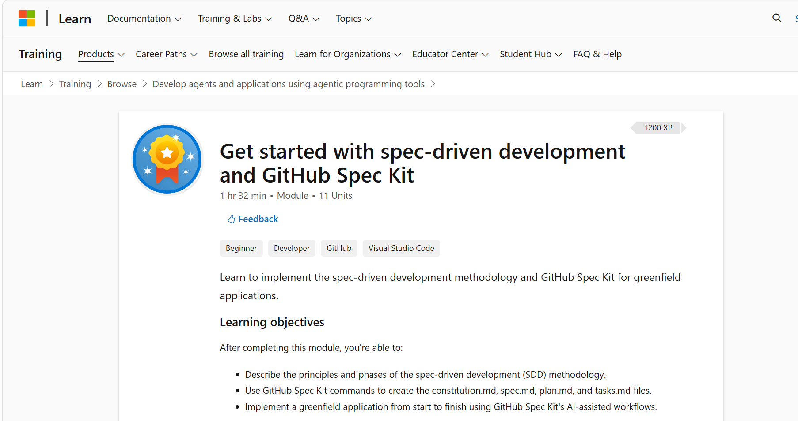](./figures/spec-kit-training/video-walkthrough.png)
*Figure C-1. Spec Kit training module overview — Get started with spec-driven development and GitHub Spec Kit ([Click to open full-size image](./figures/spec-kit-training/video-walkthrough.png)).*

[](./figures/spec-kit-training/video-demo.png)
*Figure C-2. Spec Kit training video walkthrough — Unit 6: What is GitHub Spec Kit? ([Click to open full-size image](./figures/spec-kit-training/video-demo.png)).*

[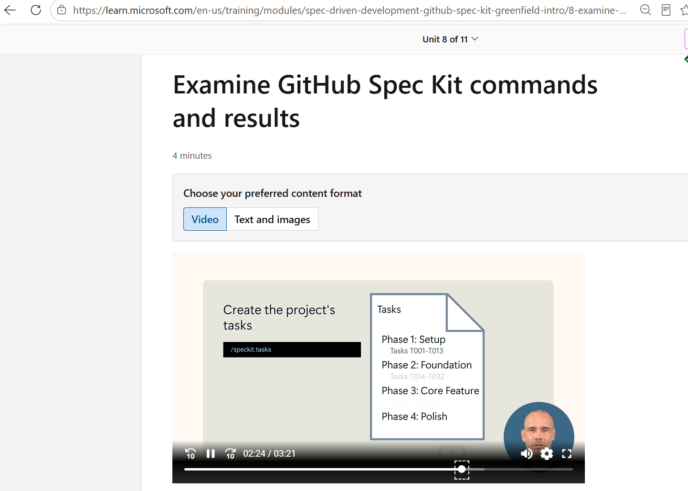](./figures/spec-kit-training/video-analysis.png)
*Figure C-3. Spec Kit training walkthrough — Unit 8: Examine GitHub Spec Kit commands and results ([Click to open full-size image](./figures/spec-kit-training/video-analysis.png)).*

**Key learnings recorded by Đàng Thế Tony:**

1. Spec Kit is a spec-driven development toolchain: the specification is the single source of truth, and generated code serves the specification.
2. The `/speckit.constitution` step fixes project-level engineering principles and quality gates before any feature is specified.
3. `/speckit.specify` turns a feature description into a testable specification with prioritized user stories and acceptance criteria.
4. `/speckit.plan` and `/speckit.tasks` convert the specification into a technical plan and dependency-ordered, independently verifiable tasks.
5. `/speckit.implement` executes the tasks against the plan while the review gates (`/speckit.analyze`, `/speckit.checklist`) keep artifacts consistent.

## C.1.3 Per-Member Training Log
Per the PA2-2026 requirement, each team member completes the Spec Kit training following the official tutorials. The log below records the status, key takeaways, and photographic certificate evidence for every member.

| Member | Student ID | Status | Key Takeaways & Competencies | Certificate / Evidence |
| :--- | :--- | :--- | :--- | :--- |
| **Phùng Quốc Huy** | 24127402 | Completed & Certified | Requirement Engineering, System Design, Task Decomposition, AI Agent Orchestration, Quality Gates. | [View Certificate (C.1.3.1)](#c131-training-evidence-learned-skills-phung-quoc-huy-24127402) · [Image File](./figures/spec-kit-training/huy.png) |
| **Võ Ngọc Thịnh** | 24127246 | Completed & Certified | Spec-Driven Development, GitHub Spec Kit CLI & Tools, AI-Assisted Development Workflow. | [View Certificate (C.1.3.2)](#c132-training-evidence-learned-skills-vo-ngoc-thinh-24127246) · [Image File](./figures/spec-kit-training/thinh.png) |
| **Đàng Thế Tony** | 24127561 | Completed & Certified | Spec Kit toolchain initialization, specify→plan→tasks→implement loop, Skills integration. | [View Certificate (C.1.3.3)](#c133-training-evidence-learned-skills-ang-the-tony-24127561) · [Image File](./figures/spec-kit-training/tony.png) |
| **Đặng Trọng Phúc** | 24127495 | Completed (Tutorial Watched) | Architectural enforcement via `/speckit.plan`, test-first invariant, async-only FastAPI pipeline. | [Training Record (C.1.3.4)](#c134-training-status-ang-trong-phuc-24127495) |

### C.1.3.1 Training Evidence & Learned Skills — Phùng Quốc Huy (24127402)
- **Student Name:** Phùng Quốc Huy
- **Student ID:** 24127402
- **Training Module:** Get started with spec-driven development and GitHub Spec Kit
- **Status:** Completed & Module Assessment Passed

[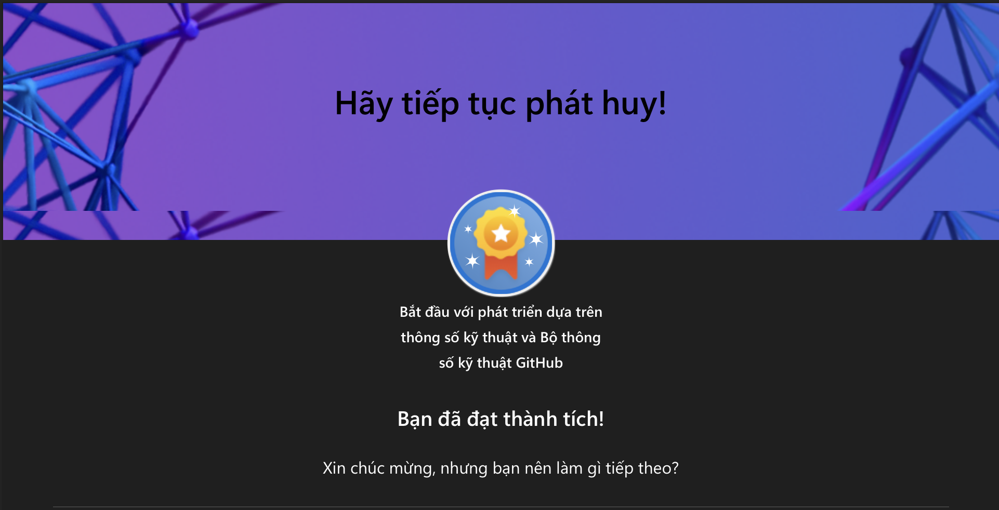](./figures/spec-kit-training/huy.png)
*Figure C-1.1. Spec Kit Training Achievement Badge & Certificate — Phùng Quốc Huy (24127402) ([Click to open full-size image](./figures/spec-kit-training/huy.png)).*

**Core Competencies & Key Learnings:**
1. **Requirement Engineering:** Converting high-level concepts and business ideas into rigorous Software Specifications, User Stories, and Acceptance Criteria.
2. **System Design:** Designing system architecture, establishing the technology stack (FastAPI, PostgreSQL/PostGIS, Next.js 14), defining modular boundaries, database schemas, and RESTful APIs.
3. **Task Decomposition:** Decomposing large, complex system components into small, manageable tasks with clear dependency tracking and implementation sequences.
4. **AI Agent Orchestration:** Coordinating and steering AI Coding Agents through structured, phase-by-phase execution cycles rather than naive single-prompt code generation.
5. **Code Quality & Verification:** Enforcing strict consistency between specifications, architecture, and code; validating test-first quality gates (`pytest`, `mypy`, `ruff`) and directing automated error remediation.
6. **Project Management:** Managing specifications, technical plans, and tasks directly within git repositories, seamlessly integrating Spec Kit workflows with GitHub and Jira.

---

### C.1.3.2 Training Evidence & Learned Skills — Võ Ngọc Thịnh (24127246)
- **Student Name:** Võ Ngọc Thịnh
- **Student ID:** 24127246
- **Training Module:** Get started with spec-driven development and GitHub Spec Kit
- **Status:** Completed & Module Assessment Passed

[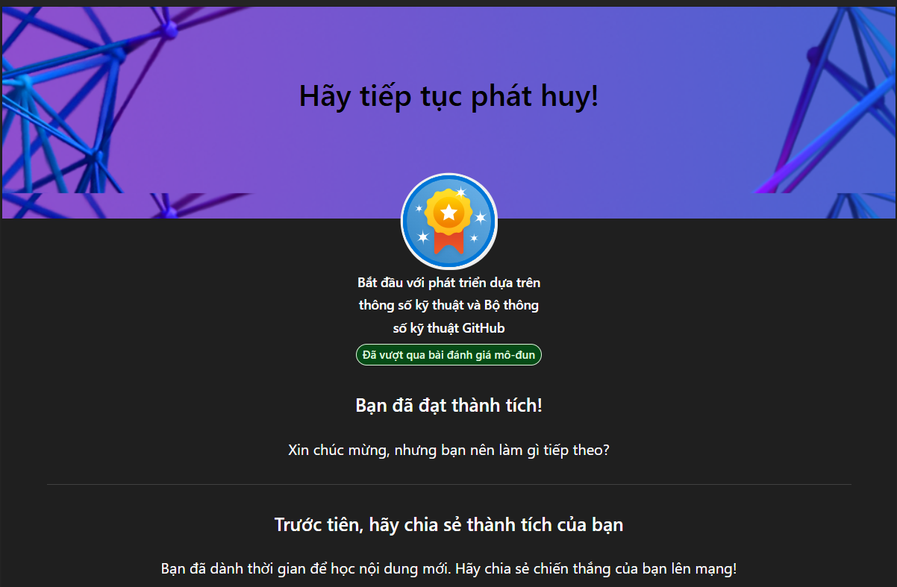](./figures/spec-kit-training/thinh.png)
*Figure C-1.2. Spec Kit Training Achievement Badge & Certificate — Võ Ngọc Thịnh (24127246) ([Click to open full-size image](./figures/spec-kit-training/thinh.png)).*

**Core Competencies & Key Learnings:**
1. **Spec-Driven Development:** Mastering the specification-driven software development lifecycle, ensuring that specifications govern code implementation.
2. **GitHub Spec Kit Tools:** Proficiently utilizing the Spec Kit CLI and commands to initialize project constitutions, feature specs, execution plans, and actionable task sets.
3. **AI-Assisted Workflow:** Collaborating effectively with AI coding assistants during sprint planning, architectural design, and milestone implementation.

---

### C.1.3.3 Training Evidence & Learned Skills — Đàng Thế Tony (24127561)
- **Student Name:** Đàng Thế Tony
- **Student ID:** 24127561
- **Training Module:** Get started with spec-driven development and GitHub Spec Kit
- **Status:** Completed & Module Assessment Passed (Team Pilot Reviewer)

[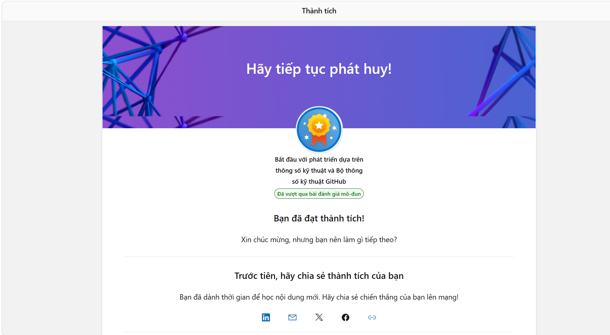](./figures/spec-kit-training/tony.png)
*Figure C-1.3. Spec Kit Training Achievement Badge & Certificate — Đàng Thế Tony (24127561) ([Click to open full-size image](./figures/spec-kit-training/tony.png)).*

**Core Competencies & Key Learnings:**
1. **Spec Kit Toolchain Integration:** Installed and verified the Spec Kit environment, CLI scripts, and Antigravity `.agents/skills/` integration across the repository.
2. **End-to-End Workflow Execution:** Executed the complete specification-to-implementation loop (`specify` → `clarify` → `plan` → `tasks` → `implement`) with live agent validation.
3. **Quality Consistency:** Demonstrated how `/speckit.analyze` and `/speckit.checklist` prevent drift between specifications and generated code.

---

### C.1.3.4 Training Status — Đặng Trọng Phúc (24127495)
- **Student Name:** Đặng Trọng Phúc
- **Student ID:** 24127495
- **Training Module:** Get started with spec-driven development and GitHub Spec Kit
- **Status:** Completed (Tutorial Watched & Team Alignment Verified)

**Core Competencies & Key Learnings:**
1. **Architectural Constraints in Feature Plans:** Applying `/speckit.plan` to guarantee that architectural rules (e.g., FastAPI async I/O, Pydantic v2 schemas, SQLAlchemy 2.0 type mapping) are maintained.
2. **Test-First Implementation:** Aligning tasks with test suite generation before coding to uphold the project's inviolable guardrails.

## C.2 Spec Kit Initialization Artifacts
Spec Kit was initialized in the EcoBite repository with the following configuration:

- **Spec Kit version:** 1.2.1
- **Integration:** Antigravity (`agy`) agent integration, with the Antigravity agent skills installed at `.agents/skills/` (10 `SKILL.md` command files covering specify, clarify, plan, tasks, implement, analyze, checklist, constitution, converge, taskstoissues).
- **Script runtime:** PowerShell (`ps`) — all automation scripts live under `src/.specify/scripts/powershell/`.
- **Artifact location:** per the PA2-2026 instruction, all Spec Kit artifacts are committed inside the `/src` folder of the repository, rooted at `src/.specify/`.

```text
src/
└── .specify/
    ├── .gitignore
    ├── init-options.json            # Initialization options (integration=agy, script=ps, version 1.2.1)
    ├── integration.json             # Installed-integration registry and settings
    ├── integrations/
    │   ├── agy.manifest.json        # Filehash manifest for the Antigravity skills
    │   └── speckit.manifest.json    # Filehash manifest for the Spec Kit templates and scripts
    ├── memory/
    │   ├── constitution.md          # EcoBite Constitution v1.1.0 — principles and quality gates
    │   └── .constitution-template.json  # Template-integrity lock (sha256)
    ├── scripts/
    │   └── powershell/              # create-new-feature, check-prerequisites,
    │                                # setup-plan, setup-tasks, resolve-template, common
    ├── templates/
    │   ├── constitution-template.md
    │   ├── spec-template.md         # Summary, user stories, acceptance criteria, FR/NFR structure
    │   ├── plan-template.md         # Architecture overview, technical context, structure
    │   ├── tasks-template.md        # Dependency-ordered, independently verifiable tasks
    │   └── checklist-template.md
    └── workflows/
        ├── workflow-registry.json
        └── speckit/
            └── workflow.yml         # Full SDD cycle: specify → plan → tasks → implement
```

Generated and maintained Markdown artifacts submitted with this assignment:

1. **`src/.specify/memory/constitution.md`** — the EcoBite Constitution (version 1.1.0): test-first development, fully asynchronous backend stack (FastAPI + async SQLAlchemy with `aiosqlite`/`asyncpg`), JWT (`python-jose`, HS256) and bcrypt (`4.0.1`) security standards, QR HMAC-SHA256 and VNPay HMAC-SHA512 integrity rules, the AI allergen hard invariant, and the code-quality gates (ruff, mypy, pytest, ESLint, tsc).
2. **`src/.specify/templates/*.md`** — the five process templates (constitution, spec, plan, tasks, checklist) used to generate feature documents.
3. **Workflow manifests** — `workflow-registry.json` and `workflow.yml` describing the "Full SDD Cycle" workflow with review gates.

**Figure C-4.** Repository tree showing `src/.specify/` initialization *(image to be attached: `figures/spec-kit-init/repo-tree.png`)*

**Figure C-5.** `src/.specify/memory/constitution.md` opened in the repository *(image to be attached: `figures/spec-kit-init/constitution.png`)*

## C.3 Application to EcoBite
The team applies the learned Spec Kit concepts to EcoBite as follows:

- **Constitution:** establishes project-specific engineering principles, development constraints, testing standards, and quality gates (adapted to EcoBite's safety-critical domain: allergens, payments, and inventory integrity).
- **Specify:** defines the requirements and expected behavior of each feature.
- **Plan:** describes the technical approach, architecture, and implementation decisions.
- **Tasks:** breaks implementation plans into manageable development tasks.
- **Implement:** executes the tasks according to the approved specification and plan.
- **Converge:** reviews and verifies the resulting artifacts and implementation against the intended requirements.

The four SDD phases map onto the team's Scrum practice as: `/speckit.specify` + `/speckit.clarify` run at backlog refinement, `/speckit.plan` + `/speckit.tasks` run at sprint planning, and `/speckit.implement` + converge/analyze run inside the sprint with the quality gates from the Constitution (Part A, Section 5.3).

# D — AI Usage Report and Weekly Report
> **Task Assignment **
> *Performed by*: Đặng Trọng Phúc | *Reviewed by*: Võ Ngọc Thịnh, Đàng Thế Tony | *Edited by*: Phùng Quốc Huy
## D.1 AI Usage Report (Sprint PA2)
Following the course AI usage guidelines, the team declares that **AI tools were used** during Sprint PA2. Each member who used AI tools submits the detailed usage log below. In every case, AI-suggested content was reviewed, corrected, and reconciled against the actual project requirements before being adopted; each member remains responsible for the accuracy and final content of their deliverables.

## D.1.1 AI Usage Report — Đàng Thế Tony
- **Reporting period:** 18/10/2026 – 31/10/2026
- **Student:** Đàng Thế Tony
- **Student ID:** 24127561
- **Jira issues:** SCRUM-17, SCRUM-18, SCRUM-19, SCRUM-20

**AI tools used:**

| AI Tool | Model | Purpose                                                                                        |
| ------- | ----- | ------------------------------------------------------------------------------------------------- |
| ChatGPT | GPT-6 | Requirements analysis assistance, content proposals, document review, and presentation improvements. |

**AI usage by Scrum issue:**

| Scrum Issue | AI-Assisted Work Content                                                                                                |
| ----------- | -------------------------------------------------------------------------------------------------------------------------- |
| SCRUM-17    | Analyzed and proposed the non-functional requirements (NFRs), focusing on quantifiability, performance, security, and system quality. |
| SCRUM-18    | Reviewed, consolidated, and standardized the structure and formatting of the Markdown documents.                              |
| SCRUM-19    | Consolidated AI usage information and drafted the AI usage report content.                                                     |
| SCRUM-20    | Researched, initialized, and reviewed the Spec Kit documentation, including the Constitution and related artifacts.              |

**Verification and member responsibility:**

All AI-proposed content was reviewed, corrected, and cross-checked against the actual project requirements by the member before use. The member is responsible for the accuracy, suitability, and final content adopted into the product.

## D.1.2 AI Usage Report — Đặng Trọng Phúc
- **Reporting period:** 18/10/2026 – 31/10/2026
- **Student:** Đặng Trọng Phúc
- **Student ID:** 24127495
- **Jira issues:** SCRUM-11, SCRUM-12, SCRUM-13, SCRUM-22

**AI tools used:**

| AI Tool | Model | Purpose                                                                                        |
| ------- | ----- | ------------------------------------------------------------------------------------------------- |
| Gemini  | 3.6   | Requirements analysis assistance, content proposals, document review, and presentation improvements. |

**AI usage by Scrum issue:**

| Scrum Issue | AI-Assisted Work Content                                                                                                       |
| ----------- | ---------------------------------------------------------------------------------------------------------------------------------- |
| SCRUM-11    | Analyzed technical/operational risks and proposed the risk-management and mitigation strategies for EcoBite.                     |
| SCRUM-12    | Drafted the Product Overview section and identified the technical assumptions and dependencies.                                     |
| SCRUM-13    | Described the product features in detail and converted the backend/AI logic into Mermaid workflow scripts.                           |
| SCRUM-22    | Consolidated AI usage data and compiled the AI Usage Report and the Weekly Report.                                                    |

**Verification and member responsibility:**

All AI-proposed content was reviewed, corrected, and cross-checked against the actual project requirements by the member before use. The member is responsible for the accuracy, suitability, and final content adopted into the product.

## D.1.3 AI Usage Report — Võ Ngọc Thịnh
- **Reporting period:** 18/10/2026 – 31/10/2026
- **Student:** Võ Ngọc Thịnh
- **Student ID:** 24127246
- **Jira issues:** SCRUM-14, SCRUM-15, SCRUM-16

**AI tools used:**

| AI Tool | Model | Purpose                                                                                                  |
| ------- | ----- | ------------------------------------------------------------------------------------------------------------- |
| Gemini  | argon | Requirements analysis, technical solution proposals, and document review for the assigned Scrum issues.        |

**AI usage by Scrum issue:**

| Scrum Issue | AI-Assisted Work Content                                                                                                          |
| ----------- | -------------------------------------------------------------------------------------------------------------------------------------- |
| SCRUM-14    | Summarized the cross-functional Agile/Scrum organization model with domain-lead delegation from the PA1 team contract.                  |
| SCRUM-15    | Converted the project proposal content into the two standard RUP Vision tables: the four-row Problem Statement and the six-row Product Position Statement. |
| SCRUM-16    | Systematized the 5 stakeholder groups and 3 user groups (consumers, store partners, system administrators) and specified the operating environment on the PWA platform. |

**Verification and member responsibility:**

All AI-proposed content was reviewed, corrected, and cross-checked against the actual project requirements by the member before use. The member is responsible for the accuracy, suitability, and final content adopted into the product.

## D.1.4 AI Usage Report — Phùng Quốc Huy
- **Reporting period:** 18/10/2026 – 31/10/2026
- **Student:** Phùng Quốc Huy
- **Student ID:** 24127402
- **Jira issues:** SCRUM-8, SCRUM-9, SCRUM-10

**AI tools used:**

| AI Tool | Model | Purpose |
| :--- | :--- | :--- |
| Gemini | 3.8 Flash, 4 Argon | Requirements analysis assistance, content proposals, document review, and presentation improvements. |

**AI usage by Scrum issue:**

| Scrum Issue | AI-Assisted Work Content |
| :--- | :--- |
| SCRUM-8 | Drafted the Project Overview outlining the project scope, objectives, target deliverables, and architectural boundaries for EcoBite. |
| SCRUM-9 | Formulated the Sprint PA2 execution plan, milestone timelines, and overall project lifecycle roadmap. |
| SCRUM-10 | Articulated the project motivation, business justification, and social impact of the EcoBite food waste reduction platform. |

**Verification and member responsibility:**

All AI-proposed content was reviewed, corrected, and cross-checked against the actual project requirements by the member before use. The member is responsible for the accuracy, suitability, and final content adopted into the product.

## D.2 Weekly Report (18/10 – 31/10/2026)
This weekly report documents the required Scrum ceremonies for Sprint PA2 — Sprint Planning, the daily Scrum meetings, and the Sprint Review — together with the Jira evidence of task assignments and progress.

## D.2.1 Sprint Planning — 18/10/2026
| Item              | Detail                                                                                        |
| ------------------ | ----------------------------------------------------------------------------------------------- |
| Date and time      | 18/10/2026, 20:30 – 21:30 (Google Meet)                                                          |
| Attendees          | Phùng Quốc Huy, Đặng Trọng Phúc, Võ Ngọc Thịnh, Đàng Thế Tony (4/4 — full attendance)              |
| Facilitator        | Phùng Quốc Huy (Scrum Master)                                                                    |
| Sprint goal        | Complete the PA2 deliverables: identity security (JWT + RBAC), KYC workflow, base menu and surplus dish management, the deterministic discounting engine — plus the PA2 documentation pack (Software Development Plan, Vision Document, Spec Kit initialization, AI usage report, weekly report). |
| Capacity           | 4 part-time student engineers; planned velocity 18–20 story points (aligned with the PA2 estimate).                |

**Sprint scope and task assignment:**

| Jira Issue | Task                                                            | Assignee         | Estimate | Type         |
| ----------- | ------------------------------------------------------------------ | ------------------ | -------- | ------------ |
| SCRUM-11    | Risk-management analysis and mitigation strategies                 | Đặng Trọng Phúc    | 3 pts    | Documentation |
| SCRUM-12    | Product Overview and technical assumptions/dependencies            | Đặng Trọng Phúc    | 5 pts    | Documentation |
| SCRUM-13    | Product features descriptions + Mermaid workflow diagrams          | Đặng Trọng Phúc    | 3 pts    | Documentation |
| SCRUM-14    | Organizational structure section (Agile/Scrum + domain leads)      | Võ Ngọc Thịnh     | 2 pts    | Documentation |
| SCRUM-15    | RUP Problem Statement and Product Position Statement tables        | Võ Ngọc Thịnh     | 3 pts    | Documentation |
| SCRUM-16    | Stakeholder summary, user summary, and user environment            | Võ Ngọc Thịnh     | 3 pts    | Documentation |
| SCRUM-17    | Non-functional requirements (quantifiable, prioritized)            | Đàng Thế Tony      | 5 pts    | Documentation |
| SCRUM-18    | Markdown consolidation and formatting standardization               | Đàng Thế Tony      | 2 pts    | Documentation |
| SCRUM-19    | AI usage report compilation                                        | Đàng Thế Tony      | 1 pt     | Reporting    |
| SCRUM-20    | Spec Kit training, initialization, and Constitution review          | Đàng Thế Tony      | 3 pts    | Tooling      |
| SCRUM-22    | Weekly report and final AI usage data consolidation                | Đặng Trọng Phúc    | 2 pts    | Reporting    |

Tasks beyond the PA deliverables (per the PA2-2026 guidance that sprint tasks are not limited to the PA scope): the Sprint 2 engineering backlog — the JWT dual-token/RBAC auth module, the KYC approval workflow, the base menu catalog and surplus dish services with unit tests — is tracked in the repository Sprint 2 board and fed the backend restructuring verified by the full pytest, ruff, and mypy gates during this sprint.

**Definition of Done for the sprint:**

1. Documentation published in the repository, peer-reviewed by at least one member, and formatted in Markdown following the template structures.
2. Backend code merged with at least one domain-lead approval and all quality gates green (`ruff check`, `ruff format --check`, `mypy`, `pytest tests/ -v`, `npm run lint`, `npm run type-check`).
3. Evidence recorded on Jira (status transitions and comments) before the PA2 submission cut-off.

## D.2.2 Daily Scrum Summary
The daily Scrum ran asynchronously on the team chat each morning of the sprint, with every member answering the three standard questions (done yesterday / plan today / blockers). Blockers and their resolutions are logged below.

| Date       | Raised By        | Blocker                                                                                                    | Resolution                                                                                                        |
| ----------- | ------------------ | -------------------------------------------------------------------------------------------------------------- | ---------------------------------------------------------------------------------------------------------------------- |
| 19/10/2026 | Đặng Trọng Phúc    | Local PDF tooling could not extract the PA2-2026 requirements for cross-checking.                                | Installed `pypdf` in the project virtual environment and extracted the full PDF text for the outline cross-check.          |
| 20/10/2026 | Đàng Thế Tony      | The Gantt chart in the project plan failed to render in the team's preview tool (non-canonical Mermaid syntax). | Rewrote the schedule chart in canonical Mermaid gantt syntax with sections and milestone markers.                          |
| 24/10/2026 | Đàng Thế Tony      | Spec Kit manifest integrity check reported checksum drift on all managed files.                                 | Regenerated the sha256 manifests for both integration manifests and re-verified 100% (12/12 and 10/10).                    |
| 27/10/2026 | Võ Ngọc Thịnh     | Base64 screenshots bloated the Markdown documents and corrupted rendering.                                     | Replaced the inline base64 images with repository figure placeholders under `figures/`.                                   |

## D.2.3 Sprint Review — 31/10/2026
| Item          | Detail                                                                                                |
| ---------------- | -------------------------------------------------------------------------------------------------------- |
| Date and time    | 31/10/2026, 20:30 (Google Meet)                                                                       |
| Presenter        | Each member demoed their assigned Scrum items.                                                              |
| Verified against | The PA2 exit criteria from Part A, Section 4.2.2.                                                            |

**Demo and acceptance checklist:**

| PA2 Outcome                                                        | Evidence                                                          | Status             |
| ----------------------------------------------------------------------- | -------------------------------------------------------------------- | -------------------- |
| Software Development Plan drafted (Scrum sprints, WBS, schedule, risks) | Part A of `PA2.md`                                                    | Completed           |
| Vision Document drafted (RUP structure, features, NFRs, workflows)      | Part B of `PA2.md`                                                    | Completed           |
| Spec Kit initialized with artifacts under `/src`                        | `src/.specify/` and Part C evidence                                    | Completed           |
| Spec Kit training completed by all members                               | Part C training log                                                    | Completed           |
| AI usage reporting by each member                                       | Part D.1                                                               | Completed           |
| Sprint ceremonies documented                                             | Part D.2 (this report)                                                  | Completed           |
| JWT dual-token auth & RBAC module                                       | Repository Sprint 2 board, unit tests passing                          | In progress — completed the backend restructuring with gates green; feature completion continues in Sprint 3 |
| KYC approval workflow                                                    | Repository Sprint 2 board                                             | In progress — carried to Sprint 3 with adjusted backlog |

**Stakeholder feedback:** teaching-assistant feedback on this PA2 submission will be recorded here and folded into the Sprint 3 (PA3) backlog through the Section 4.3.1 change-request workflow. *(Feedback to be attached after review.)*

## D.2.4 Sprint Retrospective
| What went well                                                                                          | What did not go well                                                        | Actions for Sprint 3                                                                                       |
| ------------------------------------------------------------------------------------------------------------ | -------------------------------------------------------------------------------- | --------------------------------------------------------------------------------------------------------------- |
| Quality gates caught real issues early (Mermaid syntax, manifest drift, bloated base64 images).              | Documentation volume for PA2 was underestimated; the NFR section took longer than estimated. | Split large documentation items into smaller Scrum tasks with explicit acceptance criteria.                        |
| Single-source-of-truth drafting (one repository, one spec) avoided duplicate versions.                       | One engineering feature (auth module) slipped into Sprint 3 due to documentation overlap.    | Apply the internal-deadline rule (24 hours early) to the sprint board, not only to submissions.                     |
| AI assistance measurably accelerated analysis and drafting while every member kept editorial responsibility. | Ad-hoc PDF/DOCX template extraction cost time at the start of the sprint.                    | Pre-extract all course templates into text form during Sprint Planning next sprint.                                 |

## D.2.5 Jira Task Evidence
The Jira Scrum board for Sprint PA2 (Sprint 2 — PA2) records the task assignments listed in Section D.2.1 and the status transitions through the review. The evidence screenshots are referenced below.

**Figure D-1.** Jira Sprint 2 board showing task assignments and owners *(image to be attached: `figures/jira/sprint2-board.png`)*

**Figure D-2.** Jira Sprint 2 burndown chart *(image to be attached: `figures/jira/sprint2-burndown.png`)*

**Figure D-3.** Jira issue detail example — SCRUM-17 (NFR authoring) with assignee and activity log *(image to be attached: `figures/jira/scrum-17-detail.png`)*
