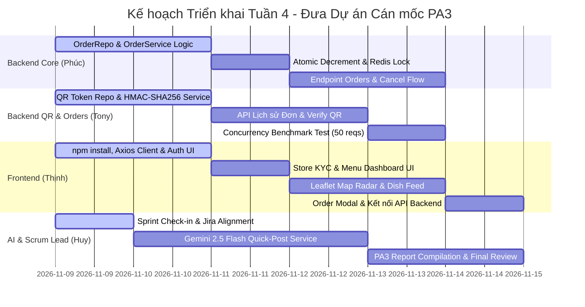

# 📋 KẾ HOẠCH HÀNH ĐỘNG TUẦN 4 — ECOBITE PLATFORM
> **Giai đoạn**: Tuần 4 (09/11/2026 – 15/11/2026)
> **Sprint tương ứng**: Sprint 3 — Project Assignment 3 (PA3: Radar Discovery & Anti-Overselling Inventory Engine)
> **Hạn chót nội bộ (Internal Deadline)**: **23:59 Thứ Sáu, 14/11/2026** (Đệm 1 ngày trước mốc chính thức theo Team Contract)
> **Mục tiêu tối thượng (Sprint Goal)**: Khép kín toàn bộ tính năng **Đặt hàng & Khóa tồn kho nguyên tử chống Over-selling (Feature 5)**, bổ sung **Phân hệ Mã QR động HMAC-SHA256 (Feature 7 Preview)**, hoàn thành **Chiến dịch tăng tốc Frontend kết nối PostGIS Radar Map & Đặt món**, và nghiệm thu toàn diện gói tài liệu **PA3 Report**.

---

## 1. Cơ cấu Phân bổ Lại Nhiệm vụ Nhóm (Re-allocation Strategy)

Căn cứ theo định hướng mới:
- **Đàng Thế Tony**: Giảm tối đa khối lượng viết test dàn trải; chuyển trọng tâm sang **Kỹ sư Backend nòng cốt (Core Backend Engineer)**, trực tiếp chịu trách nhiệm kiến trúc phân hệ **Mã QR động HMAC-SHA256** và **Hệ thống API Quản lý/Truy vấn Đơn hàng**.
- **Đặng Trọng Phúc**: Tập trung vào **Giao dịch Đặt hàng cốt lõi (Order Core Transaction)**, cơ chế **Khóa tồn kho nguyên tử (Atomic SQL decrement)** và **Redis Distributed Lock** chống race conditions bán quá số lượng.
- **Võ Ngọc Thịnh**: Tập trung 100% công lực vào **Chiến dịch Bù đắp Frontend**, dựng giao diện Next.js 14 từ Auth, Store KYC đến Bản đồ Radar Leaflet và Form đặt đơn.
- **Phùng Quốc Huy**: Quản lý điều phối dự án (PM/Scrum Master), chuẩn bị báo cáo PA3, xây dựng nền tảng **Service AI Gemini 2.5 Flash Quick-Post** và hỗ trợ giải quyết blocker full-stack.

---

## 2. Chi tiết Công việc & Sản phẩm Phải có của Từng Thành viên

---

### 👤 1. ĐẶNG TRỌNG PHÚC (Backend Lead & AI Engineer)
*Trách nhiệm chính: Kiến trúc Giao dịch Đặt hàng, Khóa tồn kho nguyên tử & Chống bán quá số lượng (Feature 5 Core).*

#### A. Nhiệm vụ Chi tiết (Detailed Tasks)
1. **Xây dựng `OrderRepository` (`backend/app/repositories/order_repo.py`)**:
   - Viết các phương thức truy vấn SQLAlchemy 2.0 Async:
     - `create_order(order_data: dict) -> Order`: Khởi tạo bản ghi đơn hàng trong DB transaction.
     - `get_by_id(order_id: UUID) -> Order | None`: Lấy chi tiết đơn hàng kèm quan hệ `consumer`, `store`, `dish`.
     - `get_by_order_code(code: str) -> Order | None`: Tra cứu đơn bằng mã hiển thị (vd: `EB-20261109-XXXX`).
     - `update_status(order_id: UUID, new_status: OrderStatus) -> Order`: Cập nhật trạng thái (`CONFIRMED`, `COMPLETED`, `CANCELLED`, `EXPIRED`).
2. **Xây dựng `OrderService` (`backend/app/services/order_service.py`)**:
   - Triển khai hàm đặt món `create_rescue_order(consumer_id, payload: OrderCreate)`:
     - **Kiểm tra nghiệp vụ**: Món ăn có đang trong trạng thái `ACTIVE` không? Thời điểm hiện tại có nằm trong khung giờ đón món (`pickup_start_time` - `pickup_end_time`) không?
     - **Khóa tồn kho nguyên tử (Inviolable Guardrail #4)**: Gọi hàm `dish_repo.atomic_decrement_quantity(dish_id, qty)` thực thi câu lệnh SQL:
       $$\text{UPDATE dishes SET remaining\_quantity} = \text{remaining\_quantity} - :qty \text{ WHERE id} = :id \text{ AND remaining\_quantity} \ge :qty$$
       Nếu affected rows = 0 $\rightarrow$ Raise `HTTPException(409, "Món ăn đã hết suất hoặc số lượng còn lại không đủ")`.
     - **Redis Distributed Lock**: Bọc quanh bước trừ kho với key `lock:dish:{dish_id}` để chặn nghẽn tải cao.
     - **Đo lường Tác động Môi trường & Điểm Xanh**: Tự động tính lượng khí thải cắt giảm:
       $$\text{co2\_saved\_kg} = \text{quantity} \times 2.5\text{ kg}$$
       Quy đổi: $1\text{ kg } CO_2e = 10\text{ Green Points}$.
     - Sinh mã đơn ngẫu nhiên định dạng: `EB-YYYYMMDD-<8 ký tự hash>`.
   - Triển khai hàm hủy đơn `cancel_order(order_id, user_id)`:
     - Hoàn lại số lượng suất ăn vào kho: `UPDATE dishes SET remaining_quantity = remaining_quantity + :qty WHERE id = :dish_id`.
3. **Xây dựng Router Đặt hàng (`backend/app/api/v1/endpoints/orders.py` - Phần 1)**:
   - `POST /api/v1/orders`: Endpoint tạo đơn giải cứu (Yêu cầu quyền `CONSUMER`).
   - `PATCH /api/v1/orders/{order_id}/cancel`: Hủy đơn khi chưa quá hạn lấy (Quyền `CONSUMER` hoặc `STORE_PARTNER`).

#### B. Sản phẩm Phải Bàn giao (Deliverables)
- [ ] File mới: `backend/app/repositories/order_repo.py`.
- [ ] File mới: `backend/app/services/order_service.py` (hoàn thiện logic đặt hàng + hoàn tồn kho + tính Green Points).
- [ ] File cập nhật: `backend/app/api/v1/endpoints/orders.py` (các endpoint tạo & hủy đơn).
- [ ] File cập nhật: `backend/app/api/v1/router.py` (gắn prefix `/orders`).

#### C. Tiêu chí Hoàn thành (Definition of Done)
- Tạo đơn thành công trừ đúng số lượng tồn kho `remaining_quantity` của `dish`.
- Khi số lượng đặt vượt quá tồn kho, hệ thống trả về HTTP `409 Conflict`, tuyệt đối không có hiện tượng tồn kho bị âm.
- Lượng $CO_2e$ và Green Points được tính toán chuẩn xác và lưu vào `Order`.
- Mã nguồn vượt qua `ruff check`, `ruff format`, và `mypy app/` 0 lỗi.

---

### 👤 2. ĐÀNG THẾ TONY (Backend Engineer & QA Lead)
*Trách nhiệm chính: Backend Mã QR Động HMAC-SHA256, API Truy vấn Đơn hàng & Concurrency Benchmark (Tập trung Backend thực chiến).*

#### A. Nhiệm vụ Chi tiết (Detailed Tasks)
1. **Xây dựng Phân hệ Mã QR Động Ký HMAC-SHA256 (Feature 7 Backend / Guardrail #3)**:
   - Tạo `backend/app/repositories/qr_token_repo.py`:
     - Lưu trữ bản ghi `QRToken` trong DB (`order_id`, `token_hash`, `nonce`, `expires_at`, `is_used`).
     - Hàm atomic xác thực: `mark_token_as_used(token_id)` với điều kiện `WHERE is_used = FALSE` để ngăn chặn Replay Attack (quét 2 lần).
   - Tạo `backend/app/services/qr_service.py`:
     - Hàm `generate_order_qr_token(order_id: UUID, user_id: UUID, pickup_deadline: datetime) -> str`:
       - Sinh chuỗi ngẫu nhiên `nonce` bằng thư viện `secrets.token_hex(16)`.
       - Ký chữ ký số bảo mật bằng thuật toán **HMAC-SHA256**:
         $$\text{signature} = \text{HMAC\_SHA256}(\text{key}=SECRET\_KEY, \text{msg}=order\_id + ":" + user\_id + ":" + nonce + ":" + expires\_at)$$
       - Trả về mã token an toàn để đóng gói vào ảnh/chuỗi QR cho người dùng.
     - Hàm `verify_and_redeem_qr_token(store_id: UUID, qr_payload: str) -> OrderResponse`:
       - Giải mã và kiểm tra chữ ký HMAC-SHA256.
       - Kiểm tra thời hạn hiệu lực (`expires_at < now` $\rightarrow$ `HTTP 400 Expired`).
       - Kiểm tra quán quét mã có đúng là chủ đơn hàng không (`store_id == order.store_id`).
       - Thực thi kiểm tra cờ `is_used`: Nếu `is_used == True` $\rightarrow$ Raise `HTTP 400 "Mã QR đã được sử dụng trước đó!"`.
       - Đánh dấu `is_used = True`, cập nhật trạng thái đơn sang `COMPLETED`, ghi nhận `completed_at`.
2. **Xây dựng Router API Lịch sử & Tra cứu Đơn hàng (`backend/app/api/v1/endpoints/orders.py` - Phần 2)**:
   - `GET /api/v1/orders/me`: Danh sách đơn của người tiêu dùng hiện tại (hỗ trợ phân trang, lọc theo status).
   - `GET /api/v1/orders/{order_id}`: Chi tiết đơn hàng kèm thông tin QR token hợp lệ.
   - `GET /api/v1/orders/store/{store_id}`: Danh sách đơn hàng phía chủ quán cần bàn giao (Yêu cầu quyền `STORE_PARTNER` và kiểm tra quyền sở hữu quán).
   - `POST /api/v1/orders/verify-qr`: Chủ quán quét xác thực nhận món (Yêu cầu quyền `STORE_PARTNER`).
3. **Viết Script Kiểm thử Tải & Tranh chấp Tồn kho (Concurrency Benchmark Script)**:
   - Tạo `backend/tests/integration/test_order_concurrency.py`:
     - Giả lập 50 request bất đồng bộ (`asyncio.gather`) cùng lúc gửi lệnh mua 1 món ăn chỉ còn `remaining_quantity = 2`.
     - Xác nhận chính xác: Đúng 2 request thành công (201 Created), 48 request còn lại nhận lỗi 409 Conflict; tồn kho còn lại đúng bằng 0.
     - Xuất log thời gian phản hồi (latency) để đưa vào Báo cáo PA3.

#### B. Sản phẩm Phải Bàn giao (Deliverables)
- [ ] File mới: `backend/app/repositories/qr_token_repo.py`.
- [ ] File mới: `backend/app/services/qr_service.py`.
- [ ] File cập nhật: `backend/app/api/v1/endpoints/orders.py` (các endpoint truy vấn lịch sử đơn + endpoint verify QR).
- [ ] File mới: `backend/tests/integration/test_order_concurrency.py`.
- [ ] File mới: `backend/tests/unit/test_qr_service.py` (test tạo token, ký HMAC, chặn mã hết hạn & mã quét lại).

#### C. Tiêu chí Hoàn thành (Definition of Done)
- Mã QR không thể bị giả mạo (thay đổi dữ liệu sẽ bị lỗi chữ ký HMAC invalid).
- Quét mã lần thứ 2 lập tức bị từ chối với thông báo rõ ràng (Chống Replay Attack).
- API lịch sử đơn hàng trả về đúng định dạng Pydantic `OrderResponse` và `QRTokenResponse`.
- Test concurrency pass 100%, không xảy ra deadlock hay âm tồn kho.

---

### 👤 3. VÕ NGỌC THỊNH (Frontend Lead & Full-Stack Engineer)
*Trách nhiệm chính: Chiến dịch Bù đắp Frontend — Xây dựng giao diện Next.js 14 kết nối PostGIS Radar & Đặt món.*

#### A. Nhiệm vụ Chi tiết (Detailed Tasks)
1. **Thiết lập Môi trường & Bộ khung UI (Sprint Setup)**:
   - Chạy cài đặt dependencies: `npm install` (cài `lucide-react`, `leaflet`, `@types/leaflet`, `clsx`, `tailwind-merge`).
   - Cấu hình file `frontend/src/lib/axios.ts` hoặc `api-client.ts` tự động gắn `Authorization: Bearer <token>` và xử lý refresh token tự động khi gặp mã 401.
   - Xây dựng Layout Shell: Navigation Bar (Logo, Tìm kiếm, Đăng nhập/Tài khoản, Giỏ/Đơn hàng).
2. **Xây dựng Phân hệ Xác thực & Quán ăn (Auth & KYC Screens)**:
   - Màn hình Đăng nhập & Đăng ký (`/login`, `/register`): Lưu token vào LocalStorage/Cookie, điều hướng theo vai trò (`CONSUMER` sang trang Radar, `STORE_PARTNER` sang trang Quản lý quán).
   - Màn hình Onboarding Quán ăn (`/store-partner/onboard`): Form nhập tên quán, địa chỉ, chọn toạ độ GPS trên bản đồ mini, upload/nhập link giấy phép ATVSTP.
3. **Xây dựng Màn hình Radar Khám phá Bản đồ (Leaflet Interactive Map - Feature 4)**:
   - Tạo trang `/radar` hoặc trang chủ Consumer:
     - Lấy toạ độ GPS hiện tại của trình duyệt qua `navigator.geolocation.getCurrentPosition`.
     - Tích hợp thư viện Leaflet Map (Client Component `'use client'`), hiển thị Marker vị trí hiện tại kèm vòng tròn bán kính 1–5 km (Radar circle).
     - Gọi API `GET /api/v1/discovery/nearby?latitude=...&longitude=...&radius_km=3`: Render danh sách Marker các quán ăn lân cận.
     - Khi bấm vào Marker: Hiện Popup thông tin quán (Tên quán, khoảng cách mét, số món đang cứu hộ).
4. **Xây dựng Danh sách Món ăn Cứu trợ (Surplus Dish Feed & Countdown Timer - Feature 2 & 3)**:
   - Thẻ món ăn (Dish Card): Hiển thị ảnh, tên món, giá gốc bị gạch ngang, giá cứu hộ (-50% hoặc -70%), số lượng suất còn lại (`remaining_quantity`).
   - Đồng hồ đếm ngược giờ chót (Countdown Timer Component): Đếm ngược đến giờ chuyển sang giá xả 70% hoặc giờ đóng ca đón món.
5. **Xây dựng Modal Đặt hàng & Xác nhận Đơn (Order Checkout Flow - Feature 5 UI)**:
   - Nút "Cứu món ngay" mở Modal xác nhận: Cho phép chọn số lượng suất muốn cứu (chặn không cho chọn vượt quá tồn kho).
   - Nút bấm xác nhận đặt món $\rightarrow$ Gọi API `POST /api/v1/orders`.
   - Hiển thị màn hình chúc mừng đặt đơn thành công kèm mã đơn hàng `order_code` và lượng $CO_2e$ người dùng đã giúp Trái Đất tiết kiệm.

#### B. Sản phẩm Phải Bàn giao (Deliverables)
- [ ] Gói thư viện `node_modules` cài đặt hoàn tất, lệnh `npm run lint` và `npm run type-check` chạy thành công.
- [ ] Các trang chức năng tại `frontend/src/app/`:
  - `(auth)/login/page.tsx` & `(auth)/register/page.tsx`.
  - `(store-partner)/onboard/page.tsx`.
  - `(consumer)/radar/page.tsx` (Bản đồ Leaflet Map radar tương tác).
  - `(consumer)/dishes/page.tsx` (Feed món ăn giảm giá kèm đồng hồ đếm ngược).
- [ ] Component dùng chung tại `frontend/src/components/`:
  - `Navbar.tsx`, `DishCard.tsx`, `CountdownTimer.tsx`, `OrderModal.tsx`, `RadarMap.tsx`.
- [ ] Tích hợp API services tại `frontend/src/services/`:
  - `order.service.ts`, `dish.service.ts`, `discovery.service.ts`, `store.service.ts`.

#### C. Tiêu chí Hoàn thành (Definition of Done)
- Người dùng có thể đăng nhập, xem bản đồ quanh vị trí GPS của mình, thấy các cửa hàng có món cứu hộ.
- Chọn được món và gửi request tạo đơn hàng thành công đến Backend `localhost:8000`.
- Giao diện thân thiện trên thiết bị di động (Responsive mobile-first), không có lỗi TypeScript (`npm run type-check` exit code 0).

---

### 👤 4. PHÙNG QUỐC HUY (AI/Data Lead & Project Manager - Scrum Master)
*Trách nhiệm chính: Quản trị Tiến độ Dự án, Hồ sơ Đánh giá PA3, AI Service Gemini 2.5 Flash Structured Output & Hỗ trợ Full-Stack.*

#### A. Nhiệm vụ Chi tiết (Detailed Tasks)
1. **Quản trị Tiến độ Scrum & Jira Sprint 3**:
   - Chủ trì buổi họp Sprint Check-in đầu tuần (Thứ Hai 20:30 trên Google Meet).
   - Rà soát toàn bộ Issue trên Jira (`ecobite-hcmus.atlassian.net`): Đảm bảo 100% các task của 4 thành viên tuân thủ **Quy tắc Gán 1-1** và có đầy đủ `Start Date`, `Story Points`, và `Resolution Date`.
   - Kiểm soát rủi ro tiến độ (đặc biệt là tiến độ bù của Frontend), hỗ trợ pair-programming tháo gỡ khó khăn cho các thành viên.
2. **Khởi tạo Phân hệ AI Service Gemini 2.5 Flash Quick-Post (Chuẩn bị bàn giao sớm PA5)**:
   - Tạo `backend/app/services/quick_post_service.py`:
     - Kết nối SDK `google-genai` với model `gemini-2.5-flash`.
     - Sử dụng schema `QuickPostExtractionResponse` đã hoàn thành tại [nlp.py](file:///Users/phungquochuy/Desktop/EcoBite-Platform/backend/app/schemas/nlp.py).
     - Áp dụng Server-Time Grounding: Truyền thời gian thực của server (`now_iso`) vào system prompt để Gemini tính chính xác giờ đóng cửa quán ăn.
     - Xử lý Menu Grounding: So khớp tên món trích xuất từ audio/văn bản với `menu_items` trong cơ sở dữ liệu để tự động lấy `image_url` và `original_price`.
3. **Soạn thảo & Tổng hợp Bộ Hồ sơ Đánh giá PA3 (Project Assignment 3 Deliverables)**:
   - Tạo file báo cáo `docs/PA3.md` (hoặc cập nhật vào cấu trúc môn học):
     - Mục tiêu Sprint 3 & Kết quả đạt được (Radar PostGIS + Anti-Overselling + HMAC QR).
     - Báo cáo kết quả kiểm thử Concurrency (Bằng chứng 0% bán quá số lượng).
     - Báo cáo Benchmark thời gian phản hồi của Radar PostGIS ($\le 100\text{ ms}$).
     - Ảnh chụp màn hình minh chứng Jira Sprint 3 board, Git commit log chuẩn Conventional Commits.
     - Cập nhật nhật ký sử dụng AI (AI Usage Report) của 4 thành viên.
4. **Code Review & Kiểm soát Quality Gates**:
   - Review chéo các Pull Request của Phúc, Tony và Thịnh trước khi merge vào nhánh `dev` / `main`.
   - Đảm bảo toàn bộ 8 Ranh giới Bất khả Xâm phạm trong [AGENTS.md](file:///Users/phungquochuy/Desktop/EcoBite-Platform/AGENTS.md) được tuân thủ 100%.

#### B. Sản phẩm Phải Bàn giao (Deliverables)
- [ ] File mới: `backend/app/services/quick_post_service.py` (tích hợp Gemini 2.5 Flash Structured Outputs).
- [ ] File tài liệu hoàn chỉnh: `docs/PA3.md` (đầy đủ các phần Báo cáo tiến độ, Báo cáo kiểm thử, Báo cáo AI).
- [ ] Bảng Jira Sprint 3 được cập nhật trạng thái `Done` 100% kèm minh chứng ngày giờ.
- [ ] Bản demo video hoặc kịch bản trình diễn luồng: Tìm kiếm quán lân cận $\rightarrow$ Đặt món $\rightarrow$ Trừ kho thành công.

#### C. Tiêu chí Hoàn thành (Definition of Done)
- Hồ sơ PA3 sẵn sàng trước 23:59 ngày 14/11/2026 (sớm hơn 1 ngày so với deadline môn học).
- Service AI Gemini chạy thử nghiệm trích xuất trả về đúng schema Pydantic, phân loại đúng dị ứng 2 tầng `EXPLICIT` và `INFERRED`.
- Toàn bộ repo xanh 100% trên cả Backend và Frontend.

---

## 3. Lịch trình Phối hợp Chi tiết Theo Ngày (Execution Matrix)



| Ngày | Đặng Trọng Phúc (Backend Lead) | Đàng Thế Tony (Backend & QA) | Võ Ngọc Thịnh (Frontend Lead) | Phùng Quốc Huy (PM & AI Lead) |
| :--- | :--- | :--- | :--- | :--- |
| **Thứ Hai (09/11)** | Viết `order_repo.py`, phác thảo `OrderService` | Viết `qr_token_repo.py`, hàm ký HMAC-SHA256 | Chạy `npm install`, setup Axios client & Auth UI | Họp nhóm 20:30, chốt Jira Sprint 3, review PRs |
| **Thứ Ba (10/11)** | Cài đặt SQL Atomic Update & Redis Lock | Hoàn thành `qr_service.py` (chống Replay Attack) | Dựng trang Store KYC & Dashboard quản lý Menu | Thiết kế prompt & grounding cho Quick-Post AI |
| **Thứ Tư (11/11)** | Viết endpoint `POST /orders` và tính Green Points | Viết endpoint `GET /orders/me` & `GET /orders/store` | Dựng Bản đồ Radar Leaflet gọi `/discovery/nearby` | Tích hợp Gemini 2.5 Flash với schema `nlp.py` |
| **Thứ Năm (12/11)** | Hoàn thiện logic `PATCH /orders/{id}/cancel` | Viết endpoint `POST /orders/verify-qr` & Unit test | Dựng Dish Feed, Badge giảm giá & Countdown Timer | Soạn thảo sườn Báo cáo PA3 (Test Plan & AI Report) |
| **Thứ Sáu (13/11)** | Hỗ trợ Tony kiểm thử tải đồng thời | **Chạy Stress Test Concurrency 50 reqs tranh mua** | Nối Form Đặt món với API `POST /orders` của Phúc | Tổng hợp biểu đồ Concurrency & Latency vào PA3 |
| **Thứ Bảy (14/11)** | *Code Freeze Backend PA3*, rà soát bảo mật | Chạy toàn bộ test suite (`pytest`, `mypy`) | Kiểm thử giao diện di động, sửa lỗi UI cuối cùng | **Hoàn tất & Nộp Báo cáo PA3** (trước hạn 1 ngày) |
| **Chủ Nhật (15/11)**| Sprint 3 Review & Retrospective | Họp tổng kết kiểm thử | Demo sản phẩm nội bộ | Lên kế hoạch Sprint 4 (VNPay & QR Camera Scanner) |

---

## 4. Tiêu chuẩn Nghiệm thu Hoàn thành Tuần 4 (Sprint 3 DoD)

Dự án chỉ được coi là hoàn tất Tuần 4 khi thỏa mãn đầy đủ các điều kiện sau:

1. **Về Mã nguồn Backend**:
   - `OrderService` và `QRService` hoạt động ổn định, có test coverage đạt trên 85%.
   - Chạy lệnh kiểm tra tự động đạt trạng thái xanh tuyệt đối:
     ```bash
     cd backend && source venv_backend/bin/activate
     ruff check app/
     ruff format --check app/
     mypy app/
     pytest tests/ -v
     ```
2. **Về Khả năng Chịu tải & An toàn Dữ liệu**:
   - Script Concurrency giả lập 50 requests chứng minh được **tỷ lệ Over-selling bằng 0%**.
   - Mã QR được ký số bảo mật, không thể quét trùng 2 lần.
3. **Về Mã nguồn Frontend**:
   - `npm run lint` và `npm run type-check` không xuất hiện bất kỳ thông báo lỗi đỏ nào.
   - Luồng tương tác chính: Đăng nhập $\rightarrow$ Xem radar quán lân cận $\rightarrow$ Chọn món $\rightarrow$ Đặt đơn hoạt động trơn tru trên môi trường dev.
4. **Về Báo cáo & Hồ sơ Môn học**:
   - Tài liệu `docs/PA3.md` hoàn thiện đầy đủ số liệu, hình ảnh minh chứng Jira và chữ ký nghiệm thu của 4 thành viên.
