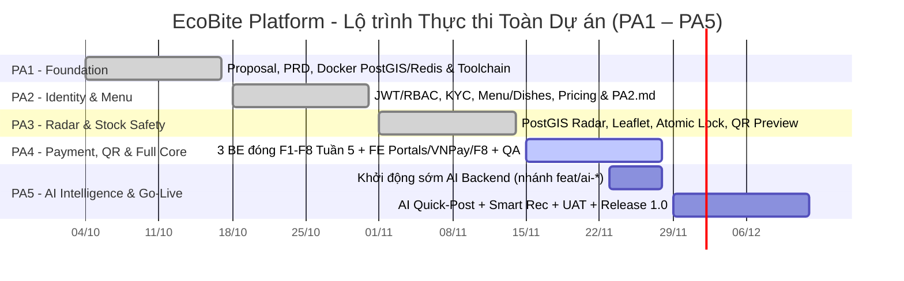

# 🗺️ Tổng hợp Lộ trình & Tiến độ Toàn Dự án EcoBite (PA1 – PA5)

> **Cập nhật lần cuối**: `16/11/2026` (Đầu Tuần 5 — Khởi động Sprint 4 / PA4)
> **Nhóm thực hiện**: Group 05 — Phùng Quốc Huy (`PM / AI & BE`), Đặng Trọng Phúc (`BE Lead`), Đàng Thế Tony (`QA Lead & BE`), Võ Ngọc Thịnh (`FE Lead`)

---

## 1. Bảng Tổng quan Tiến độ 5 Đợt Đánh giá (PA1 – PA5)

| Giai đoạn | Thời gian Sprint | Hạn nội bộ | Hạn nộp Moodle | Chủ trì chính | Sản phẩm & Release | Trạng thái (`16/11`) | Thư mục Chi tiết |
| :--- | :---: | :---: | :---: | :--- | :--- | :---: | :--- |
| **PA1 (Sprint 1)** | `04/10 – 17/10` | `16/10` | `17/10/2026` | Phùng Quốc Huy | Proposal, PRD, Kiến trúc, Docker PostGIS + Redis, Jira, Pre-commit (`v0.1`) | `DONE` | [`pa1_sprint1/`](./pa1_sprint1/README.md) |
| **PA2 (Sprint 2)** | `18/10 – 31/10` | `30/10` | `31/10/2026` | Đặng Trọng Phúc | JWT/RBAC, KYC, Menu Catalog, Dishes, Time-shift Discount, `PA2.md` | `DONE` | [`pa2_sprint2/`](./pa2_sprint2/README.md) |
| **PA3 (Sprint 3)** | `01/11 – 14/11` | `13/11` | `14/11/2026` | Võ Ngọc Thịnh & Đặng Trọng Phúc | PostGIS Radar, Leaflet UI, Atomic Order Lock, Dynamic QR Preview (`v0.2`) | `DONE` | [`pa3_sprint3/`](./pa3_sprint3/README.md) |
| **PA4 (Sprint 4)** | `15/11 – 28/11` | `27/11` | `28/11/2026` | Đàng Thế Tony & Cả nhóm | **Đóng 100% Core F1–F8**: VNPay HMAC-SHA512 + IPN, QR Payment Guard, Reviews/Green Points/Vouchers, Store/Admin Portals, Vitest (`v0.3`) | `IN PROGRESS` | [`pa4_sprint4/`](./pa4_sprint4/README.md) |
| **PA5 (Sprint 5)** | `29/11 – 12/12` *(AI kickoff `23/11`)* | `11/12` | `12/12/2026` | Phùng Quốc Huy & Cả nhóm | **AI Suite (Gemini 2.5 Flash)**: Voice Quick-Post + 2-Tier Allergen Guard, 3-Layer Recommendation + Semantic Search, UAT & Go-Live (`v1.0`) | `PLANNED` | [`pa5_sprint5/`](./pa5_sprint5/01_PA5_Plan_and_Backlog.md) |

---

## 2. Ma trận Hoàn thành Tính năng Toàn Hệ thống (8 Core + 2 AI)

| Mã Tính năng | Tên Tính năng | Backend | Frontend | Automated Tests | Mốc Đóng Tính năng |
| :---: | :--- | :---: | :---: | :---: | :---: |
| **F1** | Auth JWT Dual-tokens, Store KYC & Admin Duyệt | `95%` *(thêm `/stores/me`)* | `65%` *(thiếu `/admin`)* | Unit + Integration BE | **PA4 (Tuần 5)** |
| **F2** | Base Menu Catalog (`menu_items`) & Surplus Dishes | `100%` | `0%` *(thiếu `/store/menu`, `/store/dishes`)* | Integration BE | **PA4 (Tuần 5)** |
| **F3** | Rule-Based Time-Shift Discounting (50% / 70%) | `100%` | `40%` *(có ở Radar, thiếu Store preview)* | Unit BE | **PA4 (Tuần 5)** |
| **F4** | Location-Based Search & PostGIS Radar Discovery | `100%` | `100%` (`RadarMap.tsx`) | Unit + Integration BE | **PA3 (Đã xong)** |
| **F5** | Anti-Overselling Inventory Lock & Order Cancel | `100%` *(thêm hoàn kho IPN fail)* | `100%` | Concurrency 50 reqs BE | **PA3 (Đã xong)** |
| **F6** | VNPay Payment Gateway (HMAC-SHA512 & Idempotent IPN) | `10%` *(mới có model/schema)* | `10%` *(mới có nút chọn)* | Chưa có | **PA4 (Tuần 5–6)** |
| **F7** | Dynamic HMAC-SHA256 QR & Web Camera Scanner | `90%` *(thêm check `PAID`)* | `90%` *(thêm bảng đơn quán)* | Unit + Integration BE | **PA3 / Khóa ở PA4** |
| **F8** | Verified Reviews, Green Points, CO₂ & Vouchers | `15%` *(mới có model/schema)* | `0%` | Chưa có | **PA4 (BE Tuần 5, FE Tuần 6)** |
| **AI-1** | Gemini 2.5 Flash Voice Quick-Post & 2-Tier Allergen Guard | `15%` *(đã có `schemas/nlp.py`)* | `0%` | `test_nlp_schemas.py` | **PA5 (Khởi động `23/11`)** |
| **AI-2** | 3-Layer Recommendation (SQL Hard Filter) & Semantic Search | `0%` | `0%` | Chưa có | **PA5 (Khởi động `25/11`)** |

---

## 3. Lịch Trình Gối đầu Tổng thể (PA1 – PA5)

---

## 4. Quy chế Phân vai Chung Qua Các Sprint

| Thành viên | Vai trò Chính | Trọng tâm từ PA4 đến PA5 |
| :--- | :--- | :--- |
| **Phùng Quốc Huy** (`24127402`) | PM / Scrum Master · AI & Data Lead · Backend Engineer | **PA4 Tuần 5**: Gamification/Vouchers BE + Seed + Spec/PRs. **PA4 Tuần 6 → PA5**: Báo cáo PA4/PA5 + Chủ trì AI Feature 1 & 2. |
| **Đặng Trọng Phúc** (`24127495`) | Backend & Architecture Lead | **PA4 Tuần 5**: VNPay Gateway (HMAC-SHA512, IPN, Hoàn kho) + `/stores/me`. **PA4 Tuần 6 → PA5**: Sandbox E2E + Layer 1 SQL PostGIS Hard Filter & Kiến trúc hệ thống. |
| **Đàng Thế Tony** (`24127561`) | QA / Testing Lead · Backend Engineer | **PA4 Tuần 5**: Env Sync + Payment↔QR Guard + Reviews BE. **PA4 Tuần 6 → PA5**: Integration/Concurrency Tests, Quality Gates, Test AI Safety & UAT. |
| **Võ Ngọc Thịnh** (`24127246`) | Frontend & UI/UX Lead | **PA4 (2 tuần)**: Vitest + Admin KYC + Store Menu/Dishes + VNPay UI + Feature 8 UI (`/green-points`, Review). **PA5**: UI Voice Quick-Post, Smart Recommendation Cards, Semantic Search & PWA Polish. |
