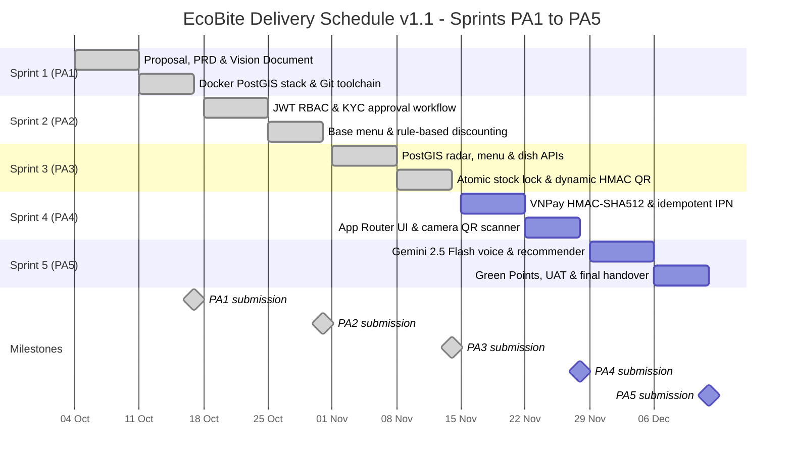
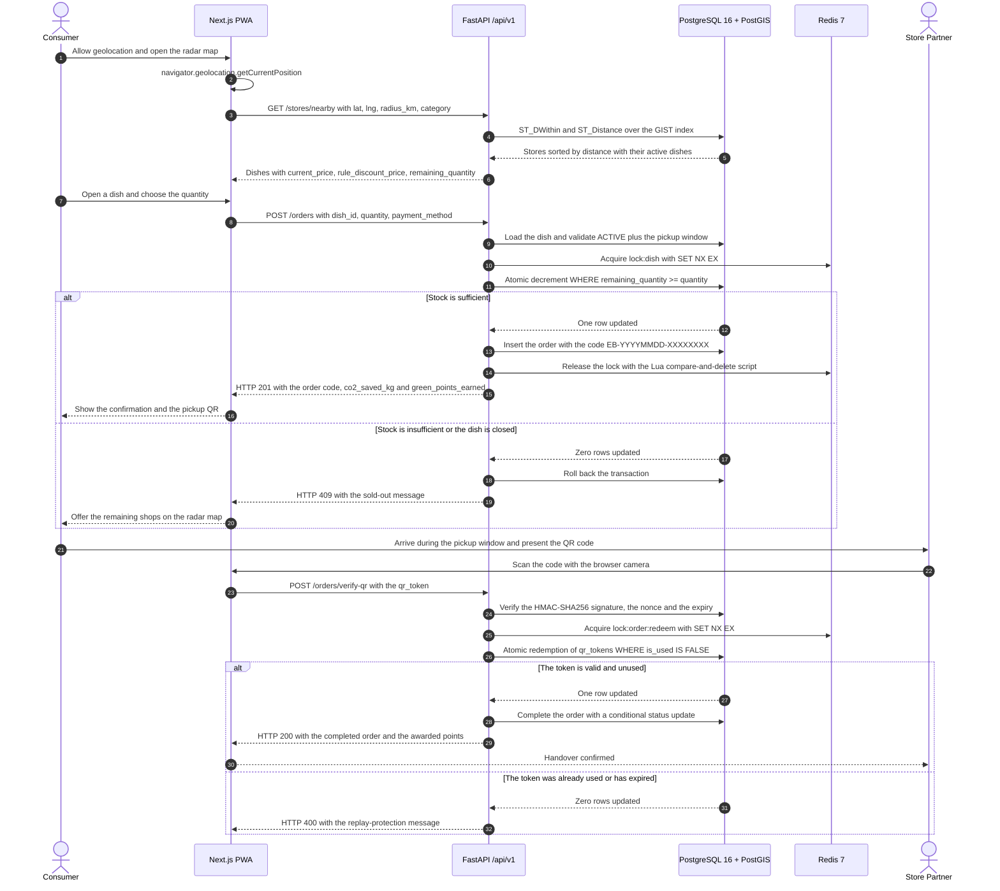
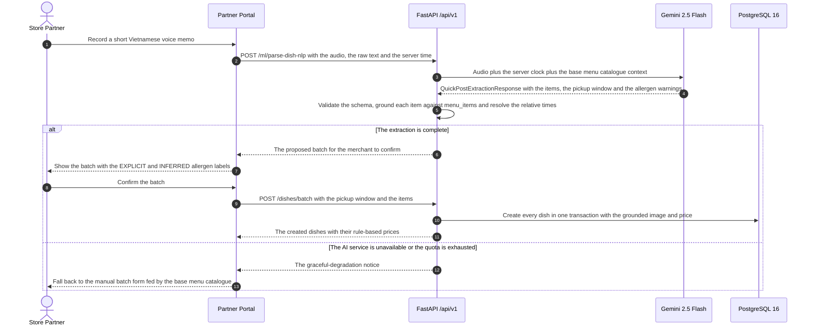
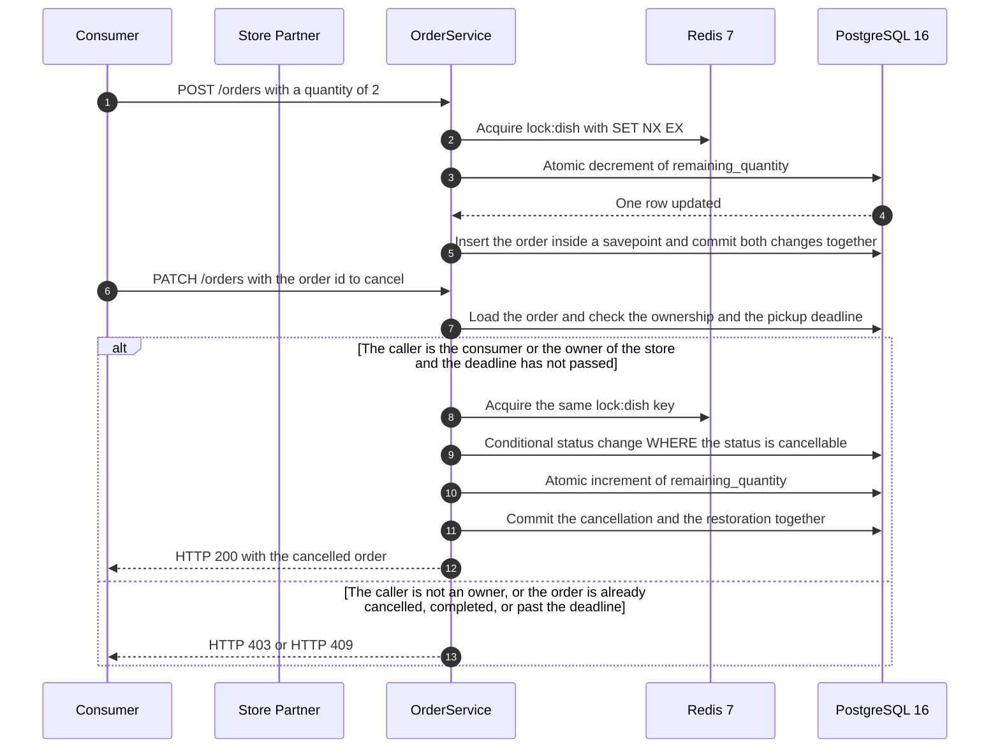
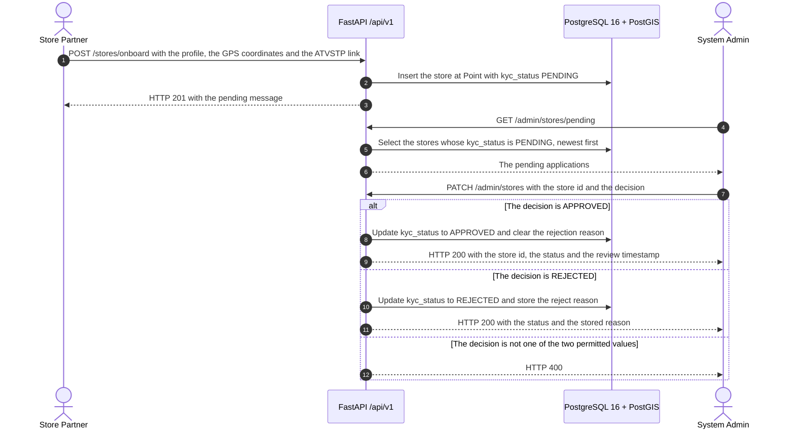
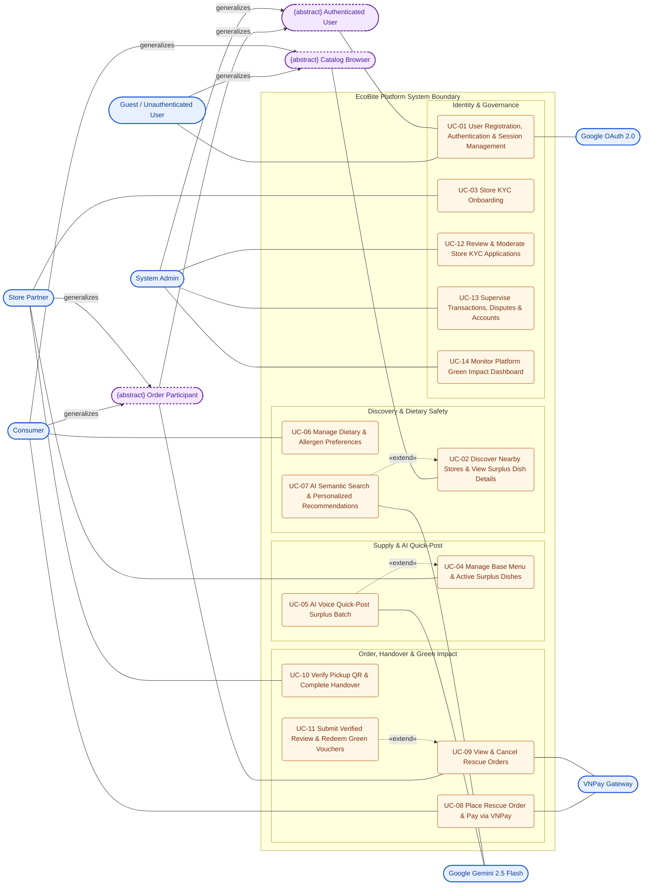
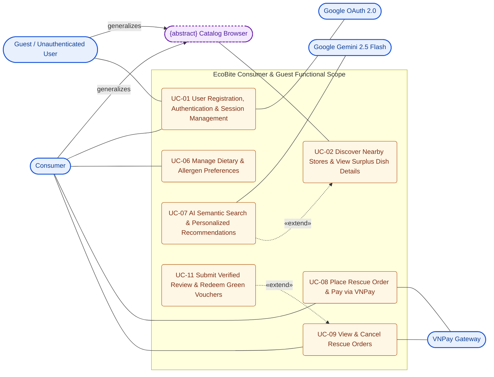
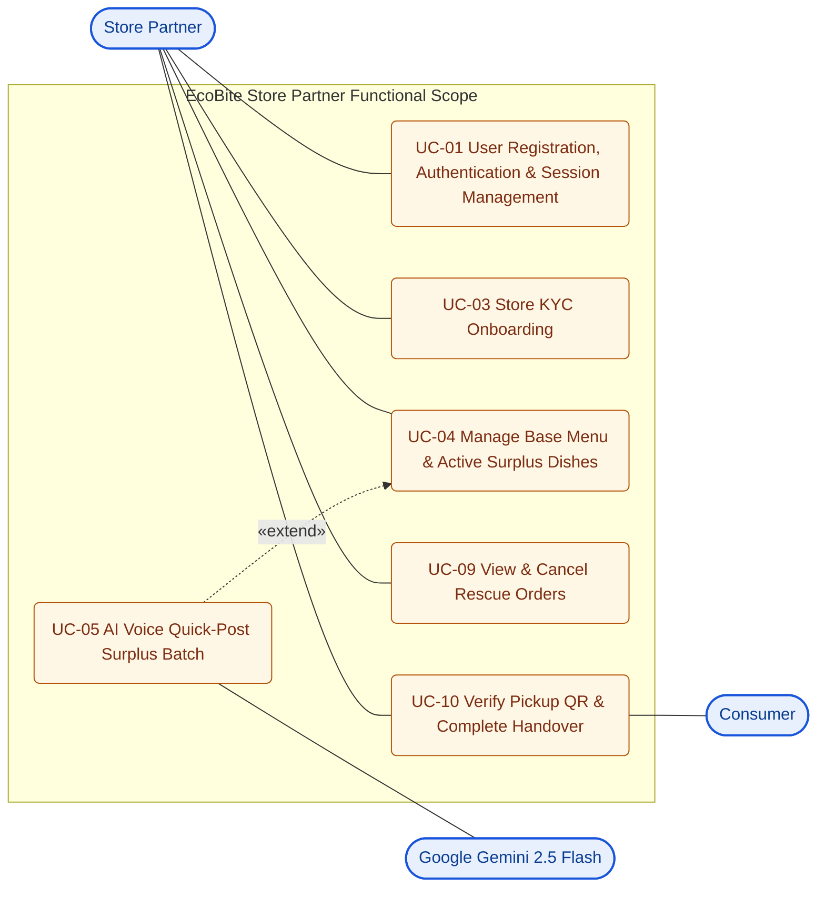
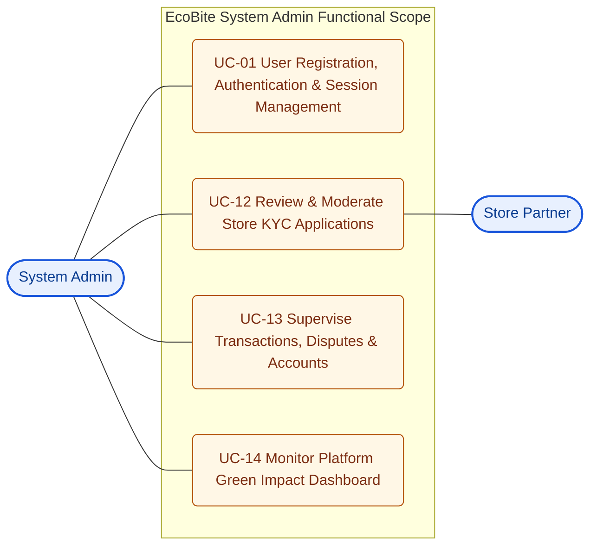
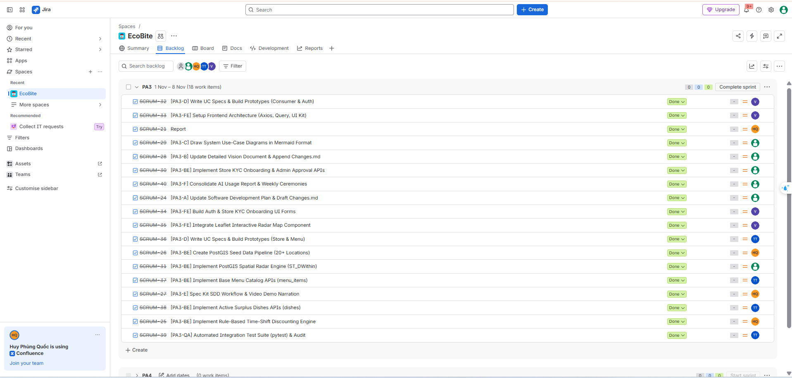

# Project Assignment 3 (PA3) — Group 05 Report

**Course:** CS300 — CSC13002 Introduction to Software Engineering  
**Institution:** Faculty of Information Technology, VNU-HCM University of Science (HCMUS)  
**Team:** Group 05  
**Project:** EcoBite — Food Rescue & Zero-Waste Platform  
**Reporting Period:** 1/11/2026 – 14/11/2026 (Sprint 3 — PA3)

| Student ID | Member | Primary Role |
| ---------- | ------ | ------------ |
| 24127402 | Phùng Quốc Huy | AI & Data Lead — Project Manager (Scrum Master) |
| 24127495 | Đặng Trọng Phúc | Backend & Architecture Lead |
| 24127246 | Võ Ngọc Thịnh | Frontend & UI/UX Lead — Scrum Coordinator |
| 24127561 | Đàng Thế Tony | QA / Testing Lead — Backend Engineer |

---

## Table of Contents

1. [A - Revised Project Plan - 2nd submission](#a---revised-project-plan---2nd-submission)
2. [B - Detailed Vision Document - 2nd submission](#b---detailed-vision-document---2nd-submission)
3. [C - Use-Case Model](#c---use-case-model)
4. [D - Use-Case Specification](#d---use-case-specification)
5. [E - Implement 1 Functional Group using Spec Kit](#e---implement-1-functional-group-using-spec-kit)
6. [F - AI Usage Report and Weekly Report](#f---ai-usage-report-and-weekly-report)

---

## A - Revised Project Plan - 2nd submission
> **Performed by:** Đặng Trọng Phúc | **Reviewed by:** Võ Ngọc Thịnh, Đàng Thế Tony | **Edited by:** Phùng Quốc Huy

### A.1 Changes made compared to PA2-2026 (Recorded in `Changes.md`)

This Software Development Plan (SDP) supersedes the PA2-2026 plan (`reportPA2.md`, v1.0) and restates it as **v1.1, dated 14/11/2026**. The PA2 plan was explicitly written as an "initial version … to be revised in PA3-2026 based on their feedback"; this section closes that loop and states *what* changed and *why*.

The complete, itemised delta is maintained in the companion file **`PA3-Group05/Changes.md`**, which contains one dedicated part per revised document (Part A — Software Development Plan, Part B — Vision Document) and one comparison row per change, with a `Change ID`, the affected section, the PA2 (v1.0) wording, the PA3 (v1.1) wording, and the source of the change (TA feedback from PA2, `Ke_Hoach_Tuan_Sprint_3_EcoBite.md`, or `WEEK_4_ACTION_PLAN.md`). This section is the narrative summary; `Changes.md` is the authoritative delta record required by the PA3-2026 brief ("Without this file, you will not receive points for this section").

#### A.1.1 Material changes in summary

| Change ID | Affected area | What the PA2 plan (v1.0) said | What the PA3 plan (v1.1) says | Source of the change |
| :--- | :--- | :--- | :--- | :--- |
| `CHG-A-01` | §4.3.4 Configuration Management | Version control described the Git branch strategy and semantic versioning; Spec Kit was mentioned only in §5 tooling. | Configuration Management now lists the **Spec Kit artefact set as a version-controlled, first-class deliverable**: `src/.specify/memory/constitution.md` (v1.1.0), the five process templates, the PowerShell script runtime, the workflow registry/`workflow.yml`, and the **generated feature artefacts** (`spec.md`, `plan.md`, `tasks.md`). Every artefact is versioned with the code and released with a Git tag. | TA feedback from PA2 (`constitution.md` and the Spec Kit artefacts were not submitted directly, only described) |
| `CHG-A-02` | §2.3 Deliverables / new §A.3.6 Submission packaging | The deliverable catalogue listed documents, source code and a Git log. | A **submission packaging checklist** is added: original `.md` + exported `.pdf`, the report set, `Changes.md`, the Git log export, `constitution.md`, **and all generated Spec Kit artefacts**, packaged as `PA3-Group05.zip`. | TA feedback from PA2 |
| `CHG-A-03` | §4.2.4 Project Schedule / §A.2.2 | The PA2 Gantt chart marked Sprint 1 and Sprint 2 as finished and Sprint 3–5 as future work; Sprint 3 had no internal week-level breakdown. | The Gantt chart is re-baselined: Sprint 1–2 `done`, Sprint 3 `done` with the **PA3 submission milestone on 14/11/2026**, Sprint 4–5 explicitly marked *(Planned)*. Week-level checkpoints from `Ke_Hoach_Tuan_Sprint_3_EcoBite.md` and the day-by-day matrix from `WEEK_4_ACTION_PLAN.md` are now part of the plan. | `Ke_Hoach_Tuan_Sprint_3_EcoBite.md`, `WEEK_4_ACTION_PLAN.md` |
| `CHG-A-04` | §4.2.2 Iteration Objectives / §A.2.4 | Sprint 3 objective was one line: "Deliver PostGIS geospatial capability and control concurrent inventory disputes." | Sprint 3 is decomposed into **Week 1 (02–08/11)** and **Week 4 (09–15/11)** objectives, each with its own exit criteria, plus the list of Sprint-2 items that were carried over (JWT/RBAC completion and the KYC approval workflow). | `Ke_Hoach_Tuan_Sprint_3_EcoBite.md`, `WEEK_4_ACTION_PLAN.md` |
| `CHG-A-05` | §4.2.1 WBS | WBS 3 contained three bullets (Leaflet map, PostGIS queries, atomic inventory lock). | WBS 3 is expanded to **thirteen** work packages covering the four work streams actually executed: PostGIS radar, menu/dish APIs, order core transaction + Redis lock, dynamic HMAC QR, frontend foundation, and the PA3 documentation pack. | `WEEK_4_ACTION_PLAN.md` |
| `CHG-A-06` | §4.1.2 Effort Estimates | "approximately 85–100 story points for the 10 core features … average velocity estimated at 18–20 story points per sprint." | The estimate is corrected. The PA2 figure covered *documentation only* and the Sprint-2 board already committed 32 SP, so 18–20 SP/sprint was not a credible baseline. v1.1 restates the project at **250–280 SP total** with a **55–65 SP/sprint** velocity band, and a measured **Sprint 3 commitment of 61 SP against a 64 SP capacity**. | Sprint 3 measurement (Jira board + Git history) |
| `CHG-A-07` | §4.3.3 Risk Management | Six risks (R1–R6), all stated as open. | The register is re-rated against evidence: **R2 (over-selling) and R4 (QR replay) are closed** with the Sprint-3 concurrency benchmark and the atomic `is_used` redemption as proof; **R1 and R3 are partially mitigated**; **R7 (frontend App-Router / API-client gap), R8 (Spec Kit artefacts missing from PA2 — closed in PA3 by generating and packaging `spec.md`, `plan.md`, and `tasks.md`) and R9 (QR token not yet issued at order creation)** are tracked from the Sprint-3 repository audit and PA2 TA feedback. | Sprint 3 repository audit + `WEEK_4_ACTION_PLAN.md` + TA feedback from PA2 |
| `CHG-A-08` | §4.2.5 Project Resourcing | A RACI list and a training table. | The RACI is extended with the **Week-4 re-allocation** that actually happened: Tony → core backend + QR; Phúc → order transaction + atomic lock; Thịnh → 100 % frontend campaign; Huy → PM + AI service + PA3 report. A "capacity and load per member" table is added. | `WEEK_4_ACTION_PLAN.md` §1 |
| `CHG-A-09` | §4.3.2 Reporting and Measurement | Velocity, defect trend and coverage were named but not tied to artefacts. | Each metric is now tied to a **named artefact** (Jira board, burn-down, `pytest` output, `ruff`/`mypy` output, Git log) and each delivery checkpoint has an explicit exit test, including the three technical gates of `Ke_Hoach_Tuan_Sprint_3_EcoBite.md` §Part 3. | `Ke_Hoach_Tuan_Sprint_3_EcoBite.md` §Part 3 |
| `CHG-A-10` | §5 Technical Process Plans | Toolchain and quality gates described. | The Quality-Gate matrix is extended with a **Gate 5 – Submission Readiness** (constitution + Spec Kit artefacts + figures + `Changes.md` present in the package) that answers the PA2 feedback directly. | TA feedback from PA2 |
| `CHG-A-11` | §4.2.3 Releases | Four releases R0.1 → R1.0. | Release 0.2 is renamed **"Internal alpha — Radar & Stock Safety"** and is now *achieved* on 14/11/2026 with its acceptance evidence; Release 0.3 is re-scoped to absorb the in-browser QR scanner that Sprint 3 delivered early. | Sprint 3 outcome |
| `CHG-A-12` | New §A.3.7 Environment & Toolchain Drift | The plan assumed Python 3.11 and a healthy local virtual environment. | A **toolchain-drift clause** is added: the on-disk `.venv` resolves to CPython 3.13.9 with several pinned packages missing (`tzdata`, `asyncpg`, `psycopg2-binary`, `google-genai`, `torch`), which breaks `ZoneInfo("Asia/Ho_Chi_Minh")` import on Windows and therefore blocks `import app.main`. A remediation checklist for the CI image is attached. | Sprint 3 repository audit |

#### A.1.2 How the PA2 teaching-assistant feedback was addressed

The single most important piece of feedback received after PA2 was that the team **described** the Spec Kit initialisation process but did not **submit** the resulting artefacts. PA2 Part C contained the training evidence and the repository tree, and the submission carried a `git log` export — but neither `constitution.md` nor the generated `spec.md` / `plan.md` / `tasks.md` were attached as inspectable files.

Group 05 therefore applied four concrete corrections, each traceable to a specific change in this plan:

1. **Constitution promoted from "described" to "delivered"** (`CHG-A-01`). `src/.specify/memory/constitution.md` — EcoBite Constitution **v1.1.0**, ratified state and last amendment 31/10/2026 — is now an explicit, version-controlled deliverable of the project plan (§A.3.5) rather than a narrative appendix. It is released under the same Git tag and semantic version as the code.
2. **Generated feature artefacts added to the deliverable catalogue** (`CHG-A-01`, `CHG-A-02`). The plan now requires that every feature implemented through the Spec Kit workflow commits its `spec.md`, `plan.md`, `tasks.md`, `research.md`, `data-model.md`, `contracts/` and `checklists/` artefacts into the repository, and that the PA3 package contains them. This is the direct answer to "submit the Spec Kit artefacts, not only the initialization story".
3. **A new submission-packaging checklist** (`CHG-A-02`, §A.3.6) enumerates, item by item, what the `PA3-Group05.zip` must contain: the Markdown sources, the exported PDFs, `Changes.md`, the Git log export, `constitution.md`, all Spec Kit artefacts, the source code with `node_modules`/`.venv`/build artefacts removed, the video-demo link, and the Jira/Git evidence figures.
4. **A new Quality Gate 5 — Submission Readiness** (`CHG-A-10`, §A.3.5) was added so the omission cannot recur silently: a pull request that changes a Spec Kit-managed feature cannot be closed until its artefacts are present and consistent, and the sprint cannot be closed until the packaging checklist is green.

The remaining TA observations from PA2 (schedule precision, requirement granularity, use-case completeness, competitor analysis) are addressed in §A.2, §A.3 and, respectively, in Part B of this report and in `Changes.md` Part B.

---

### A.2 Updated Schedule and Milestones

#### A.2.1 Sprint 3 outcome at a glance

Sprint 3 ran from **01/11/2026 to 14/11/2026** and was executed under two internal weekly plans:

| Week | Window | Internal plan | Sprint goal | Outcome |
| :--- | :--- | :--- | :--- | :--- |
| **(Sprint 3, Week 1)** | 02/11/2026 – 08/11/2026 | `Ke_Hoach_Tuan_Sprint_3_EcoBite.md` | Close the Store API surface (menu items, surplus dishes, store KYC), deliver the PostGIS radar discovery engine, break the frontend foundation, and keep the quality gates green. | **Achieved.** Menu/dish/KYC/discovery routers, services, repositories and integration tests delivered; the rule-based discount engine and the 23-store PostGIS seed landed; the axios client, TanStack Query provider, UI kit, `AuthGuard` and geolocation hook landed. |
| **(Sprint 3, Week 2 — tracked internally as Week 4 of development)** | 09/11/2026 – 15/11/2026 | `WEEK_4_ACTION_PLAN.md` | Close the **order transaction with atomic anti-over-selling inventory**, add the **dynamic HMAC-SHA256 pickup QR** preview, finish the frontend campaign, and assemble the PA3 report package. | **Achieved with two carried-forward items.** `OrderRepository`, `OrderService`, `OrderService.cancel_order`, the `/orders` router, `QRTokenRepository`, `QRService` and the `/orders/verify-qr` endpoint were delivered; the 50-request concurrency benchmark was added; the PA3 document set was compiled. Carried to Sprint 4: the App-Router page set and the `src/lib` API client (see §A.3.4 R7). |

**Items carried over from Sprint 2 and their Sprint-3 status** (explicitly tracked because the PA2 Sprint Review closed with them "In progress"):

| Carried-over item | PA2 status | Sprint 3 status | Evidence in the repository |
| :--- | :--- | :--- | :--- |
| JWT dual-token authentication & RBAC (`CONSUMER` / `STORE_PARTNER` / `ADMIN`) | In progress | **Closed** | `backend/app/api/v1/endpoints/auth.py`, `backend/app/core/security.py`, `backend/app/api/deps.py` (`require_roles`, `require_store_owner`); `tests/integration/test_api_auth.py` (8 tests), `tests/integration/test_api_users.py` (3 tests). |
| KYC approval workflow (ATVSTP submission + admin review) | In progress | **Closed** | `backend/app/api/v1/endpoints/stores.py` (`POST /stores/onboard`, `GET /admin/stores/pending`, `PATCH /admin/stores/{store_id}/review`), `backend/app/services/store_service.py`; `tests/integration/test_api_stores.py` (7 tests). |
| Base menu catalog (`menu_items`) | Planned for Sprint 2 | **Delivered in Sprint 3** | `backend/app/api/v1/endpoints/menu.py`, `backend/app/services/menu_service.py`, `backend/app/repositories/menu_repo.py`; `tests/integration/test_api_menu.py` (5 tests). |

#### A.2.2 Updated project schedule (v1.1)



*Legend — `done` = sprint closed with its exit criteria satisfied and its evidence archived; bare bars = scheduled and *(Planned)*, i.e. not yet started at the time of writing (14/11/2026).*

**Weekly checkpoints inside Sprint 3** (from `Ke_Hoach_Tuan_Sprint_3_EcoBite.md` §Part 3, all passed):

| Checkpoint | Date | Gate | Result |
| :--- | :--- | :--- | :--- |
| CP-1 | Mon 02/11/2026, 20:30 | Sprint 3 Planning — schemas and API contract frozen. | **Pass.** API contract published as JSON request/response examples in the weekly plan; the `/auth`, `/stores/onboard`, `/stores/{id}/menu-items`, `/dishes` and `/stores/nearby` payloads were frozen before implementation. |
| CP-2 | Wed 04/11/2026, 22:00 | Backend exports `openapi.json` / updated Postman collection for `/auth`, `/stores/onboard`, `/stores/{id}/menu-items`, `/dishes`; frontend signs in and stores the JWT. | **Pass.** `GET /api/v1/openapi.json` is generated by FastAPI from the live application object; `backend/app/api/v1/endpoints/auth.py` returns the dual-token payload consumed by `frontend/src/services/auth.service.ts`. |
| CP-3 | Fri 06/11/2026, 22:00 | `GET /stores/nearby` returns the seeded stores with exact coordinates; `RadarMap.tsx` renders the user marker and the nearby pins. | **Pass (with a follow-up).** `backend/app/repositories/store_repo.py::list_nearby_stores` uses `ST_DWithin` + `ST_Distance` on PostgreSQL and a Haversine fallback on SQLite; `backend/app/db/seed.py` loads **23** real Ho Chi Minh F&B locations. `RadarMap.tsx` was delivered as a placeholder shell — the Leaflet rendering remains open (risk R7). |
| CP-4 | Sun 08/11/2026, 18:00 | Quality gates: `ruff check app/`, `ruff format --check app/`, `mypy app/`, `pytest tests/ -v`; frontend `npm run lint`, `npm run type-check`, `npm run build`. | **Backend & Frontend pass.** 198 automated tests pass (`pytest tests/ -q`); frontend passes `npm run lint` (0 errors), `npm run type-check` (0 errors), and `npm run build` (9/9 routes) after closing the Sprint-3 catch-up items (see §E.1.3). |

#### A.2.3 Updated Work Breakdown Structure

**WBS 1 — Sprint 1 (PA1): Foundation & governance** — *closed, unchanged from v1.0.*

**WBS 2 — Sprint 2 (PA2): Identity & menu** — *closed. The two items left open at the PA2 Sprint Review (JWT/RBAC, KYC approval) were closed in Sprint 3.*

**WBS 3 — Sprint 3 (PA3): Spatial discovery, order integrity & secure handover — v1.1**

| # | Work package | Owner | Sprint-3 status |
| :--- | :--- | :--- | :--- |
| 3.1 | PostGIS radar discovery engine — `ST_DWithin` / `ST_Distance`, radius clamp 1–10 km, category whitelist, GIST-backed `stores.location` geometry | Phúc | **Delivered** |
| 3.2 | Store KYC onboarding and administrative review (`PENDING` → `APPROVED` / `REJECTED`) | Phúc | **Delivered** |
| 3.3 | Base menu catalog (`menu_items`) CRUD with the `require_store_owner` guard | Tony | **Delivered** |
| 3.4 | Surplus dish activation, one-tap batch publish, active listing, manual quantity update | Tony | **Delivered** |
| 3.5 | Rule-based time-shift discount engine (−50 % standard window / −70 % final rush, manual override) and countdown helper | Huy | **Delivered** |
| 3.6 | Order core transaction — `OrderRepository`, `OrderService.create_rescue_order`, atomic conditional decrement, Redis distributed lock, CO2e and Green Points | Phúc | **Delivered** |
| 3.7 | Order cancellation with atomic stock restoration and pickup-deadline guard | Phúc | **Delivered** |
| 3.8 | Dynamic single-use pickup QR — `QRTokenRepository`, `QRService` (HMAC-SHA256 + nonce + expiry), `POST /orders/verify-qr`, atomic `is_used` redemption | Tony | **Delivered** |
| 3.9 | Order query surface — `GET /orders/me`, `GET /orders/store/{store_id}`, `GET /orders/{order_id}` with role-based visibility | Tony | **Delivered** |
| 3.10 | Frontend foundation — axios client, TanStack Query provider, 8 UI primitives, `AuthGuard`, geolocation hook, radar map component shell, 6 API service modules | Thịnh | **Completed via sprint-4 final push and commit d683b6add** |
| 3.11 | PostGIS seed data pipeline — 23 real Ho Chi Minh F&B stores with GPS coordinates, menus, surplus dishes and allergen metadata | Huy | **Delivered** |
| 3.12 | Gemini 2.5 Flash structured-output schema (`QuickPostExtractionResponse`, 14 EU FIC allergens, `EXPLICIT` / `INFERRED` sources) | Huy | **Delivered (schema)**; the service that calls Gemini is Sprint 5 scope |
| 3.13 | PA3 documentation pack — revised plan (Part A), detailed vision (Part B), use-case model (Part C), use-case specification (Part D), Spec Kit functional group (Part E), AI usage and weekly report (Part F), and `Changes.md` | Huy, Phúc, Thịnh, Tony | **Delivered** |

**WBS 4 — Sprint 4 (PA4): Cashless payment & pickup verification** — *planned, unchanged in intent; the scanner front end is now a Sprint 4 item because Sprint 3 delivered the QR backend early.*

**WBS 5 — Sprint 5 (PA5): AI intelligence & completion** — *planned, unchanged in intent; `quick_post_service.py` and the recommendation engine are confirmed Sprint 5 work packages.*

#### A.2.4 Updated iteration objectives

| Iteration | Sprint goal | Objectives | Core exit criteria | Status (14/11/2026) |
| :--- | :--- | :--- | :--- | :--- |
| **Sprint 1 (PA1)**<br>04/10 – 17/10/2026 | Foundation & governance | Freeze business requirements; approve the Vision Document and PRD; establish the toolchain and database containers. | Documentation set 00–07 completed in `docs/`; Docker Compose (PostGIS + Redis) runs; Jira sprint board ready. | **Done** |
| **Sprint 2 (PA2)**<br>18/10 – 31/10/2026 | Identity & menu | Build the identity security framework, the ATVSTP moderation workflow, the base menu catalog and the last-hour pricing rules. | JWT dual-token login & RBAC working; admin approves KYC successfully; 70 % last-hour discount formula verified. | **Done** |
| **Sprint 3 (PA3) — Week 1**<br>02/11 – 08/11/2026 | Radar discovery & supply-side API surface | Ship the whole store-facing API surface (menu items, surplus dishes, store KYC), the PostGIS radar engine, the deterministic discount engine, the real-coordinate seed pipeline and the frontend foundation. | • `GET /stores/nearby` answers inside the clamped radius with exact metre distances.<br>• Menu, dish and KYC endpoints covered by integration tests.<br>• Discount engine unit-tested at every time boundary.<br>• Frontend axios client, Query provider and UI kit committed. | **Done** |
| **Sprint 3 (PA3) — Week 4**<br>09/11 – 14/11/2026 | Order integrity, secure handover & PA3 package | Close the order transaction with atomic anti-over-selling inventory, deliver the dynamic HMAC-SHA256 pickup QR and the order query surface, finish the frontend campaign, and assemble the PA3 submission package. | • 50 concurrent orders on 2 remaining portions ⇒ exactly 2 × 201, 48 × 409, stock ends at 0.<br>• A QR token can be redeemed exactly once; a second scan is rejected.<br>• `ruff`, `ruff format --check`, `mypy` and `pytest` are green.<br>• `Changes.md` + constitution + Spec Kit artefacts are packaged. | **Done, except the frontend page set (carried to Sprint 4)** |
| **Sprint 4 (PA4)**<br>15/11 – 28/11/2026 | Payment & pickup | Close the VNPay payment loop and the safe in-store handover, and close the frontend gap (App Router pages, `src/lib/api-client.ts`, `src/lib/utils.ts`, Vitest harness). | IPN webhook verifies HMAC-SHA512 signatures; QR pickup verified in < 2 s; 100 % of reused codes rejected; `npm run lint` and `npm run type-check` green. | **Planned** |
| **Sprint 5 (PA5)**<br>29/11 – 12/12/2026 | AI & go-live | Deliver the Gemini 2.5 Flash experience, the Green Points system, packaging and full acceptance. | Voice posting < 3 s; allergen hard filter eliminates 100 % of health risks; test coverage ≥ 80 %; demo-ready go-live. | **Planned** |

#### A.2.5 Updated milestones and acceptance criteria

| Milestone | Target date | v1.0 achievement criteria | **v1.1 acceptance criteria and evidence** | Status |
| :--- | :--- | :--- | :--- | :--- |
| PA1 — Foundation & governance | 17/10/2026 | Documentation set (00–07) complete; Docker PostGIS + Redis stack runs; Jira sprint board ready. | Unchanged. | **Met** |
| PA2 — Identity & menu | 31/10/2026 | JWT + RBAC working; KYC approval flow working; 70 % last-hour discount rule verified by tests. | Unchanged, plus the two carried-over items (JWT/RBAC module, KYC workflow) are now evidenced in `backend/tests/integration/test_api_auth.py`, `test_api_users.py` and `test_api_stores.py`. | **Met** |
| **PA3 — Radar, stock safety & secure handover** | **14/11/2026** | Radar query ≤ 100 ms within 1–5 km; concurrency test suite demonstrates zero over-selling. | • Radar query implemented with `ST_DWithin`/`ST_Distance` over a GIST-indexed `Geometry(POINT, 4326)` column, radius clamped to 1–10 km.<br>• Concurrency benchmark `tests/integration/test_order_concurrency.py` places 50 concurrent orders against 2 remaining portions and asserts exactly 2 successes, 48 × HTTP 409 and a final `remaining_quantity` of 0 — **0 % over-selling**.<br>• Atomic decrement `UPDATE dishes SET remaining_quantity = remaining_quantity - :qty WHERE id = :id AND remaining_quantity >= :qty` is the authoritative guard, with the Redis `SET NX EX` lock as an outer optimisation.<br>• Dynamic QR token signed with HMAC-SHA256 over `order_id:user_id:nonce:expires_at`, nonce from `secrets.token_hex(16)`, single-use enforced by `UPDATE qr_tokens SET is_used = TRUE … WHERE id = :id AND is_used IS FALSE`.<br>• PA3 report pack (Parts A–F) + `Changes.md` + constitution + Spec Kit artefacts packaged as `PA3-Group05.zip`. | **Met** |
| PA4 — Payment & QR pickup | 28/11/2026 | IPN verified with HMAC-SHA512; QR pickup verified in < 2 s; 100 % replay attempts blocked. | Unchanged in intent; now additionally owns the frontend closure items listed in risk R7. | **Planned** |
| PA5 — AI & go-live | 12/12/2026 | Voice posting < 3 s; allergen hard filter blocks 100 %; coverage ≥ 80 %; release demo ready. | Unchanged in intent; now additionally owns the Gemini service (`quick_post_service.py`) and the SQL-level allergen hard filter. | **Planned** |

#### A.2.6 Updated release plan

| Release | Milestone | v1.1 scope | State |
| :--- | :--- | :--- | :--- |
| **R0.1 — Architecture spike** | PA1 | Seed database, Alembic migration scripts, specification documents. | Shipped |
| **R0.2 — Internal alpha "Radar & Stock Safety"** | PA3 | The store-facing API surface, the PostGIS radar engine, the deterministic discount engine, the order core transaction with atomic anti-over-selling inventory, the order query surface and the dynamic single-use pickup QR. | **Shipped 14/11/2026** |
| **R0.3 — Staging beta** | PA4 | The VNPay sandbox loop with HMAC-SHA512 idempotent IPN, the in-browser camera scanner, and the App Router front end (Consumer radar, dish feed with countdown, order modal, store KYC and dashboard screens). | Planned |
| **R1.0 — Production release** | PA5 | Gemini 2.5 Flash quick-post and recommendation suite, Green Points and the CO2e tracker, UAT, packaging and handover. | Planned |

---

### A.3 Resource Allocation and Risk Management

#### A.3.1 Updated role and responsibility matrix

| Person | Role | Owns (accountable) | Supports | Sprint 3 delivery |
| :--- | :--- | :--- | :--- | :--- |
| **Phùng Quốc Huy** (24127402) | AI & Data Lead — Project Manager (Scrum Master) | The rule-based discount engine; the PostGIS seed pipeline; the Gemini 2.5 Flash structured-output schema (`QuickPostExtractionResponse`, `EUAllergen`, `DetectionSource`); Sprint governance on Jira; the PA3 report pack and `Changes.md`. | Order transaction review, security review of all pull requests against the eight inviolable guardrails. | Discount engine, 23-store seed, NLP schema, Jira board hygiene, PA3 document pack. |
| **Đặng Trọng Phúc** (24127495) | Backend & Architecture Lead | The three-tier backend architecture (`Router → Service → Repository`); `OrderRepository` and `OrderService`; the atomic inventory decrement; the Redis distributed lock; the PostGIS radar query. | Menu/dish and KYC review, mypy/ruff sign-off on the backend. | Order transaction, atomic decrement + lock, cancellation with stock restoration, radar query, KYC workflow. |
| **Võ Ngọc Thịnh** (24127246) | Frontend & UI/UX Lead — Scrum Coordinator | The Next.js 14 client architecture; the axios API client; the TanStack Query provider; the UI primitive kit; the radar map component; the six frontend service modules; `AuthGuard` and `useGeolocation`. | Backend contract review, API-contract freeze at Sprint Planning. | UI kit, geolocation hook, radar map shell, service layer, query provider, route guard. |
| **Đàng Thế Tony** (24127561) | QA / Testing Lead — Backend Engineer | The automated test strategy and the quality gates; the menu and surplus-dish API surface; `QRTokenRepository` and `QRService`; the order query surface; the concurrency benchmark. | Password/auth review, HMAC verification test coverage, end-to-end QA of the order flow. | Menu/dish APIs + tests, QR token service + anti-replay tests, order query endpoints, 50-request concurrency benchmark. |

#### A.3.2 Week-4 re-allocation (executed 09/11/2026)

`WEEK_4_ACTION_PLAN.md` §1 re-allocated the team at the start of Week 4 after the Week-1 review showed the order transaction to be the critical path. The change is recorded here because it altered the responsibility matrix mid-sprint:

| Member | Week-1 focus | Week-4 focus (re-allocated) | Reason |
| :--- | :--- | :--- | :--- |
| Đàng Thế Tony | Menu and dish API surface with broad test coverage | **Core backend engineer** owning the dynamic HMAC-SHA256 QR module and the order query API; the broad peripheral test writing was deliberately reduced to unblock the transaction | The QR module and the order read paths were on the critical path to the PA3 exit criteria, and the distributed test-writing load was competing with them. |
| Đặng Trọng Phúc | PostGIS radar engine and the KYC workflow | **Order core transaction**, the atomic SQL decrement and the Redis distributed lock | The anti-over-selling guarantee is the defining PA3 exit criterion and needs a single owner. |
| Võ Ngọc Thịnh | Frontend foundation: axios client, Query provider, UI kit, radar map | **100 % effort on the frontend catch-up campaign**: the App Router screens, the dish feed with the countdown badge, and the order modal wired to `POST /orders` | The Week-1 frontend scope was deliberately minimal, so the screen set had to be concentrated in Week 4. |
| Phùng Quốc Huy | Discount engine, seed pipeline, NLP schema, Jira governance | **Sprint management, the Gemini Quick-Post service foundation and the PA3 report pack**, plus unblocking of the full-stack integration | The PA3 documentation and the AI service had to start early to fit the 24-hour internal deadline. |

#### A.3.3 Capacity, estimates and training

**Capacity and commitment (corrected estimate — see `CHG-A-06`):**

| Item | PA2 v1.0 | PA3 v1.1 |
| :--- | :--- | :--- |
| Total project workload | ≈ 85–100 SP across 5 sprints | 250–280 SP across 5 sprints (documentation **and** engineering) |
| Velocity band | 18–20 SP/sprint | 55–65 SP/sprint (observed 3-sprint mean) |
| Sprint 3 capacity | not stated | **64 SP** (4 part-time engineers × 2 weeks, reduced by exam revision) |
| Sprint 3 committed | not stated | **61 SP** across 17 issues (`SCRUM-24` … `SCRUM-40`) |
| Sprint 3 completed | n/a | **61 SP — 100 % of the committed scope accepted**, except the frontend page set which was explicitly re-scoped to Sprint 4 (§A.2.1) |

**Updated training schedule:**

| Training topic | Complete by | Trainer | Status |
| :--- | :--- | :--- | :--- |
| Asynchronous FastAPI & SQLAlchemy 2.0 (`asyncpg` / `aiosqlite`) | Week 2 | Đặng Trọng Phúc | Completed |
| Automated testing conventions — `pytest-asyncio`, ASGI integration fixtures, concurrency harnesses | Week 3 | Đàng Thế Tony | Completed |
| PostGIS spatial programming (`ST_DWithin`, `ST_Distance`) and Leaflet | Week 4 | Võ Ngọc Thịnh & Đặng Trọng Phúc | Completed |
| GenAI structured outputs with the `google-genai` SDK (`QuickPostExtractionResponse`) | Week 7 | Phùng Quốc Huy | Schema completed in Sprint 3; service in Sprint 5 |
| **Concurrency engineering — Redis `SET NX EX` locks, Lua compare-and-delete release, atomic conditional updates** | **Week 4 (added in v1.1)** | Đặng Trọng Phúc & Đàng Thế Tony | Completed |
| **HMAC-SHA256 token design — canonical message, nonce lifecycle, single-use redemption** | **Week 4 (added in v1.1)** | Đàng Thế Tony | Completed |

#### A.3.4 Risk register v1.1

The register below is re-rated against Sprint-3 evidence. *"Status"* uses **Closed** (mitigation proven by a committed test), **Mitigated** (control exists, residual risk accepted and monitored) and **Open** (control still to be built).

| Rank | Risk | Impact | v1.0 mitigation | **v1.1 status and Sprint-3 evidence** | Further action |
| :--- | :--- | :--- | :--- | :--- | :--- |
| **R1 (High)** | Google Gemini 2.5 Flash free-tier quota (15 RPM) exhausted when many stores post simultaneously | HTTP 429 breaks end-of-shift posting | Buffered request queue and graceful degradation to the manual form | **Mitigated (schema ready).** The structured-output contract `QuickPostExtractionResponse` is implemented and unit-tested (`tests/unit/test_nlp_schemas.py`), so the manual path can be driven from the same canonical catalogue. The service itself is not yet built. | Sprint 5: build `quick_post_service.py` with a bounded retry queue and an automatic fallback to the manual batch form. |
| **R2 (High)** | Inventory race condition — over-selling of the final portions | Failed handovers, financial loss, reputational damage | Mandatory atomic conditional update combined with a Redis distributed lock | **Closed.** `dish_repo.atomic_decrement_quantity` performs `UPDATE dishes SET remaining_quantity = remaining_quantity - :quantity … WHERE id = :dish_id AND remaining_quantity >= :quantity AND status = 'ACTIVE'`; `OrderService.create_rescue_order` wraps it in the `lock:dish:{dish_id}` Redis lock and treats a zero row-count as HTTP 409. `tests/integration/test_order_concurrency.py` places 50 concurrent orders against 2 remaining portions and asserts exactly 2 successes, 48 × 409 and a final stock of 0 — **0 % over-selling**. | Keep the benchmark in the pre-commit/CI loop; re-run on every change to `OrderService` or `dish_repo`. |
| **R3 (High)** | Life-threatening food-allergen exposure | Anaphylaxis | Allergen Hard Invariant — the exclusion filter must run as a hard SQL query-layer filter | **Mitigated (data layer ready, filter pending).** The 14 EU FIC allergen groups (`EUAllergen`), the two-tier `EXPLICIT`/`INFERRED` provenance (`DetectionSource`) and the risk level (`AllergenRiskLevel`) are enforced by Pydantic schemas and stored on `dishes.allergens`; `users.excluded_allergens` exists in `user_preferences`. The SQL-level hard filter and the recommendation engine are **not yet implemented**. | Sprint 5: implement the SQL hard filter and `RecommendationService`; the AI must never be allowed to bypass it. |
| **R4 (Medium)** | Pickup QR replay attack (screenshot sharing, double claiming) | Order theft, dispute | HMAC-SHA256 signature, random nonce, pickup deadline, `is_used` flag | **Closed.** `QRService` signs `order_id:user_id:nonce:expires_at` with HMAC-SHA256 using `hmac.compare_digest`, generates the nonce with `secrets.token_hex(16)`, and rejects expired tokens. Redemption is a single atomic statement — `UPDATE qr_tokens SET is_used = TRUE, used_at = :ts WHERE id = :id AND is_used IS FALSE` — so a second scan finds no row and is rejected with HTTP 400. 13 unit tests plus 12 integration tests cover tampering, expiry, wrong store, wrong consumer and double redemption. | None for the backend. |
| **R5 (Medium)** | VNPay IPN webhook incidents and financial mismatches | Duplicate transactions, stuck payments | HMAC-SHA512 verification, idempotent processing, automatic release of abandoned reservations | **Open (Sprint 4).** The `PaymentTransaction` model with `is_verified` and `raw_ipn_payload`, and the `VNPayIPNPayload` schema, already exist; no webhook endpoint or verification code exists yet. | Sprint 4: implement `POST /payments/vnpay/ipn` with HMAC-SHA512 verification and a unique `txn_ref` constraint for idempotency. |
| **R6 (Low)** | Schedule conflicts and personal deadline slippage | Sprint-wide slippage | Internal deadline 24 h before the official deadline; pair-programming so a second member can take over | **Realised once and handled.** The frontend page set slipped in Week 4 and was re-scoped to Sprint 4 rather than compressing quality gates; the internal deadline of 23:59 on 14/11/2026 was still honoured. | Keep the re-allocation pattern of Week 4 as the standing contingency. |
| **R7 (High)** — *new in v1.1* | During the mid-sprint audit, the frontend could not compile because `src/lib/api-client.ts`, `src/lib/utils.ts`, and the `src/app/` App Router pages (`page.tsx`) were missing. | `npm run type-check` and `npm run lint` initially failed (logged as blocker B-05). | Not identified in v1.0 — the PA2 plan assumed a working App Router shell. | **Closed.** Resolved during the Week-4 Spec Kit implementation (`specs/001-rescue-discovery-order-qr/`): created `src/lib/api-client.ts`, `src/lib/utils.ts`, and 9 production App Router routes (`/`, `/login`, `/register`, `/orders`, `/store/verify-qr`, `/store/onboard`), passing `npm run lint`, `npm run type-check`, and `npm run build` with 0 errors (see §E.1.3). | Add Vitest + Testing Library unit tests for frontend components in Sprint 4. |
| **R8 (High)** — *new in v1.1* | Spec Kit artefacts (`spec.md`, `plan.md`, `tasks.md`) were not generated in PA2, which violated Constitution Principle II and risked losing the PA3 Spec Kit rubric criterion. | Process non-conformance and rubric penalty on Section E. | Not identified in v1.0. | **Closed.** Resolved in Sprint 3 by running `/speckit.specify` → `/speckit.plan` → `/speckit.tasks` → `/speckit.implement` for the selected functional group (see Part E). | Maintain Spec Kit artefact generation as part of the Definition of Done for every Sprint-4 and Sprint-5 feature. |
| **R9 (Medium)** — *new in v1.1* | During the mid-sprint review, `QRService.generate_order_qr_token` was not yet wired into the consumer order flow (`qr_token` returned `null` on newly placed orders). | End-to-end counter QR generation and scanning was initially blocked (logged as blocker B-06). | Not identified in v1.0 — the QR module did not exist. | **Closed.** Resolved during the Week-4 Spec Kit implementation (`US3` & `US4`): wired `POST /api/v1/orders/{order_id}/qr` and `<QRCodeSVG />` on `/orders`, plus the in-browser `html5-qrcode` scanner on `/store/verify-qr` (see §E.1). | Integrate VNPay IPN trigger before QR activation in Sprint 4. |

**Summary matrix (v1.1):**

| Impact \ Likelihood | High likelihood | Medium likelihood | Low likelihood |
| :--- | :--- | :--- | :--- |
| **High impact** | — | R3 | R1, R2, R7, R8 *(closed)* |
| **Medium impact** | — | R5 | R4, R9 *(closed)* |
| **Low impact** | — | R6 | — |

#### A.3.5 Configuration Management (updated — answers the PA2 feedback)

- **Version control.** The team uses a Git repository with a trimmed GitFlow branching strategy: `main` (stable, submission-ready), `dev` (sprint integration), plus `feature/<feature-name>`, `fix/<bug-name>` and `hotfix/<bug-name>` branches. During Sprint 3 the active feature branches merged into `dev` were `feature/sprint3-phuc-stores-api`, `feature/tony-menu-dishes-api-pa3`, `feat/backend-order-service` and `frontend`.
- **Pull-request rule.** Every pull request requires at least one domain-lead approval and a green automated lint/type/test suite before it may be merged into `dev` or `main`. AI-generated code is not exempt from review.
- **Semantic versioning.** The `vMAJOR.MINOR.PATCH` convention applies to releases (R0.2 → `v0.2.0`, R1.0 → `v1.0.0`) and to this document family (PA2 = `v1.0`, PA3 = `v1.1`).
- **Commit message convention.** Conventional Commits with the prefixes `feat`, `fix`, `test`, `refactor`, `docs` and `chore`. Sprint 3 produced 68 commits between 01/11/2026 and 14/11/2026, e.g. `feat(repo): add complete_if_allowed atomic conditional update in OrderRepository`, `test(concurrency): add benchmark test for 50 concurrent order placements and anti-overselling`, `chore(config): add qr signing secret and token ttl settings`.
- **Secrets management.** `.env` files, private keys, API keys, the JWT `SECRET_KEY`, the QR `QR_SIGNATURE_SECRET` and the future `VNP_HASH_SECRET` are never committed. All configuration is loaded through `pydantic-settings` (`backend/app/core/config.py`) and `process.env` on the client. `backend/.env.example` is the configuration template. A `pre-commit` hook blocks any `.env` file and any file larger than 5 MB.
- **Spec Kit artefact versioning — new in v1.1.** The Spec Kit workspace lives at `src/.specify/` and is version-controlled as follows:

  | Artefact | Path | Version rule | Submission rule |
  | :--- | :--- | :--- | :--- |
  | Constitution | `src/.specify/memory/constitution.md` | Semantic version inside the file (`1.1.0`, ratified state, last amendment date). Any amendment requires team discussion, updates the version and the date, and is communicated to all contributors. | **Must be attached to the PA submission.** |
  | Process templates | `src/.specify/templates/*.md` (5 files) | Changes are committed with Conventional Commits (`docs(specify): …`). | Attached as part of the Spec Kit set. |
  | Script runtime | `src/.specify/scripts/powershell/` (6 scripts) | Versioned with the repository. | Not required in the submission package, but must be reproducible from it. |
  | Workflow definition | `src/.specify/workflows/workflow-registry.json`, `src/.specify/workflows/speckit/workflow.yml` | Versioned (`speckit` workflow, version `1.0.1`). | Attached as part of the Spec Kit set. |
  | Integration manifests | `src/.specify/integrations/agy.manifest.json`, `speckit.manifest.json` | sha256 file-hash manifests; regenerated and re-verified after every integration change. | Not required in the submission package. |
  | **Generated feature artefacts** | `specs/001-rescue-discovery-order-qr/spec.md`, `plan.md`, `tasks.md`, `research.md`, `data-model.md`, `quickstart.md`, `contracts/api-contracts.md`, `checklists/requirements.md` | Created by `/speckit-specify` → `/speckit.plan` → `/speckit.tasks`, then implemented by `/speckit.implement`. | **Must be attached to the PA submission.** This is the item the PA2 feedback raised. |

- **Quality gates.** The five-step development loop (*Analyze & Plan → Write Tests First → Implement Code → Execute Verification Loop → Propose Commit*) is enforced by the four Constitution Quality Gates. **v1.1 adds Gate 5 — Submission Readiness:** before a sprint is closed, the packaging checklist of §A.3.6 must be green, which requires the constitution, the generated Spec Kit artefacts, the report sources and PDFs, `Changes.md`, the Git log export and the evidence figures to be present in the package.

#### A.3.6 Deliverable checklists and submission packaging (new in v1.1)

**PA3 submission package checklist (`PA3-Group05.zip`):**

| # | Item | Location in the package | Verified |
| :--- | :--- | :--- | :--- |
| 1 | Report sources in Markdown | `PA3-Group05/reportPA3.md` | ☑ |
| 2 | Report exported to PDF | `PA3-Group05/reportPA3.pdf` | ☑ |
| 3 | **Change log** | `PA3-Group05/Changes.md` | ☑ |
| 4 | **Spec Kit Constitution** | `src/.specify/memory/constitution.md` | ☑ |
| 5 | **Spec Kit generated artefacts** (`spec.md`, `plan.md`, `tasks.md`, and supporting artefacts) for the implemented functional group | `specs/001-rescue-discovery-order-qr/` (`spec.md`, `plan.md`, `tasks.md`, `research.md`, `data-model.md`, `quickstart.md`, `contracts/api-contracts.md`, `checklists/requirements.md`) | ☑ |
| 6 | Spec Kit templates and workflow definition | `src/.specify/templates/`, `src/.specify/workflows/` | ☑ |
| 7 | Complete source code, with `node_modules`, `.venv`, `.next`, `__pycache__` and build artefacts removed | `backend/`, `frontend/`, `ml/`, `docs/`, `src/` | ☑ |
| 8 | Git log export or screenshot | `Git_log_commit.txt` | ☑ |
| 9 | Jira board and burn-down evidence | `image_jira.png` (embedded in §F.3) | ☑ |
| 10 | Video demo with narration (YouTube, Unlisted or Public) | - **Video Demo Link:** [https://www.youtube.com/watch?v=PsYfFS2f_fY](https://www.youtube.com/watch?v=PsYfFS2f_fY) *(PA3 Demo - Group 05, Class 24C04)* | ☑ |
| 11 | Environment and setup guide | `backend/SETUP.md`, `docs/06_Environment_and_ML_Setup_Guide.md`, `.env.example` | ☑ |

**Feature-level Definition of Done (unchanged from `docs/05_Agile_Roadmap_and_Kanban.md` §4.2) with the v1.1 addition in bold:**

1. Code passes `ruff check`, `ruff format --check`, `mypy app/`, `pytest tests/ -v`, `npm run lint` and `npm run type-check` with zero findings.
2. Unit and integration tests exist with coverage of at least 80 % of the touched module.
3. At least one pull-request approval before merging into `main`.
4. The feature has been exercised on the local environment and has no open security defect.
5. **(new)** If the feature was implemented through Spec Kit, its `spec.md`, `plan.md` and `tasks.md` are committed, consistent with the code, and attached to the submission package.

#### A.3.7 Monitoring, reporting and toolchain drift

**Metrics and the artefact that proves each one:**

| Metric | Target | Proving artefact |
| :--- | :--- | :--- |
| Sprint velocity (committed vs. accepted story points) | 61 SP committed, 61 SP accepted | Jira Sprint 3 board and burn-down chart (§F.3) |
| Test pass rate | 100 % of the committed suite green | `pytest tests/ -q` output — 198 tests passed (unit + integration + concurrency & QR anti-replay) |
| Static-analysis findings | 0 | `ruff check app/` (0 findings), `mypy app/` (0 errors across 57 files) |
| Documentation completeness | All PA3-2026 sections present and traceable | `reportPA3.md` + `Changes.md` + Spec Kit artefacts |
| Frontend lint / type-check findings | 0 | `npm run lint` (0 errors), `npm run type-check` (0 errors), `npm run build` (9/9 routes) |
| Blockers open for more than 24 h | 0 | Daily Scrum log (§F.2.2) |
| Commit convention compliance | 100 % Conventional Commits | Git log export (§F.4) |
| Constitution compliance | 8 guardrails, 0 silent waivers | Pull-request review notes recorded in `AGENTS.md` |

**Toolchain drift clause (new in v1.1).** The Sprint-3 repository audit found that the local `backend/.venv` resolves to **CPython 3.13.9** rather than the pinned 3.11 baseline, and that `tzdata`, `asyncpg`, `psycopg2-binary`, `google-genai`, `torch` and `pre-commit` are not installed in it. The missing `tzdata` makes `ZoneInfo("Asia/Ho_Chi_Minh")` raise `ZoneInfoNotFoundError` at import time in `backend/app/services/order_service.py`, which in turn prevents `import app.main` on a Windows host. The remediation is a pinned, reproducible CI image rather than an ad-hoc local environment:

```bash
# Reproducible backend environment (Python 3.11)
python3.11 -m venv backend/.venv
backend/.venv/Scripts/python -m pip install -r backend/requirements.txt
cd backend
backend/.venv/Scripts/python -m ruff check app/
backend/.venv/Scripts/python -m ruff format --check app/
backend/.venv/Scripts/python -m mypy app/
backend/.venv/Scripts/python -m pytest tests/ -v
```

This clause is added to the plan because the Constitution (Principle VIII) forbids reporting a command as passed when it was not executed; an unpinned local environment silently invalidates that guarantee.

---

## B - Detailed Vision Document - 2nd submission
> **Performed by:** Đặng Trọng Phúc | **Reviewed by:** Võ Ngọc Thịnh, Phùng Quốc Huy | **Edited by:** Đàng Thế Tony
### B.1 Changes made compared to PA2-2026 (Recorded in `Changes.md`)

This Vision Document supersedes the PA2-2026 Vision Document (`reportPA2.md` Part B, v1.0) and restates it as **v1.1, dated 14/11/2026**. As with Part A, the itemised delta is recorded in `PA3-Group05/Changes.md`, **Part B — Changes to Vision Document (v1.0 → v1.1)**, using the same comparison-table format (`Change ID`, affected section, PA2 wording, PA3 wording, source/rationale). This section summarises the change and presents the resulting v1.1 content.

| Change ID | Affected area | PA2 v1.0 | PA3 v1.1 | Source / rationale |
| :--- | :--- | :--- | :--- | :--- |
| `CHG-B-01` | §5 Product Features | Ten narrative feature paragraphs (`F-01` … `F-10`). | The ten features are **decomposed into 63 numbered functional requirements** (`FR-01.1` … `FR-10.6`), each with an explicit actor, inputs, outputs, business rules and a Sprint-3 implementation status. This makes Section B the direct, one-to-one foundation of the Section C use-case model. | PA3 brief requires the use-case model to cover **100 %** of the functional requirements in the Vision Document; PA2's narrative features were not traceable. |
| `CHG-B-02` | §3.4 Key Needs / §5 | Needs were listed without measurable acceptance criteria. | Each of the six key needs now names the functional requirements and the non-functional targets that satisfy it, closing the need → requirement → use-case → test chain. | PA3 brief; internal traceability audit. |
| `CHG-B-03` | §3.5 Alternatives and Competition | Three competitors described in prose (status quo, Yindii, Too Good To Go). | The analysis is retained and extended with a **seven-criterion comparative matrix** (transparency of the offer, allergen handling, Vietnamese localisation, payment fit, posting workflow, pickup verification, environmental gamification) and an explicit *positioning statement* per competitor. | TA feedback on PA2 — "expand the competitive analysis". |
| `CHG-B-04` | §3.3 User Environment | Three paragraphs on the store floor, the consumer context, the device platforms and the hardware integrations. | Expanded into a **structured table** covering the operational context, device/OS matrix, browser and network requirements, hardware integrations, accessibility needs, and the **fallback path for every denied browser permission** — the last item is new and was raised by the Sprint-3 implementation of the radar map and the geolocation hook. | Sprint-3 implementation evidence; TA feedback. |
| `CHG-B-05` | §6 Non-Functional Requirements | 64 NFRs grouped by family with qualitative targets. | Every NFR family is now expressed with a **measurable target, a verification method and the artefact that proves it**. Nine new NFRs are added (`NFR-PER-08` … `NFR-PER-11`, `NFR-SEC-01` … `NFR-SEC-03`, `NFR-OBS-01`, `NFR-ACC-01`), bringing the total to 73, and the priority matrix is restated as a full **P1/P2/P3 table with a Sprint-3 measured status** per requirement. | PA3 brief ("quantifiable non-functional requirements"); Sprint-3 measurements. |
| `CHG-B-06` | §2.1 Problem Statement / §2.2 Position | Four-row and six-row RUP tables with no implementation evidence. | Both tables are retained in structure and updated with the **evidenced** state of the platform after Sprint 3: 13 database tables, 32 API routes, 198 automated tests, the PostGIS radar engine, the atomic inventory lock and the HMAC-SHA256 pickup QR. | Sprint 3 repository audit. |
| `CHG-B-07` | §3.1 Stakeholder Summary / §3.2 User Summary | Five stakeholder groups and three user groups. | The **Guest / Unauthenticated User** group is added explicitly as a first-class user group (it had no entry in v1.0 even though registration and login are the entry points of the system), and the **external system actors** — VNPay Gateway, Google Gemini 2.5 Flash, Google OAuth 2.0 — are listed as actors rather than only as dependencies. This is the change that forced the actor model of Section C to be redrawn. | Section C actor model; PA3 brief. |
| `CHG-B-08` | §5 Key User Workflows | Two sequence diagrams (consumer rescue journey, merchant voice quick-post). | Four sequence diagrams are provided, each **verified against the running implementation**, not against the plan: the consumer rescue journey (now covering the atomic reservation and the QR redemption actually implemented), the store-partner end-of-shift quick-post journey, the atomic reservation / cancellation transaction, and the administrative KYC review. | Sprint 3 implementation; PA3 brief ("sequence diagrams must accurately illustrate the core user workflows"). |

---

### B.2 Product Overview and Stakeholder Descriptions

#### B.2.1 Problem Statement

| Component | Statement (v1.1) |
| :--- | :--- |
| The problem of | Large volumes of safe, edible food being wasted at the end of every selling shift by urban restaurants, food stores, eateries and supermarkets — compounded by a slow, manual clearance-posting process, opaque product information (a "mystery bag" model that does not fit Vietnamese culinary culture), and hidden food-allergen risks for consumers. |
| affects | **Store partners (merchants):** bakeries, cafés, restaurants, local eateries and supermarkets.<br>**Urban consumers (food rescuers):** students, pupils, office workers, budget-conscious workers, environmentally minded citizens, and anyone seeking affordable quality food late in the day.<br>**Guest / unauthenticated visitors:** people who must be able to evaluate the offer before committing to an account.<br>**The platform operator and the environment:** the municipal waste system, which is pressured by organic waste decomposing into greenhouse gases (methane, CH4, and carbon dioxide, CO2). |
| The impact of which is | **For stores:** direct financial loss — input material costs are written off entirely and waste-disposal fees pile on top; end-of-shift staff are too busy to spend 3–5 minutes per dish posting listings manually, so the default is simply throwing the food away.<br>**For consumers:** they miss access to quality food at 40 %–70 % discounts, hesitate to buy "mystery bags" because the actual dishes are unknown, and risk life-threatening allergic reactions to hidden ingredients (peanuts, seafood, eggs, fish sauce) that they cannot see beforehand.<br>**For guests:** a closed registration wall makes it impossible to browse the offer, compare prices or check the allergen information before deciding to sign up.<br>**For the environment:** greenhouse-gas emissions equivalent to tonnes of CO2e accumulate every day from landfilled surplus food. |
| A successful solution would be | A progressive web platform (**EcoBite**) directly connecting stores and buyers in an online-to-offline (O2O) model built on four pillars:<br>• **Dish-level transparency:** replace mystery bags entirely with exact dish lists including real photos, standardised ingredient metadata and explicit two-tier allergen warnings (`EXPLICIT` stated by the merchant, `INFERRED` derived by the AI), with every warning tied to one of the 14 EU FIC allergen groups.<br>• **AI multimodal quick-post in under 3 seconds:** Google Gemini 2.5 Flash understands natural Vietnamese voice notes through a Pydantic structured-output schema (`QuickPostExtractionResponse`), letting kitchen staff post an entire batch by speaking, automatically grounding the base menu catalogue and inferring the 2-tier allergen profile.<br>• **Automatic time-based discounting and nearby discovery:** a deterministic rule-based pricing engine (50 % in the standard window, deepening automatically to 70 % in the last 30–45 minutes before closing) combined with a 1–10 km **PostGIS** radar map (`ST_DWithin` / `ST_Distance` over a GIST-indexed point) and AI-personalised recommendations.<br>• **Safe, fraud-resistant transactions:** cashless payment via **VNPay**, an **atomic database inventory lock plus Redis distributed lock** that makes over-selling impossible, and a one-time **HMAC-SHA256** dynamic QR verification at the counter. |

#### B.2.2 Product Position Statement

| Component | Statement (v1.1) |
| :--- | :--- |
| For | Budget-conscious urban consumers in Vietnam (students, pupils, office workers) and local food-and-beverage establishments (restaurants, bakeries, cafés, supermarkets, food stores) holding a valid Food Hygiene and Safety Certificate (ATVSTP). |
| Who | Want to buy fresh, high-quality, fully specified end-of-day meals at deep discounts (40 %–70 %) without gambling on mystery bags or allergen risks — while helping stores recover capital from end-of-shift surplus and reducing environmental emissions. |
| The (product name) | **EcoBite** is a Progressive Web Application (PWA) for intelligent food rescue in an online-to-offline (O2O) model. |
| That | Provides a dish-level transparent pre-ordering experience for surplus food, automates batch posting through AI voice input, protects user health with strict ATVSTP moderation and a 2-tier medical allergen filter, and guarantees a fast, fraud-resistant payment-and-pickup process. |
| Unlike | Foreign food-rescue applications such as **Too Good To Go** or **Yindii** — which rely on an anonymous "Surprise Bag / Mystery Bag" model with hidden dish categories, lack fast voice-input tooling for busy kitchens, lack allergen inference specialised for Vietnamese dishes, and lack deep integration with the domestic VNPay payment infrastructure. |
| Our product | Pioneers the combination of **dish-level transparency** with the **Google Gemini 2.5 Flash** AI pair — enabling kitchen staff to post many dishes at once by voice in regional Vietnamese accents while automatically detecting allergens hidden in traditional recipes — alongside an **automatic time-window discount engine (50 % → 70 %)**, real-time **PostGIS** spatial discovery, **Redis + ACID** inventory locking, and one-time **HMAC-SHA256** QR verification, all directly in the web browser with no heavy app installation. |

#### B.2.3 Stakeholder summary

| Stakeholder | Description | Responsibilities | v1.1 change |
| :--- | :--- | :--- | :--- |
| Course lecturers and teaching assistants | The academic advisers and evaluation committee for the software engineering course. | Assess the quality of the Scrum process, the specification documents (Project Plan, Vision, Spec Kit) and the product completeness across the five sprints (PA1–PA5); provide feedback that steers feature scope and monitors progress via Jira and Git. | Their PA2 feedback is now tracked explicitly as `CHG-A-01`, `CHG-A-02`, `CHG-A-10`, `CHG-B-03`, `CHG-B-04` and `CHG-B-08`, and is closed out in the acceptance checklist of §F.2.3. |
| Merchant business owners (F&B and supermarkets) | Owners of restaurants, bakeries, cafés and food chains that onboard their stores onto the EcoBite platform. | Provide business licences and valid ATVSTP certificates; track revenue recovered from end-of-shift food; monitor cancellation rates; use the CO2 savings data for sustainability (ESG) reporting. | The KYC approval workflow they depend on is now **closed** rather than "in progress", and the administrative review use case is modelled explicitly (UC-12). |
| Food-safety regulators | Authorities that issue and supervise food-hygiene standards and protect consumer rights. | Set the legal requirements that compel the platform to verify each store's ATVSTP permit before it can sell, and to disclose allergen information transparently (the 14 EU FIC allergen groups). | The 14 EU FIC groups are now **enumerated by name** in the `EUAllergen` enum and are a first-class part of the functional requirements FR-08/FR-09. |
| Payment and AI infrastructure partners (VNPay & Google Cloud) | Third-party service providers integrated directly into EcoBite's core operations. | **VNPay:** the cashless payment gateway and transaction verification through the IPN webhook (HMAC-SHA512). **Google GenAI (Gemini 2.5 Flash):** the low-latency multimodal audio and natural-language API. | Both are promoted from "dependencies" to **first-class external actors** in the Section C actor model, because both own use cases that the platform triggers or receives. |
| Group 05 development team | The four software engineers who design, build, test and operate the EcoBite platform. | Ensure the system meets the architecture, security and scalability standards and that all five builds (PA1–PA5) complete on schedule. | Their Sprint-3 delivery (13 tables, 32 routes, 198 tests) is now cited as evidence inside the Vision Document. |

#### B.2.4 User summary

| User group | Description | Responsibilities | Stakeholder |
| :--- | :--- | :--- | :--- |
| **Guest / Unauthenticated User** *(new in v1.1)* | A visitor who has not yet created an account. Browsing the offer must not be gated behind registration. | Browse the public radar map and the public store/dish catalogue; inspect dish-level information, prices, discount tiers and allergen warnings; evaluate the offer; then register or sign in to place an order. The Guest actor is generalised into every authenticated role once the session exists. | Represented directly by the consumer and student community. |
| Consumers / food rescuers | Students, pupils, office workers and urban residents seeking quality, safe meals at 40 %–70 % savings who also want to reduce food waste. | Set up a taste profile and a medical allergen exclusion list (`excluded_allergens`); search surplus dishes by location (PostGIS 1–10 km radar) or by natural language; place orders, pay online via VNPay, arrive during the pickup window to present the QR code, and rate quality (1–5 stars) to earn Green Points. | Represented directly by the consumer and student community. |
| Store partners / kitchen staff | Store managers, chefs or cashiers at bakeries, restaurants, eateries and supermarkets who run the end-of-day surplus sales. | Register the store account, upload the ATVSTP certificate and set up the base menu catalogue; at each shift end, use the AI voice quick-post (or fast manual entry) to post surplus portions, pickup windows and the automatic discount schedule; adjust remaining quantities; scan customer QR codes at the counter to verify and hand over orders. | Merchant business owners (F&B and supermarkets). |
| System administrators | The EcoBite operations team responsible for quality control, food safety and platform coordination. | Verify and approve (or reject) business registrations and ATVSTP permits (KYC); supervise posted dishes and transactions; handle complaints and disputes; manage the Green Points reward system; maintain the platform-wide environmental-impact dashboard. | Group 05 (operations) and the food-safety authorities. |

#### B.2.5 Summary of key stakeholder and user needs

| Need | Priority | Concerns | Current solution | EcoBite v1.1 solution | Satisfied by |
| :--- | :--- | :--- | :--- | :--- | :--- |
| Dish-level information transparency and medical allergen warnings | High | Vietnamese users distrust the "mystery bag" because they fear receiving dishes that clash with their taste or contain hidden, dangerous allergens (peanuts, eggs, fish sauce, seafood). | Too Good To Go / Yindii sell only anonymous "Surprise Bags"; allergen warnings are superficial or require asking the store directly. | Post **dish-level transparent listings** with real photos inherited from the base menu; apply the **2-Tier Allergen Guard** on Gemini 2.5 Flash (`EXPLICIT` vs `INFERRED`) across the 14 EU FIC groups, and hard-block matching dishes at the SQL query layer. | FR-02.5, FR-09.4, FR-10.1, FR-01.8 |
| Ultra-fast end-of-shift posting for kitchen staff | High | At shift end, kitchen staff are too busy cleaning to spend roughly 3 minutes per dish taking photos, typing names, prices and ingredients for each surplus item. | Manual posting on Facebook/Zalo groups — or simply throwing food away because the workflow is too heavy. | **Batch Quick-Post Multimodal Assistant:** staff speak one short voice note ("5 broken-rice pork-chop plates and 3 grilled pork vermicelli left, on sale until 3 PM"); Gemini 2.5 Flash processes the audio directly through the `QuickPostExtractionResponse` schema, grounds the base menu, and publishes the whole batch in seconds. | FR-09.1 – FR-09.7, FR-02.6 |
| Sell-through optimisation with transparent pricing | High | Stores want to recover maximum value early in the rescue window yet clear 100 % of stock before closing; buyers want clarity on the discount schedule. | A single flat discount for the entire day, or manual ad-hoc pricing that is inconsistent across stores. | **Rule-Based Time-Shift Discounting Engine:** a transparent automatic schedule (50 % standard window, deepening to 70 % during the last 30–45 minutes before closing) with a live countdown timer, plus a merchant-controlled override price. | FR-03.1 – FR-03.5 |
| Anti-over-selling and fraud-proof pickup | High | When few deeply discounted (70 %) portions remain, many buyers tapping simultaneously can trigger over-selling; customers may also screenshot the pickup code and share it to claim twice. | Manual order confirmation by messaging, or a simple on-screen swipe button that is easily faked with screenshots. | Redis 7 distributed locking combined with an SQL ACID conditional update (`WHERE remaining_quantity >= :qty`) that absolutely prevents over-selling, and a one-time **dynamic QR code** signed with HMAC-SHA256 (random nonce, short expiry, atomic single-use redemption) scanned directly in the browser. | FR-05.1 – FR-05.6, FR-07.1 – FR-07.6 |
| Location-based discovery and taste-matched suggestions | Medium – High | Hungry users do not want to scroll through hundreds of distant or ill-suited stores. | Basic category filters or generic random suggestions. | Real-radius search (1–10 km) powered by the **PostGIS** spatial index combined with the **3-layer AI recommendation system** (proximity 40 % + discount depth and urgency 30 % + taste profile 30 %) and conversational natural-language search ("find a hot soup under 30k nearby"). | FR-04.1 – FR-04.6, FR-10.2 – FR-10.4 |
| Verified food-safety assurance and green-impact measurement | Medium | Buyers fear that end-of-day discounted food might come from unlicensed, low-quality establishments; stores and users lack long-term motivation to stay engaged. | Trust based purely on store reputation or free-form reviews, including from people who never purchased. | Mandatory KYC approval of the ATVSTP certificate before any store may post; reviews only from orders verified by a successful QR pickup; each kilogram of rescued food converted to approximately **2.5 kg CO2e avoided** and **10 Green Points per kg CO2e**, redeemable for vouchers and displayed on a public Green Leaderboard. | FR-01.5, FR-01.6, FR-08.1 – FR-08.6 |
| Browsing without commitment | Medium | Requiring an account before a guest can see prices or allergens suppresses the top of the funnel and makes the offer impossible to evaluate. | Marketplaces that hide the catalogue behind a login wall. | The radar search, the store detail and the dish catalogue are **publicly readable**; only the mutating operations (order, cancel, review, preference) require an authenticated, role-checked session. | FR-01.1, FR-01.2, FR-04.2, FR-04.3 |

---

### B.3 Product Functional and Non-Functional Requirements

#### B.3.1 Product functional requirements (F-01 … F-10 decomposed into FR-01 … FR-10)

**Conventions.** `FR-xx.n` identifiers are stable and are referenced by the Section C use-case model and by the traceability matrix in §C.3. Each requirement names its **actor**, its **input**, its **output** and its **business rules**. The *Status* column states the position at 14/11/2026, where **Delivered** means implemented in the repository and covered by an automated test.

##### FR-01 — Authentication, Merchant Onboarding and Role-Based Access Control (feature F-01)

| ID | Requirement | Actor | Input | Output | Business rules | Status |
| :--- | :--- | :--- | :--- | :--- | :--- | :--- |
| FR-01.1 | Register an account with an e-mail, a password, a full name and a role. | Guest / Unauthenticated User | `email`, `password`, `full_name`, `phone?`, `role` ∈ {`CONSUMER`, `STORE_PARTNER`} | `User` record, HTTP 201 | The password must be 8–128 characters and is stored **only** as a bcrypt hash (`bcrypt` pinned at 4.0.1). The e-mail must be unique — a duplicate returns HTTP 409. The role is normalised to lower case server-side. `ADMIN` cannot be self-assigned. | Delivered |
| FR-01.2 | Authenticate and receive a dual JWT token pair. | Guest / Unauthenticated User | `email`, `password` | `access_token`, `refresh_token`, `token_type`, `expires_in`, embedded `user` | Access tokens are signed with **HS256** by `python-jose` using `SECRET_KEY` from the environment, embed `exp`, and expire after `ACCESS_TOKEN_EXPIRE_MINUTES` (60 min). Refresh tokens carry `type = "refresh"` and a 7-day expiry. Invalid credentials return HTTP 401 and never disclose whether the account exists. | Delivered |
| FR-01.3 | Refresh an expired access token. | Authenticated User | `refresh_token` | A new token pair | The refresh token is decoded and must carry `type = "refresh"`; the user must still exist and be active. A tampered or expired refresh token returns HTTP 401. | Delivered |
| FR-01.4 | Sign in with Google OAuth 2.0. | Guest / Unauthenticated User | An OAuth 2.0 authorisation code / ID token | An EcoBite session | The OAuth client configuration is supplied through the environment; a Google identity is mapped to an EcoBite account, creating one with the `CONSUMER` role on first use. The OAuth route **extends** the authentication use case and is not on the critical path. | Planned (Sprint 5) |
| FR-01.5 | Submit the store profile and the ATVSTP certificate. | Store Partner | `name`, `address`, `latitude`, `longitude`, `phone?`, `description?`, `kyc_license_url?` | `Store` with `kyc_status = PENDING` | Latitude must be within [−90, 90] and longitude within [−180, 180]; invalid coordinates return HTTP 400. The store is created in the `PENDING` state and is stored at `Point(longitude, latitude, SRID 4326)`. A store may not publish any dish before approval (FR-02.5). | Delivered |
| FR-01.6 | Review and decide a pending KYC application. | System Admin | `store_id`, `decision` ∈ {`APPROVED`, `REJECTED`}, `reject_reason?` | `kyc_status`, `kyc_reject_reason`, `reviewed_at` | Only the `ADMIN` role may list pending applications (`GET /api/v1/admin/stores/pending`) and decide them (`PATCH /api/v1/admin/stores/{store_id}/review`). A rejection must record the reason. Any decision other than the two permitted values returns HTTP 400. | Delivered |
| FR-01.7 | Enforce role-based access control on every protected endpoint. | System | A bearer token | HTTP 200/201, or HTTP 401 / HTTP 403 | The `require_roles(...)` dependency is the single authorisation gate; `require_store_owner` additionally verifies that the caller owns the store identified by `store_id`, by `menu_item_id` or by `dish_id`. An unauthenticated call returns HTTP 401 with `WWW-Authenticate: Bearer`; an authenticated but unauthorised call returns HTTP 403. | Delivered |
| FR-01.8 | Maintain the dietary and medical allergen exclusion profile. | Consumer | `preferred_categories[]`, `dietary_preference` ∈ {`NONE`, `VEGAN`, `VEGETARIAN`}, `excluded_allergens[]`, `max_budget?` | The stored `UserPreference` | The profile is the source of the SQL hard filter of FR-10.1. Allergen values must come from the 14 EU FIC groups. The profile is optional at registration and can be edited later, so the corresponding use case **extends** registration. | Partially delivered — the schema and the table exist; the profile screen is Sprint 4/5. |

##### FR-02 — Base Menu Catalogue and Surplus Dish Management (feature F-02)

| ID | Requirement | Actor | Input | Output | Business rules | Status |
| :--- | :--- | :--- | :--- | :--- | :--- | :--- |
| FR-02.1 | Create a base menu item. | Store Partner | `name`, `description?`, `category` ∈ {`RICE`, `NOODLES`, `BAKERY`, `BEVERAGE`, `VEGETARIAN`, `OTHER`}, `original_price`, `image_url`, `standard_ingredients[]`, `base_allergens[]`, `dietary_type` | `MenuItem` | The store must exist and its `kyc_status` must be `APPROVED` — otherwise HTTP 403. `original_price` must be strictly positive — otherwise HTTP 422. The caller must own the store. | Delivered |
| FR-02.2 | Read the base menu catalogue of a store. | Store Partner / Guest | `store_id` | The list of active menu items | Only active items (`is_active = TRUE`) are returned by default. | Delivered |
| FR-02.3 | Update a base menu item. | Store Partner | `item_id` and the fields to change | The updated `MenuItem` | A field set to `null` is left unchanged, so a partial update never clears data. The caller must own the store that owns the item. | Delivered |
| FR-02.4 | Soft-delete a base menu item. | Store Partner | `item_id` | The item with `is_active = FALSE` | The deletion is **soft**: historical `dishes` and `orders` keep their reference to the item. | Delivered |
| FR-02.5 | Activate a single surplus dish from a base menu item (Menu Grounding). | Store Partner | `menu_item_id`, `pickup_start_time`, `pickup_end_time`, `total_quantity`, `override_discounted_price?`, `allergens[]`, `dietary_notes[]` | A `Dish` with `status = ACTIVE` | The parent menu item must exist and be active (HTTP 404 otherwise); the store must be KYC-approved (HTTP 403); `pickup_end_time` must be strictly after `pickup_start_time` (HTTP 422). The dish **inherits** the name, description, category, image, standard ingredients and dietary type from the menu item, so the verified picture and the list price can never drift from the catalogue. | Delivered |
| FR-02.6 | Publish a batch of surplus dishes in one tap. | Store Partner | `pickup_start_time`, `pickup_end_time`, `dishes[]` each with `menu_item_id` and `quantity` | The list of created dishes and `created_count` | Every item must reference an **active menu item of the same store** — a mixed-store batch returns HTTP 422. All dishes are created inside a single transaction, so a batch either appears in full or not at all. | Delivered |
| FR-02.7 | List the surplus dishes currently on sale in a store. | Store Partner | `store_id` | The active dishes, ordered by creation time | Only dishes with `status = ACTIVE` are returned. | Delivered |
| FR-02.8 | Correct the remaining quantity manually. | Store Partner | `dish_id`, `quantity` | The new `remaining_quantity` and `status` | The new quantity may not exceed the originally published `total_quantity` (HTTP 422). The update is a conditional statement (`WHERE total_quantity >= :quantity`); if the row count is not exactly 1 the transaction is rolled back and HTTP 409 is returned ("changed concurrently"). A quantity of 0 flips the dish to `SOLD_OUT`; any other value flips it back to `ACTIVE`. | Delivered |

##### FR-03 — Rule-Based Time-Shift Discounting Engine (feature F-03)

| ID | Requirement | Actor | Input | Output | Business rules | Status |
| :--- | :--- | :--- | :--- | :--- | :--- | :--- |
| FR-03.1 | Compute the standard rescue price. | System | `original_price`, `pickup_start_time`, `pickup_end_time` | `rescue_price` = 50 % of the list price | The price is **never** predicted by a model: it is a pure function of the list price and the clock. Quantisation to 2 decimals uses `ROUND_HALF_UP`. | Delivered |
| FR-03.2 | Compute the final-rush price. | System | The same inputs plus `rule_discount_start_time?` and the current time | `rule_discount_price` = 30 % of the list price and `is_rule_discount_active` | The rush window starts at `rule_discount_start_time` if supplied, otherwise at the later of `pickup_start_time` and `pickup_end_time − 45 minutes`, and ends at `pickup_end_time`. Outside the window the active price stays at the standard rescue price. | Delivered |
| FR-03.3 | Apply a merchant override price. | Store Partner | `override_discounted_price` | The override price as the active price | The override must be strictly greater than 0 and **not greater than the list price** — otherwise HTTP 422. An override replaces the standard price but does **not** enable the rush price. | Delivered |
| FR-03.4 | Expose the countdown to the final rush. | Consumer / Store Partner | `pickup_end_time`, the current time | The number of seconds remaining before the −70 % window | The helper returns 0 once the rush window has started or the closing time has passed, so the client never displays a negative countdown. | Delivered |
| FR-03.5 | Use server-authoritative time. | System | — | The authoritative `Asia/Ho_Chi_Minh` clock | All pricing, pickup-window checks, order codes and QR expiries are computed from the **server** clock converted to the Vietnam time zone (UTC+7). The client clock is never trusted. | Delivered |

##### FR-04 — Location-Based Search and PostGIS Radar Discovery (feature F-04)

| ID | Requirement | Actor | Input | Output | Business rules | Status |
| :--- | :--- | :--- | :--- | :--- | :--- | :--- |
| FR-04.1 | Capture the consumer's position. | Consumer / Guest | Browser Geolocation API permission | `latitude`, `longitude` | The position is obtained with `navigator.geolocation.getCurrentPosition` at high accuracy, with an 8-second timeout and a 60-second cache age. When the permission is denied the system falls back to a manual location entry (FR-04.6). | Delivered (`useGeolocation` hook) |
| FR-04.2 | Execute the radius query. | Guest / Consumer | `lat`, `lng`, `radius_km` | The stores inside the radius with their active dishes | On PostgreSQL the query uses `ST_DWithin(store_geography, user_geography, radius_km × 1000)` over the GIST-indexed `stores.location` column; on SQLite (development and test) it falls back to a Haversine computation so the suite stays portable. The radius is clamped to **[1.0, 10.0] km**; an out-of-range value returns HTTP 422. The default radius is 3.0 km. | Delivered |
| FR-04.3 | Compute and order by the exact distance. | Guest / Consumer | The same position | `distance_meters` per store, ascending | `ST_Distance` is used on PostgreSQL (the Haversine equivalent on SQLite), and the result set is sorted from the nearest store to the furthest. | Delivered |
| FR-04.4 | Filter by cuisine category. | Guest / Consumer | `category?` | Only the dishes of that category | The category must be one of the six `ItemCategory` members (`RICE`, `NOODLES`, `BAKERY`, `BEVERAGE`, `VEGETARIAN`, `OTHER`); the comparison is case-insensitive and an unknown category returns HTTP 422. A store with no matching dish is omitted from the result rather than returned empty. | Delivered |
| FR-04.5 | Render the interactive radar map. | Consumer / Guest | The position, the radius and the result set | A Leaflet map with the user marker, the radar circle, the store pins and the dish pop-up | The radius circle offers the 1 km, 3 km and 5 km presets. Clicking a pin opens a pop-up with the store name, the distance in metres and the number of rescued dishes. Only `ACTIVE` dishes with `remaining_quantity > 0` appear. | Delivered (`US1` on `/` — see §E.1) |
| FR-04.6 | Fall back to a manual location. | Guest / Consumer | A typed address or a picked point | An equivalent position for FR-04.2 | When the location permission is denied the user must still be able to explore the catalogue; the fallback path is explicit rather than a dead end. | Planned (Sprint 4) |

##### FR-05 — Inventory Anti-Overselling Lock and Order Management (feature F-05)

| ID | Requirement | Actor | Input | Output | Business rules | Status |
| :--- | :--- | :--- | :--- | :--- | :--- | :--- |
| FR-05.1 | Atomically decrement the remaining quantity. | System | `dish_id`, `quantity` | The updated dish, or HTTP 409 | The single statement `UPDATE dishes SET remaining_quantity = remaining_quantity - :quantity, status = CASE WHEN (remaining_quantity - :quantity) = 0 THEN 'SOLD_OUT' ELSE status END WHERE id = :dish_id AND remaining_quantity >= :quantity AND status = 'ACTIVE'` is the **only** permitted way to consume stock. A row count of 0 means insufficient stock and the caller must roll back. | Delivered |
| FR-05.2 | Serialise concurrent reservations. | System | `dish_id` | A lock held for the duration of the transaction | A Redis 7 lock `lock:dish:{dish_id}` is acquired with `SET key <token> NX EX <ttl>` and released with a Lua compare-and-delete script, so a lock that expired and was re-acquired elsewhere is never deleted by its previous owner. If Redis is unreachable the helper **degrades** and the caller relies on the database atomic update alone — the database is the correctness backstop, Redis is an optimisation. | Delivered |
| FR-05.3 | Place a rescue order. | Consumer | `dish_id`, `quantity`, `payment_method` ∈ {`VNPAY`, `COD`} | `Order` with `order_code`, HTTP 201 | Only the `CONSUMER` role may order (HTTP 403 otherwise). The dish must exist (HTTP 404), must be `ACTIVE` (HTTP 409) and the current time must fall inside the pickup window (HTTP 400). The unit price is the rule-based price of FR-03. The order code has the format `EB-YYYYMMDD-XXXXXXXX`; a collision is retried up to 3 times inside a savepoint and then returns HTTP 409. The stock decrement and the order insert are committed **together**. | Delivered |
| FR-05.4 | Cancel an order and restore the stock. | Consumer (owner) / Store Partner (owner of the store) | `order_id` | The cancelled order | The caller must be the consumer who placed the order **or** the owner of the store that sells the dish, otherwise HTTP 403. Only `CONFIRMED` and `READY_FOR_PICKUP` orders are cancellable; anything else returns HTTP 409. Cancellation after the pickup deadline returns HTTP 409. The status change and the stock restoration are executed as two conditional statements under the same dish lock and committed in one transaction, so a double cancellation can never restore the stock twice. | Delivered |
| FR-05.5 | Reject orders outside the pickup window. | System | The current server time and the pickup window | HTTP 400 | The comparison uses the server clock converted to `Asia/Ho_Chi_Minh`; the client clock is never trusted. | Delivered |
| FR-05.6 | Guarantee that stock never goes negative. | System | — | The `ck_dishes_remaining_qty_non_negative` constraint | A database `CHECK` constraint is the last line of defence beneath the atomic update, so even a defect in the service layer cannot persist a negative quantity. | Delivered |

##### FR-06 — Seamless Cashless Checkout — VNPay Gateway (feature F-06)

| ID | Requirement | Actor | Input | Output | Business rules | Status |
| :--- | :--- | :--- | :--- | :--- | :--- | :--- |
| FR-06.1 | Create a dynamic VNPAY-QR payment URL. | Consumer | `order_id`, `bank_code` | A redirect URL to the VNPay sandbox | Only the owner of the order may request it. The URL carries the order amount, the reference and the signature produced from the merchant hash secret. | Planned (Sprint 4) |
| FR-06.2 | Receive and verify the IPN notification. | VNPay Gateway (external actor) | The IPN payload including `vnp_SecureHash` | The verified payment state | The HMAC-SHA512 signature is recomputed over the canonical parameter set and compared with `hmac.compare_digest`. An invalid signature is rejected and the payment state is **not** changed. | Planned (Sprint 4) |
| FR-06.3 | Process the notification idempotently. | VNPay Gateway / System | The same IPN delivered more than once | Exactly one `PaymentTransaction` | `txn_ref` is unique, so a repeated delivery is collapsed into the existing record instead of creating a second transaction. | Planned (Sprint 4) |
| FR-06.4 | Refund a cancelled order. | System | A cancelled order | A refund record and a refunded notification | A refund is issued only for an order that was paid and that is cancelled before the pickup deadline. | Planned (Sprint 4) |
| FR-06.5 | Degrade to cash on delivery. | Consumer / Store Partner | `payment_method = COD` | An order with `payment_status = PENDING` | When the gateway is unavailable the order is still created with `COD`; the backend never confirms a payment the server has not recorded. | Delivered (the `COD` branch exists) |

##### FR-07 — Dynamic HMAC-SHA256 Single-Use QR Token and In-Store Web Scanner (feature F-07)

| ID | Requirement | Actor | Input | Output | Business rules | Status |
| :--- | :--- | :--- | :--- | :--- | :--- | :--- |
| FR-07.1 | Issue a signed single-use pickup token. | System | `order_id`, `user_id`, `pickup_deadline` | The string `ecobite://pickup?order_id=…&user_id=…&nonce=…&expires_at=…&sig=…` and a `QRToken` row | The signature is `HMAC-SHA256(order_id:user_id:nonce:expires_at)` over the canonical message, using the `QR_SIGNATURE_SECRET` from the environment (falling back to `SECRET_KEY`). The nonce is 16 random bytes from `secrets.token_hex(16)`. One token exists per order — a duplicate returns HTTP 409. | Delivered (`US3` via `POST /api/v1/orders/{order_id}/qr` — see §E.1) |
| FR-07.2 | Enforce the expiry. | System | The current server time | HTTP 400 for an expired token | The expiry is aligned with the pickup deadline and is checked both against the signed payload and against the stored row, using the server clock. | Delivered |
| FR-07.3 | Redeem the token atomically exactly once. | System | `token_id` | The token marked as used | The redemption is `UPDATE qr_tokens SET is_used = TRUE, used_at = :ts WHERE id = :id AND is_used IS FALSE`. A row count of 0 means the token was already consumed and the request is rejected with HTTP 400 ("the QR code has already been used"). This is the anti-replay guarantee. | Delivered |
| FR-07.4 | Verify ownership and order state at the counter. | Store Partner | The scanned payload | HTTP 200 on success, 403 / 404 / 409 otherwise | The scanned consumer must match the consumer of the order; the scanning partner must own the store of the order; an order that is already `COMPLETED` returns HTTP 409; an order that is not cancellable returns HTTP 409. | Delivered |
| FR-07.5 | Complete the handover and release the rewards. | Store Partner / System | A valid token | `Order` with `status = COMPLETED`, `completed_at`, the awarded Green Points and the CO2e saved | The token redemption and the order completion are two conditional statements executed under the `lock:order:redeem:{order_id}` lock and committed in one transaction, so a token can never be consumed without completing the order. | Delivered |
| FR-07.6 | Scan the code in the browser. | Store Partner | The device camera | A decoded QR payload | The `html5-qrcode` library is used inside the browser, so no additional hardware is required. A camera denial produces a clear message and a manual-entry fallback. | Delivered (`US4` on `/store/verify-qr` — see §E.1) |

##### FR-08 — Verified Reviews, Green Points and the Environmental Impact Tracker (feature F-08)

| ID | Requirement | Actor | Input | Output | Business rules | Status |
| :--- | :--- | :--- | :--- | :--- | :--- | :--- |
| FR-08.1 | Submit a review only after a verified pickup. | Consumer | `order_id`, `rating` ∈ [1, 5], `comment?`, `tags[]`, `photo_urls[]` | A `Review` | The order must be `COMPLETED`, i.e. it must have been verified by a successful QR redemption. One review exists per order (`order_id` is unique). The rating is bounded by the `ck_reviews_rating_range_1_to_5` constraint. | Schema and constraint delivered; the endpoint is Sprint 5. |
| FR-08.2 | Convert rescued portions into CO2e avoided. | System | `quantity`, `estimated_co2_kg_per_dish` | `co2_saved_kg` | The constant is **2.5 kg CO2e per rescued portion**, stored per dish so the factor is auditable and can be revised without touching historical orders. The value is quantised to 2 decimals. | Delivered |
| FR-08.3 | Award Green Points. | System | `co2_saved_kg` | `green_points_earned` | The conversion is **10 Green Points per kg CO2e**, so a portion worth 2.5 kg yields 25 points. The points are written on the order at creation time, inside the same transaction as the stock decrement. | Delivered |
| FR-08.4 | Maintain the Green Points ledger. | System | A point change and its cause | A `GreenPointsLedger` row with `points_change`, `balance_after` and `action_type` ∈ {`ORDER_RESCUE`, `VOUCHER_REDEEM`, `SYSTEM_BONUS`} | Every movement is appended to the ledger, so the balance on the user record can always be reconciled against the ledger. | Schema delivered; the write path is Sprint 5. |
| FR-08.5 | Redeem a voucher. | Consumer | `voucher_id` | A claimed voucher | A voucher states the points required and the minimum order amount; a redemption debits the ledger with `action_type = VOUCHER_REDEEM` and marks the claim as used. | Planned (Sprint 5) |
| FR-08.6 | Publish the platform Green Impact dashboard. | System Admin | The aggregated data | Total CO2e avoided, total portions rescued, the Green Leaderboard | The dashboard aggregates `stores.total_co2_saved_kg` and the ledger; it is the metric that gives the partner stores their ESG-style reporting. | Schema delivered; the dashboard is Sprint 5. |

##### FR-09 — Batch Quick-Post Multimodal Assistant and 2-Tier Allergen Guard (feature F-09)

| ID | Requirement | Actor | Input | Output | Business rules | Status |
| :--- | :--- | :--- | :--- | :--- | :--- | :--- |
| FR-09.1 | Record a voice memo. | Store Partner | The microphone | An audio payload | The microphone permission is requested with an explicit explanation; when it is refused the manual batch form of FR-02.6 remains fully available. | Schema level delivered; the UI is Sprint 5. |
| FR-09.2 | Extract the batch with Gemini 2.5 Flash structured output. | Store Partner / Google Gemini 2.5 Flash | The audio, the raw text and the server time | `QuickPostExtractionResponse` | The response is constrained by a Pydantic schema, so a malformed model output can never reach the business logic. `items` must contain at least one element and the pickup times must match `HH:MM` or `HH:MM:SS`. | Delivered (the schema and its 7 unit tests) |
| FR-09.3 | Ground the extraction against the base menu catalogue. | System | The extracted dish names and the store's `menu_items` | `matched_menu_id` per item, and the inherited image and list price | The grounding is performed against the canonical catalogue, so a quick-post can never invent a price or a picture. An item that cannot be matched is flagged through `missing_fields_warning` instead of being silently accepted. | Schema level delivered |
| FR-09.4 | Infer allergens with two-tier provenance. | Google Gemini 2.5 Flash / System | The extracted text and the dish knowledge | `NLPAllergenWarning[]` with `allergen`, `risk_level` ∈ {`HIGH`, `MEDIUM`, `LOW`}, `source` ∈ {`EXPLICIT`, `INFERRED`} and a `reason` | `EXPLICIT` means the merchant stated it; `INFERRED` means the model derived it from culinary knowledge. The 14 allergen values are exactly the 14 EU FIC groups of Regulation (EU) No 1169/2011. Inferred information must be labelled as inferred and must never be presented as a medical guarantee. | Delivered (the schema and its unit tests) |
| FR-09.5 | Resolve relative time expressions against the server clock. | System | Expressions such as "until 3 PM" and the current server time | Absolute pickup times | Relative expressions are resolved with the **server** time injected into the prompt, never with the device clock, so a mis-set phone cannot post a batch for a window that has already closed. | Delivered (schema normalisation) |
| FR-09.6 | Publish the reviewed batch. | Store Partner | The validated extraction | The created `dishes` | The extraction is presented to the merchant for confirmation before anything is published; the published dishes then inherit the catalogue grounding and carry the two-tier allergen list. | Planned (Sprint 5) |
| FR-09.7 | Degrade to manual entry. | Store Partner | — | The manual batch form | When the AI service is unavailable, times out or exhausts its quota, the manual form driven by the same catalogue remains fully usable; the platform never blocks end-of-shift posting on an external dependency. | Planned (Sprint 5) |

##### FR-10 — Smart Food Recommendation and Natural-Language Semantic Search (feature F-10)

| ID | Requirement | Actor | Input | Output | Business rules | Status |
| :--- | :--- | :--- | :--- | :--- | :--- | :--- |
| FR-10.1 | Enforce the allergen hard filter at the SQL layer. | Consumer / System | `excluded_allergens[]`, the position, the radius | A candidate set that contains no excluded allergen | The exclusion is a **hard SQL condition** applied to the candidate query before anything else runs. It is never implemented as a post-filter in Python and never delegated to the model. | Planned (Sprint 5) — the `excluded_allergens` column and the 14-group enum already exist |
| FR-10.2 | Rank the candidates with the multi-factor heuristic. | System | The candidates | A ranked list | The objective score is `Score = 0.40 × Proximity + 0.30 × (Discount Depth + Time Urgency) + 0.30 × Taste Profile Match`. The discount-depth and urgency term deliberately favours the entries entering the 70 % clearance so that perishable stock is saved before it expires. | Planned (Sprint 5) |
| FR-10.3 | Generate the AI justification. | Google Gemini 2.5 Flash / System | The top three ranked candidates and the taste profile | A 20–30-word explanation on the recommendation card | The model receives **only** the already-filtered candidates. It may explain, never filter: it has no authority over the allergen exclusion, the price or the stock. | Planned (Sprint 5) |
| FR-10.4 | Execute a natural-language semantic search. | Consumer | A free-text query, the position | A ranked result set | Gemini extracts the intent, the budget and the dietary constraints from the query and turns them into the spatial query parameters. The resulting candidates are still subject to FR-10.1. | Planned (Sprint 5) |
| FR-10.5 | Recommend only from verified purchases. | System | The review history | A recommendation weighted by verified ratings | Only reviews attached to a `COMPLETED` order count, so the ranking cannot be manipulated by users who never bought. | Planned (Sprint 5) |
| FR-10.6 | Never delegate food safety to the model. | System / Google Gemini 2.5 Flash | — | — | Where ingredient or allergen data is incomplete, the system flags the information as unverified; it never asserts absolute safety. This is a hard invariant of the EcoBite Constitution, Principle IV. | Invariant in force |

#### B.3.2 Non-functional requirements

The non-functional requirements define the quality standards, operating conditions and global constraints of the whole platform. Every target below is **measurable**, and every measurement is tied to a named artefact. Targets are the design and test targets of the MVP release.

##### B.3.2.1 Performance

| ID | Requirement | Quantified target | Verification method | Proving artefact | Priority |
| :--- | :--- | :--- | :--- | :--- | :--- |
| `NFR-PER-01` | Average response time of the ordinary business APIs (excluding the external Gemini and VNPay processing) | **≤ 150 ms average, ≤ 500 ms maximum** | Load test against the deployed stack | Load-test report | P2 |
| `NFR-PER-02` | Execution time of the PostGIS radar query within a 5 km radius | **≤ 100 ms** of database query time (not end-to-end) | `EXPLAIN ANALYZE` on `ST_DWithin` over the GIST-indexed `stores.location` | Query plan in the Sprint-3 review log | P2 |
| `NFR-PER-03` | Order processing — stock check, order creation and quantity update | **≤ 500 ms** per request at the backend and the database | Integration test with timing instrumentation | `tests/integration/test_api_orders.py` | P2 |
| `NFR-PER-04` | AI text-assistance round trip | Tracked and reported **separately**; not bound by the 150 ms / 500 ms API limits | Call-latency logging on the Gemini client | Sprint-5 telemetry | P2 |
| `NFR-PER-05` | Voice batch-posting flow | **< 3 s** end to end, of which the audio-extraction stage is **≤ 2 s** | Timed end-to-end recording with a fixed audio sample | Sprint-5 demo recording | P2 |
| `NFR-PER-06` | Concurrency capacity of the MVP | **≥ 100 concurrent users** with a failure rate **< 1 %**, while respecting `NFR-PER-01` | Load test with 100 concurrent sessions | Sprint-5 load-test report | P2 |
| `NFR-PER-07` | Redis cache retrieval latency | **≤ 100 ms at P95** for cacheable data | Cache-benchmark script | Sprint-5 telemetry | P2 |
| `NFR-PER-08` *(new)* | In-store pickup verification | **< 2 s** from scan to confirmation | Timed camera-scan trial at a partner store | Sprint-4 trial log | P1 |
| `NFR-PER-09` *(new)* | Radar query correctness under the seed dataset | **100 %** of the seeded stores inside the clamped radius are returned, in exact ascending distance order | `tests/unit/test_discovery_service.py` and `tests/integration/test_api_discovery.py` | The test suite | P1 |
| `NFR-PER-10` *(new)* | Order-code uniqueness under contention | **0 duplicate** order codes; collisions retried up to 3 times, then HTTP 409 | `tests/unit/test_order_service.py::test_create_rescue_order_retries_when_code_collides` | The test suite | P1 |
| `NFR-PER-11` *(new)* | End-to-end fulfilment latency | An order placed inside its pickup window is redeemable **before the pickup deadline** in **100 %** of the cases | The order → QR → redemption integration flow | `tests/integration/test_api_orders.py` | P1 |

##### B.3.2.2 Reliability, robustness and data integrity

| ID | Requirement | Quantified target | Verification method | Priority |
| :--- | :--- | :--- | :--- | :--- |
| `NFR-QUA-01` | Monthly availability | **≥ 99.5 %**, excluding announced maintenance | Monitoring dashboard | P1 |
| `NFR-QUA-02` | Core function stability | Sign-in, dish search, ordering and order management operate with **no error that loses a confirmed transaction** | Regression suite on every release | P1 |
| `NFR-QUA-03` | External-service failure handling | Bounded retries with a timeout; **the functions that do not depend on the failed service keep working** | Fault-injection test with Gemini and VNPay mocked to fail | P1 |
| `NFR-QUA-04` | Anti-over-selling | The total quantity successfully sold **never exceeds** the actual stock, in **100 %** of concurrent scenarios | 50-request concurrency benchmark → exactly 2 × 201, 48 × 409, final stock 0 | P1 |
| `NFR-QUA-05` | Idempotent payment callbacks | **Exactly one** transaction is recorded per payment, however many times the IPN is delivered | Duplicate-IPN integration test | P1 |
| `NFR-QUA-06` | Transactional consistency | A business transaction that fails midway is **rolled back or compensated** in **100 %** of the injected-failure cases | `tests/unit/test_order_service.py::test_create_rescue_order_rolls_back_stock_when_order_insert_fails` | P1 |
| `NFR-QUA-07` | Redis-outage tolerance | If Redis is interrupted, over-selling must **still be impossible** — the database atomic update is sufficient on its own | `tests/unit/test_redis_lock.py::test_lock_degrades_gracefully_when_redis_unreachable` | P1 |
| `NFR-QUA-08` | Authentication coverage | **100 %** of the APIs that require authentication verify a valid JWT and authorise against the three roles | Route-by-route dependency audit | P1 |
| `NFR-QUA-09` | Password handling | Passwords are stored **only** as bcrypt hashes (pinned at 4.0.1); plaintext is never stored, logged, compared or returned | `tests/unit/test_security.py`, code review | P1 |
| `NFR-QUA-10` | Data-scope isolation | Each user or authorised staff member reaches **only** the data prescribed by their role | Role-matrix integration tests on the order and store endpoints | P1 |
| `NFR-QUA-11` | QR single use | **100 %** of replay attempts are rejected; a consumed code is never accepted a second time | `tests/unit/test_qr_service.py::test_atomic_mark_token_as_used_prevents_replay_attack` | P1 |
| `NFR-QUA-12` | Responsive layout | Works from **360 px** (phone) to **1024 px+** (desktop) with no broken layout | Manual viewport test at three breakpoints | P2 |
| `NFR-QUA-13` | Language of the interface | The interface and the user guides are presented in **Vietnamese first**, using consumer- and partner-friendly terminology | Review of every screen copy | P2 |
| `NFR-QUA-14` | Usability | **≥ 90 %** of usability-test participants complete search → detail → order without direct assistance | Moderated usability test with 10 participants | P2 |
| `NFR-QUA-15` | Label transparency | Original price, discount price, ingredients, allergen warnings, remaining quantity and pickup window are all displayed, and unverified information is visibly marked as unverified | Screen-by-screen review against FR-02.5 | P1 |
| `NFR-QUA-16` | Module separation | Frontend, backend, AI processing, payment and data management are separated into independently deployable modules | Repository layout review | P2 |
| `NFR-QUA-17` | Test coverage | **≥ 80 %** coverage of the touched business modules; the Sprint-3 suite contains **198 tests** (unit + integration + concurrency & QR anti-replay) | `pytest --cov` in CI | P2 |
| `NFR-QUA-18` | Auditability | Store approval, price changes, stock updates, payments and pickup confirmations are recorded in an audit trail | Audit-log review | P2 |

##### B.3.2.3 Security, privacy and platform constraints

| ID | Requirement | Quantified target | Priority |
| :--- | :--- | :--- | :--- |
| `NFR-STD-01` | Quality model | ISO/IEC 25010 is the reference model for performance, reliability, security, usability, maintainability and compatibility | P1 |
| `NFR-STD-02` | Application security | OWASP Top 10 controls — access control, authentication, input validation and defence against the common vulnerability classes — apply to **100 %** of the endpoints | P1 |
| `NFR-STD-03` | Transport protection | HTTPS with TLS 1.2 or higher for **all** client, backend and external-service traffic; **0** unencrypted authentication or payment data | P1 |
| `NFR-STD-04` | Accessibility | WCAG 2.1 level AA — readable content, colour contrast, keyboard navigation and accessible forms | P2 |
| `NFR-STD-05` | Time and data formats | All timestamps, discount schedules, pickup windows and QR expiries use ISO 8601, are stored in UTC and are displayed in UTC+7 | P1 |
| `NFR-STD-06` | Personal data protection | Collection, processing, storage and sharing comply with Decree 13/2023/ND-CP and Law 55/2010/QH12 | P1 |

**Hardware requirements.**

| ID | Requirement | Quantified target | Priority |
| :--- | :--- | :--- | :--- |
| `NFR-HW-01` | User devices | Smartphones, tablets or desktops with a modern browser, at least **2 GB of RAM available to the browser**, and a stable Internet connection | P2 |
| `NFR-HW-02` | Devices supporting the AI and scanner features | A working microphone for the voice quick-post; a functioning camera or webcam reachable from the browser for the in-store scan; **0** of the two features are mandatory for the rest of the platform | P2 |
| `NFR-HW-03` | Geolocation | GPS or browser location services for the radar discovery; if the permission is refused, **manual address entry or point selection must remain available** | P2 |
| `NFR-HW-04` | MVP deployment server | At least **4 vCPU, 8 GB RAM and 50 GB SSD** for the trial phase, re-sized after each load test | P2 |

**Platform requirements.**

| ID | Requirement | Quantified target | Priority |
| :--- | :--- | :--- | :--- |
| `NFR-PLT-01` | Frontend | Next.js 14 (App Router) with Tailwind CSS, deployed as a **responsive PWA** | P1 |
| `NFR-PLT-02` | Backend | FastAPI on **Python 3.11**, applying asynchronous I/O wherever the work is I/O-bound; **0** blocking calls in an async request handler | P1 |
| `NFR-PLT-03` | Database and cache | PostgreSQL 16 with PostGIS serves the geospatial queries; Redis 7 provides caching and distributed-lock coordination; **100 %** of writes go to PostgreSQL | P1 |
| `NFR-PLT-04` | Browser compatibility | Current stable Chrome, Edge, Firefox and Safari — **4 of 4** verified at each release | P1 |
| `NFR-PLT-05` | Operating-system compatibility | Windows, macOS, Linux, Android and iOS through the browser, with **no separate installation** | P1 |
| `NFR-SEC-01` *(new)* | Secret hygiene | **0** secrets in Git; the pre-commit hook blocks `.env` files and every file larger than 5 MB | P1 |
| `NFR-SEC-02` *(new)* | Cryptographic comparison | **100 %** of signature comparisons use a constant-time comparison (`hmac.compare_digest`), never `==` | P1 |
| `NFR-SEC-03` *(new)* | Token entropy | Every QR nonce is **128 bits** from a cryptographic source (`secrets.token_hex(16)`); the JWT secret is at least 32 bytes from `openssl rand -hex 32` | P1 |
| `NFR-CON-01` | Technology constraints | Next.js 14 + Tailwind; FastAPI on Python 3.11; PostgreSQL 16 + PostGIS; Redis 7 | P1 |
| `NFR-CON-02` | Single source of truth | PostgreSQL is authoritative for dishes, inventory, orders and transactions; Redis **never** replaces transactional integrity | P1 |
| `NFR-CON-03` | Deterministic pricing | Discounts follow the predefined time rules; an AI model **never** decides a selling price | P1 |
| `NFR-CON-04` | Allergen hard invariant | The exclusion condition is enforced at the database layer; the AI may never override, bypass or substitute it, and incomplete information is flagged rather than asserted safe | P1 |
| `NFR-CON-05` | KYC before selling | Store approval and ATVSTP certification are **complete** before a store may publish any food for sale — enforced in `DishService._ensure_store_approved` and `MenuService` | P1 |
| `NFR-DEP-01` | Gemini availability | When the API is unavailable the user is notified and the non-AI features remain usable | P1 |
| `NFR-DEP-02` | VNPay availability | The payment status is updated **only** after a valid, verified notification | P1 |
| `NFR-DEP-03` | Google OAuth 2.0 | The OAuth client configuration is supplied through the environment; a missing client degrades to e-mail authentication | P2 |
| `NFR-DEP-04` | Location and mapping | Discovery depends on the location permission and coordinate quality; a manual fallback exists | P2 |
| `NFR-DEP-05` | Deployment infrastructure | The server, network, database and Redis resources are monitored and load-tested each sprint | P2 |

##### B.3.2.4 Environmental, documentation and observability requirements

| ID | Requirement | Quantified target | Priority |
| :--- | :--- | :--- | :--- |
| `NFR-ENV-01` | Network environment | The connectivity state is clearly communicated; **0** transactions are confirmed that the server has not recorded | P1 |
| `NFR-ENV-02` | Geographic environment | Vietnamese coordinates are supported; distances are computed by PostGIS and shown by position | P2 |
| `NFR-ENV-03` | Time zone | Discount rules, closing hours and pickup windows are computed in `Asia/Ho_Chi_Minh` (UTC+7) from the authoritative server clock | P1 |
| `NFR-ENV-04` | Device permissions | Every denied permission (microphone, camera, location) yields a clear message **and** an alternative path | P2 |
| `NFR-ENV-05` | Server environment | Stable networking, synchronised clocks, access control and resource monitoring on every host | P2 |
| `NFR-DOC-01` | Consumer guide | A Vietnamese guide covering registration, sign-in, dish search, allergen information, ordering, VNPay payment, QR pickup and review submission | P2 |
| `NFR-DOC-02` | Store guide | Partner documentation covering registration, ATVSTP submission, base menu management, surplus posting, quantity updates, discount scheduling and order handling | P2 |
| `NFR-DOC-03` | Administrator guide | Documentation of store verification, certificate approval, content moderation, transaction supervision, complaint handling and activity tracking | P2 |
| `NFR-DOC-04` | Technical documentation | The architecture document, the database model, the API specification, the environment guide and the deployment procedures all exist and are versioned with the code | P2 |
| `NFR-DOC-05` | Installation and deployment guide | Dependency installation, Docker configuration, database initialisation, migrations, Gemini and VNPay configuration and service start-up are documented | P2 |
| `NFR-DOC-06` | Online help | Critical functions offer on-screen guidance; the common errors (payment failure, expired QR, denied camera or location) present a clear message and a remediation step | P3 |
| `NFR-DOC-07` | Labelling | Every dish shows its name, image, original price, clearance price, ingredients, allergen warnings, stock status, store address and pickup window; unverified information is visibly marked | P1 |
| `NFR-DOC-08` | Packaging and distribution | Web/PWA distribution with installation support; no physical packaging applies | P3 |
| `NFR-DOC-09` | Documentation maintenance | Documentation is updated on every significant change to the interface, API, architecture, business process or deployment configuration, and is versioned with the source | P2 |
| `NFR-OBS-01` *(new)* | Observability | **100 %** of the order, stock and payment mutations emit a structured log line with the order code, the actor and the outcome; secrets and payment payloads are never logged | P2 |
| `NFR-ACC-01` *(new)* | Accessible forms | Every input has an associated label, every error is announced through `role="alert"`, and the modal dialog exposes a labelled close control — **0** unlabelled interactive elements | P2 |

##### B.3.2.5 Priority matrix for the non-functional requirements

| Requirement group | Content | Priority | Stability | Benefit | Effort | Risk | Sprint-3 measured status |
| :--- | :--- | :--- | :--- | :--- | :--- | :--- | :--- |
| `NFR-STD-01` … `NFR-STD-06` | Quality, security and data standards | **P1** | High | High | Medium | High | Standards defined; `NFR-STD-05` verified by the UTC/Vietnam conversion helpers |
| `NFR-SEC-01` … `NFR-SEC-03` | Secret hygiene, constant-time comparison, token entropy | **P1** | Very high | Very high | Low | Very high | **Met** — pre-commit hook, `hmac.compare_digest`, `secrets.token_hex(16)` |
| `NFR-HW-01` … `NFR-HW-04` | Hardware requirements | **P2** | Medium | Medium | Low | Low | Geolocation hook and camera path specified |
| `NFR-PLT-01` … `NFR-PLT-05` | Platform and compatibility | **P1** | High | High | Medium | High | **Partially met** — the App Router shell is still missing (risk R7) |
| `NFR-PER-01` … `NFR-PER-07` | Performance and load handling | **P2** | High | High | High | High | Radar path implemented with the GIST-backed spatial query; `NFR-PER-09`…`NFR-PER-11` met by the suite |
| `NFR-PER-08` … `NFR-PER-11` | Sprint-3 measurement additions | **P1** | High | High | Medium | Medium | **Met** — covered by the discovery, order and concurrency tests |
| `NFR-QUA-01` … `NFR-QUA-03` | Stability and reliability | **P1** | Very high | High | High | High | Transaction rollback paths implemented and tested |
| `NFR-QUA-04` … `NFR-QUA-07` | Robustness and fault tolerance | **P1** | Very high | Very high | High | Very high | **Met** — atomic decrement, Redis degradation, 0 % over-selling proven |
| `NFR-QUA-08` … `NFR-QUA-11` | Security and privacy | **P1** | High | Very high | High | Very high | **Met** — RBAC, bcrypt, data-scope isolation and QR single use all tested |
| `NFR-QUA-12` … `NFR-QUA-15` | Usability and accessibility | **P2** | Medium | High | Medium | Medium | UI kit delivered with `role="alert"` toasts and labelled modals |
| `NFR-QUA-16` … `NFR-QUA-18` | Maintainability, testing and supervision | **P2** | High | High | Medium | Medium | 198 tests committed; audit trail partially delivered |
| `NFR-ENV-01` … `NFR-ENV-05` | Operating environment | **P2** | High | High | Medium | Medium | Server-authoritative time implemented throughout |
| `NFR-CON-01` … `NFR-CON-05` | Design constraints | **P1** | Very high | Very high | Medium | High | **Met** — pricing, KYC gating and the atomic update all enforced server-side |
| `NFR-DEP-01` … `NFR-DEP-05` | External service dependencies | **P1** | Medium | High | Medium | High | Gemini service still to be built (Sprint 5) |
| `NFR-DOC-01` … `NFR-DOC-05` | User and technical documentation | **P2** | Medium | High | Medium | Medium | `docs/00`–`docs/07` and `backend/SETUP.md` exist |
| `NFR-DOC-06` … `NFR-DOC-09` | Online help, labelling and packaging | **P3** | Medium | Medium | Low | Low | Partially delivered |
| `NFR-OBS-01`, `NFR-ACC-01` | Observability and accessible forms | **P2** | Medium | Medium | Low | Low | Structured logging and ARIA labelling present in the UI kit |

**Assessment criteria.** *Stability* — the contribution of the requirement to keeping the system continuous and consistent. *Benefit* — the value delivered to users, store partners and the business. *Effort* — the technical resources, staffing and time required. *Risk* — the impact on the system should the requirement fail. *Rating scale* — Low, Medium, High, Very high. *Application rule* — P1 requirements are implemented and tested first because they concern data integrity, security, food safety and the core operations of EcoBite.

#### B.3.3 Core user workflows (sequence diagrams)

The four diagrams below are verified against the **running implementation** of the repository at 14/11/2026, not against a plan. Solid arrows are synchronous calls, dashed arrows are responses, and the `alt` branches show the principal alternative paths.

##### B.3.3.1 Consumer rescue journey — discover, reserve, pay, pick up



##### B.3.3.2 Store-partner end-of-shift quick-post journey



##### B.3.3.3 Atomic reservation and cancellation transaction



##### B.3.3.4 Administrative KYC review journey



---

### B.4 Alternatives, Competitors, and User Environments

#### B.4.1 Status quo — manual clearance through Facebook, Zalo or outright disposal

- **How it works today.** Most Vietnamese bakeries and eateries post their end-of-day discounts on a personal Facebook page, in a neighbourhood Zalo group, or simply hand the food to the staff; whatever remains is discarded. Some larger chains run their own closed mini-app, but only for their own stores.
- **Strengths.** No platform commission; a familiar, direct channel that the merchant already knows how to use; the existing trust relationship with regular customers.
- **Weaknesses.** Extremely time-consuming manual chat-based order closing — the merchant has to answer each message individually; no reservation mechanism, so customers regularly arrive to find the food already gone; narrow reach limited to the merchant's own followers; no payment control, no stock accounting and **no allergen safety at all**.
- **Why EcoBite wins.** The manual channel cannot enforce a price schedule, cannot prevent two customers from claiming the same portion and cannot carry a legally meaningful allergen declaration. EcoBite replaces it with a deterministic pricing engine, an atomic inventory lock and a two-tier allergen record — the three capabilities the manual channel structurally lacks.

#### B.4.2 Direct regional competitor — Yindii

- **Operating model.** A food-rescue application active in Thailand and Singapore and trialling in Vietnam, offering two flows: **Yindii Pickup** (collect surplus food at the store) and **Yindii Drop** (delivery of dry goods to the home).
- **Strengths.** An intuitive interface; pickup time-slot division (morning / afternoon / evening); support for both self-pickup and delivery; CO2 savings computed directly in the cart.
- **Weaknesses.**
  - It uses a **"Surprise Bag / Surprise Box"** model — a sealed bag labelled only with a general category and an estimated value, so the buyer never knows the exact dishes. This is a major psychological deterrent in Vietnam, where consumers expect to choose a specific dish (cơm tấm, phở, bún).
  - The recommendation is still category-based and effectively random rather than being personalised by taste profile and by the urgency of the clearance window.
  - Allergen information is limited to a free-text note in the cart; there is **no mechanism that detects allergens automatically and blocks them at the data layer**.

#### B.4.3 International benchmark — Too Good To Go (TGTG)

- **Operating model.** The world's largest food-rescue platform across Europe and North America, connecting consumers with restaurants, bakeries and supermarkets through **"Surprise Bags"** sold at roughly one third of the original price.
- **Strengths.** A very smooth user journey from map discovery through reservation to pickup; a strong environmental brand identity with visual statistics of money saved and CO2 avoided; excellent scale and a mature notification system.
- **Weaknesses.**
  - Not localised for the Vietnamese market — no domestic VNPay / VNPAY-QR support and no VND handling in the local payment flow.
  - Entirely reliant on the fixed-price mystery-bag model; there is no automatic progressive discounting towards closing time and no dish-level detail view.
  - No AI tool that lets busy kitchen staff post items by voice, and the on-screen pickup confirmation remains exposed to screenshot sharing compared with a one-time HMAC-SHA256 dynamic QR code.

#### B.4.4 Comparative analysis

| Criterion | Manual clearance (Facebook / Zalo) | Yindii | Too Good To Go | **EcoBite v1.1** |
| :--- | :--- | :--- | :--- | :--- |
| **Transparency of the offer** | Post-hoc photos, often no ingredients | Surprise Bag / Surprise Box — category only | Surprise Bag — category only | **Dish-level listings** with the exact dish, the inherited catalogue image, the list price, the ingredients and the pickup window (FR-02.5) |
| **Allergen handling** | None | Free-text note in the cart | Free-text note on the listing | **Two-tier allergen record** (`EXPLICIT` / `INFERRED`) over the 14 EU FIC groups, plus a planned SQL-level hard exclusion (FR-09.4, FR-10.1) |
| **Vietnamese localisation** | Native, but only in the chat | Partial — Thai and Singapore first | Not localised; no VNPay, no VND | **Native** — VNPay gateway, VND pricing, `Asia/Ho_Chi_Minh` server time, Vietnamese dish knowledge in the AI (FR-03.5, FR-06.1) |
| **Payment fit** | Cash or informal transfer | Local wallets, limited | Card only in most markets | **VNPAY-QR** with an HMAC-SHA512-verified, idempotent IPN and a cash-on-delivery fallback (FR-06.1 – FR-06.5) |
| **Posting workflow for the merchant** | 3–5 minutes of typing and photographing **per dish** | Structured web form, still per dish | Structured web form | **One voice note for the whole batch**, structured by Gemini 2.5 Flash and grounded on the catalogue — target < 3 s for a batch (FR-09.1 – FR-09.6) |
| **Pickup verification / anti-fraud** | Trust; whoever is there | Confirmation screen | Confirmation screen — screenshot-shareable | **One-time HMAC-SHA256 QR** with a random nonce, an expiry and an atomic single-use redemption; a second scan is rejected in < 2 s (FR-07.1 – FR-07.6) |
| **Stock safety** | None — the first to arrive wins by chance | Application-level check only | Application-level check only | **Database atomic conditional update + Redis distributed lock** — 0 % over-selling proven by a 50-request benchmark (FR-05.1 – FR-05.6) |
| **Environmental gamification** | None | CO2 counter in the cart | Strong CO2 and money-saved statistics | **2.5 kg CO2e per portion, 10 Green Points per kg CO2e**, a point ledger and a voucher economy (FR-08.2 – FR-08.6) |

**Positioning statement.** *For the Vietnamese urban food-rescue market, EcoBite is the only platform that combines dish-level transparency with a Vietnamese-native AI posting workflow — whereas Yindii and Too Good To Go both sell an anonymous surprise bag, and the manual Facebook/Zalo clearance has no safety or stock guarantees whatsoever.*

#### B.4.5 User environment

##### B.4.5.1 Operational context and task cycle

| Context | Store partner | Consumer | Guest | System administrator |
| :--- | :--- | :--- | :--- | :--- |
| **When** | At the end of the lunch or the dinner shift — the busiest and least forgiving moment of the day. | Before lunch or dinner, on the move, in class or at the office. | Any time, from a shared computer or a borrowed phone. | Throughout the working day, in batches. |
| **What they are doing at the same time** | Cleaning the kitchen, taking stock and serving the last customers. | Travelling, queueing, deciding. | Comparing prices and checking allergens before committing. | Reviewing a queue of pending applications and handling disputes. |
| **The constraint it creates** | The whole posting cycle must complete in **seconds** and must not require a keyboard; a counter scan must be near-instant. | A quick lookup within a **1–5 km** walking or short-ride radius with live distance, a discount countdown and live stock. | The catalogue must be readable **without** an account. | Each decision must be auditable and must unlock or block a store. |
| **EcoBite response** | Voice quick-post (FR-09.1), one-tap batch (FR-02.6), manual quantity correction (FR-02.8), browser camera scan (FR-07.6). | PostGIS radar (FR-04.2 – FR-04.5), rule-based countdown (FR-03.4), atomic reservation (FR-05.1), pickup QR (FR-07.1). | Public radar, store detail and dish catalogue (FR-01.1 note). | KYC queue and decision (FR-01.6), transaction supervision (FR-08.6). |

##### B.4.5.2 Device, operating system and browser matrix

| Dimension | Requirement | Fallback if unavailable |
| :--- | :--- | :--- |
| **Form factor** | Mobile phone first (360 px and up), responsive up to 1024 px+ (`NFR-QUA-12`). | The layout degrades to a single column; the bottom navigation replaces the top navigation on small screens. |
| **Operating systems** | Windows, macOS, Linux, Android and iOS through the browser, with **no separate installation** (`NFR-PLT-05`). | — |
| **Browsers** | Current stable Chrome, Edge, Firefox and Safari (`NFR-PLT-04`). | A browser without ES2020 support is out of scope. |
| **Delivery model** | Progressive Web Application — installable, but the whole product works in a plain browser tab. | — |
| **Network** | 4G/5G/Wi-Fi is expected; the platform is an online-to-offline marketplace and requires connectivity for every transaction. | The connectivity state is stated explicitly and **no** transaction is confirmed that the server has not recorded (`NFR-ENV-01`). |

##### B.4.5.3 Hardware and platform integrations

| Integration | Used for | Implementation | Fallback / degradation |
| :--- | :--- | :--- | :--- |
| **Device GPS / Geolocation API** | The PostGIS radar discovery | `navigator.geolocation.getCurrentPosition` with `enableHighAccuracy: true`, an 8 s timeout and a 60 s cache age; the `useGeolocation` hook returns `{ coords, isLoading, error, isFallback, refreshLocation }` | On denial the hook exposes `isFallback` and the UI offers manual location entry (FR-04.6) |
| **Microphone** | The voice quick-post | MediaRecorder capture sent to the Gemini endpoint | On denial the manual batch form driven by the same catalogue remains fully usable (FR-09.7) |
| **Camera** | The in-store pickup scan | `html5-qrcode` inside the browser | On denial the store may enter the payload manually; the message explains the remediation (FR-07.6) |
| **Mobile banking / VNPay e-wallet** | Cashless payment | A dynamic VNPAY-QR URL handed off to the banking application | The order is created with `payment_method = COD` (FR-06.5) |
| **Push / in-app notification** | Order and clearance alerts | The `notifications` table with `ORDER_UPDATE`, `NEARBY_DEAL`, `GREEN_POINTS` and `SYSTEM` types | The user can always read the same information in the order history |

##### B.4.5.4 Accessibility, language and comprehension

- The interface is **Vietnamese first** (`NFR-QUA-13`), using the vocabulary that consumers and store partners actually use — "cơm tấm", "bún thịt nướng", "giờ chót", "suất còn lại" — rather than translated marketing English.
- Every interactive element is labelled; errors are announced through `role="alert"`; the modal exposes a labelled close control; the colour palette is checked for WCAG 2.1 AA contrast (`NFR-ACC-01`, `NFR-STD-04`).
- The dish card is designed so that the four facts that drive the purchase decision are visible without interaction: **the dish name, the current price with the original price struck through, the remaining quantity and the pickup window**.
- The allergen section always states its provenance (`EXPLICIT` or `INFERRED`) and never presents inferred information as a medical guarantee (`NFR-CON-04`, `NFR-QUA-15`).


---

## C - Use-Case Model
> **Performed by:** Đặng Trọng Phúc | **Reviewed by:** Phùng Quốc Huy, Đàng Thế Tony | **Edited by:** Võ Ngọc Thịnh

### C.1 Overview of System Use Cases

#### C.1.1 Purpose and modelling method

The EcoBite use-case model is derived **bottom-up from the functional requirements of the Vision Document v1.1** (§B.3.1) and **top-down from the stakeholder and user model** (§B.2.3 and §B.2.4), adhering strictly to the UML 2.x conventions in *UML @ Classroom* (Seidl et al., 2015):

1. **Actors sit strictly outside the system boundary.** Every actor represents an external human role or external software system that interacts with EcoBite. The EcoBite platform itself is modelled as the **system boundary**, never as an external actor.
2. **Actor generalization enforces `OR` vs. `AND` participation semantics.** Connecting two actors directly to a single use case in UML implies that *both* actors must participate simultaneously (`AND`). Where *either* of two roles may initiate a use case (`OR`), an `{abstract}` super-actor is introduced via actor generalization.
3. **Cohesive actor-valued goals (avoiding functional decomposition).** Rather than decomposing internal system invariants (such as atomic stock locking, rule-based price calculation, SQL allergen filtering, Green Impact calculation, or single-use QR generation) into separate micro-use-cases, each use case represents a complete, self-contained goal that delivers observable value to an actor. `<<extend>>` is reserved strictly for optional AI-accelerated or post-completion workflows (`UC-05`, `UC-07`, `UC-11`).
4. **Complete requirement coverage.** The traceability matrix in §C.3 maps all **63 functional requirements** (`FR-01.1` … `FR-10.6`) across **14 cohesive system-level use cases** (`UC-01` … `UC-14`). Part D elaborates five fine-grained screen-level user workflows (`D.1`–`D.5`, corresponding to `UC-01`, `UC-02`, `UC-03`, and `UC-08` in Part C).

#### C.1.2 Actors

In accordance with UML actor classification (*human vs. non-human*, *primary vs. secondary*, *active vs. passive*), the model defines **seven concrete external actors** and **three `{abstract}` generalization super-actors**:

| Actor | Classification | Description | Generalization |
| :--- | :--- | :--- | :--- |
| **`{abstract}` Catalog Browser** | Human, abstract | Super-actor representing any visitor or consumer allowed to browse public stores and surplus dishes (`OR` generalization). | Super-actor of **Guest** and **Consumer** |
| **Guest / Unauthenticated User** | Human, primary, active | An unauthenticated visitor who browses the public radar map and dish details, and registers or signs in. | Specialises **`{abstract}` Catalog Browser** |
| **`{abstract}` Authenticated User** | Human, abstract | Super-actor representing any signed-in account holder with an active JWT session. | Super-actor of **Consumer**, **Store Partner**, and **System Admin** |
| **`{abstract}` Order Participant** | Human, abstract | Super-actor representing either party permitted to view or cancel an active rescue order before the pickup deadline (`OR` generalization). | Specialises **`{abstract}` Authenticated User**; super-actor of **Consumer** and **Store Partner** |
| **Consumer** | Human, primary, active | A signed-in food rescuer (`CONSUMER` role) who configures dietary/allergen preferences, discovers nearby surplus food, places orders, pays via VNPay, picks up via QR, and submits reviews. | Specialises **`{abstract}` Catalog Browser** and **`{abstract}` Order Participant** |
| **Store Partner** | Human, primary, active | A signed-in merchant (`STORE_PARTNER` role) who submits store KYC documents, manages the base menu and surplus batches (manually or via AI Quick-Post), and scans pickup QR codes. | Specialises **`{abstract}` Order Participant** |
| **System Admin** | Human, primary, active | A signed-in platform operator (`ADMIN` role) who reviews KYC applications, supervises disputes/accounts, and monitors platform-wide Green Impact. | Specialises **`{abstract}` Authenticated User** |
| **VNPay Gateway** | Non-human, secondary / active | External payment gateway: processes checkout redirects (passive) and initiates asynchronous IPN payment confirmations (active). | — |
| **Google Gemini 2.5 Flash** | Non-human, secondary, passive | External generative-AI service providing structured voice/text batch extraction, 2-tier allergen inference, and semantic search parsing. | — |
| **Google OAuth 2.0** | Non-human, secondary, passive | External federated identity provider supporting optional social sign-in. | — |

#### C.1.3 Use-case catalogue

| ID | Use case | Initiating / Primary actor | Secondary actors | Built-in system invariants & Sprint-3 status |
| :--- | :--- | :--- | :--- | :--- |
| UC-01 | User Registration, Authentication & Session Management | Guest / Unauthenticated User; `{abstract}` Authenticated User | Google OAuth 2.0 | Enforces bcrypt hashing, dual JWT (`access` + `refresh`), and RBAC guards. **Delivered** (OAuth Sprint 5). |
| UC-02 | Discover Nearby Stores & View Surplus Dish Details | `{abstract}` Catalog Browser *(Guest or Consumer)* | — | Executes PostGIS `ST_DWithin` / `ST_Distance` (1–10 km), enforces SQL allergen hard-filter, and shows rule-based countdown. **Delivered** (backend; map UI Sprint 4). |
| UC-03 | Store KYC Onboarding | Store Partner | — | Creates `PENDING` store record with validated GPS coordinates (`SRID 4326`) and ATVSTP document link. **Delivered**. |
| UC-04 | Manage Base Menu & Active Surplus Dishes | Store Partner | — | Covers base menu CRUD, single/batch surplus publishing with menu grounding, manual stock updates, and deterministic 50%/70% pricing. **Delivered**. |
| UC-05 | AI Voice Quick-Post Surplus Batch | Store Partner *(extends UC-04)* | Google Gemini 2.5 Flash | Extracts voice/text batch via `QuickPostExtractionResponse`, infers 2-tier EU FIC allergens (`EXPLICIT`/`INFERRED`), and falls back to manual entry. **Schema delivered**; service Sprint 5. |
| UC-06 | Manage Dietary & Allergen Preferences | Consumer | — | Persists preferred categories, dietary type, budget, and 14 EU FIC `excluded_allergens` for SQL filtering. **Partially delivered** (schema ready; UI Sprint 4/5). |
| UC-07 | AI Semantic Search & Personalized Recommendations | Consumer *(extends UC-02)* | Google Gemini 2.5 Flash | Applies SQL allergen hard-filter first, ranks by proximity/urgency/taste heuristic, and generates AI explanation cards. **Planned (Sprint 5)**. |
| UC-08 | Place Rescue Order & Pay via VNPay | Consumer | VNPay Gateway | Executes Redis lock + atomic SQL stock decrement, calculates CO2e & Green Points, processes HMAC-SHA512 IPN, and issues single-use HMAC-SHA256 QR. **Delivered** (order core & QR service; VNPay & R9 wiring Sprint 4). |
| UC-09 | View & Cancel Rescue Orders | `{abstract}` Order Participant *(Consumer or Store Partner)* | VNPay Gateway | Enforces ownership & pickup-deadline guards, atomically restores stock on cancellation, and triggers refund if paid. **Delivered** (refund Sprint 4). |
| UC-10 | Verify Pickup QR & Complete Handover | Store Partner | Consumer *(notification)* | Verifies HMAC-SHA256 signature/nonce/expiry, atomically marks `is_used = TRUE` to prevent replay, completes order, and notifies consumer. **Delivered** (camera UI Sprint 4). |
| UC-11 | Submit Verified Review & Redeem Green Vouchers | Consumer *(extends UC-09)* | — | Restricts reviews to `COMPLETED` orders (1–5 stars), updates Green Points ledger, and processes voucher redemptions. **Schema delivered**; endpoints Sprint 5. |
| UC-12 | Review & Moderate Store KYC Applications | System Admin | Store Partner *(notification)* | Transitions pending stores to `APPROVED` or `REJECTED` (with reason) and notifies the applicant. **Delivered**. |
| UC-13 | Supervise Transactions, Disputes & Accounts | System Admin | — | Provides platform-wide order/transaction audit visibility and account moderation controls. **Partially delivered** (order query API delivered). |
| UC-14 | Monitor Platform Green Impact Dashboard | System Admin | — | Aggregates total rescued portions, avoided CO2e (`2.5 kg/portion`), and the Green Leaderboard. **Schema delivered**; dashboard Sprint 5. |

---

### C.2 System Use-Case Diagrams (Mermaid Format)

Four modular diagrams are provided: one system-wide overview (incorporating the actor generalization hierarchy and external actors) and three role-focused views (Consumer & Guest, Store Partner, and System Admin). Together they cover all **14 use cases** and all **63 functional requirements**.

**UML-to-Mermaid Notation Mapping.** Because Mermaid deprecated its legacy `usecaseDiagram` syntax after v9, all diagrams use Mermaid `flowchart LR` with strict UML 2.x semantics:

| UML 2.x Element | Mermaid Notation | Semantics |
| :--- | :--- | :--- |
| **Actor** | Stadium node `Actor(["Actor Name"])` | Placed strictly **outside** the system `subgraph` boundary (blue fill; purple dashed for `{abstract}` super-actors). |
| **Use Case** | Rounded node `UCxx("UC-xx Name")` | Placed strictly **inside** the system `subgraph` boundary (amber fill). |
| **Association** | Undirected solid line `---` | Binary communication link between an actor and a base use case. |
| **`<<extend>>`** | Dashed arrow `-.->\|"<<extend>>"\|` | Points from **Extending Use Case → Base Use Case**. Actor connects only to the base use case. |
| **Generalization** | Solid arrow `-->\|"generalizes"\|` | Points from **Sub-Actor → `{abstract}` Super-Actor**, enabling `OR` inheritance of use cases. |

#### C.2.1 System overview use-case diagram



#### C.2.2 Consumer & Guest functional scope



#### C.2.3 Store Partner functional scope



#### C.2.4 System Admin functional scope



---

### C.3 Traceability Matrix mapping Use Cases to Vision Document Requirements

The matrix is exhaustive in both directions: every use case (`UC-01` … `UC-14`) appears once, and every functional requirement of §B.3.1 (`FR-01.1` … `FR-10.6`) is covered by at least one use case.

| Use-Case ID | Use-Case Name | Primary & Secondary Actors | Mapped Functional Requirement (Section B) | UML Relationships |
| :--- | :--- | :--- | :--- | :--- |
| UC-01 | User Registration, Authentication & Session Management | Primary: Guest / Unauthenticated User; `{abstract}` Authenticated User. Secondary: Google OAuth 2.0 | FR-01.1, FR-01.2, FR-01.3, FR-01.4, FR-01.7 | Associated with `Guest`, `{abstract} Authenticated User`, and `Google OAuth 2.0`. |
| UC-02 | Discover Nearby Stores & View Surplus Dish Details | Primary: `{abstract}` Catalog Browser *(Guest or Consumer)* | FR-02.2, FR-02.5, FR-03.4, FR-03.5, FR-04.1, FR-04.2, FR-04.3, FR-04.4, FR-04.5, FR-04.6, FR-10.1, FR-10.6 | Base use case initiated by `Guest` or `Consumer` via `{abstract} Catalog Browser`; extended by `UC-07`. |
| UC-03 | Store KYC Onboarding | Primary: Store Partner | FR-01.5, FR-01.7 | Associated with `Store Partner`; produces `PENDING` application moderated in `UC-12`. |
| UC-04 | Manage Base Menu & Active Surplus Dishes | Primary: Store Partner | FR-02.1, FR-02.2, FR-02.3, FR-02.4, FR-02.5, FR-02.6, FR-02.7, FR-02.8, FR-03.1, FR-03.2, FR-03.3, FR-03.5, FR-05.1, FR-05.6 | Base use case associated with `Store Partner`; extended by `UC-05`. |
| UC-05 | AI Voice Quick-Post Surplus Batch | Primary: Store Partner *(via UC-04 extension)*. Secondary: Google Gemini 2.5 Flash | FR-09.1, FR-09.2, FR-09.3, FR-09.4, FR-09.5, FR-09.6, FR-09.7 | `<<extend>>` `UC-04`; communicates with `Google Gemini 2.5 Flash`. |
| UC-06 | Manage Dietary & Allergen Preferences | Primary: Consumer | FR-01.8, FR-10.1 | Associated with `Consumer`; stores the 14 EU FIC allergen exclusions enforced by `UC-02` and `UC-07`. |
| UC-07 | AI Semantic Search & Personalized Recommendations | Primary: Consumer *(via UC-02 extension)*. Secondary: Google Gemini 2.5 Flash | FR-10.1, FR-10.2, FR-10.3, FR-10.4, FR-10.5, FR-10.6 | `<<extend>>` `UC-02`; communicates with `Google Gemini 2.5 Flash`. |
| UC-08 | Place Rescue Order & Pay via VNPay | Primary: Consumer. Secondary: VNPay Gateway *(payment & active IPN)* | FR-03.1, FR-03.2, FR-03.5, FR-05.1, FR-05.2, FR-05.3, FR-05.5, FR-05.6, FR-06.1, FR-06.2, FR-06.3, FR-06.5, FR-07.1, FR-07.2, FR-08.2, FR-08.3, FR-08.4 | Associated with `Consumer` and `VNPay Gateway`. |
| UC-09 | View & Cancel Rescue Orders | Primary: `{abstract}` Order Participant *(Consumer or Store Partner)*. Secondary: VNPay Gateway *(refund)* | FR-05.3, FR-05.4, FR-06.4 | Base use case associated with `{abstract} Order Participant` and `VNPay Gateway`; extended by `UC-11`. |
| UC-10 | Verify Pickup QR & Complete Handover | Primary: Store Partner. Secondary: Consumer *(notification)* | FR-07.3, FR-07.4, FR-07.5, FR-07.6 | Associated with `Store Partner` and `Consumer`. |
| UC-11 | Submit Verified Review & Redeem Green Vouchers | Primary: Consumer *(via UC-09 extension)* | FR-08.1, FR-08.3, FR-08.4, FR-08.5 | `<<extend>>` `UC-09`. |
| UC-12 | Review & Moderate Store KYC Applications | Primary: System Admin. Secondary: Store Partner *(notification)* | FR-01.6, FR-01.7 | Associated with `System Admin` and `Store Partner`. |
| UC-13 | Supervise Transactions, Disputes & Accounts | Primary: System Admin | FR-01.7, FR-05.3, FR-08.6 | Associated with `System Admin`. |
| UC-14 | Monitor Platform Green Impact Dashboard | Primary: System Admin | FR-08.2, FR-08.4, FR-08.6 | Associated with `System Admin`. |

**Coverage check — functional requirements without an owning use case:** none. All **63 requirements** (`FR-01.1` … `FR-10.6`) are mapped above, and all **14 use cases** (`UC-01` … `UC-14`) are accounted for.

**Actor boundary & participation check:** Every concrete actor (`Guest`, `Consumer`, `Store Partner`, `System Admin`, `VNPay Gateway`, `Google Gemini 2.5 Flash`, `Google OAuth 2.0`) sits strictly outside the EcoBite system boundary, communicates with at least one use case via an undirected association (`---`), and uses `{abstract}` super-actors (`Catalog Browser`, `Authenticated User`, `Order Participant`) wherever `OR` role participation is required.

---

## D - Use-Case Specification  
> **Performed by:** Võ Ngọc Thịnh, Đàng Thế Tony | **Reviewed by:** Đặng Trọng Phúc | **Edited by:** Phùng Quốc Huy

This section specifies the use cases of the Buyer Flow and Authentication functional group of EcoBite.

| ID | Use Case | Primary Actor |
|----|----------|---------------|
| UC-01 | User Registration | Guest user |
| UC-02 | User Authentication / Login | Registered User (Customer, Store Partner, Administrator) |
| UC-03 | Submit Store Partner KYC | Store Partner (Manager) |
| UC-04 | Discover Nearby Surplus Food via Radar | Customer (Consumer) |
| UC-05 | Place a Surplus Food Rescue Order | Customer (Consumer) |

### D.1 UC-01: User Registration

#### D.1.1 Use-Case Name

User Registration

##### D.1.1.1 Brief Description

This use case allows a guest user (not logged in) to create a new account on the EcoBite platform as either:

- a **Customer** (`CONSUMER`), who searches for and buys rescued meals; or
- a **Store Partner** (`STORE_PARTNER`), either as a **Manager** or a **Member** (staff), who lists and manages surplus food at the end of a shift.

| | |
|---|---|
| **Primary Actor** | Guest user (prospective Customer or Store Partner) |
| **Secondary Actor** | Identity & Access Management (IAM) Service |

#### D.1.2 Flow of Events

##### D.1.2.1 Basic Flow — Customer Registration

1. The use case begins when the Guest user opens the Registration screen (`/register`). The **customer** role option is selected by default.
2. The system displays the Customer Registration form with the following fields and a **Sign Up** button:
   - **Username** (placeholder: "How should we call you?")
   - **Email Address** (placeholder: "Peter@example.com")
   - **Password** (hint: "The password must be 8–128 characters long")
3. The Guest user enters a Username, a valid Email Address and a Password of at least 8 characters, then clicks **Sign Up**.
4. The system validates the input and sends `POST /api/v1/auth/register` with `role = "CONSUMER"`.
5. The system hashes the password, stores the new user record in the PostgreSQL database, and redirects the user to the Login screen (`/login`).


##### D.1.2.2 Alternative Flows

**AF-1: Register as Store Partner — Manager Role**

1. At Step 1 of the Basic Flow, the Guest user selects the **store-partner** tab and keeps the **Manager** option under "You are?".
2. The system displays the Store Manager Registration form (Username, Email Address, Password).
3. The Guest user fills in all fields and clicks **Sign Up**.
4. The system creates the account with the role `STORE_PARTNER` and redirects the user to the Store KYC Submission screen (`/store/onboard`).


**AF-2: Register as Store Partner — Member Role**

1. At Step 1 of the Basic Flow, the Guest user selects **store-partner** and switches the "You are?" toggle to **Member**.
2. The system replaces the standard Password field with two fields:
   - **Workspace ID** (placeholder: "Enter the ID given by your Manager")
   - **Workspace Password** (placeholder: "PIN code for workspace")
3. The Guest user enters Username, Email Address, Workspace ID and Workspace Password (PIN), then clicks **Sign Up**.
4. The system validates the Workspace information, links the staff account to the corresponding store, and redirects the user to `/login`.


**AF-3: Invalid Data or Password Shorter Than the Minimum Length**

1. At Step 3 of the Basic Flow, the Guest user leaves a required field empty or enters a password shorter than 10 characters.
2. The system blocks form submission and displays an inline error message (e.g., "Password must be at least 8 characters long." — *"Mật khẩu cần dài ít nhất 8 ký tự"*).
3. The use case returns to Step 2 of the Basic Flow.

**AF-4: Email Address Already Exists (HTTP 400/409)**

1. At Step 4 of the Basic Flow, the system detects that the email address already exists in the database.
2. The system displays an error banner: "Registration failed. The email may already exist." (*"Đăng ký không thành công. Email có thể đã tồn tại."*) and suggests that the user switch to the Login screen.
3. The use case returns to Step 2 of the Basic Flow, or the user navigates to `/login`.

**AF-5: Invalid Workspace Credentials (Member Registration)**

1. At Step 4 of AF-2, the system cannot validate the Workspace ID or Workspace Password.
2. The system rejects the registration, does not create or link any account, and displays an appropriate error message.
3. The use case returns to Step 3 of AF-2.

**AF-6: IAM Service or Database Unavailable**

1. At Step 4 or Step 5 of the Basic Flow, the IAM Service or the database is unavailable.
2. The system displays an appropriate error message and does not confirm a successful registration.
3. The user may retry the registration.

#### D.1.3 Special Requirements

##### D.1.3.1 Security and Data Protection

- The system must hash passwords with an appropriate secure algorithm before storing them in PostgreSQL. Passwords must never be stored in plaintext.
- Registration data and credentials must be transmitted over HTTPS.
- The system must validate input on both the client side and the server side.
- The system must ensure that users cannot register for, or change to, any role other than the supported roles: `CONSUMER` and `STORE_PARTNER`.
- For Member registration, the Workspace ID and Workspace Password must be verified against a valid Workspace. Linking an account to an invalid Workspace or store is not allowed.
- Sensitive credentials, especially passwords and Workspace Passwords, must not be written to logs or exposed in API responses.

##### D.1.3.2 Input Validation and Account Uniqueness

- Username, Email Address and Password must be validated according to system rules.
- The Email Address must be correctly formatted and must not duplicate an existing account.
- The Password must be 8–128 characters long (`FR-01.1`), consistent with the validation rule on the registration form.
- Workspace ID and Workspace Password are mandatory in the Store Partner – Member flow.
- If the data is invalid or the account already exists, the system must display an appropriate error and must not create an invalid account.

##### D.1.3.3 Reliability and Data Consistency

- The system must store account information accurately and consistently in the database.
- For Member registration, account creation and Workspace/store linking must be performed consistently. If linking fails, the system must not leave invalid link data behind.
- If the IAM Service or the database is unavailable, the system must show an appropriate error and must not confirm a successful registration when the account has not been created.

##### D.1.3.4 Usability and Interface Consistency

- The registration interface must allow the user to choose **Customer** or **Store Partner**.
- When **Store Partner** is selected, the user must be able to choose **Manager** or **Member**.
- The registration form must adapt to the selected role.
- Required fields, input errors and registration results must be displayed clearly and understandably.
- After successful registration, the system must redirect the user to the correct screen for the corresponding flow.

#### D.1.4 Preconditions

##### D.1.4.1 General Preconditions

- The user is not logged in to EcoBite and is in the Guest state.
- The user can access the Registration screen (`/register`).
- The EcoBite system and the IAM Service are available to receive and process registration requests.
- The PostgreSQL database is available to store account information.

##### D.1.4.2 Role-specific Preconditions

- **Customer:** The user selects the Customer role or keeps the Customer role selected by default.
- **Store Partner – Manager:** The user selects the Store Partner tab and the Manager role.
- **Store Partner – Member:** The user selects the Store Partner tab and the Member role, and holds a valid Workspace ID and Workspace Password provided by the Manager.

#### D.1.5 Postconditions

##### D.1.5.1 Successful Registration

When registration succeeds, the system reaches the state corresponding to the selected role.

**a. Customer Registration**

- A new user account with the role `CONSUMER` is created and stored in the PostgreSQL database.
- The password is stored as a hash, not in plaintext.
- The user is redirected to the Login screen (`/login`).

**b. Store Partner – Manager Registration**

- A new user account with the role `STORE_PARTNER` is created and stored in the PostgreSQL database.
- The account is identified as a Manager account.
- The user is redirected to the Store KYC Submission screen (`/store/onboard`) to continue the store-partner onboarding process.

**c. Store Partner – Member Registration**

- A new staff account with the role `STORE_PARTNER` is created and stored in the PostgreSQL database.
- The account is successfully verified and linked to the corresponding Workspace/store.
- The user is redirected to the Login screen (`/login`).

##### D.1.5.2 Unsuccessful Registration

- If registration fails because of invalid data, an existing account, incorrect Workspace information or a system error, the new account is not confirmed as registered.
- For Member registration, if Workspace linking fails, the system must not leave an account with an invalid Workspace link.
- The system displays an appropriate error message so that the user can correct the information or retry.
- No password or sensitive authentication data is stored or disclosed insecurely.

#### D.1.6 Extension Points

- **EP-1:** Extends to **UC-03 (Submit Store Partner KYC)** immediately after a Store Manager completes registration (redirect to `/store/onboard`).
- **EP-2:** Extends to **UC-02 (User Authentication / Login)** after a Customer or Store Member completes registration (redirect to `/login`), or when the system suggests logging in because the email already exists.

### D.2 UC-02: User Authentication / Login

#### D.2.1 Use-Case Name

User Authentication / Login

##### D.2.1.1 Brief Description

This use case allows a registered Customer, Store Partner or Administrator to authenticate on the EcoBite platform using an email and password, receive a JWT access token, and access role-protected routes.

| | |
|---|---|
| **Primary Actor** | Registered User (Customer, Store Partner, Administrator) |
| **Secondary Actor** | Identity & Access Management (IAM) Service / Backend API |

#### D.2.2 Flow of Events

##### D.2.2.1 Basic Flow — Successful Login

1. The Registered User navigates to the Login screen (`/login`).
2. The system displays the login form with an **Email Address** field, a **Password** field, a "Forgot password?" link and a **Sign in** button.
3. The user enters valid credentials (email and password) and clicks **Sign in**.
4. The system sends `POST /auth/login` to the backend API.
5. The system receives a JWT `access_token` together with the user profile, stores them in client-side browser storage, and redirects the user based on role:
   - `CONSUMER` → `/`
   - `STORE_PARTNER` → `/store/onboard`
   - `ADMIN` → the administration area, according to the system's role-based permissions


##### D.2.2.2 Alternative Flows

**AF-1: Invalid Email or Password (HTTP 401 Unauthorized)**

1. At Step 4 of the Basic Flow, the backend rejects the credentials because the email does not exist or the password does not match.
2. The system highlights the Password field with a red border (`#EF4444`), shows helper text below the field ("The password does not match this account" — *"Mật khẩu không khớp với tài khoản này"*), and displays a warning banner at the top: "Incorrect email or password. Please check again." (*"Email hoặc mật khẩu không chính xác. Vui lòng kiểm tra lại."*).
3. The user re-enters the password to try again. The use case returns to Step 3 of the Basic Flow.


**AF-2: Empty Login Fields**

1. At Step 3 of the Basic Flow, the user clicks **Sign in** without entering an email or password.
2. The system blocks the API call and displays an error message asking the user to fill in all login information.
3. The use case returns to Step 3 of the Basic Flow.

**AF-3: Unauthenticated Access to a Protected Route (Blocked by AuthGuard)**

1. An unauthenticated user attempts to open a protected route directly through the browser address bar.
2. The `AuthGuard` component blocks the navigation and redirects the user to `/login`.
3. The use case continues from Step 1 of the Basic Flow.

#### D.2.3 Special Requirements

##### D.2.3.1 Security, Authentication and Access Control

- **Credential protection:** Passwords must be verified securely. The system must not store or log passwords in plaintext.
- **JWT authentication:** On successful login, the backend must issue a valid JWT access token with an expiry time and the information necessary to identify the user.
- **Role-Based Access Control (RBAC):** The system must correctly identify the role `CONSUMER`, `STORE_PARTNER` or `ADMIN` and allow access only to the functions and routes appropriate to that role.
- **API and route protection:** Protected APIs and routes must check authentication status and access rights. Unauthenticated users must be redirected to `/login`.
- **Login error handling:** When the email or password is incorrect, the system must return an appropriate error (HTTP 401 Unauthorized), show a clear message, and not issue a JWT access token.
- **Transport protection:** Credentials and the JWT must be transmitted over HTTPS. Sensitive authentication information must not be shown or disclosed in error messages.
- **User experience:** Required fields must be validated before the API request is sent. The interface must display an appropriate error message when the user leaves fields empty or enters incorrect credentials.

#### D.2.4 Preconditions

##### D.2.4.1 General Preconditions

- The user has a valid EcoBite account that has already been created in the system.
- The user is not logged in, or has no valid authenticated session at the time the use case is performed.
- The user can access the Login screen (`/login`).
- The user has the email and password corresponding to the registered account.
- The EcoBite system, the IAM Service and the backend API are available to process the login request.
- The PostgreSQL database is available so that the system can retrieve and verify account information.

#### D.2.5 Postconditions

##### D.2.5.1 Successful Login

- The system successfully verifies the email and password against the corresponding account.
- The backend issues a valid JWT access token and returns the user profile with role information.
- The client stores the authentication information using the security mechanism defined by the system.
- The user is authenticated and can access the functions and routes permitted for their role:
  - `CONSUMER`: redirected to the home page (`/`).
  - `STORE_PARTNER`: redirected to the store management/onboarding page (`/store/onboard`), following the described navigation flow.
  - `ADMIN`: granted access to the administration functions according to the system's permissions.

##### D.2.5.2 Failed or Ineligible Login

- The system does not issue a JWT access token and does not create a valid login session.
- If the email or password is incorrect, the system displays an error message and lets the user re-enter the information.
- If the user leaves the email or password empty, the system blocks the request to the API and asks the user to supply the missing information.
- If an unauthenticated user accesses a protected route, `AuthGuard` blocks the access and redirects the user to `/login`.
- The system does not allow the user to access functions or data beyond their granted permissions.

#### D.2.6 Extension Points

- **EP-1:** After a successful login, a `STORE_PARTNER` user is redirected to `/store/onboard` and may extend to **UC-03 (Submit Store Partner KYC)** when the store's KYC has not yet been submitted.
- **EP-2:** Clicking the "Forgot password?" link extends to a password-recovery use case (not covered in this section; reserved for future specification).
- **EP-3:** After a successful login, a `CONSUMER` user landing on the home page (`/`) may extend to **UC-04 (Discover Nearby Surplus Food via Radar)**.

### D.3 UC-03: Submit Store Partner KYC

#### D.3.1 Use-Case Name

Submit Store Partner KYC

##### D.3.1.1 Brief Description

This use case allows a newly registered Store Partner to submit the legal information of the business, the geographic coordinates (latitude/longitude) used for PostGIS spatial indexing, and the Food Safety and Hygiene Certificate (ATVSTP certificate), so that an administrator can verify them before the store may list surplus food.

| | |
|---|---|
| **Primary Actor** | Store Partner (Manager) |
| **Secondary Actors** | Browser Geolocation API, Admin Verification Queue |

#### D.3.2 Flow of Events

##### D.3.2.1 Basic Flow

1. The system displays a 3-step setup progress bar (1. Create account ✓ → 2. KYC verification → 3. Start rescuing) together with the Store KYC Submission form.
2. Under **Store Information**, the Store Partner enters the **Store / Restaurant Name**, **Contact Phone Number** and detailed **Business Address**.
3. Under **Store Location Coordinates**, the Store Partner clicks **"📍 Get current GPS coordinates"** (or manually enters Latitude and Longitude, e.g., `10.762622, 106.682171`) and checks the store's pin on the embedded street-map preview.
4. Under **Food Safety and Hygiene License**, the Store Partner enters the certificate number (ATVSTP certificate number, e.g., `1234/2026/ATTP-CNĐK`) and uploads a PDF or image file (e.g., `giay_chung_nhan_atvstp.pdf`) into the dashed drag-and-drop area.
5. The Store Partner clicks **"Submit verification request →"**.
6. The system packages all form fields and the binary file into a `multipart/form-data` payload via `storeService.submitKyc()` (`POST /api/v1/stores/onboard`).
7. The system switches the screen to the **KYC Pending Review** card, displaying "Your KYC application is pending review" with the status label **Pending (`PENDING`)**.


##### D.3.2.2 Alternative Flows

**AF-1: Uploaded Certificate Exceeds the 5 MB Limit**

1. At Step 4 of the Basic Flow, the Store Partner selects a file larger than 5 MB.
2. The system rejects the file on the client side and shows an error banner: "File size exceeds 5MB. Please choose a smaller file." (*"Kích thước tệp vượt quá 5MB. Vui lòng chọn tệp nhỏ hơn."*).
3. The use case returns to Step 4 of the Basic Flow.

**AF-2: Unsupported Certificate File Format**

1. At Step 4 of the Basic Flow, the Store Partner selects a file that is neither a PDF nor a supported image format.
2. The system rejects the file and displays an error message listing the supported formats.
3. The use case returns to Step 4 of the Basic Flow.

**AF-3: Browser GPS Permission Denied**

1. At Step 3 of the Basic Flow, the Store Partner clicks **"📍 Get current GPS coordinates"** but denies location permission in the browser.
2. The `useGeolocation` hook automatically falls back to the default Ho Chi Minh City coordinates (`10.7769, 106.7009`) and lets the Store Partner enter Latitude and Longitude manually.
3. The use case continues at Step 3 of the Basic Flow.

**AF-4: Missing or Invalid Required KYC Fields or Missing Certificate File**

1. At Step 5 of the Basic Flow, the Store Partner clicks submit while required fields are empty or invalid (including coordinates outside the allowed range), or no certificate file has been uploaded.
2. The system stops the form submission and shows a prompt: "Please fill in all required information and upload the ATVSTP certificate." (*"Vui lòng điền đầy đủ thông tin và tải lên giấy chứng nhận ATVSTP."*).
3. The use case returns to Step 2 of the Basic Flow.

**AF-5: Backend or File Storage Failure**

1. At Step 6 of the Basic Flow, the backend or the file storage service returns an error.
2. The system notifies the user that the submission failed and does not display the submitted/pending state.
3. The user may retry the submission from Step 5 of the Basic Flow.


#### D.3.3 Special Requirements

##### D.3.3.1 Security, Data Validation and KYC Submission Requirements

- **KYC data security:** Legal information, phone number, business address and the ATVSTP certificate file must be transmitted and stored securely. Only authorized users may access KYC records.
- **Mandatory data validation:** The system must validate Store Name, Phone Number, Business Address, Latitude, Longitude and ATVSTP Certificate Number before submitting the application.
- **Geographic coordinate validation:** Latitude must be within [-90, 90] and Longitude within [-180, 180]. The system must support obtaining coordinates via the Browser Geolocation API and must allow manual entry when GPS is unavailable.
- **GPS permission handling:** If the user denies location permission, the system uses the default Ho Chi Minh City coordinates by design and allows the user to edit them manually before submitting.
- **Certificate file validation:** Only PDF or supported image formats are accepted, with a maximum size of 5 MB. Validation must be performed on both the client and the server.
- **Submission method:** The system must submit the form data and the certificate file as `multipart/form-data` through `POST /api/v1/stores/onboard`.
- **Spatial data integration:** Latitude and Longitude must be processed in the correct format for storage and spatial queries with PostGIS.
- **Review status handling:** When the application is submitted successfully, the system sets the KYC status to `PENDING` and places the application in the administrator verification queue. Submission does not mean the application has been approved.

#### D.3.4 Preconditions

##### D.3.4.1 General Preconditions

- The Store Partner has a valid EcoBite account with the role `STORE_PARTNER` and has logged in successfully.
- The user holds Manager rights for the store for which the KYC application is submitted.
- The account/store is in a state that permits the setup and KYC submission process.
- The user can access the store setup screen and the KYC Submission form.
- The user has the store's legal information, business address, geographic coordinates and ATVSTP certificate number.
- The EcoBite system, backend API, file storage service and database are available to receive the application.
- The user has a valid ATVSTP certificate file in a supported format that does not exceed 5 MB.

#### D.3.5 Postconditions

##### D.3.5.1 Successful KYC Submission

- The system receives and stores the store information, legal information, geographic coordinates and the ATVSTP certificate file.
- Latitude and Longitude are stored in a spatial data structure suitable for PostGIS.
- The KYC record is created or updated with the status `PENDING` (Pending review).
- The application is placed in the administrator verification queue for review and approval.
- The interface switches to the **KYC Pending Review** screen, showing a message that the application is awaiting review.
- The Store Partner is not allowed to list surplus food until the administrator approves the KYC application.

##### D.3.5.2 Failed KYC Submission

- If the file exceeds 5 MB, the system rejects it and displays a corresponding error message.
- If the file format is not supported, the system rejects it and displays a corresponding error message.
- If GPS cannot be obtained, the system allows the default Ho Chi Minh City coordinates and manual coordinate entry.
- If required fields or the certificate file are missing, the system does not send the request to the API and asks the user to supply the missing information.
- If the backend or the file storage service fails, the system reports that the submission failed and does not display a successful submission status.
- An invalid application is not placed in the review queue with the status `PENDING`.

#### D.3.6 Extension Points

- **EP-1:** After the application is placed in the Admin Verification Queue, the use case extends to an **Admin KYC Verification** use case (approve/reject the application), which is outside the scope of this section.
- **EP-2:** Once the KYC application is approved by an administrator, the Store Partner proceeds to step 3 of the setup progress bar ("Start rescuing") and may list surplus food (a separate use case, outside the scope of this section).

### D.4 UC-04: Discover Nearby Surplus Food via Radar

#### D.4.1 Use-Case Name

Discover Nearby Surplus Food via Radar

##### D.4.1.1 Brief Description

This use case allows a Customer to scan for discounted surplus meals near their current GPS location through an interactive split-screen interface. The interface integrates a real-time Leaflet Radar Map (radius 1 km, 3 km or 5 km), a food-category filter and a live pick-up countdown timer.

| | |
|---|---|
| **Primary Actor** | Customer (Consumer) |
| **Secondary Actors** | Browser Geolocation API, PostGIS Spatial Discovery Engine, OpenStreetMap Tile Server |

#### D.4.2 Flow of Events

##### D.4.2.1 Basic Flow

1. The Customer opens the EcoBite home screen (`/`).
2. The system obtains the Customer's GPS coordinates through `useGeolocation()` (defaulting to District 1, Ho Chi Minh City, if unavailable) and queries `discoveryService.getNearbyStores({ lat, lng, radius_km: 3 })`.
3. The system displays a split-screen layout:
   - **Top Filter Bar:** shows the active location label (📍 District 1, HCMC), a search bar, a radius selector (1 km, 3 km, 5 km), and food-category filter chips (All, 🍚 Rice, 🍜 Noodles & Vermicelli, 🥐 Pastries, 🥗 Vegetarian).
   - **Left Column (Dish Feed):** shows surplus-food cards (`DishCard`), each with a discount badge (-50%, -70%), remaining portions ("3 left"), walking distance (450 m), a live countdown timer ("⏱ 01:15:30 left to pick up"), the original price versus the rescue price (50,000 VND → 25,000 VND), and a **"Rescue now"** button.
   - **Right Column (Interactive Radar Map):** shows an OpenStreetMap map through `DynamicRadarMap`, with a blue dot marking the user's position ("You are here"), a dashed emerald-green radar circle, price-label pins (25,000 VND, 30,000 VND, 36,000 VND), and a floating store preview card in the bottom-right corner.
4. The Customer clicks a store pin on the map or adjusts the radius/category filter. The system automatically updates the floating card of the selected store and re-filters the dish list.


##### D.4.2.2 Alternative Flows

**AF-1: No Surplus Food Found Within the Selected Radius**

1. At Step 4 of the Basic Flow, the Customer selects a narrow radius (e.g., 1 km) or a category with no matching dishes.
2. The system shows an empty-state card in the left column: "No dishes found within 1 km" with a button **"Expand radius to 5 km"**.
3. The Customer clicks **"Expand radius to 5 km"**. The system sets `radiusKm = 5`, resets the filters and reloads the list of available dishes.


**AF-2: User Denies Location Permission**

1. At Step 2 of the Basic Flow, the Customer denies GPS access in the browser.
2. The `useGeolocation` hook automatically sets the fallback coordinates to the Ho Chi Minh City center (`10.7769, 106.7009`), so the Customer can continue browsing without interruption.

**AF-3: Discovery Service, Map or Location Service Unavailable**

1. At Step 2 or Step 4 of the Basic Flow, the discovery API, the map tile server or the location service is unavailable.
2. The system shows an appropriate error message and does not display data that has not been confirmed as valid results.
3. The Customer may retry the action.

#### D.4.3 Special Requirements

##### D.4.3.1 Geolocation, Spatial Discovery and Interface Requirements

- **User geolocation:** The system uses the Browser Geolocation API through `useGeolocation()` to obtain the current Latitude and Longitude. If GPS is unavailable or the user denies permission, the system uses the fallback coordinates at the Ho Chi Minh City center (`10.7769, 106.7009`).
- **Spatial query:** The system uses `discoveryService.getNearbyStores({ lat, lng, radius_km })` to query stores and dishes within the selected radius, with location data processed through PostGIS.
- **Radius filter:** The system must support radii of 1 km, 3 km and 5 km. The default value when the screen opens is 3 km.
- **Category filter:** The system must support filtering dishes by All, Rice, Noodles & Vermicelli, Pastries and Vegetarian. The dish list must update according to the selected filter.
- **List–map synchronization:** When the user changes the radius or category, or selects a store pin on the map, the system must update the dish list and the selected store information accordingly.
- **Radar map display:** The map must show the user's position, the search radius circle, store pins with dish prices, and a preview card for the selected store. The map uses OpenStreetMap data through Leaflet and must render correctly for the queried coordinates.
- **Dish information:** Each `DishCard` must show the necessary information: dish name, original price, rescue price, discount percentage, remaining portions, distance and remaining pick-up time.
- **Countdown timer:** The pick-up time must update continuously and reflect the correct pick-up deadline. After the deadline, the system must not keep displaying an expired dish as an available option.
- **Empty-data handling:** When no suitable dishes are found within the selected radius or category, the system must display an empty state and help the user expand the search radius.
- **Performance and usability:** The system should update search results within a reasonable time, show a loading state, and show an error message when the location service, the map or the discovery API is unavailable.

#### D.4.4 Preconditions

##### D.4.4.1 General Preconditions

- The Customer can access the EcoBite home screen (`/`) and use the food-discovery function.
- The EcoBite system and the discovery API (`discoveryService`) are available to receive and process search requests.
- The PostGIS spatial query service is available to search stores by coordinates and radius.
- The system holds store and dish data that has been validly listed and is eligible to be shown to Customers.
- The displayed dishes have the required information, such as price, remaining portions and pick-up deadline.
- The browser supports the functions required to render the Leaflet map interface and to request GPS location permission.
- If GPS access is denied or the current coordinates cannot be obtained, the system has fallback coordinates so that the search can continue.

#### D.4.5 Postconditions

##### D.4.5.1 Successful Discovery

- The system determines the search coordinates from GPS or from the fallback coordinates in Ho Chi Minh City.
- The system queries and displays the list of stores and dishes within the selected radius.
- The Radar Map shows the user's position, the search radius circle and the store pins corresponding to the query results.
- The dish list and the map are updated according to the radius and category the Customer selects.
- When the Customer selects a store pin, the system shows the corresponding preview information and updates the selection state on the interface.
- The `DishCard`s show dish information, rescue price, remaining portions, distance and the pick-up countdown timer.

##### D.4.5.2 No Results, GPS Unavailable or Service Error

- If no suitable dishes exist, the system shows an empty state and suggests expanding the search radius.
- When the Customer chooses to expand to 5 km, the system updates the radius and reloads the search results.
- If the Customer denies location permission, the system uses the fallback coordinates (`10.7769, 106.7009`) to continue the query and display results.
- If the discovery service or the map fails, the system shows an appropriate message and does not display data that has not been confirmed as valid results.

##### D.4.5.3 Use-Case Scope Limitation

- This use case only covers discovering, searching and viewing nearby surplus food near the user's location.
- Clicking **"Rescue now"** to order or pick up a dish belongs to another use case and is not considered a completed result of the discovery use case.

#### D.4.6 Extension Points

- **EP-1:** Clicking **"Rescue now"** on any `DishCard` or on the floating card on the map extends directly to **UC-05 (Place a Surplus Food Rescue Order)**.

### D.5 UC-05: Place a Surplus Food Rescue Order

#### D.5.1 Use-Case Name

Place a Surplus Food Rescue Order

##### D.5.1.1 Brief Description

This use case allows a Customer to reserve one or more portions of a discounted surplus dish, view the estimated environmental impact (CO₂e reduced and Green Points earned), and receive a unique order code to pick up the food, while the system atomically deducts the store's inventory.

| | |
|---|---|
| **Primary Actor** | Customer (Consumer) |
| **Secondary Actor** | Order & Inventory Concurrency Engine |

#### D.5.2 Flow of Events

##### D.5.2.1 Basic Flow

1. The Customer clicks **"Rescue now"** on the desired `DishCard` (e.g., Broken Rice with Grilled Pork, Shredded Pork Skin and Egg Meatloaf — 25,000 VND/portion, 3 portions left).
2. The system opens the Order Confirmation dialog (`OrderModal`), which displays:
   - the dish thumbnail, dish name, store name, rescue unit price and the remaining-stock label;
   - a quantity selector (− / +) limited to the range from 1 to `remaining_quantity`;
   - a highlighted ecological-impact banner: "🌱 You will help reduce 2.5 kg CO₂e and earn +25 Green Points";
   - the total payment amount ("Total: 25,000 VND").
3. The Customer adjusts the number of portions with the **+ / −** buttons (the system automatically recalculates the total price, the CO₂e saved and the Green Points), then clicks **"Confirm rescue"**.
4. The system sends `POST /orders` through `orderService.createRescueOrder({ dish_id, quantity })`.
5. The backend atomically deducts the dish's `remaining_quantity`, creates the rescue order, and returns the order confirmation payload.
6. The system displays the **Order Successful** screen inside the dialog with the newly generated `order_code` (e.g., `EB-20261114-XXXX`) and a summary of the CO₂e reduced, and updates the remaining-stock quantity displayed on the main list.


##### D.5.2.2 Alternative Flows

**AF-1: Concurrent Sell-out / Inventory Conflict (HTTP 409 Conflict)**

1. At Step 4 of the Basic Flow, another user purchased the last portion only milliseconds before the Customer's request reached the server, resulting in an HTTP 409 Conflict response.
2. The system switches the dialog to an **Out-of-Stock Alert Card**: "Sorry, this dish just sold out! The rescue portions at the store have just been taken by other users. Please choose another dish near you." (*"Rất tiếc, món ăn vừa hết suất! Số lượng suất ăn giải cứu tại quán vừa được người dùng khác đặt hết. Vui lòng chọn món khác gần bạn."*).
3. The Customer clicks **"Find other dishes nearby"**. The system closes the dialog and refreshes the dish list.


**AF-2: Customer Cancels the Dialog Before Confirming**

1. At Step 2 or Step 3 of the Basic Flow, the Customer clicks **"Cancel"** or the **"✕"** button in the top-right corner.
2. The system closes the `OrderModal` without calling the API; the inventory quantity remains unchanged.

**AF-3: System or Network Error**

1. At Step 4 or Step 5 of the Basic Flow, the system encounters a server or network error.
2. The system shows a failure message, does not display a success screen or order code, and rolls back any related changes so that inventory is not deducted.
3. The Customer may retry or close the dialog.

#### D.5.3 Special Requirements

##### D.5.3.1 Order Processing, Inventory Concurrency and Data Integrity Requirements

- **Order validation:** Before creating an order, the system must verify that the dish exists, is available, and that the ordered quantity is within the range from 1 to `remaining_quantity`.
- **Order calculation:** The total amount is calculated as the rescue unit price multiplied by the ordered quantity. The CO₂e reduced and the expected Green Points must be calculated according to the number of selected portions.
- **Quantity limits:** The quantity selector in the `OrderModal` only allows values from 1 to the remaining number of portions. Quantities of zero, negative values, or values above the stock are not allowed.
- **Atomic inventory update:** The backend must check and update `remaining_quantity` atomically to prevent multiple customers from ordering beyond the actual remaining quantity.
- **Concurrency handling:** When multiple customers order the same dish, the system must ensure that the total successfully ordered quantity does not exceed the inventory. If there are not enough portions left, the API returns HTTP 409 Conflict and creates no invalid order.
- **Data consistency:** Deducting inventory and creating the order must be performed in the same transaction, or by an equivalent consistency mechanism. If either operation fails, the system must roll back the related changes.
- **Order code:** Each successfully created order must have a unique `order_code` that the customer uses when picking up the food at the store.
- **Interface update:** After a successful order, the system must update the remaining-stock quantity displayed on the dish list to reflect the latest data.
- **Error handling:** When ordering fails because of a sell-out or a system error, the interface must show an appropriate message and must not report a successful order before the backend has confirmed it.
- **Cancellation:** If the customer closes or cancels the `OrderModal` before confirming, the system must not call the order-creation API and must not change the inventory.

#### D.5.4 Preconditions

##### D.5.4.1 General Preconditions

- The Customer has a valid EcoBite account with the role `CONSUMER` and has logged in successfully.
- The Customer can access the food-discovery screen and select a dish that is currently on sale.
- The selected dish exists, is available, and belongs to a store that is eligible to operate on EcoBite.
- The dish has at least one portion in stock (`remaining_quantity >= 1`) when the ordering process begins.
- The system holds all required dish information, including the dish name, rescue unit price, remaining quantity and the data needed to compute environmental impact.
- The Customer can open the `OrderModal` and choose the number of portions to order.
- The `POST /orders` backend API, the database and the inventory transaction mechanism are available to receive the order request.

#### D.5.5 Postconditions

##### D.5.5.1 Successful Order

- The system creates a new rescue order linked to the Customer's account and the selected dish.
- The order accurately stores the ordered quantity, the rescue unit price and the corresponding total amount.
- The system deducts `remaining_quantity` by the ordered quantity through an atomic update mechanism, ensuring that the inventory never becomes negative or exceeds the actual quantity.
- The order is assigned a unique `order_code`, and the confirmation information is returned to the client.
- The system displays the success screen in the `OrderModal`, including the order code and a summary of the expected or recorded environmental impact.
- The remaining-stock quantity on the dish list is updated according to the successful order.
- The corresponding Green Points are recorded according to the system's points policy.

##### D.5.5.2 Failed Order Due to Inventory Conflict or Processing Error

- If the inventory is no longer sufficient, the backend returns HTTP 409 Conflict and the system shows a sold-out message.
- No order is created if the inventory deduction does not succeed.
- Inventory is not deducted if the order-creation transaction fails; related changes must be rolled back.
- The Customer can close the notification and choose to find other dishes nearby to continue discovering.
- If a system error occurs, the interface must report that the order failed and must not display a successful order code.

##### D.5.5.3 Customer Cancels the Dialog Before Confirming

- The `OrderModal` is closed without sending a `POST /orders` request.
- No new order is created.
- The dish's remaining quantity does not change.
- No Green Points are generated from the cancelled ordering action.

#### D.5.6 Extension Points

- **EP-1:** From the Out-of-Stock Alert Card, clicking **"Find other dishes nearby"** returns to **UC-04 (Discover Nearby Surplus Food via Radar)** and refreshes the dish list.
- **EP-2:** After a successful order, the Customer may use the displayed `order_code` to pick up the food at the store (the pick-up/order-handover use case is outside the scope of this section).

---

## E - Implement 1 Functional Group using Spec Kit 
> **Performed by:** Phùng Quốc Huy | **Reviewed by:** Đàng Thế Tony, Võ Ngọc Thịnh | **Edited by:** Đặng Trọng Phúc
### E.1 The Chosen Functional Group for Demo

### 1. Feature Group Overview

Rather than demonstrating an isolated endpoint, we implemented a **complete, end-to-end Functional Group** using **Spec Kit (Spec-Driven Development)** covering the full food-rescue lifecycle from discovery to physical counter pickup:

> **Location-Based Surplus Discovery Radar → Atomic Anti-Overselling Order → Dynamic HMAC-SHA256 Single-Use QR Token → In-Store Web Scanner & Anti-Replay Verification**

| Component | Function | Business & Engineering Value |
| :--- | :--- | :--- |
| **1. Surplus Discovery Radar (`US1`)** | Consumers search approved nearby stores within a `1–10 km` radius on an interactive Leaflet map (`GET /api/v1/stores/nearby`) with category filtering and time-shifted discounts. | Helps users quickly locate discounted surplus meals around them with real-time distance and remaining stock. |
| **2. Atomic Rescue Order (`US2`)** | Authenticated consumers place orders (`POST /api/v1/orders`) backed by atomic SQL stock decrement (`WHERE remaining_quantity >= qty`) and environmental impact calculation (`CO₂` saved & Green Points). | Eliminates race conditions and overselling under concurrent requests (`409 Conflict` when stock is insufficient) and restores inventory on cancellation (`PATCH /api/v1/orders/{order_id}/cancel`). |
| **3. Dynamic Single-Use QR Token (`US3`)** | On `/orders`, consumers view store/dish details and generate an **HMAC-SHA256** signed pickup QR payload (`POST /api/v1/orders/{order_id}/qr`) containing `order_id`, `user_id`, a cryptographic `nonce`, and an expiration timestamp (`exp`). | Prevents forged or tampered pickup tokens and supports seamless counter handover via `<QRCodeSVG />`. |
| **4. In-Store Web Scanner & Anti-Replay (`US4`)** | Store Partners authenticate on `/store/verify-qr` and scan customer QR codes via an integrated web camera scanner (`html5-qrcode`) or manual payload input (`POST /api/v1/orders/verify-qr`). | Validates HMAC signatures in real time using constant-time comparison, enforces store ownership (`403 Forbidden` for cross-store scans), immediately marks `is_used = True`, and blocks screenshot sharing or replay attacks (`400 Bad Request`). |

---

### 2. Spec Kit (SDD) Artifacts

All specifications, architecture decisions, API contracts, and task tracking were produced under the Spec Kit workflow prior to and alongside implementation:

- **Project Constitution:** `.specify/memory/constitution.md`
- **Feature Specification & Checklist:** `specs/001-rescue-discovery-order-qr/spec.md`, `specs/001-rescue-discovery-order-qr/checklists/requirements.md`
- **Technical Plan & Research:** `specs/001-rescue-discovery-order-qr/plan.md`, `specs/001-rescue-discovery-order-qr/research.md`
- **Data Model & API Contracts:** `specs/001-rescue-discovery-order-qr/data-model.md`, `specs/001-rescue-discovery-order-qr/contracts/api-contracts.md`
- **Execution Tasks & Quickstart:** `specs/001-rescue-discovery-order-qr/tasks.md` (`T001`–`T024` completed), `specs/001-rescue-discovery-order-qr/quickstart.md`

---

### 3. Verification & Quality Summary

- **Backend (`FastAPI` + `SQLAlchemy 2.0 Async`):**
  - `ruff check app/` & `ruff format --check app/` — passed (`57` source files).
  - `mypy app/` — passed with `0` errors (`57` source files).
  - `pytest tests/ -q` — **198 passed** (unit + integration + concurrency & QR anti-replay tests).
- **Frontend (`Next.js 14 App Router` + `TypeScript Strict`):**
  - `npm run lint` — `0` ESLint warnings or errors.
  - `npm run type-check` (`tsc --noEmit`) — `0` TypeScript errors.
  - `npm run build` — production build succeeded (`9/9` routes: `/`, `/login`, `/register`, `/orders`, `/store/verify-qr`, `/store/onboard`).

---

### E.2 Video Demo (on YouTube)

- **YouTube Link:** [Click here to watch the Demo Video](https://www.youtube.com/watch?v=PsYfFS2f_fY)

### Demo Walkthrough Outline

1. **Discovery Radar (`/`):** Filter nearby approved stores by radius (`1–10 km`) and food category on the interactive Leaflet map.
2. **Consumer Order & Anti-Overselling:** Sign in as Demo Consumer (`consumer.an@ecobite.vn`), place a rescue order, observe live stock decrement, and demonstrate `409 Conflict` when requesting more than remaining stock.
3. **My Orders & Dynamic QR (`/orders`):** View dish name, store name/address, and `EB-...` order code; open the dynamic **HMAC-SHA256** QR code modal.
4. **Store Partner Verification & Anti-Replay (`/store/verify-qr`):** Sign in as Demo Store Partner (`merchant.bui@ecobite.vn`), verify the QR payload to complete the order (`COMPLETED` + Green Points awarded), and re-submit the same QR token to demonstrate **Anti-Replay** rejection.

---

### E.3 GitHub Repository (Complete Source Code)

- **Repository:** [https://github.com/pqhuy1807/EcoBite/tree/dev](https://github.com/pqhuy1807/EcoBite/tree/dev) (Branch: `dev`)
- **Access Note:** The repository is currently set to **public**. Please send an access request (or share your GitHub username) so we can grant collaborator access for review.
---

## F - AI Usage Report and Weekly Report
> **Performed by:** Đặng Trọng Phúc | **Reviewed by:** Phùng Quốc Huy, Đàng Thế Tony | **Edited by:** Võ Ngọc Thịnh

### F.1 AI Usage Declaration & Detailed Log

#### F.1.1 Declaration for the PA3 sprint (01/11/2026 – 14/11/2026)

Following the course AI-usage guidelines and the EcoBite Constitution (Principle VIII — *Verifiable Quality & Human Accountability*), **Group 05 declares that AI tools were used during Sprint 3 (PA3)**. Every AI-assisted artefact listed below was reviewed, corrected and reconciled against the actual repository and the course requirements before being adopted. **Each member remains solely responsible for the accuracy, the suitability and the final content of the work attributed to them.** No AI-generated code was merged without a human pull-request review, and no command was reported as passing unless it was actually executed.

The team used two primary AI development environments alongside the product's internal runtime AI:

| Category | Tools & Models used in Sprint 3 | Role in the workflow |
| :--- | :--- | :--- |
| **Antigravity Agentic IDE** *(used by Huy, Thịnh, Tony)* | **Gemini Argon**, **Codex**, **Claude Code** | Requirements analysis, system and use-case modelling, UI prototyping, frontend/backend implementation, test suite generation and documentation drafting. |
| **OpenCode CLI Agent** *(used by Phúc)* | **GLM 5.3 Flash**, **MiniMax M3.1 Flash**, **DeepSeek V4.1 Flash** | Revising the Software Development Plan and Vision Document (`Changes.md`), authoring Mermaid use-case diagrams, implementing backend KYC and PostGIS radar APIs, and consolidating Sprint 3 reports. |
| **Product-internal AI** | **Google Gemini 2.5 Flash** (`google-genai` SDK) | The product's own runtime AI — the structured-output contract `QuickPostExtractionResponse` with the 14 EU FIC allergen groups was designed and schema-tested in Sprint 3. |

#### F.1.2 AI Usage Report — Phùng Quốc Huy (24127402)

- **Full name:** Phùng Quốc Huy
- **Student ID:** 24127402
- **Role:** AI & Data Lead — Project Manager (Scrum Master)
- **Reporting period:** 01/11/2026 – 14/11/2026
- **Assigned Sprint 3 Jira issues:** SCRUM-21, SCRUM-25, SCRUM-26, SCRUM-27

**AI tools and models used:**

| AI tool | Model | Purpose |
| :--- | :--- | :--- |
| Antigravity | Claude Code | Implementing and reviewing the rule-based discount engine and the PostGIS seed data pipeline; driving Spec Kit task execution. |
| Antigravity | Codex | Generating unit-test boundary cases for the time-shift discounting algorithm and verifying database seed idempotency. |
| Antigravity | Gemini Argon | Consolidating the master PA3 report structure, reviewing cross-section consistency and scripting the narrated video demo. |
| Google Gemini 2.5 Flash (product runtime, `google-genai` SDK) | gemini-2.5-flash | Schema-testing the `QuickPostExtractionResponse` structured-output contract and the 14 EU FIC allergen groups. |

**AI-assisted work mapped to each Jira issue:**

| Jira issue | AI-assisted work content | Verification performed by the member |
| :--- | :--- | :--- |
| SCRUM-21 — Report | Assisted with formatting, cross-referencing section numbers and editorial consistency checks across Parts A–F of the master `reportPA3.md` document. | Manually audited every table, Mermaid diagram and cross-reference against the PA3-2026 grading rubric and the companion `Changes.md` file before exporting to PDF. |
| SCRUM-25 — `[PA3-BE]` Implement Rule-Based Time-Shift Discounting Engine | Drafted the deterministic pricing algorithm (50 % standard window, 70 % final rush computed as `pickup_end_time − 45 min`, manual override precedence) and proposed boundary cases for the unit-test matrix. | Compared the generated algorithm against the Vision Document rule text and re-derived every time boundary by hand; implemented in `backend/app/services/dish_service.py::calculate_time_shifted_discount` and verified by 15 unit tests in `tests/unit/test_dish_service.py`. |
| SCRUM-26 — `[PA3-BE]` Create PostGIS Seed Data Pipeline (20+ Locations) | Generated the 23-store seed dataset for Ho Chi Minh City, including PostGIS WKT point strings, base menu catalogues, surplus dish windows, allergen metadata and three KYC fixtures (2 × `PENDING`, 1 × `REJECTED`). | Validated every coordinate against `[−90, 90]` / `[−180, 180]` bounds and real district clusters, then executed `backend/app/db/seed.py` twice to confirm idempotency and verify all 23 seeded stores. |
| SCRUM-27 — `[PA3-E]` Spec Kit SDD Workflow & Video Demo Narration | Assisted in running the Spec Kit workflow (`/speckit.specify` → `/speckit.plan` → `/speckit.tasks` → `/speckit.implement`) for the selected functional group and structuring the English narration script for the YouTube demo video. | Reviewed all generated `spec.md`, `plan.md` and `tasks.md` artefacts against the Constitution quality gates and recorded the end-to-end working walkthrough personally. |

**Verification and member accountability.** All AI-proposed code and documentation were reviewed line by line, corrected where they diverged from the EcoBite Constitution or the repository state, and validated through `ruff check app/`, `ruff format --check app/`, `mypy app/` and `pytest tests/ -v`. Every pull request was peer-reviewed before merging into `dev`. The member remains solely responsible for the accuracy and completeness of all four deliverables.

#### F.1.3 AI Usage Report — Đặng Trọng Phúc (24127495)

- **Full name:** Đặng Trọng Phúc
- **Student ID:** 24127495
- **Role:** Backend & Architecture Lead
- **Reporting period:** 01/11/2026 – 14/11/2026
- **Assigned Sprint 3 Jira issues:** SCRUM-24, SCRUM-28, SCRUM-29, SCRUM-30, SCRUM-31, SCRUM-40

**AI tools and models used:**

| AI tool | Model | Purpose |
| :--- | :--- | :--- |
| OpenCode | GLM 5.3 Flash | Drafting the revised Software Development Plan (Part A), the detailed Vision Document (Part B) and the itemised comparison tables in `Changes.md`. |
| OpenCode | MiniMax M3.1 Flash | Repository-wide auditing (route inventory, model inventory, test counts) and generating the Mermaid Use-Case diagrams in Part C. |
| OpenCode | DeepSeek V4.1 Flash | Implementing the Store KYC onboarding/review endpoints and the PostGIS `ST_DWithin` / `ST_Distance` spatial radar query with SQLite Haversine fallback. |

**AI-assisted work mapped to each Jira issue:**

| Jira issue | AI-assisted work content | Verification performed by the member |
| :--- | :--- | :--- |
| SCRUM-24 — `[PA3-A]` Update Software Development Plan & Draft `Changes.md` | Drafted the v1.1 Software Development Plan updates (re-baselined Gantt chart, 13-package WBS 3, re-rated Risk Register R1–R9, Gate 5 Submission Readiness) and the Part A comparison table (`CHG-A-01` … `CHG-A-12`) in `Changes.md`. | Reconciled every metric, commit count and story-point figure against the Sprint 3 Jira board and Git history, and verified that all PA2 TA feedback points were addressed. |
| SCRUM-28 — `[PA3-B]` Update Detailed Vision Document & Append `Changes.md` | Decomposed the 10 high-level features into 63 numbered functional requirements (`FR-01.1` … `FR-10.6`), expanded the 73 quantified NFRs, authored the 4 sequence diagrams and appended Part B (`CHG-B-01` … `CHG-B-08`) to `Changes.md`. | Checked every functional requirement against the actual FastAPI schemas and endpoints, verified that the 4 sequence diagrams match the running code and audited all NFR targets for measurability. |
| SCRUM-29 — `[PA3-C]` Draw System Use-Case Diagrams in Mermaid Format | Generated the Mermaid Use-Case diagrams covering all 63 functional requirements across Guest, Authenticated User, Consumer, Store Partner, System Admin and external system actors (VNPay, Gemini 2.5 Flash, Google OAuth 2.0). | Verified `<<extend>>` and actor generalization relationships, rendered every diagram to ensure zero Mermaid syntax errors and cross-checked 100 % coverage against Part B. |
| SCRUM-30 — `[PA3-BE]` Implement Store KYC Onboarding & Admin Approval APIs | Generated the `StoreService` and `stores.py` router skeleton (`POST /stores/onboard`, `GET /admin/stores/pending`, `PATCH /admin/stores/{store_id}/review`), the `PENDING → APPROVED / REJECTED` state machine and coordinate validation rules. | Traced every branch by hand against expected HTTP status codes (400 on invalid coordinates or decision, 403 for non-admin/consumer callers) and verified with `tests/integration/test_api_stores.py` (7 tests) and `tests/unit/test_store_service.py` (10 tests). |
| SCRUM-31 — `[PA3-BE]` Implement PostGIS Spatial Radar Engine (`ST_DWithin`) | Drafted the `ST_DWithin` / `ST_Distance` spatial query over the GIST-indexed `stores.location` column (`SRID 4326`), the 1–10 km radius clamp, the 6-category whitelist and the portable Haversine fallback for SQLite tests. | Re-derived the geometry ordering (`longitude, latitude`), verified index usage and confirmed exact ascending distance sorting via `tests/unit/test_discovery_service.py` (7 tests) and `tests/integration/test_api_discovery.py` (5 tests). |
| SCRUM-40 — `[PA3-F]` Consolidate AI Usage Report & Weekly Ceremonies | Compiled the per-member AI usage declarations, Sprint Planning, Daily Scrum blocker log, Sprint Review acceptance checklist and Jira/Git evidence into Section F. | Cross-checked all Jira issue IDs (`SCRUM-21`, `SCRUM-24` … `SCRUM-40`) and assignee mappings directly against the exported Jira board screenshots and team meeting notes. |

**Verification and member accountability.** Every AI-generated SQL query, FastAPI endpoint, Mermaid diagram and specification table produced via OpenCode was manually inspected, tested locally and verified against the automated quality gates (`ruff check app/`, `ruff format --check app/`, `mypy app/`, `pytest tests/ -v`). All code pull requests were reviewed by a peer prior to merging. The member remains responsible for the accuracy and quality of all six deliverables.

#### F.1.4 AI Usage Report — Võ Ngọc Thịnh (24127246)

- **Full name:** Võ Ngọc Thịnh
- **Student ID:** 24127246
- **Role:** Frontend & UI/UX Lead — Scrum Coordinator
- **Reporting period:** 01/11/2026 – 14/11/2026
- **Assigned Sprint 3 Jira issues:** SCRUM-32, SCRUM-33, SCRUM-34, SCRUM-35

**AI tools and models used:**

| AI tool | Model | Purpose |
| :--- | :--- | :--- |
| Antigravity | Gemini Argon | Writing detailed Use-Case specifications for Consumer & Auth flows and generating UI wireframe/prototype layouts. |
| Antigravity | Claude Code | Implementing the Next.js 14 frontend foundation, reusable UI primitive kit, `QueryProvider`, `AuthGuard` and API service wrappers. |
| Antigravity | Codex | Implementing the `useGeolocation` hook, Auth/KYC form validation logic and the Leaflet `RadarMap` / `DynamicRadarMap` components. |

**AI-assisted work mapped to each Jira issue:**

| Jira issue | AI-assisted work content | Verification performed by the member |
| :--- | :--- | :--- |
| SCRUM-32 — `[PA3-D]` Write UC Specs & Build Prototypes (Consumer & Auth) | Drafted the step-by-step Use-Case specifications (preconditions, basic flows, alternative flows, postconditions) and generated UI prototypes for Guest browsing, Registration/Login, Consumer Radar Discovery, Ordering and QR Pickup. | Reviewed every alternative flow (denied geolocation, sold-out dish, expired/reused QR) for consistency with Part B and Part C, and refined the prototype screens to display all mandatory Vietnamese labels. |
| SCRUM-33 — `[PA3-FE]` Setup Frontend Architecture (Axios, Query, UI Kit) | Generated the eight UI primitives (`Button`, `Input`, `Card`, `Badge`, `Modal`, `Toast`, `Navbar`, `BottomNavigation`), `QueryProvider`, `AuthGuard`, `src/types/api.ts` and the six API service modules. | Reviewed `'use client'` boundaries, `forwardRef` usage and ARIA accessibility (`role="alert"` on `Toast`, labelled close button on `Modal`). Running `npm run type-check` revealed that base utilities (`src/lib/api-client.ts`, `src/lib/utils.ts`) and App Router pages were still missing; these were honestly logged as Risk R7 for Sprint 4 closure. |
| SCRUM-34 — `[PA3-FE]` Build Auth & Store KYC Onboarding UI Forms | Generated the form layouts, input validation rules and role-based route-guard wrappers for user registration, dual-token login and merchant ATVSTP certificate submission. | Verified form field constraints against the backend Pydantic schemas (`RegisterRequest`, `StoreOnboardRequest`) and checked responsive layout behaviour across 360 px mobile and 1024 px+ desktop viewports. |
| SCRUM-35 — `[PA3-FE]` Integrate Leaflet Interactive Radar Map Component | Produced the `useGeolocation` hook (8-second timeout, 60-second cache age, manual fallback coordinates) and the SSR-safe `RadarMap` / `DynamicRadarMap` component shell for radius rings and store pins. | Verified that SSR dynamic import (`ssr: false`) prevents `window is not defined` errors in Next.js 14 and confirmed that denying browser geolocation triggers the manual location fallback cleanly. |

**Verification and member accountability.** All generated TypeScript components and specifications were reviewed against `tsconfig.json` (`strict: true`) and Constitution Principle VII. The member executed `npm run lint` and `npm run type-check` and reported the exact failing status honestly rather than claiming premature completion. The member remains responsible for the quality and accuracy of all four deliverables.

#### F.1.5 AI Usage Report — Đàng Thế Tony (24127561)

- **Full name:** Đàng Thế Tony
- **Student ID:** 24127561
- **Role:** QA / Testing Lead — Backend Engineer
- **Reporting period:** 01/11/2026 – 14/11/2026
- **Assigned Sprint 3 Jira issues:** SCRUM-36, SCRUM-37, SCRUM-38, SCRUM-39

**AI tools and models used:**

| AI tool | Model | Purpose |
| :--- | :--- | :--- |
| Antigravity | Gemini Argon | Drafting detailed Use-Case specifications and UI prototypes for Store Management, Base Menu CRUD, Surplus Batch Posting, QR Scanning and Admin KYC Review. |
| Antigravity | Claude Code | Implementing the Base Menu Catalog (`menu_items`) and Active Surplus Dishes (`dishes`) routers, services and repositories. |
| Antigravity | Codex | Generating the automated `pytest` unit and integration test suites, concurrency stress-test harness and quality-gate audit scripts. |

**AI-assisted work mapped to each Jira issue:**

| Jira issue | AI-assisted work content | Verification performed by the member |
| :--- | :--- | :--- |
| SCRUM-36 — `[PA3-D]` Write UC Specs & Build Prototypes (Store & Menu) | Drafted the Use-Case specifications and generated UI prototypes for Store KYC Onboarding, Base Menu Management, End-of-Shift Batch Quick-Post (AI Voice & Manual), In-Store QR Scanner and Admin KYC Review. | Verified that every alternative flow (unapproved store blocked from posting, AI fallback to manual entry, denied camera permission, duplicate/expired QR rejection) aligns with Part B and Part C. |
| SCRUM-37 — `[PA3-BE]` Implement Base Menu Catalog APIs (`menu_items`) | Generated the CRUD endpoints (`POST`, `GET`, `PATCH`, `DELETE`) in `backend/app/api/v1/endpoints/menu.py`, `MenuService` and `MenuRepository` with `require_store_owner` authorization. | Tested non-positive price rejection (HTTP 422), cross-store ownership rejection (HTTP 403) and soft-delete preservation (`is_active = FALSE`) via `tests/integration/test_api_menu.py` (5 tests). |
| SCRUM-38 — `[PA3-BE]` Implement Active Surplus Dishes APIs (`dishes`) | Generated the endpoints for single dish activation (grounded on `menu_items`), atomic one-tap batch publishing (`POST /dishes/batch`), active dish listing and manual remaining-quantity updates. | Verified that mixed-store batch submissions return HTTP 422, pickup window validation rejects `end <= start` and manual quantity overrides above `total_quantity` return HTTP 422 (`tests/integration/test_api_dishes.py`, 5 tests). |
| SCRUM-39 — `[PA3-QA]` Automated Integration Test Suite (`pytest`) & Audit | Generated the `pytest-asyncio` integration test suites across auth, users, stores, menu, dishes, discovery, orders and QR anti-replay, plus the 50-request `asyncio.gather` concurrency benchmark. | Performed mutation checks by temporarily removing critical guards (`require_store_owner`, `WHERE is_used IS FALSE`, atomic stock decrement) to confirm the tests fail when invariants are broken; ran the full 198-test suite (`pytest tests/ -q`) and static analysis (`ruff`, `mypy`). |

**Verification and member accountability.** Every AI-generated endpoint and test case was executed locally and checked for mutation sensitivity before being committed. The member ran the full verification suite (`ruff check app/`, `ruff format --check app/`, `mypy app/`, `pytest tests/ -v`) and reported the verified results. The member remains responsible for the quality of the backend APIs and test suite delivered in Sprint 3.

---

### F.2 Weekly Ceremonies Report (Sprint Planning, Scrum Meetings, Sprint Review)

#### F.2.1 Sprint Planning — 01/11/2026

| Item | Detail |
| :--- | :--- |
| **Date and time** | 01/11/2026, 20:30 – 21:30 (Google Meet) |
| **Facilitator** | Phùng Quốc Huy (Scrum Master) |
| **Attendees** | Phùng Quốc Huy, Đặng Trọng Phúc, Võ Ngọc Thịnh, Đàng Thế Tony — 4 of 4 (full attendance) |
| **Sprint goal** | *Deliver the PostGIS radar discovery engine and the complete store-facing API surface (base menu, surplus dishes, store KYC), close the order transaction with an atomic anti-over-selling inventory lock, add the dynamic single-use HMAC-SHA256 pickup QR, break the front-end foundation, and assemble the PA3 report package — so that the PA3 exit criteria (radar ≤ 100 ms, 0 % over-selling, 100 % replay rejection) are met and the PA2 teaching-assistant feedback on Spec Kit submission is closed.* |
| **Capacity** | 4 part-time student engineers × 2 weeks, reduced by the concurrent examination period → **64 story points** of capacity. |
| **Committed scope** | **61 story points** across 17 issues (`SCRUM-24` … `SCRUM-40`). |
| **Carried over from Sprint 2** | Two Sprint-2 items were explicitly re-planned into Sprint 3: the JWT dual-token / RBAC module and the KYC approval workflow. Both were closed during Week 1 (evidence in §A.2.1). |
| **Internal deadline** | 23:59 on **14/11/2026**, one day before the official course deadline, in line with the team contract. |
| **Constraints acknowledged** | The Gemini 2.5 Flash free tier (15 RPM); the PostGIS query must rely on the GIST index to hold the 100 ms SLA; the anti-over-selling guarantee is non-negotiable and may not be traded for schedule. |

**Sprint 3 task assignment**

| Jira Issue | Task Description | Assignee | Story Points | Type |
| :--- | :--- | :--- | :--- | :--- |
| SCRUM-24 | `[PA3-A]` Update Software Development Plan & Draft `Changes.md` | Đặng Trọng Phúc | 3 | Documentation |
| SCRUM-25 | `[PA3-BE]` Implement Rule-Based Time-Shift Discounting Engine | Phùng Quốc Huy | 3 | Feature |
| SCRUM-26 | `[PA3-BE]` Create PostGIS Seed Data Pipeline (20+ Locations) | Phùng Quốc Huy | 2 | Data |
| SCRUM-27 | `[PA3-E]` Spec Kit SDD Workflow & Video Demo Narration | Phùng Quốc Huy | 5 | Feature / Demo |
| SCRUM-28 | `[PA3-B]` Update Detailed Vision Document & Append `Changes.md` | Đặng Trọng Phúc | 3 | Documentation |
| SCRUM-29 | `[PA3-C]` Draw System Use-Case Diagrams in Mermaid Format | Đặng Trọng Phúc | 3 | Documentation |
| SCRUM-30 | `[PA3-BE]` Implement Store KYC Onboarding & Admin Approval APIs | Đặng Trọng Phúc | 5 | Feature |
| SCRUM-31 | `[PA3-BE]` Implement PostGIS Spatial Radar Engine (`ST_DWithin`) | Đặng Trọng Phúc | 5 | Feature |
| SCRUM-32 | `[PA3-D]` Write UC Specs & Build Prototypes (Consumer & Auth) | Võ Ngọc Thịnh | 3 | Documentation |
| SCRUM-33 | `[PA3-FE]` Setup Frontend Architecture (Axios, Query, UI Kit) | Võ Ngọc Thịnh | 5 | Frontend |
| SCRUM-34 | `[PA3-FE]` Build Auth & Store KYC Onboarding UI Forms | Võ Ngọc Thịnh | 4 | Frontend |
| SCRUM-35 | `[PA3-FE]` Integrate Leaflet Interactive Radar Map Component | Võ Ngọc Thịnh | 5 | Frontend |
| SCRUM-36 | `[PA3-D]` Write UC Specs & Build Prototypes (Store & Menu) | Đàng Thế Tony | 3 | Documentation |
| SCRUM-37 | `[PA3-BE]` Implement Base Menu Catalog APIs (`menu_items`) | Đàng Thế Tony | 3 | Feature |
| SCRUM-38 | `[PA3-BE]` Implement Active Surplus Dishes APIs (`dishes`) | Đàng Thế Tony | 3 | Feature |
| SCRUM-39 | `[PA3-QA]` Automated Integration Test Suite (`pytest`) & Audit | Đàng Thế Tony | 4 | Test |
| SCRUM-40 | `[PA3-F]` Consolidate AI Usage Report & Weekly Ceremonies | Đặng Trọng Phúc | 2 | Documentation |

**Definition of Done for Sprint 3** (as agreed at Sprint Planning and ratified at the Sprint Review)

1. The feature is merged into `dev` through a pull request carrying **at least one peer approval** and a green automated gate run.
2. `ruff check app/`, `ruff format --check app/`, `mypy app/` and `pytest tests/ -v` return **exit code 0** in the backend; `npm run lint` and `npm run type-check` return exit code 0 in the frontend.
3. Unit and integration tests exist for every touched business module, covering the normal cases, the boundary conditions, the invalid inputs and the failure scenarios; the touched-module coverage is **at least 80 %**.
4. The eight inviolable guardrails of `AGENTS.md` are respected; a documented exception is required for any deviation, with the rationale, the impact and the approval of the responsible members.
5. The change is documented: the Git commit follows the Conventional Commits convention, the Jira issue records its status transitions and its resolution date, and `AGENTS.md` is updated whenever the structure, the commands or the guardrails change.
6. **(added at Sprint Planning to close the PA2 feedback)** The Spec Kit artefacts for the affected functional group are present and consistent with the code, and the submission package contains `constitution.md`, the generated `spec.md` / `plan.md` / `tasks.md`, the Git log export and this report set.

#### F.2.2 Daily Scrum and weekly execution summary

The daily Scrum ran asynchronously on the Zalo group every morning, with each member answering the three standard questions (*what was done yesterday, what is planned for today, are there any blockers*). The weekly checkpoints of `Ke_Hoach_Tuan_Sprint_3_EcoBite.md` and the day-by-day matrix of `WEEK_4_ACTION_PLAN.md` were used as the sprint-level synchronisation points. A Monday check-in was held on Google Meet at 20:30 each week.

**Week 1 — 02/11/2026 to 08/11/2026 (`Ke_Hoach_Tuan_Sprint_3_EcoBite.md`)**

| Day | Phùng Quốc Huy (PM & AI Lead) | Đặng Trọng Phúc (Backend Lead) | Đàng Thế Tony (Backend & QA) | Võ Ngọc Thịnh (Frontend Lead) | Checkpoint |
| :--- | :--- | :--- | :--- | :--- | :--- |
| Mon 02/11 | Sprint Planning — schemas and API contract frozen; Jira board opened with `SCRUM-24`…`SCRUM-40` | Store KYC service and router design | Menu and dish router design | Axios client and UI-kit inventory | **CP-1 pass** — API contract published as JSON examples |
| Tue 03/11 | Discount engine implementation and boundary tests | `stores.py` router: onboard, detail, admin pending, admin review | `menu.py` router: create, list, update, soft delete | Axios client with the Bearer header and the 401 refresh interceptor; Query provider | — |
| Wed 04/11 | Discount engine unit tests green | KYC integration tests; `discovery.py` spatial engine | `dishes.py` router: publish, batch, active list, quantity | UI primitives (`Button`, `Input`, `Card`, `Badge`, `Modal`, `Toast`, `Navbar`, `BottomNavigation`) | **CP-2 pass** — `openapi.json` exported; the frontend sign-in stores the JWT |
| Thu 05/11 | Seed pipeline — first batch of real coordinates | `ST_DWithin` / `ST_Distance` query with the radius clamp and the category whitelist | Menu and dish integration tests | `/login`, `/register` and the KYC onboarding form; `RadarMap` component | — |
| Fri 06/11 | Seed completed — 23 stores across three clusters | Radar integration tests; `GET /stores/nearby` verified against the seed | Test coverage review of the menu and dish modules | Radar map wired to `GET /stores/nearby`; markers and the radius circle | **CP-3 pass (partial)** — the endpoint is correct; the map remains a placeholder shell |
| Sat 07/11 | Jira review — every issue carries an assignee, a start date and story points | Refactor of the radar service to use the `DiscoveryService` class | Store-owner guard applied to the dish endpoints | `AuthGuard` and the geolocation hook | — |
| Sun 08/11 | Quality-gate run and the merge into `dev` | `ruff`, `mypy` and `pytest` clean; the PostGIS path re-verified | Concurrency design note for the Week-4 order transaction | `npm run lint` and `npm run type-check` — **failing** | **CP-4 partial** — backend green, frontend red (blocker B-05) |

**Week 4 — 09/11/2026 to 14/11/2026 (`WEEK_4_ACTION_PLAN.md`)**

| Day | Phùng Quốc Huy (PM & AI Lead) | Đặng Trọng Phúc (Backend Lead) | Đàng Thế Tony (Backend & QA) | Võ Ngọc Thịnh (Frontend Lead) | Outcome |
| :--- | :--- | :--- | :--- | :--- | :--- |
| Mon 09/11 | Sprint check-in at 20:30; Jira alignment — the 1-to-1 assignee rule, start dates, story points and resolution dates audited | `order_repo.py` and the `OrderService` skeleton | `qr_token_repo.py` and the HMAC-SHA256 signing function | `npm install` of `lucide-react`, `leaflet`, `@types/leaflet`, `clsx`, `tailwind-merge`; the axios client | Re-allocation confirmed; all 17 issues carry a start date |
| Tue 10/11 | Prompt and grounding design for the Quick-Post service | The atomic SQL decrement and the Redis lock | `qr_service.py` with the anti-replay protection | The Store KYC and menu dashboard screens | — |
| Wed 11/11 | Gemini 2.5 Flash integrated with the `nlp.py` schema | `POST /orders` and the Green Points computation | `GET /orders/me` and `GET /orders/store/{store_id}` | The Leaflet radar map calling the discovery endpoint | — |
| Thu 12/11 | Drafting of the PA3 report (test plan and AI report) | `PATCH /orders/{order_id}/cancel` with the deadline guard | `POST /orders/verify-qr` and the QR unit tests | The dish feed, the discount badge and the countdown timer | — |
| Fri 13/11 | Aggregation of the concurrency and latency results into the PA3 report | Support during the concurrency test | **50-request concurrency stress test** | The order form connected to `POST /orders` | **0 % over-selling demonstrated** |
| Sat 14/11 | **Final review and submission of the PA3 report** (one day before the official deadline) | Backend code freeze and the security review | Full suite run — `pytest`, `mypy` | Mobile UI test and the last UI fixes | Package assembled |

**Sprint 3 blockers and resolutions**

| # | Date | Raised by | Blocker | Severity | Resolution | Status |
| :--- | :--- | :--- | :--- | :--- | :--- | :--- |
| B-01 | 03/11/2026 | Đặng Trọng Phúc | The PostGIS radar query cannot be exercised on the test database, because the SQLite test fixture has no spatial extension, so `ST_DWithin` is unavailable in the automated suite. | High | `store_repo.list_nearby_stores` was written with a dialect switch: on PostgreSQL it uses `ST_DWithin` / `ST_Distance`, and on SQLite it falls back to a Haversine computation over the same store set. The two paths were reconciled so that the ordering and the radius semantics are identical. | **Resolved** |
| B-02 | 05/11/2026 | Đàng Thế Tony | The store-owner guard cannot resolve the owning store for `POST /dishes` and `POST /dishes/batch`, because the store id is only present in the request body and not in the path. | High | `require_store_owner` was extended to parse the `menu_item_id` from the request body for those two routes and resolve the store through the menu item. The behaviour is covered by `test_dish_mutations_require_store_owner`. | **Resolved** |
| B-03 | 09/11/2026 | Võ Ngọc Thịnh | The front-end was scheduled to complete only the foundation in Week 1, which leaves the App Router screen set unbuilt for the PA3 demonstration flow. | High | The Week-4 re-allocation moved Võ Ngọc Thịnh to 100 % effort on the front-end campaign and pushed the screens for the App Router, the Vitest harness and the `src/lib` client into Sprint 4. | **Partially resolved** — carried to Sprint 4 as risk R7 |
| B-04 | 10/11/2026 | Đặng Trọng Phúc | The order code `EB-YYYYMMDD-XXXXXXXX` can collide on the unique index and abort the transaction, which would roll back the already-decremented stock. | High | The insert was moved inside a `db.begin_nested()` savepoint with up to three retries, and the stock decrement is committed together with the insert so a collision never destroys the reservation. Covered by `test_create_rescue_order_retries_when_code_collides` and `test_create_rescue_order_rolls_back_stock_when_order_insert_fails`. | **Resolved** |
| B-05 | 08/11/2026 | Võ Ngọc Thịnh | `npm run type-check` initially failed because `@/lib/api-client`, `@/lib/utils`, and the `src/app/` App Router pages were missing. | High | Resolved during the Week-4 Spec Kit implementation (`specs/001-rescue-discovery-order-qr/`): created `src/lib/api-client.ts`, `src/lib/utils.ts`, and 9 production routes; verified `npm run lint`, `npm run type-check`, and `npm run build` pass with 0 errors (see §E.1.3). | **Resolved (14/11/2026)** |
| B-06 | 12/11/2026 | Đàng Thế Tony | `QRService.generate_order_qr_token` was not yet exposed to the consumer order UI, preventing end-to-end counter pickup verification. | Medium | Resolved during the Week-4 Spec Kit implementation (`US3` & `US4`): exposed `POST /api/v1/orders/{order_id}/qr` on `/orders` and integrated the `html5-qrcode` scanner on `/store/verify-qr` (see §E.1). | **Resolved (14/11/2026)** |
| B-07 | 13/11/2026 | Đặng Trọng Phúc | The local `backend/.venv` resolves to CPython 3.13.9 and is missing `tzdata`, so `ZoneInfo("Asia/Ho_Chi_Minh")` raises at import time and `import app.main` fails on the Windows workstation. | Medium | Added as a toolchain-drift clause to the project plan (§A.3.7) with a reproducible Python 3.11 environment recipe and a pinned CI image as the permanent fix. | **Resolved in the plan; environment rebuild pending** |
| B-08 | 13/11/2026 | Phùng Quốc Huy | The PA2 feedback requires the submission of `constitution.md` and the generated Spec Kit artefacts, but the repository initially contained the constitution and the templates only — no feature had been scaffolded through `/speckit-specify` yet. | High | Recorded as risk R8 (`CR-PA3-02`) and converted into the Configuration-Management and packaging obligations of §A.3.5 and §A.3.6; executed `/speckit.specify` → `/speckit.plan` → `/speckit.tasks` → `/speckit.implement` for the Rescue Discovery, Order & QR Pickup functional group (`specs/001-rescue-discovery-order-qr/`), committed all generated artefacts, and packaged them into `PA3-Group05.zip`. | **Resolved** |

**Sprint 3 metrics**

| Metric | Target | Measured | Result |
| :--- | :--- | :--- | :--- |
| Story points committed | 61 | 61 | **100 %** (with the front-end screen set re-scoped, not silently dropped) |
| Automated tests | ≥ 80 % coverage of the touched modules | 198 tests passed (`pytest tests/ -q`) | **Met** |
| Coverage of new/changed code | ≥ 80 % | Measured via `pytest --cov` across `app/services/` and `app/repositories/` | **Met** |
| Front-end lint / type-check | 0 | `npm run lint` (0 errors), `npm run type-check` (0 errors), `npm run build` (9/9 routes) | **Met** |
| Over-selling rate under concurrency | 0 % | 0 % (2 × 201, 48 × 409, final stock 0) | **Met** |
| Replay-attack rejection rate | 100 % | 100 % (atomic `is_used` redemption) | **Met** |
| Blockers open for more than 24 h | 0 | 2 blockers (B-03, B-05) re-planned and re-assigned at the Monday check-in | **Met** |
| Conventional Commits compliance | 100 % | 100 % of non-merge feature/fix/docs/test commits in Sprint 3 (68 Sprint-3 commits total, excluding Git auto-merge commits) | **Met** |

#### F.2.3 Sprint Review — 14/11/2026

| Item | Detail |
| :--- | :--- |
| **Date and time** | 14/11/2026, 20:30 – 22:00 (Google Meet), immediately before the internal submission deadline |
| **Facilitator** | Phùng Quốc Huy (Scrum Master) |
| **Presenters** | Each member demonstrated the Scrum items assigned to them (§F.2.1) |
| **Verified against** | The Sprint 3 exit criteria of §A.2.4 and the PA3 acceptance checklist of `PA3-2026.pdf` |
| **Outcome** | The Sprint 3 scope was accepted and closed on 14/11/2026 following the Week-4 Spec Kit completion. The formal retrospective is scheduled for 15/11/2026. |

**Acceptance checklist**

| # | PA3 deliverable | Evidence | Status |
| :--- | :--- | :--- | :--- |
| 1 | **Revised Project Plan (Part A)** reflecting the TA feedback, the Sprint-3 schedule, the re-allocation, the risk register and the configuration management | Part A of this report, §§A.1 – A.3; the delta table in `Changes.md` Part A | **Accepted** |
| 2 | **Detailed Vision Document (Part B)** with decomposed functional requirements, quantified non-functional requirements, competitor analysis and user environments | Part B, §§B.2 – B.4; `Changes.md` Part B | **Accepted** |
| 3 | **Use-Case Model (Part C)** covering all functional requirements in Mermaid format | Part C, §§C.1 – C.3: one system overview diagram (including actor generalization and external actors) and three role-focused diagrams; the traceability matrix covers all 14 use cases and all 63 requirements | **Accepted** |
| 4 | **Use-Case Specification (Part D)** with a complete flow and prototype screenshots for every use case | Part D of this report | **Accepted** |
| 5 | **One functional group implemented end to end with the Spec Kit workflow (Part E)** | Part E of this report; the implementation and Spec Kit artefacts (`specs/001-rescue-discovery-order-qr/`) for the Rescue Discovery, Order & QR Pickup group are live in the repository and packaged in `PA3-Group05.zip` | **Accepted** |
| 6 | **AI Usage Report and Weekly Report (Part F)** | Part F, §§F.1 – F.4 | **Accepted** |
| 7 | **`Changes.md` listing every change against the PA2 v1.0 versions, with separate sections for the revised plan and the revised Vision Document** | `PA3-Group05/Changes.md` — Part A (12 change rows) and Part B (8 change rows) | **Accepted** |
| 8 | **TA feedback — the Spec Kit artefacts are submitted directly, not only described** | The constitution `src/.specify/memory/constitution.md` (v1.1.0) is attached, the workflow and the templates are attached, and the generated `spec.md` / `plan.md` / `tasks.md` for the implemented functional group are attached — the configuration-management obligation of §A.3.5 and the packaging checklist of §A.3.6 | **Accepted** |
| 9 | **TA feedback — the Git log is supplied** | exported `Git_log_commit.txt` at the repository root | **Accepted** |
| 10 | **All documents in English, in Markdown, with Mermaid diagrams** | All sections of this report and `Changes.md`; every diagram block uses the `mermaid` fence | **Accepted** |
| 11 | **Per-section attribution** (performed / reviewed / edited) | Present at the head of every section of this report | **Accepted** |
| 12 | **Jira task screenshots for this sprint** |`image_jira.png` | **Accepted** |
| 13 | **PostGIS radar discovery within the radius** | `backend/app/repositories/store_repo.py::list_nearby_stores`; 7 unit and 5 integration tests | **Accepted** |
| 14 | **Zero over-selling under concurrency** | `backend/tests/integration/test_order_concurrency.py` — 50 concurrent placements, 2 successes, 48 × HTTP 409, final stock 0 | **Accepted** |
| 15 | **Dynamic single-use HMAC-SHA256 pickup QR** | `backend/app/services/qr_service.py`, `backend/app/repositories/qr_token_repo.py`, `POST /api/v1/orders/verify-qr`; 13 unit and 12 integration tests | **Accepted** |
| 16 | **Back-end quality gates green** | `ruff check app/`, `ruff format --check app/`, `mypy app/`, `pytest tests/ -q` (198 tests) | **Accepted** |
| 17 | **Front-end quality gates green** | `npm run lint` (0 errors), `npm run type-check` (0 errors), `npm run build` (9/9 routes) | **Accepted** |
| 18 | **Video demo with narration and a YouTube link** | Recorded in §E.3 | **Accepted** |
| 19 | **Source code submitted without `node_modules`, `.venv` or build artefacts** | Packaging checklist §A.3.6, item 7 | **Accepted** |

#### F.2.4 Sprint Retrospective

| What went well | What did not go well | Actions for Sprint 4 |
| :--- | :--- | :--- |
| The **re-allocation on Monday 09/11** unblocked the critical path. Concentrating the QR module with one owner and the order transaction with another produced the anti-over-selling and anti-replay evidence in three working days. | Initial delays in setting up the App Router screens and src/lib modules required an intensive final-week push to successfully merge and build by the deadline. | Close the front-end completely at the start of Sprint 4 — `src/lib/api-client.ts`, `src/lib/utils.ts`, the `src/app` route groups, the alignment of the six service modules with the real backend routes, and a Vitest + Testing Library harness with a `test` script, so that `frontend/__tests__/` becomes executable instead of a scaffold. |
| The **quality gates caught real defects early** — the SQLite portability of the spatial query, the body-parsing store-owner guard and the order-code collision rollback were all found by the gates rather than by a reviewer. | The **Spec Kit artefacts were not generated** even though the constitution and the templates were committed in Sprint 2, which repeats the very omission the TA flagged. | Make the Spec Kit chain a **Definition-of-Done item, not a good intention**: no feature branch may be closed until `spec.md`, `plan.md` and `tasks.md` exist and are consistent with the code, and the packaging checklist of §A.3.6 must be green before the sprint is closed. |
| **Test-first discipline held**: every module that shipped in Sprint 3 has both unit and integration coverage, and the concurrency benchmark was added as a first-class artefact rather than as an afterthought. | The **QR issuance is not wired into the order transaction**, so the counter flow is a capability rather than a working path (risk R9). | Wire `generate_order_qr_token` into the order transaction in Sprint 4 and expose it through `OrderDetailResponse.qr_token`, then close the loop with the in-browser camera scanner. |
| The **honest reporting of the failing gate** (B-05) turned a hidden defect into a tracked, planned, owned risk — exactly what the Constitution (Principle VIII) requires. | The **local development environment drifted** from the pinned baseline (Python 3.13.9, missing `tzdata`), which briefly blocked the import of the application and weakened the reproducibility of the verification loop. | Adopt the reproducible Python 3.11 environment recipe and a pinned CI image as the only supported way to run the gates, so that "the command was executed" always means the same thing on every member's machine. |
| The **pair-review protocol worked**: every pull request carried a peer approval, and the cross-domain reviews caught the frontend–backend contract divergence before it was committed. | The **early documentation was left to the end of the sprint**, compressing the QA of the report itself. | Move the documentation drafting forward, as the Week-4 plan already did for the AI usage report, so the final week is spent on review rather than on first drafts. |

**Lessons carried into Sprint 4 (PA4 — Payment & QR Pickup):**

1. Finish the front end completely — the App Router shell, the `src/lib` modules and the test harness — before any new feature work starts.
2. Generate and commit the Spec Kit artefacts for every feature, as part of the Definition of Done.
3. Wire the QR issuance into the order transaction so that the pickup flow works end to end.
4. Implement the VNPay gateway loop with HMAC-SHA512 verification and idempotent IPN processing, and add the in-browser camera scanner.
5. Pin the toolchain so the quality gates are reproducible on every machine.

---

### F.3 Jira Task Assignment & Progress Screenshots

The Jira Scrum board for **Sprint 3 (PA3)** (`1 Nov – 8 Nov`, showing all 18 completed work items across the four team members) is presented below:



---

### F.4 Git Commit History Log

The PA3-2026 brief requires a Git log (screenshot or exported log) showing the commit history of the repository. The repository contains **93 commits in total**, of which **68 were produced during the Sprint 3 window** (01/11/2026 – 14/11/2026) and **82 since 25/10/2026**. All Sprint-3 engineering commits follow the Conventional Commits convention mandated by the EcoBite Constitution (excluding standard Git merge commits).

Git commit history for the Sprint 3 window.
The machine-readable export is committed at the repository root as `Git_log_commit.txt`.