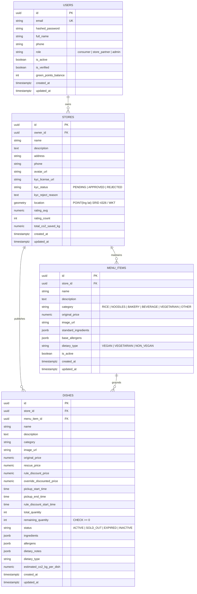

# Data Model: Auth, Store KYC, Base Menu Catalog, Surplus Dishes & Time-Shift Discounting

**Feature**: `003-auth-kyc-menu-pricing` | **Date**: 2026-11-28 | **Spec**: [spec.md](./spec.md)

All persistent tables below are implemented in SQLAlchemy 2.0 (`Mapped[T]`) and already present in the initial Alembic schema migration (`backend/alembic/versions/`). No new database migrations are required for Feature `003`.

---

## 1. Entity-Relationship Overview

---

## 2. Persistent ORM Entities

### 2.1 `User` (`backend/app/models/user.py` — Table `users`)

- **Enum `UserRole(StrEnum)`**: `CONSUMER = "consumer"`, `STORE_PARTNER = "store_partner"`, `ADMIN = "admin"` (serialized uppercase in login `UserLoginData.role` and normalized case-insensitively in `UserBase`).

| Column | Type | Constraints / Defaults | Notes |
| :--- | :--- | :--- | :--- |
| `id` | `Uuid` | `PK`, default `uuid.uuid4`, indexed | Primary key |
| `email` | `String(255)` | `UNIQUE`, `NOT NULL`, indexed | Login identifier |
| `hashed_password` | `String(255)` | `NOT NULL` | Bcrypt hash via passlib (`bcrypt==4.0.1`); never exposed |
| `full_name` | `String(100)` | `NOT NULL` | Display name |
| `phone` | `String(20)` | `NULL` | Optional contact number |
| `role` | `Enum(UserRole, native_enum=False, length=32)` | `NOT NULL`, default `CONSUMER` | RBAC role |
| `is_active` | `Boolean` | `NOT NULL`, default `True` | Checked on every JWT request (`403` when `False`) |
| `is_verified` | `Boolean` | `NOT NULL`, default `False` | Account verification flag |
| `green_points_balance` | `Integer` | `NOT NULL`, default `0` | Eco-gamification balance |
| `created_at` / `updated_at` | `DateTime(timezone=True)` | `NOT NULL`, `server_default=func.now()` | Audit timestamps |

### 2.2 `Store` (`backend/app/models/store.py` — Table `stores`)

- **Enum `KycStatus(StrEnum)`**: `PENDING = "PENDING"`, `APPROVED = "APPROVED"`, `REJECTED = "REJECTED"`.
- **Portable Spatial Column**: `LOCATION_TYPE = String(255).with_variant(Geometry("POINT", srid=4326), "postgresql")`.

| Column | Type | Constraints / Defaults | Notes |
| :--- | :--- | :--- | :--- |
| `id` | `Uuid` | `PK`, default `uuid.uuid4`, indexed | Primary key |
| `owner_id` | `Uuid` | `FK(users.id, ON DELETE CASCADE)`, `NOT NULL`, indexed | Owning `STORE_PARTNER` |
| `name` | `String(255)` | `NOT NULL` | Storefront / brand name |
| `description` | `Text` | `NULL` | Optional introduction |
| `address` | `String(500)` | `NOT NULL` | Street address |
| `phone` | `String(20)` | `NULL` | Contact phone |
| `avatar_url` | `String(500)` | `NULL` | Logo / storefront photo |
| `kyc_license_url` | `String(500)` | `NULL` | Food-safety (`ATVSTP`) certificate URL |
| `kyc_status` | `Enum(KycStatus, native_enum=False, length=20)` | `NOT NULL`, default `PENDING` | Admin review gate |
| `kyc_reject_reason` | `Text` | `NULL` | Populated when `REJECTED`, cleared on `APPROVED` |
| `location` | `LOCATION_TYPE` | `NOT NULL`, indexed (`GIST` in Postgres) | WGS84 `POINT(longitude latitude)` |
| `rating_avg` | `Numeric(3, 2)` | `NOT NULL`, default `5.0` | Average verified rating |
| `rating_count` | `Integer` | `NOT NULL`, default `0` | Verified review count |
| `total_co2_saved_kg` | `Numeric(10, 2)` | `NOT NULL`, default `0.0` | Cumulative saved CO₂ |
| `created_at` / `updated_at` | `DateTime(timezone=True)` | `NOT NULL` | Audit timestamps |

### 2.3 `MenuItem` (`backend/app/models/menu_item.py` — Table `menu_items`)

- **Enum `ItemCategory(StrEnum)`**: `RICE`, `NOODLES`, `BAKERY`, `BEVERAGE`, `VEGETARIAN`, `OTHER`.
- **Enum `DietaryType(StrEnum)`**: `VEGAN`, `VEGETARIAN`, `NON_VEGAN`.

| Column | Type | Constraints / Defaults | Notes |
| :--- | :--- | :--- | :--- |
| `id` | `Uuid` | `PK`, default `uuid.uuid4`, indexed | Grounding target (`menu_item_id`) |
| `store_id` | `Uuid` | `FK(stores.id, ON DELETE CASCADE)`, `NOT NULL`, indexed | Owning store |
| `name` | `String(255)` | `NOT NULL` | Canonical dish name |
| `description` | `Text` | `NULL` | Standard dish description |
| `category` | `Enum(ItemCategory, native_enum=False, length=50)` | `NOT NULL` | One of 6 canonical categories |
| `original_price` | `Numeric(12, 2)` | `NOT NULL` (`> 0` validated in Pydantic) | Verified retail price (VND) |
| `image_url` | `String(500)` | `NOT NULL` | Canonical high-res photo |
| `standard_ingredients` | `JSON_TYPE` (`JSONB`/`JSON`) | `NOT NULL`, default `[]` | Inherited by `Dish.ingredients` |
| `base_allergens` | `JSON_TYPE` (`JSONB`/`JSON`) | `NOT NULL`, default `[]` | Store-declared baseline allergens |
| `dietary_type` | `Enum(DietaryType, native_enum=False, length=50)` | `NOT NULL`, default `NON_VEGAN` | Inherited by `Dish.dietary_type` |
| `is_active` | `Boolean` | `NOT NULL`, default `True` | Soft-delete flag (`False` hides from active menu & grounding) |
| `created_at` / `updated_at` | `DateTime(timezone=True)` | `NOT NULL` | Audit timestamps |

### 2.4 `Dish` (`backend/app/models/dish.py` — Table `dishes`)

- **Enum `DishStatus(StrEnum)`**: `ACTIVE`, `SOLD_OUT`, `EXPIRED`, `INACTIVE`.
- **Table Constraint**: `CheckConstraint("remaining_quantity >= 0", name="ck_dishes_remaining_qty_non_negative")` (Guardrail #4).

| Column | Type | Constraints / Defaults | Notes |
| :--- | :--- | :--- | :--- |
| `id` | `Uuid` | `PK`, default `uuid.uuid4`, indexed | Primary key |
| `store_id` | `Uuid` | `FK(stores.id, ON DELETE CASCADE)`, `NOT NULL`, indexed | Owning store |
| `menu_item_id` | `Uuid` | `FK(menu_items.id, ON DELETE SET NULL)`, `NULL`, indexed | Base Menu reference (Menu Grounding) |
| `name` / `description` / `category` / `image_url` | `String`/`Text`/`Enum` | Copied from `MenuItem` | Guarantees no mystery bags |
| `original_price` | `Numeric(12, 2)` | `NOT NULL` | Inherited from `MenuItem.original_price` |
| `rescue_price` | `Numeric(12, 2)` | `NOT NULL` | Standard `-50%` rescue price (or override) |
| `rule_discount_price` | `Numeric(12, 2)` | `NULL` | Scheduled `-70%` final-rush price |
| `override_discounted_price` | `Numeric(12, 2)` | `NULL` (`0 < x <= original_price`) | Optional partner-declared fixed clearance price |
| `pickup_start_time` / `pickup_end_time` | `Time` | `NOT NULL` (`end > start`) | Daily rescue pickup window |
| `rule_discount_start_time` | `Time` | `NULL` (must lie in `[start, end]`) | Optional custom `-70%` start; defaults to `max(start, end - 45m)` |
| `total_quantity` | `Integer` | `NOT NULL` (`> 0`) | Published shift capacity |
| `remaining_quantity` | `Integer` | `NOT NULL`, `CHECK >= 0`, `<= total_quantity` | Atomically updated stock |
| `status` | `Enum(DishStatus, native_enum=False, length=20)` | `NOT NULL`, default `ACTIVE` | Auto-toggles `SOLD_OUT` at `0` and `ACTIVE` at `> 0` |
| `ingredients` | `JSON_TYPE` | `NOT NULL`, default `[]` | Inherited from `MenuItem.standard_ingredients` |
| `allergens` | `JSON_TYPE` | `NOT NULL`, default `[]` | List of `AllergenWarning` (`allergen`, `risk_level`, `source`, `reason`) |
| `dietary_notes` | `JSON_TYPE` | `NOT NULL`, default `[]` | Local dietary notes (e.g., `"Có mỡ hành"`, `"Ít cay"`) |
| `dietary_type` | `Enum(DietaryType)` | `NOT NULL`, default `NON_VEGAN` | Inherited from `MenuItem` |
| `estimated_co2_kg_per_dish` | `Numeric(6, 2)` | `NOT NULL`, default `2.50` | Environmental impact per portion |
| `created_at` / `updated_at` | `DateTime(timezone=True)` | `NOT NULL` | Audit timestamps |

---

## 3. PostgreSQL Indexing Strategy (from `docs/03_Database_Schema_ERD.md`)

- `idx_stores_location` — `GIST (location)` for sub-100ms PostGIS `ST_DWithin` / `ST_Distance` queries.
- `idx_dishes_store_status` — `(store_id, status)` for fast active store listing and ownership views.
- `idx_dishes_category_status` — `(category, status)` and `idx_dishes_pickup_window` — `(pickup_start_time, pickup_end_time)`.
- `idx_dishes_allergens_gin` / `idx_dishes_ingredients_gin` — `GIN` indexes on JSONB arrays supporting downstream SQL allergen hard-filtering (Guardrail #7).

---

## 4. State Transitions

### 4.1 Store KYC Lifecycle
- `ONBOARD` (`POST /stores/onboard`) → **`PENDING`** (blocks menu CRUD and dish publishing with `403`).
- `ADMIN APPROVE` (`PATCH /admin/stores/{id}/review`, `decision="APPROVED"`) → **`APPROVED`** (`kyc_reject_reason = None`; unlocks Base Menu & Surplus Dishes).
- `ADMIN REJECT` (`PATCH /admin/stores/{id}/review`, `decision="REJECTED"`) → **`REJECTED`** (records `kyc_reject_reason`; excluded from `GET /admin/stores/pending`; publishing remains blocked).

### 4.2 Surplus Dish Stock & Pricing Lifecycle
- **Stock**: `total_quantity > 0` with `remaining_quantity > 0` → `ACTIVE`; atomic update or checkout reaching `remaining_quantity == 0` → `SOLD_OUT`; partner stock increase or order cancellation raising `remaining_quantity > 0` → `ACTIVE`.
- **Dynamic Pricing (Computed at Read Time in `DishService.serialize_dish()`)**:
  - If `override_discounted_price` is not `None`: `current_price = override_discounted_price`, `is_rule_discount_active = False`.
  - Else if `rush_start <= now <= pickup_end_time` (where `rush_start = rule_discount_start_time or max(pickup_start_time, pickup_end_time - 45 min)`): `current_price = rule_discount_price` (`-70%`), `is_rule_discount_active = True`.
  - Else: `current_price = original_price * 0.50` (`-50%`), `is_rule_discount_active = False`.

---

## 5. Key Pydantic v2 & TypeScript Validation Schemas

| Domain | Backend Pydantic Schema (`backend/app/schemas/`) | Frontend TS DTO (`frontend/src/types/api.ts`) | Key Validation Rules |
| :--- | :--- | :--- | :--- |
| Auth | `UserCreate` (`extra="forbid"`), `UserResponse`, `Token`, `RefreshTokenRequest` | `RegisterRequest` *(pending cleanup of `role`)*, `LoginRequest`, `LoginResponse`, `User` | `password`: 8–128 chars; no `role` on public registration; `hashed_password` never returned |
| Store KYC | `StoreOnboardRequest`, `StoreKycReview` (`AliasChoices` for `decision`/`kyc_status`, `reject_reason`/`kyc_reject_reason`), `StoreResponse` | `StoreOnboardRequest`, `StoreOnboardResponse`, `StoreDetailResponse`, `PendingStoresResponse`, `ReviewKycPayload` | `name >= 2`, `address >= 5`, `latitude ∈ [-90, 90]`, `longitude ∈ [-180, 180]`, `decision ∈ {APPROVED, REJECTED}` |
| Base Menu | `MenuItemBase`, `MenuItemUpdate`, `MenuItemResponse` | `MenuItemCreatePayload`, `MenuItemUpdatePayload`, `MenuItemResponse`, `MenuItemListResponse` | `original_price > 0`, `image_url >= 5`; align frontend `FoodCategory` `'DRINKS'` → `'BEVERAGE'` (`T024`) |
| Surplus Dish | `DishPublish`, `DishBatchPublish` (`min_length=1`), `DishQuantityUpdate` (`ge=0`), `DishResponse`, `AllergenWarning` | `DishPublishPayload`, `DishBatchPublishPayload`, `SurplusDishResponse`, `UpdateDishQuantityResponse`, `DishAllergenNote` | `total_quantity > 0`, `pickup_end_time > pickup_start_time`, `rule_discount_start_time ∈ [start, end]`, `remaining_quantity <= total_quantity`, `0 < override <= original_price`; align frontend `DishStatus` `'HIDDEN'` → `'INACTIVE'` (`T024`) |
